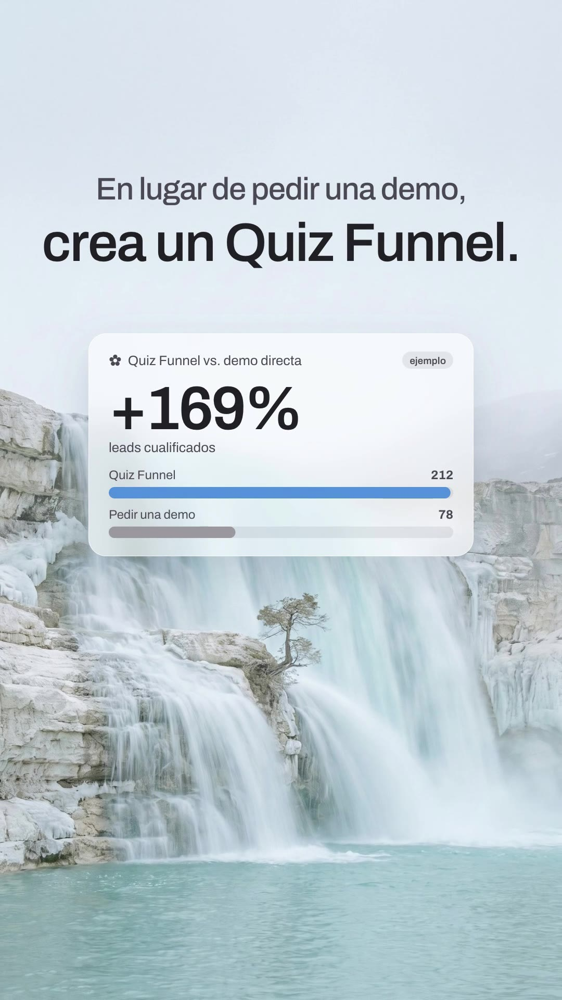
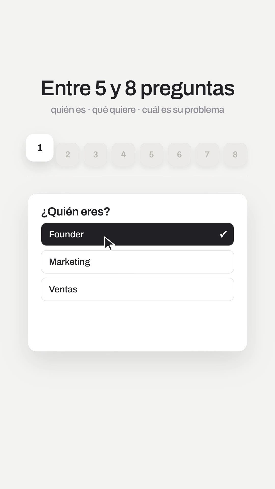
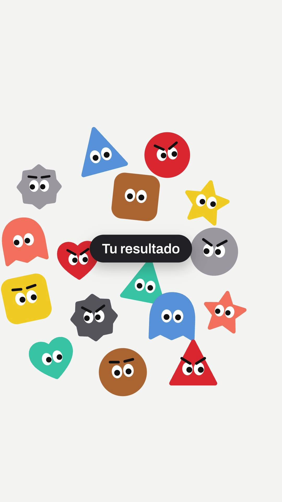

# Playbook: Airy launch film, "chapters" variant (Manus 2.0 style)

A variant of **F6 airy launch film** (`../airy-launch/PLAYBOOK.md`). Read that first: prerequisites, HyperFrames rules, the letter blur-in helper, the render and QA loop and most gotchas are the same. This file only documents **what is different**.

Example: `../../x-batch/manus.mp4` (46.0s, 1080x1920, Spanish, SaaS in House quiz-funnel script, music only). Project: `template/`.

   

Original (16:9, 1 frame / 3s): `reference-original-sheet.jpg`.

## 1. Reference and what makes it a variant

- **Reference:** "Introducing Manus 2.0" by @ManusAI (https://x.com/ManusAI/status/2104592659142869352). It is 166s, 16:9 and **music only** (Scribe on the first 90s returned no words, only "[música electrónica]").
- It shares F6's DNA: a light canvas, serene landscape photos, friendly characters and text that fades in letter by letter. It is a **feature montage cut into chapters**, though, where F6 tells one continuous story. The five devices it adds are listed below.

| Device | Manus (reference) | Ours (template) | Technique |
|---|---|---|---|
| **Chapter card** | Soft grey `#f3f3f1`, small blue line icon + label ("Create videos", "Automations"), centred, 1–1.5s, then the chapter content | "Preguntas" / "Cards de valor" with a red line icon | `.chap` = inline SVG icon (stroke 1.8) + 64px/520 text; `rise()` in, blur out |
| **Frosted card over a landscape** | Glacier waterfall / salt flat photos with a glass stat card ("Cascade vs Current 17.5%") | Cascade photo + "Quiz Funnel vs. demo directa +172%" (**ejemplo**) with bars; salt flat + 3 value cards | `.glass` = `rgba(255,255,255,.56)` + `backdrop-filter: blur(24px) saturate(1.35)` (renders fine in the mp4); card enters with `rotationX 18→0` + `transformPerspective` |
| **Dock row** | "Unlock": a row of grey squircles, the active one lifts and turns white | 8 numbered question tiles; the active one lifts (`y −26, scale 1.18`) as the quiz window swaps question and a cursor picks the answer | `tl.set(tile, {className: "tile on"})` + tween; 3 stacked `.qv` views cross-fade |
| **Mascot crowd + black pill** | "Meet Cue!": a heap of flat geometric characters with googly eyes around a dark pill | 16 **original code-built SVG mascots** (circle, triangle, square, ghost, heart, star, gear) burst in around "Tu resultado", then fly out radially | `mascot(kind, colour, look, brow)` returns an SVG; deterministic positions in `CROWD`; **no image cost** |
| **Black word ticker** | "New [Level / App / Studio / Architecture]" | "Las últimas cards llevan a tu producto:" + rolling "por qué encaja contigo / una oferta específica / un contador de tiempo / la compra" | each row tweened to `y = (i−k)·130`, opacity 1 / 0.22 / 0 per step |
| Phone over a photo | "Health Manager" agent identity phone | "Plan Growth" phone: fit rows, −30% **ejemplo**, live 14:59 countdown, cursor clicks "Canjear oferta", toast | same as F6 phone; countdown proxy `{v}` + `onUpdate` |
| End | Mascot peeking from the bottom, giant cropped mascot faces | blue triangle mascot rises under the payoff lines; 4 huge cropped mascots frame the wordmark | `CLOSE` array; keep them clear of the wordmark row (y 830–950) |

## 2. Beat map (46s, cuts placed on the music)

The music (reused from `../search-bar-film/template/assets/music.mp3`: clean electronic, 116 bpm) has a quiet intro until **8.0s**, a steady body, and fades out from **41.5s**. So the hook lives in the intro and the first photo lands on the drop.

| Time | Scene |
|---|---|
| 0–8.0 | IN badge + "Presentamos el Quiz Funnel" → hook in 3 lines → 7 visitor tiles slide into one "La misma landing" window → "Haz esto." |
| 8.0–12.6 | **drop**: cascade photo, "En lugar de pedir una demo, / crea un Quiz Funnel." + frosted comparison card |
| 12.6–18.2 | chapter "Preguntas" → "Entre 5 y 8 preguntas" + dock + quiz window (3 questions, cursor picks) |
| 18.2–20.4 | chapter "Cards de valor" + "Pero no hagas solo preguntas." |
| 20.4–26.0 | salt flat + 3 glass value cards (caso real / dato / consejo) → focus pull to "“Vale, esto tiene sentido.”" |
| 26.0–30.6 | mascot crowd + "Tu resultado" pill → 3 result rows (Founder / Marketing / Ventas) |
| 30.6–34.4 | black: "Y aquí viene la parte importante." → ticker |
| 34.4–39.6 | phone over the blurred cascade: offer + countdown + click |
| 39.6–43.4 | "Así no solo captas el lead." / Lo segmentas, lo educas y lo llevas a la compra (red underline swoosh) + mascot peek |
| 43.4–46.0 | wordmark + CTA "comenta «quiz»" among cropped mascots |

## 3. Recipe (differences from F6)

```bash
cp -R playbook/airy-launch-chapters/template my-film && cd my-film
T=../playbook/tools
# 2 landscapes at 9:16 (~$0.06). gen_image_ar.py returns 1536x2752; crop to 9:16 and resize to 1080x1920
python3 $T/gen_image_ar.py cascade.png "Photorealistic serene landscape photograph, vertical: a wide pale glacier-blue waterfall cascading down layered white limestone and ice cliffs into a calm turquoise pool, one small lone tree on a ledge, soft overcast diffuse light, airy desaturated pastel palette ... The upper 40% of the frame is soft pale hazy sky ... No text, no people, no buildings."
python3 $T/gen_image_ar.py salt.png "Photorealistic serene landscape photograph, vertical: a vast white salt flat with a winding shallow turquoise river, one bare dead tree on the right, distant pale blue mountains ... soft hazy pale blue sky filling the upper half ... No text, no people, no buildings."
# music: a NEW track is better (bash $T/el_audio.sh music assets/music.mp3 "<clean electronic launch, 116 bpm, quiet intro, groove from ~8s, outro at ~44s, no vocals>" 48000)
# then measure loudness per 0.5s (command in ../airy-launch/PLAYBOOK.md §3) and move the S2 start to the drop.
npm run check && npx hyperframes@0.8.137 snapshot --at 1.2,5.3,10.8,15,22.9,25,27.3,29.5,32.6,38.9,42.5,44.9 --no-end
npx hyperframes@0.8.137 render -o ../my-film.mp4
```

Editing: copy is inside each `<section>`; times are absolute in the `/* ---------- Sn ---------- */` blocks. Change the mascot cast in `CROWD`, `VIS`, `CLOSE`, the quiz in `#q1..#q3` + `PICK` (cursor targets), and the ticker in `TK`.

## 4. Gotchas (new in this variant)

- **White titles on the pale sky are unreadable.** These landscapes are mostly pale haze, so set titles in ink (`--ink`) on the sky. Use white + a radial scrim only for the centred quote over the blurred photo.
- **Cursor targets are absolute page pixels.** With the window at top 760 the option centres are y≈932 / 1040 / 1148. The first draft clicked "Marketing" instead of "Founder", which was only visible in snapshots.
- **End-card mascots** must leave the wordmark row (y≈830–950) and the CTA clear. A 460px square at y 620 covered the "e" of House.
- `letters()` here skips `<br>`, so a letter-revealed line can contain a manual line break.
- The counter target and the bars must agree (212 vs 78 → +172%). Keep the **ejemplo** chip on every invented number.
- Normalise the reused SFX: `tick.mp3` was −50 dB and `pop.mp3` −36 dB (`volume=28dB` / `14dB` + `alimiter`).
- The lint warnings (file too large, nested sections, track density) and the `text_occluded` infos at scene boundaries are expected for this single-file layout.

## 5. Before publishing

- The mascots are **original** flat SVG characters drawn in code, inspired by the reference's style. Don't copy Manus's characters, and don't name ours.
- Every number marked "ejemplo" (+172%, 4→19, 7 de 10, −30%) is a placeholder, and the plans in the result rows are invented. No real customers are shown.
- The CTA "comenta «quiz» / te enseño cómo montarlo" must point to something real.

## 6. Cost and time

- 2 Gemini images ≈ $0.06. **0 ElevenLabs characters this run**: the shared key returned `401 insufficient_credits` on `/v1/music`, so the music bed and the 4 SFX were reused from `search-bar-film` / `airy-launch`. With credits, generate a fresh 48s track (1 call).
- Render ~35s for 46s. From the template, a new film is ~1h (mostly copy and retiming).
