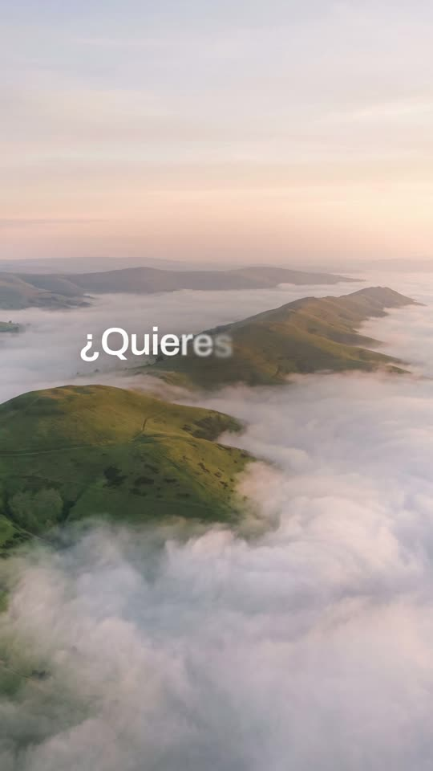
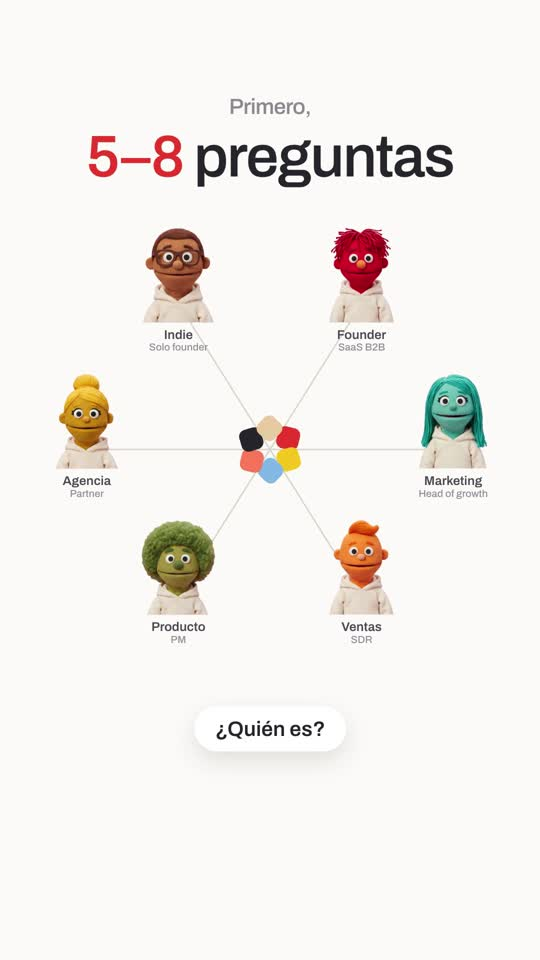
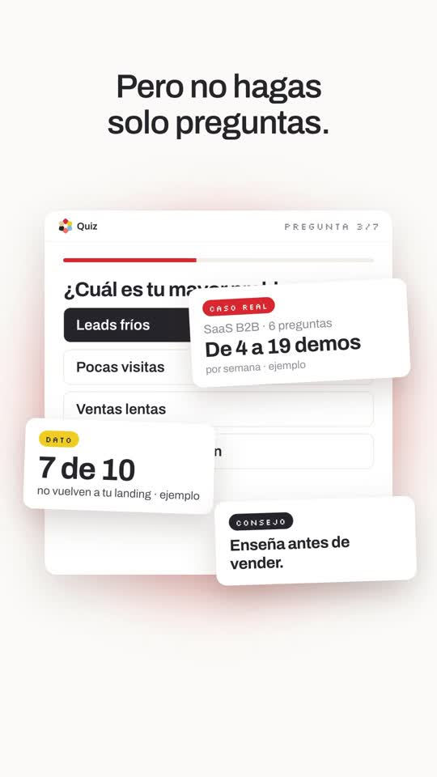
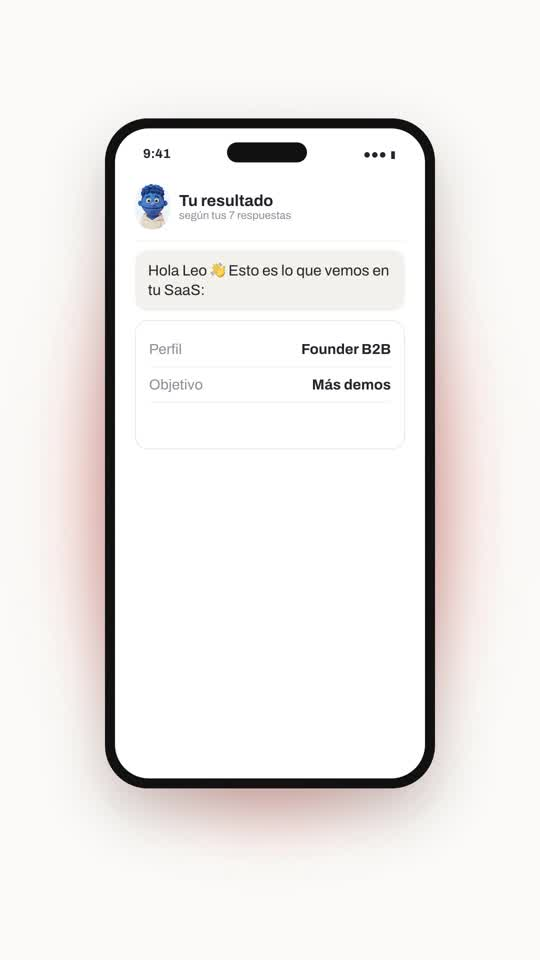

# Playbook: Airy launch film (white canvas, cloud reveal, felt-puppet cast)

A calm, premium "meet our product" film: a small multi-coloured mark opens into a **cloud-shaped window onto an aerial landscape**, the photo smears into a **blurred colour wave**, then everything lives on an **off-white canvas**: letter-by-letter text fades, a **parade of felt-puppet characters**, a **hub** with the mark in the middle and the characters around it, **app windows and a phone with a soft coral glow**, **giant sliding words**, a **word wheel**, and the wordmark landing back **over the clouds**. Music only, no narration. Built with HTML + GSAP in HyperFrames, plus **2 generated images** and ElevenLabs music/SFX. **No AI video.**

Example: `../../x-batch/skydive.mp4` (43s, 1080x1920, Spanish, SaaS in House quiz-funnel script). The project is `template/`.

   

The original (16:9) for comparison: `reference-original-sheet.jpg` (1 frame per second).

---

## 1. What the format is

Reverse-engineered from Skydive's launch film (https://x.com/getskydive/status/2107214392085696988: 35s, 16:9, **music only**, the only "voice" is on-screen text). We kept its motion language, turned it 9:16 and replaced the story with the base quiz-funnel script. Because the reference has no narration, the script is **on-screen text + music** (no TTS).

| Beat | Skydive (reference) | Our version (template) | Technique |
|---|---|---|---|
| 1 Hook | Grey petals assemble into the logo; it opens as a cloud-shaped window onto a misty mountain photo; "Agents that live in the" fades in letter by letter | 6-pixel "quiz flower" (brand colours) assembles and spins; cloud mask grows to full screen; "¿Quieres vender tu SaaS" fades in white | CSS `mask-image` (inline SVG cloud of 7 circles) with `mask-size: var(--ms)`, GSAP tweens `--ms` 0→7000px; per-letter spans with blur→sharp stagger |
| 2 Smear | Photo blurs into a yellow/blue wave; small grey "cloud" on white | Photo blurs (`blur(26px) saturate(1.6)`) into a gold/sky/coral wave; "sin mandar a todo el mundo" in ink; white wipe; grey "a la misma **landing?**" | 3 huge blurred divs drifting in x/y; a white `.full` layer fades in |
| 3 Meet | "Meet Skydive", characters walk in; the logo pops between the words | "Haz esto." → "En lugar de pedir ~~una demo~~," → "crea un ✿ Quiz Funnel" (multi-colour letters); 7 felt leads slide in and bob | strike line `scaleX`; slot `width` 26→100px opens the gap, mark pops inside (flex keeps it centred) |
| 4 Hub | Logo in the centre, 6 characters around it on lines, with names | "Primero, **5–8** preguntas"; 6 leads (Founder, Marketing, Ventas…) on drawn lines; 3 question pills pop | SVG `<line>` `stroke-dashoffset` 400→0; characters fly out from the centre with `back.out` |
| 5 Product | Logo grows into the corner of an app window with a peach glow | Quiz window (question 3/7, answer ticks) + 3 tilted cards (caso real counter, dato, consejo) + gradient "“Vale, esto tiene sentido.”" | `.glow` = blurred radial coral div behind `.win`; focus pull = `blur(5px)` + opacity on the cards |
| 6 Giant type | "They live everywhere", huge words sliding, faded rows | "un resultado / personalizado" sliding at 250px between faded rows | `.giant` rows `x` tweens in opposite directions, cropped by the frame |
| 7 Phone | Phone mockups with chat/email | Phone "Tu resultado": bubbles, profile rows, plan, "personalizado" chip | bubbles `rise()` in sequence |
| 8 Statement | "And actually handle real work." ink→orange gradient | "Y aquí viene la parte importante." ink→red→orange | `.grad` = `background-clip:text`. **Do not split gradient text into letter spans** (each span becomes its own layer and the text disappears); reveal whole lines |
| 9 Window | Dashboard with a rotating word wheel beside it | Offer window: why it fits (✓×3), −30% (ejemplo), live 14:59 countdown, "Canjear oferta" | countdown via proxy `{v}` + `onUpdate` |
| 10 Wheel | "Design / Marketing / Support…" on a dial | "Así no solo captas el lead." + wheel "Lo segmentas, / lo educas / y lo llevas a la compra." | each word `transform-origin: 540px 1300px` (wheel centre below), rotation `(i−k)·30°`, active at opacity 1 |
| 11 Logo | Logo on white, then back to the clouds, "Let's fly." | Flower collapses, "SaaS [IN] House" assembles, landscape fades in, wordmark turns white, CTA "COMENTA «QUIZ»" | colour tween ink→white + text-shadow; a soft radial scrim behind white text |

Audio: one ElevenLabs music track (45s, airy piano/plucks, builds at ~19s, resolves at ~41s) at volume 0.9, plus soft SFX: whoosh (scene changes), pop (cards, pills, mark), tick (answers, wheel), chime (result, logo). All absolute `data-start` times in the `<audio>` tags.

## 2. Prerequisites

- `ffmpeg`, Node + `npx` (HyperFrames CLI pinned to `0.8.137`), Python 3 with `numpy pillow scipy`.
- `ELEVENLABS_API_KEY` in `~/.zshrc`; `treg` CLI for Gemini 3 Pro Image.
- HyperFrames basics: one paused GSAP timeline at `window.__timelines["main"]`; each scene is `<section class="scene clip" data-start data-duration data-track-index>`; every `<audio>` has an `id`; no `Math.random`.

## 3. Recipe

```bash
cp -R playbook/airy-launch/template my-film && cd my-film
T=../playbook/tools; L=../playbook/airy-launch/tools
```

**1) Images (2 calls, ~$0.06).**
```bash
python3 $T/gen_image.py land.png "Photorealistic aerial drone photograph at golden sunrise: soft rolling green hills and a long ridge emerging from a thick sea of white fog clouds that fill the valleys, hazy pastel sky with warm peach and pale blue tones, calm and airy, soft light, high detail, vertical composition, the hills in the lower middle third and lots of soft clouds. No text, no people, no buildings."
python3 $T/gen_image.py cast.png "Seven separate original felt-puppet characters, handmade fabric puppet style like a premium stop-motion studio, each one a bust from the chest up facing the camera, big round friendly eyes, soft fuzzy felt skin and felt hair, each wearing a plain cream-white hoodie. Character felt colours: 1) bright red ... 7) warm brown with glasses. Arranged in a grid: 4 in the top row and 3 in the bottom row, all the same size, a lot of empty space between them, none touching. Perfectly flat solid pure magenta #FF00FF background, no shadows, no text, no pink or purple on the characters."
python3 $L/cutout_keyed.py cast.png assets 440 c_red c_blue c_orange c_teal c_green c_yellow c_brown
# crop the landscape to 9:16 by WIDTH (the 2:3 image is too wide, not too tall)
python3 -c "from PIL import Image;im=Image.open('land.png').convert('RGB');w,h=im.size;nw=int(h*9/16);l=(w-nw)//2;im.crop((l,0,l+nw,h)).resize((1080,1920)).save('assets/land.jpg',quality=90)"
```
Keep "no pink or purple" in the cast prompt so the magenta key stays clean.

**2) Audio (sequential, with 429 backoff).** `bash $L/el_audio.sh assets` creates `music.mp3` (45s) and `whoosh/pop/tick/chime.mp3`. Change the music prompt's timing words ("builds around 8s, lift around 30s, outro around 41s") to your beat plan, then measure loudness per second to place the scene cuts:
```bash
ffmpeg -v error -i assets/music.mp3 -ac 1 -ar 8000 -f s16le - | python3 -c "import sys,numpy as n;a=n.frombuffer(sys.stdin.buffer.read(),n.int16).astype(float);print([round(20*n.log10(n.sqrt((a[s*8000:(s+1)*8000]**2).mean())+1)) for s in range(len(a)//8000)])"
```

**3) Edit `index.html`.**
- Copy lives inside each `<section>`; times are absolute seconds in the `/* ---------- Sn ---------- */` blocks (no voice, so no word timestamps).
- Brand: `:root` tokens (`--paper`, `--ink`, `--red`, `--gold`, `--coral`, `--sky`, `--grad`) and `PETALS` (the 6 mark colours). The mark is built by `mark(id, size)` into any empty `.mark` host.
- Hub people: the `HUB` array (`[image, label, sublabel]`).
- Reading time: keep each line on screen ≥ 1.5s; this format has no voice to carry the message.

**4) Check, look, render.**
```bash
npm run check
npx hyperframes snapshot --at 1.8,3.2,5.5,11.9,14,19.9,22.6,27.9,29.6,34.2,38.8,42.5 --no-end
npx hyperframes render -o ../my-film.mp4        # ~60s for 43s
ffmpeg -i ../my-film.mp4 -af volumedetect -f null - 2>&1 | grep mean_volume
```
Then grab frames from the **mp4** (`ffmpeg -ss T -i out.mp4 -frames:v 1 f.jpg`) and look at them.

## 4. Gotchas we hit

- **SVG `<clipPath>` scaled by GSAP did not render** (photo never appeared). Use a CSS `mask-image` with an SVG data-URI and tween a CSS variable for `mask-size` instead.
- **Gemini's "magenta" came back dull (#c8529e)**, so `playbook/tools/cutout_grid.py` found 1 blob instead of 7. `tools/cutout_keyed.py` samples the key colour from the corners and keys by distance, with edge despill.
- **Landscape crop**: Gemini returns 2:3 (1696x2528); 9:16 needs cropping the width, not the height. Cropping the height padded black bars.
- **Gradient text + per-letter spans = invisible text.** Reveal gradient lines as blocks.
- **White text over a bright sky** fails contrast. Add a soft radial scrim (`rgba(40,25,15,.4)`) inside the photo layer; on the colour wave use ink text.
- `npm run check` flags `#s1-white` as a full-screen overlay visible at t=0: start it at `opacity:0`. Cards that overlap the window on purpose need `data-layout-ignore`; giant cropped words too.
- Overlapping tweens on the same property (mark scale, photo scale) are warnings: end the first before the second starts.

## 5. Before publishing

- Every number marked "ejemplo" (4→19 demos, 7 de 10, −30%) is a placeholder.
- The felt characters are original generations (no licensed characters). "Leo" in the phone is a made-up name.
- The CTA "te enseño cómo montarlo" must point to something real.

## 6. Cost and time

- 2 images ≈ $0.06 (plus a second try if the cast has fewer than 7 blobs).
- ElevenLabs: 1 music track (45s) + 4 short SFX, 0 TTS characters.
- Render ~60s for 43s. A new film from the template is ~1h, most of it rewriting copy and retiming to the new music.
