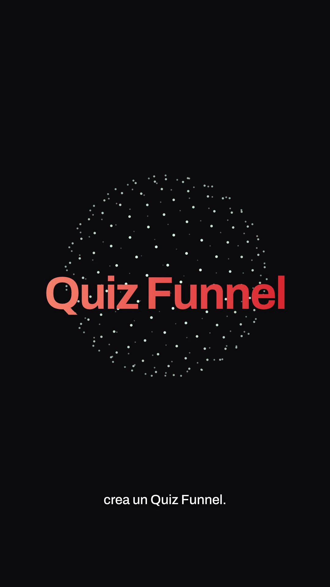
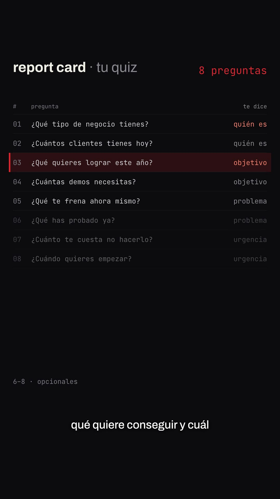
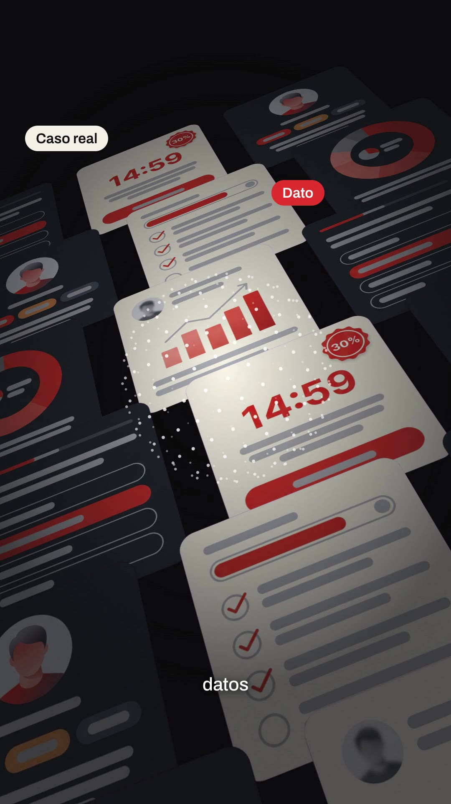
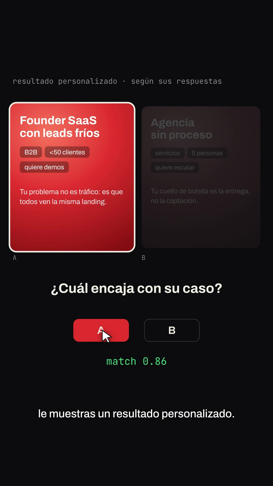

# Playbook: Benchmark / launch-announcement film ("benchmark-film")

A calm, near-black **AI-lab-style announcement film**, the way HyperFrames launched its Code2Video benchmark:
- a social post card that zooms in as the hook;
- big grey-to-white word reveals ("Every new model…");
- a **prompt box** that types, deletes and retypes, then a cursor clicks the send button;
- a **"report card"** table in small monospace with one highlighted band that moves row to row;
- a terminal with green `PASSED` / red `FAILED` lines that blur away;
- a **rotating dot sphere** (the "judge") behind titles and collages;
- a **tilted 3D collage** of UI screens drifting past;
- an **A/B comparison**: two cards, a question, A/B buttons, a cursor click, a score that counts up;
- a step-chip row, a line chart drawn point by point, and a logo lockup;
- small **white captions at the bottom** for every phrase, all the way through.

Built with HTML + GSAP in HyperFrames, plus 1 Gemini image sheet (UI screens, cut by code) and ElevenLabs audio. **No AI video.**

Example: `../../x-batch/hyperframes.mp4` (59s, 9:16, Spanish, SaaS in House quiz-funnel script). The project is `template/`.

   

The original's A/B beat, for comparison: `original-ab-compare.jpg`.

---

## 1. What the format is

Reverse-engineered from https://x.com/HyperFrames_/status/2102084939026247684 (88s, 16:9, 1.67M views, a calm male narrator plus music; it has a talking-head segment that we drop). Its story is "benchmarks measure code → nobody measures creative video → we built a human-judged benchmark + judge model". Ours maps **benchmark → quiz funnel** (the shared base script):

| Beat (VO) | HyperFrames original | Our version | Technique |
|---|---|---|---|
| Hook "¿Quieres vender tu SaaS sin…misma landing?" | A designer's tweet zooming in | A SaaS in House post card: "Todos tus leads. La misma landing." and the phrase highlights | `scale 0.62→1` expo, then a slow push to 1.12 |
| "Haz esto." | "Every new model" grey→white | "Haz esto." words deblur on their word | per-word `opacity/blur` on `t(i)` |
| "En lugar de pedir una demo… crea un Quiz Funnel" | Prompt box "this doe▌" + green send | types "pide una demo", strikes it red, retypes "crea un quiz funnel", cursor clicks send | `typeText()` proxy + `blink()` caret + `click.mp3` |
| Title | "Code2Video" over the presenter | "Quiz Funnel" gradient title over the dot sphere | `sphere()` |
| "5 a 8 preguntas… quién, qué quiere, problema" | "report card" benchmark table | report card of 8 questions (6–8 dimmed "opcionales"), counter 5 → 8, red band jumps to quién / objetivo / problema | rows built in JS, band `y` tween on words |
| "Pero no hagas solo preguntas." | Blurred terminal with PASSED lines | `quiz run --solo-preguntas`: PASSED ×4, FAILED atención / confianza, blur away | line-by-line `tl.fromTo` |
| "cards con casos reales, datos, resultados o consejos… 'vale, esto tiene sentido'" | Tilted collage of generated videos + sphere | 3D plane of 18 UI screens (6 cutouts) drifting, chips pop on each word, then a prompt box types the quote with a green ✓ | CSS `perspective` + `rotationX/Z` on a plane |
| "resultado personalizado" | Two videos A/B, "Does it hold your attention?", score 0.85 | two result cards (Founder SaaS vs Agencia), "¿Cuál encaja con su caso?", click A, `match 0.92` | cursor tween + proxy counter |
| "Y aquí viene la parte importante." | Glitch/streak reveal | "la parte / importante" (red) with light streaks | streak divs on linear `x` |
| "Las últimas cards… encaja, oferta, contador" | Step chips row ("brief · …") | chips 01 encaje / 02 oferta / 03 contador light up; app window with fit card, −30% offer + CTA, 14:59 countdown bar; a skeleton shimmer until the first card | skeleton → cards on words |
| "captas… segmentas… educas… compra" | Line chart + cursor | line chart drawn point by point, "compra" in red | SVG `strokeDashoffset` with cumulative lengths |
| End | HeyGen HyperFrames × Google DeepMind | SAAS [IN] HOUSE × Quiz Funnel, "esto es solo el principio" | lockup over the sphere |

**Palette**: bg `#0b0b0d`, panel `#141417`, lines `#26262b`, text cream `#f2efe6`, dim `#8a8a90`, faint `#7a7a82` (darker fails the contrast check), accent = brand red `#e8382d` (the original used green, swapped for our brand), green `#3fd27f` only for PASSED / ✓ / score. **Fonts**: Archivo (sans, headings and captions), JetBrains Mono (tables, terminal, chips), Silkscreen (the IN badge).

**No narration?** This format works with narration. If you want a music-only cut, keep the bottom captions (they're built from `words.json`) and drop the `#vo` audio.

## 2. Prerequisites

- `ffmpeg`, Node + `npx` (the template pins HyperFrames `0.8.137`), Python 3 with `numpy pillow scipy`.
- `ELEVENLABS_API_KEY` (`source <(grep ELEVENLABS_API_KEY ~/.zshrc)`), plus the `treg` CLI for the image sheet.
- Shared tools in `playbook/tools/` (`tts_with_timestamps.py`, `gen_image.py`, `cutout_grid.py`); this format's own tool is `tools/inject_words.py`.

## 3. Recipe

```bash
cp -R playbook/benchmark-film/template my-bench && cd my-bench && T=../playbook/tools
```

**1) Voice.** We used Bruno Torres (`SKjgN71N3MeGl4r2JbRt`, calm, close to the original narrator) at speed 1.05. The 845-character script gave 54.5s.
```bash
source <(grep ELEVENLABS_API_KEY ~/.zshrc)
python3 $T/tts_with_timestamps.py assets/script.txt assets SKjgN71N3MeGl4r2JbRt 1.05
python3 ../playbook/benchmark-film/tools/inject_words.py index.html assets/words.json
python3 -c "import json;w=json.load(open('assets/words.json'));print(' '.join(f'{i}:{x[0]}@{x[1]}' for i,x in enumerate(w)))"
```
Every cue in the timeline is `t(i)`, where `i` is a **word index**. After a new voice, update the indexes in the script block and the scene `data-start`s (each scene starts just before its first word; the root `data-duration` = VO + ~4.5s for the lockup).

**2) UI screens**: one sheet, ~$0.03. Ask for **no text at all** (placeholder bars). Our first try had garbled English labels ("What is your mint leading?").
```bash
python3 $T/gen_image.py assets/ui_sheet.png "A sheet of 6 separate mobile app screens of a modern quiz funnel web app, 2 columns by 3 rows, wide gaps, not touching, rounded rectangle cards, on a perfectly flat solid magenta (#FF00FF) background. IMPORTANT: absolutely no words, no letters, no readable text: every label is a soft grey rounded placeholder bar; numbers only '30%' and '14:59'. Screens: question with 4 answer pills (one red-orange), case study with portrait + rising bar chart, donut chart, progress bar + checklist, profile result with avatar + 3 tags, offer with red '30%' badge + '14:59' countdown + wide button. Alternate dark charcoal and cream screens, accent #e8382d, flat front view, no device frames, no pink or magenta inside the screens."
python3 $T/cutout_grid.py assets/ui_sheet.png assets 640 ui_q ui_case ui_dato ui_prog ui_res ui_offer
```

**3) Music + SFX** (one call at a time; on HTTP 429 wait 20–60s and retry). The template reuses `blip/whoosh/chime/alert` from trace-film and adds:
```bash
el(){ curl -s -o "assets/$1" -w "$1 %{http_code}\n" "https://api.elevenlabs.io/v1/$2" -H "xi-api-key: $ELEVENLABS_API_KEY" -H "Content-Type: application/json" -d "$3"; }
el music.mp3 music '{"prompt":"minimal modern tech product announcement soundtrack, soft warm synth pads and a gentle pulsing arpeggio, thoughtful and calm for the first 35 seconds, then a subtle lift with light percussion, ending with an upbeat confident final hit and short tail, clean, no vocals","music_length_ms":60000}'
el click.mp3 sound-generation '{"text":"single crisp soft mouse click, clean UI","duration_seconds":0.5,"prompt_influence":0.7}'
el type.mp3 sound-generation '{"text":"soft fast typing on a quiet laptop keyboard, about ten keystrokes","duration_seconds":1.5,"prompt_influence":0.6}'
```

**4) Edit `index.html`.** The helpers are:
- `sphere(id, cx, cy, R, n, start, dur, turns, color)`: a fibonacci dot sphere rotated by a seekable proxy tween;
- `typeText(id, text, at, dur)` and `blink(caretId, from, to)`;
- `sfx(file, at, vol, dur)`, which makes one `<audio>` per cue with a unique id;
- captions are automatic: `W` is chunked at punctuation or every 5 words, and each chunk shows from its first word until the next chunk starts (+0.5s max after its last word).

Copy lives in: the S1 post, the `Q` array (report card), `TERM` (terminal), `LAB` (collage chips + word index), the S8 A/B cards and question, the S10 cards (fit, offer, countdown), `PTS` (chart points + word index), and the S12 lockup.

**5) Check, look, render:**
```bash
npm run check          # 0 errors; the nested-structure / file-size warnings are expected
npx hyperframes snapshot --at 2.5,5.2,7.6,9.3,14.5,18.9,23.5,27.9,32.9,35.8,40.5,46.5,53.9,56.5 --no-end
npx hyperframes render -o ../my-bench.mp4      # ~45s for 59s on an M4 Pro
ffmpeg -i ../my-bench.mp4 -af volumedetect -vn -f null - 2>&1 | grep mean_volume
```
Then pull 10+ frames from the **final mp4** and look at them.

## 4. Gotchas we hit

- `letterSpacing` tweens are a **lint error** (`gsap_non_transform_motion`). Animate `scale` + blur instead.
- Faint grey `#4a4a50` text failed contrast (2.2:1). `#7a7a82` passes for small mono labels.
- The S10 app window sat **empty for 3.5s** before the first card's word. Fixed with a skeleton + shimmer that fades when card 1 lands.
- Cursors parked at their start position (bottom right) showed over the captions **before** they moved. Start them at `opacity: 0` in the same fromTo.
- SVG line drawing: use the path's real cumulative segment lengths (`CUM`), not equal thirds, or the line overshoots the points.
- Keep scene content between y≈180 and y≈1520: captions live at y=1610.
- The `gsap_repeated_fromto_without_baseline` warning on "dwell/hold" comes from the sphere proxies. It's harmless.

## 5. Before publishing

- The post stats (128 / 342 / 1,9K), the "−30% plan Growth" offer, the 14:59 timer and `match 0.92` are **illustrative** (S10 is labelled "ejemplo"). Replace them with real ones or keep the label.
- The post card uses our own brand only. Don't mimic another account's post.

## 6. Cost and time

- 2 Gemini images (~$0.06; one was discarded for garbled text).
- ElevenLabs: 845 characters of TTS, a 60s music track, 2 SFX; plus ~88s of Scribe to transcribe the reference.
- Render ~43s. A new film from the template takes ~1h, mostly re-indexing cues to the new voice.
