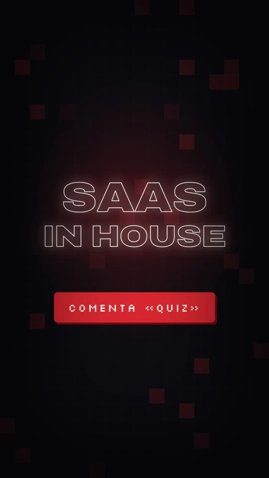
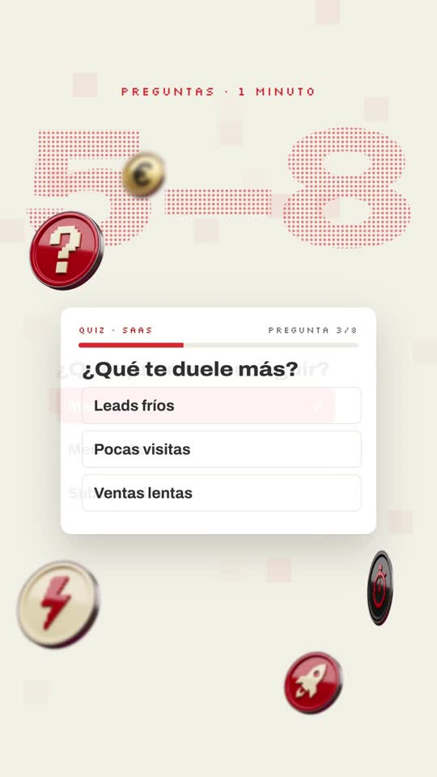

# Playbook C: Brand motion-film explainer

A premium "product launch film" look: dark pixel-grid backgrounds, typed lines, glossy 3D tokens orbiting UI cards, tilted cards with counting numbers, a dark app window that pulls back into a collage, a zoom-through, glitch words and a neon logo that draws itself. All of it is built with HTML + GSAP in HyperFrames, plus **one** generated image (the 3D tokens) and ElevenLabs audio. **No AI video.**

Example: `../../sih-quiz-film.mp4`. A 28.6s, 9:16 quiz-funnel explainer in Spanish for **SaaS in House**, ending on its neon logo. The project is `template/`.

 

This playbook is for **any coding agent (Claude Code, Codex, …) or a human**. Commands assume you are in the folder that contains `playbook/`.

---

## 1. What the format is

Reverse-engineered from the Backable launch film (https://x.com/backabledotbiz/status/2107184276512907333: 24s, 16:9, music only). We kept its motion language, turned it 9:16, added a voiceover, and swapped in our brand.

| Beat | Backable (reference) | Our version (template) | Technique |
|---|---|---|---|
| 1 Hook | Black, faint red pixel grid, a small line types in, giant faint "BE" behind | "Tu próximo cliente no llega por la landing." types word by word with a red block cursor over a giant outlined "QUIZ"; then "LLEGA POR UN QUIZ." and a glowing coin spins in | words fade from blur at their word time; `-webkit-text-stroke` giant word; seeded flickering grid cells |
| 2 Mechanism | Cut to white, giant pixel "EARLY", 3D coins burst and orbit a white stat card | Cream background, giant dotted "5–8", 6 coins burst from center and float around a quiz card that answers 3 questions in time with the voice | dotted text = `background-clip:text` with a radial-gradient dot pattern; coin burst = `fromTo` from the offset to center; fake 3D spin = `scaleX` 1→−1 yoyo |
| 3 Proof | Focus pull, tilted 3D project card slides in with counting numbers | Blurred coin bokeh; tilted "Caso real" card counts 4→19, 2,1→6,8%, −42%; a dark "dato" card drops in; "“Esto tiene sentido.”" pill | parent `perspective`, card `rotationX/Y/Z`; counters via `onUpdate` on a proxy object; blur the rest when the pill lands |
| 4 Personalization | (n/a) | Glitch cut to dark; "Tu resultado" card with rows + gold "personalizado" chip, giant outlined "PARA TI" | glitch-in = `steps()` ease + `skewX` + x jitter |
| 5 Offer + collage | Dark browser UI ("Or build what you wish existed"), camera pulls back to a collage, zooms through to a red light | App window: "−30%", live 14:59 countdown, "Canjear oferta"; pulls back (scale 1.3→0.88 + `rotationX`) to a collage (+218 founders, 78K€ MRR, payment, chart, coin); "No solo captas el lead."; zoom-through | stage scale; zoom-through = scale 5 + blur 18px + radial red flash |
| 6 Payoff | — | "Lo segmentas, / lo educas / y lo llevas a la compra." glitch in one by one | glitch-in |
| 7 Logo | Glowing outline wordmark assembles, echo copies fly out, final lockup | "SAAS / IN HOUSE" drawn as a neon outline, 4 echo outlines scale out, then the solid lockup with the red pixel "IN" chip, CTA "COMENTA «QUIZ»" | SVG `<text>` `stroke-dasharray`/`dashoffset` 2600→0 + `drop-shadow` glow; cloned SVGs scaling out |

Audio: voiceover (offset 0.35s), a music bed at 0.32, and SFX on cuts: whoosh (scene changes), tick (each quiz answer), glitch (dark cuts), typing (hook), impact (logo).

## 2. Prerequisites

- `ffmpeg`, Node + `npx` (HyperFrames CLI; the template pins `0.8.137`), Python 3 with `numpy pillow scipy`.
- `ELEVENLABS_API_KEY` (`source <(grep ELEVENLABS_API_KEY ~/.zshrc)`).
- `treg` CLI for the one image generation (~$0.03).
- HyperFrames basics: one paused GSAP timeline at `window.__timelines["main"]`; each scene is a `<section class="scene clip" data-start data-duration>`; every `<audio>` has an `id`; no `Math.random` (use a seeded RNG); fonts are local `@font-face`. Docs: `npx hyperframes docs <topic>`.

## 3. Recipe

```bash
cp -R playbook/brand-film/template my-film && cd my-film && T=../playbook/tools
```

**1) Brand**: take it from the brand's website code, not from guesses. In our case (`saas-in-house-website`, Astro):
- colours in `src/styles/global.css` `:root` (`--bg #0b0b10`, `--red #e8382d`, `--cream #f2efe6`, `--gold #f5c51b`, `--muted #a3a1ad`);
- the wordmark in `src/components/Nav.astro` (`SaaS` + red pixel chip `IN` + `House`);
- fonts: Archivo variable + Silkscreen. Copy the `.woff2` files from `dist/client/_astro/` (or `node_modules/@fontsource*`) into `assets/` and declare them with `@font-face`;
- true facts for the collage come from the hero copy (+218 founders, 78K€ MRR). Put those into the `:root` variables and the copy in `index.html`.

**2) Script + voice.** ~80 words ≈ 26s, written as beats 1–7 above. We used Gabriel Blanco (`RwzBDEn5f6FIgpAjH9YN`, Spain Spanish) at speed 1.1:
```bash
source <(grep ELEVENLABS_API_KEY ~/.zshrc)
python3 $T/tts_with_timestamps.py script.txt assets RwzBDEn5f6FIgpAjH9YN 1.1
python3 -c "import json;w=json.load(open('assets/words.json'));print(' '.join(f'{i}:{x[0]}@{x[1]}' for i,x in enumerate(w)))"
```

**3) Music + SFX.** Run the SFX calls **one at a time**: parallel calls returned HTTP 429, so check each status.
```bash
curl -s -o assets/music.mp3 https://api.elevenlabs.io/v1/music -H "xi-api-key: $ELEVENLABS_API_KEY" -H "Content-Type: application/json" \
  -d '{"prompt":"modern cinematic tech brand launch music, dark minimal electronic pulse building up, deep sub bass, crisp hi-hats, tension rising then a big impact around 23 seconds and a short glowing synth outro, no vocals, premium startup film","music_length_ms":30000}'
sfx(){ curl -s -o "assets/$1" -w "$1 %{http_code}\n" https://api.elevenlabs.io/v1/sound-generation -H "xi-api-key: $ELEVENLABS_API_KEY" -H "Content-Type: application/json" -d "{\"text\":\"$2\",\"duration_seconds\":$3,\"prompt_influence\":0.7}"; }
sfx whoosh.mp3 "fast cinematic whoosh transition, airy swoosh" 1.2
sfx impact.mp3 "deep cinematic sub boom impact hit with short tail" 2
sfx glitch.mp3 "short digital glitch stutter, electric neon buzz flicker" 1.2
sfx tick.mp3 "single soft UI click tick, clean digital" 0.5
sfx type.mp3 "soft quick keyboard typing, a few keystrokes" 1.5
```

**4) 3D tokens**: one image, cut into six (~$0.03):
```bash
python3 $T/gen_image.py coins.png "Six separate glossy 3D crypto-style coin tokens on a perfectly flat solid pure magenta #FF00FF background, arranged in a grid of 2 rows by 3 columns with a lot of empty space between them, every coin fully visible and not touching. Each coin is a thick round token with a beveled metallic rim, studio lighting, slight three-quarter tilt, photoreal 3D render. Coin faces, dark arcade style, each with one simple bold embossed icon in pixel-art style: 1) glossy red enamel with a cream question mark, 2) glossy black with a gold target, 3) cream with a red lightning bolt, 4) glossy black with a red stopwatch, 5) gold with a black euro sign, 6) glossy red with a cream rocket. No text, no shadows on the background."
python3 $T/cutout_grid.py coins.png assets 360 coin_q coin_target coin_bolt coin_clock coin_euro coin_rocket
```
Change the icons and colours to your brand and topic. Keep "magenta background, grid, not touching".

**5) Edit `index.html`.**
- **Timing.** Cues are written as `t(wordStart)`, where `t = s + VO` (`VO = 0.35`, the voice offset), so look the word starts up in `words.json`. Scene boundaries (`data-start`/`data-duration` on `#s1…#s7`) sit on the first word of each beat. The hook's typed words live in the small `WORDS` array at the top of the script.
- **Copy.** Rewrite the text inside each section (questions, card stats, offer, closing words, CTA).
- **Logo.** Edit the SVG `<text>` lines in `#s7-neon` (outline draw) and the `#s7-lock` lockup (solid).
- **Audio.** SFX `<audio>` elements carry absolute `data-start` times. Move them to the new cuts.
- **Pixel cells.** `cells(id, color, count, t0, t1)` creates the flickering grid squares per scene, with a seeded RNG.

**6) Check, look, render.**
```bash
npm run check                       # must reach 0 errors; nesting/size warnings are fine
npx hyperframes snapshot --at 1.5,3.9,6.2,10.2,12.9,14.9,17.5,19.9,22.6,24.0,27.5 --no-end
npx hyperframes render -o ../my-film.mp4                     # ~35s for 28.6s
ffmpeg -i ../my-film.mp4 -af volumedetect -f null - 2>&1 | grep mean_volume
```
Look at the snapshot PNGs yourself. When reading a contact sheet, remember that `fps=1,tile=10x3` shows second N in cell N+1. Confirm a suspicious cell by grabbing that exact second (`ffmpeg -ss T -i out.mp4 -frames:v 1 f.png`).

## 4. Techniques (copy-paste reference, all in `template/index.html`)

- **Seeded flicker grid**: `rnd()` is a Park–Miller LCG (`seed = seed*16807 % 2147483647`). Each cell gets `tl.set(opacity)` at random-but-deterministic times.
- **Dotted giant text**: `color: transparent; background-image: radial-gradient(circle, rgba(232,56,45,.55) 3px, transparent 3.6px); background-size: 11px 11px; background-clip: text`.
- **Coin burst**: compute each coin's offset to the center (`540 - cx`, `1000 - cy`), then `fromTo({x,y,scale:.3,opacity:0}, {x:0,y:0,scale:1,opacity:1, ease:"expo.out"})` with a 50ms stagger. Float with `tl.to(yPercent ±6, yoyo, finite repeat)`. Use `to`, not a second `fromTo`.
- **Depth of field**: a static `filter: blur(2–5px)` on background coins; when a scene ends, `filter: blur(14px)` on everything for a focus pull.
- **3D card**: parent `perspective: 1600px`; tween the card's `rotationX/Y/Z` and `y` together, then a slow drift tween that starts only after the entry ends.
- **Counters and countdowns**: tween a proxy `{v}` and write `textContent` in `onUpdate` (seek-safe). Use a decimal comma for Spanish (`toFixed(1).replace(".", ",")`).
- **Camera pull-back / zoom-through**: everything lives in `#s5-stage` inside a `perspective` parent. Scale 1.3 (window fills) → 0.88 with `rotationX: 10`, then scale 5 + `blur(18px)` + a radial red flash layer scaling up.
- **Glitch-in**: `fromTo({opacity:0,x:-30,skewX:20,filter:"blur(6px)"}, {… ease:"steps(5)", duration:.22})`, then 4 quick `x: 8` yoyo jitters.
- **Neon draw**: SVG `<text>` with `fill: transparent; stroke: cream; stroke-width: 3`, `strokeDasharray = strokeDashoffset = 2600`, tween the offset to 0 over ~0.9s, plus a `drop-shadow` white+red glow. Echoes: `cloneNode` the SVG 4×, then scale 1→1.25…2 while fading. Then fade the neon out and fade in the solid HTML lockup.

## 5. Gotchas we hit

- **Layout-audit errors that are really design** (`npm run check`):
  - Outline-only giant words fail `text_not_painted`: add `data-layout-ignore`.
  - Collage panels overlap on purpose: add `data-layout-ignore` on each `.panel`, and `data-layout-allow-occlusion data-layout-allow-overlap` on the stage.
  - **A `radial-gradient` vignette counts as an opaque layer** covering text (`text_occluded`). Draw the vignette with `box-shadow: inset 0 0 320px 140px rgba(0,0,0,.7)` instead.
- **Contrast**: brand red `#e8382d` on white is 4.17:1 and fails for small text. Use `#c42a20` for small labels on light cards.
- **Wide stretched type wraps**: Archivo at `font-stretch: 118%`, uppercase, runs ~0.78 em per character. "LO SEGMENTAS," at 130px wrapped, so we use 96px + `white-space: nowrap` and split long lines into two `<div>`s. The same applies to giant background words ("5–8" at 560px wrapped; 420px fits).
- **Starting the camera too zoomed** (scale 1.9) cropped "−30%" off the window; 1.3 works.
- **Lint warnings**:
  - two `fromTo` on the same element → make the second a `to`;
  - overlapping tweens on the same property → end the first before the second starts;
  - an `<audio>` slot longer than the file → set `data-duration` to the real length.
- Generated coins are photoreal and don't need a background removal pass beyond `cutout_grid.py`.

## 6. Before publishing

- Only use **true** brand facts in the collage. Ours (+218 founders, 78K€ MRR) come from the website.
- Mark invented stats as examples ("ejemplo"), or replace them. In the template, the "7 de 10 no vuelven" card and the "−30%" offer are placeholders.
- The CTA promises something ("te enseño cómo montarlo"). Make sure it exists.

## 7. Cost and time

- 1 image ≈ $0.03, plus ElevenLabs credits (~470 characters of TTS, a 30s music track, 5 short SFX).
- Render ~35s. Building a new film from the template is ~1–2h of agent time, most of it rewriting scene copy and re-timing cues to the new voice.
