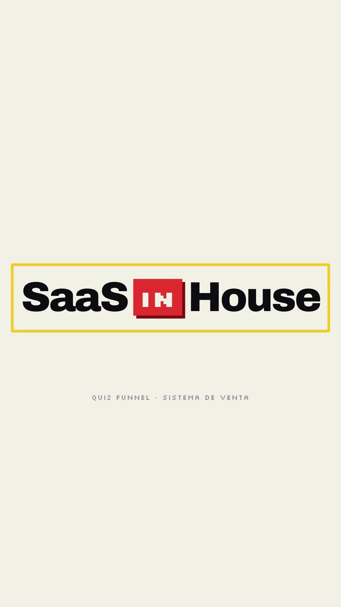
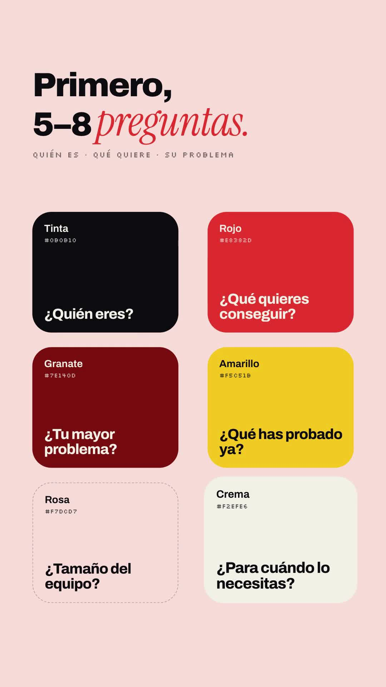
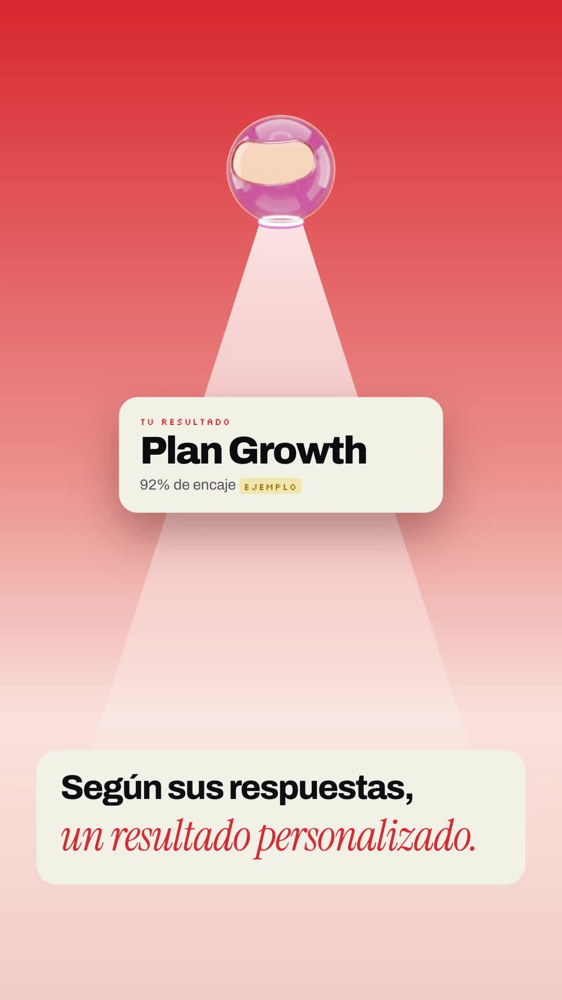
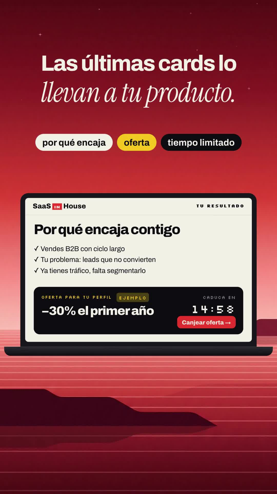

# Playbook: Brand-identity film (music only)

   

A **"brand guidelines come to life"** launch film. It plays like a design studio's identity case study: the logo builds from pixel blocks, the **colour palette** pops in as named swatches with hex codes, a **type specimen** shows huge cropped lines whose font swaps from sans to italic serif mid-line (with tiny spec labels such as `ARCHIVO HEAVY 100% / −4%`), a rounded card opens onto a **flat-vector illustrated world** (dusk sea, day sea, desert, pixel cliffs), the cards zoom out into a **mosaic wall**, a **mascot object** (a glass pod) is drawn as line art and then shown in colour, beaming results down, then an **icon grid**, a **laptop over the landscape**, a **studio triptych** (merch-style mockups), **product lockups** over each landscape, and an end lockup. Music only: the script lives on screen as the "brand copy".

- **Reference:** @theboringhumane, "Introducing xem.email, the only open-sourced email platform you need at scale. Don't ask us who made this video." https://x.com/theboringhumane/status/2104436187457032609 (30.0s, 16:9, music only, ~23k views). Contact sheet: `reference-original-sheet.jpg` (1 frame/s).
- **Ours:** `../../x-batch/boringhumane.mp4`, 42.5s, 1080×1920, 30 fps, SaaS in House quiz-funnel script as on-screen text. Contact sheet: `reference-ours-sheet.jpg`.
- **Closest existing formats:** C `../brand-film/` (brand motion, dark pixel grids), F6 `../airy-launch/` (calm, illustrated world, music only), G3 `../device-mockup-film/` (devices over dreamy backdrops). What's new here is the **identity-deck vocabulary**: logo construction, palette swatches, type specimen with spec labels and a sans→serif swap, one illustrated world reused as cards/tiles/backdrops, a mascot object drawn first as line art, and a studio triptych. It is its own format, not a variant.
- **Use it for:** a brand or offer *launch* where you want to look like a premium studio made it ("don't ask who made this video"); rebrands; announcing a named method (here "Quiz Funnel") as if it were a product with its own identity. Use H `benchmark-film/` for proof and numbers, F for a UI-first launch.
- **Cost:** 5 Gemini images (~$0.15–0.20), 0 ElevenLabs (reused music and SFX), ~1h of work.

## 1. Anatomy (canvas 1080×1920, 30 fps, 42.5s)

| t (s) | Scene | Original (Xem) | Ours (SaaS in House) |
|---|---|---|---|
| 0–3.2 | S1 logo build | grey mark fades to solid, wordmark appears, lemon highlight box | 4 grey pixel blocks turn red and merge into the **IN** chip, "SaaS" / "House" slide out from behind it, yellow box snaps on, spec line "Quiz Funnel · sistema de venta" |
| 3.2–4.6 | S2 invert | cut to near-black, small wordmark; a dot drops onto lavender | ink + small wordmark, red dot falls, bounces, and a pink circle wipe grows from it |
| 4.6–8.6 | S3 type specimen | "From a mess / to a connection / Make it yours", cropped, lines drift; one line swaps to serif | "¿Vendes tu SaaS / con la misma / landing para todos?" on brand red, lines drift in opposite directions, the middle line swaps Archivo → Instrument Serif at 6.6; spec labels in the corners |
| 8.6–12.0 | S4 type pairing | "Every email. More human." with font metadata | "Haz esto." (serif, yellow) / "En lugar de pedir una demo," / "crea un Quiz Funnel." (sans → serif swap at 11.0) |
| 12.0–15.6 | S5 palette | 6 swatches with names + hex | 6 swatches **that are also the quiz questions** (Tinta ¿Quién eres?, Rojo ¿Qué quieres conseguir?, …) |
| 15.6–19.25 | S6 card → world | purple card with a dot becomes a landscape; "Your next newsletter" | red card + yellow dot → dusk sea "Pero no hagas solo preguntas." → circle wipe from the dot to day sea "Entre medias, añade cards." → card shrinks to 0.33 |
| 19.25–23.0 | S7 mosaic | zoom out into a wall of UI screens + illustrations | 5×5 tile wall (case, data, tip, result, quiz tiles + landscape tiles + logo/pod tiles). The shrunk card is the centre tile, so the cut is seamless. Pill "casos · datos · resultados · consejos", then dim + «vale, esto tiene sentido» |
| 23.0–28.6 | S8 mascot | line drawing of the pod → pod in purple cliffs → light beam on pink/desert/sea | SVG line pod draws on cream → glass pod in red cliffs → pod beams **result cards** down on pink, desert, dusk (Plan Growth / Starter / Scale, all `ejemplo`) under "Según sus respuestas, un resultado personalizado." |
| 28.6–30.6 | S9 icon grid | dark lines + faint icon grid | 8 line icons (mail, ?, ✓, clock, chart, target, gift, user) cascading from the centre, a few in red; "Y aquí viene la parte importante." |
| 30.6–34.0 | S10 laptop | laptop with the website over the landscape | CSS laptop over the dusk sea showing the offer page: why it fits, −30% (`ejemplo`), live 14:59 countdown, Canjear button; pills "por qué encaja · oferta · tiempo limitado" |
| 34.0–36.0 | S11 triptych | cap / poster / sweatshirt merch | "Así no solo captas el lead." → three studio bands with floating white cards: 01 captas, 02 segmentas, 03 educas |
| 36.0–38.6 | S12 lockups | "Xem newsletters / automations / open source" over landscape variants | wordmark + "lo segmentas, / lo educas, / y lo llevas a la compra." over day / desert / dusk |
| 38.6–40.6 | S13 tagline | "Make email more human." + pod + floating rocks | "Haz que tu funnel venda." + pod + maroon rocks + yellow confetti |
| 40.6–42.5 | S14 end | wordmark on near-black | pod flies in, wordmark, "Comenta «QUIZ»" |

**Brand mapping:** Xem purple → SaaS in House red `#e8382d`, lavender → pink `#f7dcd7`, lemon → yellow `#f5c51b`, near-black → ink `#0b0b10`, cream → `#f2efe6`. Fonts: Archivo (sans, 640–860), Instrument Serif Italic (the "human" swap), Silkscreen for spec labels and the IN chip.

## 2. Recipe

```bash
cp -R playbook/brand-identity-film/template my-film && cd my-film && T=../playbook/tools
```

1. **Script → brand copy.** One line per scene, ≤ 6 words per line (`script.txt`). Decide which word of each key line swaps to the serif: that swap is the format's signature. Put invented numbers under an `.ex` "ejemplo" chip.
2. **Images (5 × ~$0.03).** Prompts in `template/prompts.md`. Generate the **world** first (3 landscapes + 1 "inside" scene): same STYLE string in every prompt so they read as one illustration system. Mascot on magenta at 1:1. For a **translucent** object (glass, bubble) use `../playbook/brand-identity-film/tools/fix_glass_cutout.py`, not `cutout_grid.py` (see Gotchas). Run calls one at a time.
3. **Audio.** Music only. We reused `playbook/airy-launch/template/assets/music.mp3` (45s, calm intro, lift at 19.25s, fade from 40s): the mosaic lands on the lift, the end lockup on the fade. SFX reused from airy-launch: whoosh (cuts), pop (swatches, cards), tick (countdown), chime (logo box, quote, result, end). If you have ElevenLabs credits, prompt for "airy premium brand reveal, soft plucks, lift at ~19s, resolve at ~41s".
4. **Edit `index.html`.** Scene timings are `data-start`/`data-duration` on each `<section>`; tweens use absolute times in the `<script>`. Mosaic tiles are the `tiles` array (kinds `img`, `ui`, `quiz`, `quiz2`, `logo`, `pod`); `tiles[12]` must be the same image and text as the S6 card it zooms out of.
5. **Check, look, render, QA:**
   ```bash
   npm run check
   npx --yes hyperframes@0.8.137 snapshot --at 1.0,2.8,5.5,7.5,10.0,11.6,14.8,17.0,18.8,20.5,22.0,23.6,24.8,26.6,27.5,28.2,29.8,32.5,34.3,35.7,36.4,37.2,38.2,39.8,41.6
   npx --yes hyperframes@0.8.137 render -o ../my-film.mp4      # ~40s for 42.5s
   ffmpeg -i ../my-film.mp4 -af volumedetect -f null - 2>&1 | grep mean_volume
   ```
   Pull frames from the **mp4** too (we checked 16).

## 3. Techniques in the template

- **Sans → serif swap:** two copies of the line in the same place (`#s3-l2a` Archivo, `#s3-l2b` Instrument Serif, slightly bigger and 20px higher to match the cap height). Blur out one and blur in the other within 0.3s. Both copies share the same drift tween so they stay aligned.
- **Type specimen drift:** each line is wider than the frame; `x` tweens linearly across the whole scene in alternating directions. Keep the start offset small (≤ 220px) so the line is readable in its first second.
- **Logo construction:** 2×2 `span`s in grey → `backgroundColor` to red with a stagger → the real chip fades in on top; the word halves slide out from behind with a blur.
- **Dot → circle wipe:** a small circle at the dot's landing point scales ×60 (`immediateRender: true` so it starts at 0).
- **Card → mosaic:** S6's camera scales to 0.33 in 0.35s (`power3.in`), and S7 starts with the identical tile in the centre of a 5×5 grid at scale 1, then the grid slowly scales to 0.86. Tiles appear by Manhattan distance from the centre.
- **Line-art mascot:** SVG `circle/rect/ellipse` with `.dr`; `draw()` animates `strokeDashoffset` from `getTotalLength()`. Then the coloured pod and the scene illustration crossfade in at the same position.
- **Beam:** a `clip-path: polygon(46% 0, 54% 0, 100% 100%, 0 100%)` div with a white→transparent gradient, `scaleY` from the top; result cards drop "into" it with `back.out`.
- **Countdown:** proxy `{v}` + `onUpdate` writes `mm:ss` (seek-safe).

## 4. Gotchas

- **Glass mascot on magenta = grey holes.** `cutout_grid.py` keys every magenta-ish pixel, and through translucent glass the background *is* magenta-ish, so the pod came out speckled with grey see-through patches. `tools/fix_glass_cutout.py` keys only the outside (hole-filled object mask) and recolours magenta seen through the glass to a tint (`238,172,192`). Cut-out ratio is 572×600, so `img[src$="pod.png"] { object-fit: contain; }`.
- **Specimen lines were unreadable** in the first pass (start offset 420–500px: the first words were off-screen until the swap). Smaller offsets fixed it; the crop should feel intentional, not hide the hook.
- **Laptop offer:** at 56px "−30% el primer año" ran under the Canjear button; 46px + a smaller button fit.
- "la parte importante." at 150px serif touched the frame edges; 126px fits.
- `npm run check` reports `content_overlap` for intentional layering (dim + quote over the mosaic, tight sans/serif stacks); `data-layout-allow-overlap` on the parent does not silence child spans. We verified them visually in the mp4. Contrast warnings on mosaic tiles are under the dim overlay (by design).
- Pop and tick SFX in airy-launch are the same file (same size); fine for this film, but generate a real tick if the countdown matters.

## 5. Before publishing

- Everything numeric is a placeholder with an **ejemplo** chip: "4 → 19 demos al mes", "+2,3× leads cualificados", "7 de cada 10…", "92% de encaje", plan names, "−30% el primer año", "14:59". The "Por qué encaja contigo" ticks are illustrative. Replace them with real data or keep the labels.
- "Comenta «QUIZ»" promises a deliverable: make sure it exists.
- No people appear; the pod is a generated object.

## 6. Cost and time

- 5 Gemini 3 Pro images via treg (~$0.03–0.04 each, ≈ $0.18). 0 ElevenLabs characters (music + SFX reused).
- Render ≈ 37s for 42.5s on a laptop GPU. A new film from the template: ~1h (copy + 5 images + retime).
