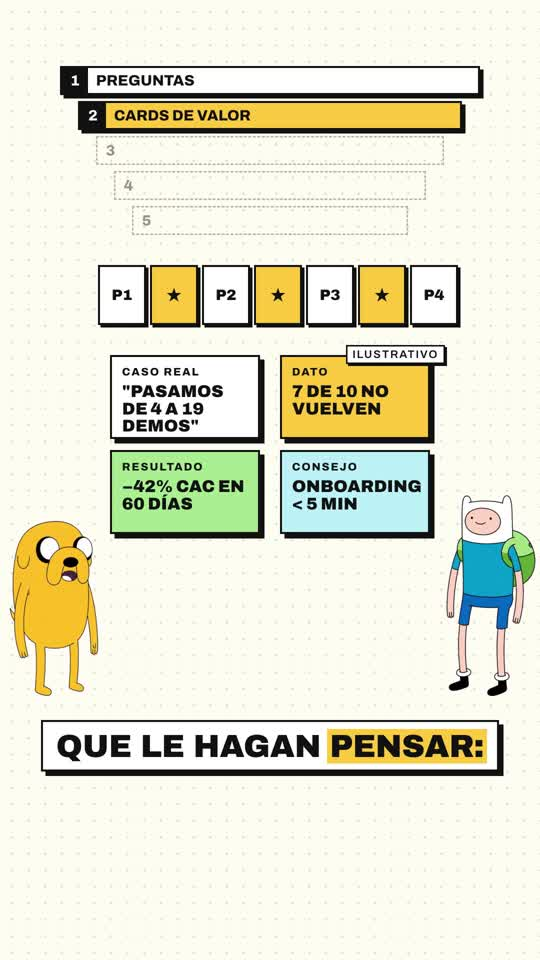

# Playbook A: Cartoon duo explainer

Two cartoon characters (one talks, one reacts) over brutalist explainer cards, a stepped funnel "spine" and word-by-word captions, with an ElevenLabs voice. Built in HyperFrames (HTML + GSAP). Examples: `../../quiz-funnel-es.mp4` (generated voice) and `../../quiz-funnel-phil.mp4` (re-timed to a voice file we were given). Project: `template/`.

This playbook is for **any coding agent (Claude Code, Codex, …) or a human**. Commands assume you are in the folder that contains `playbook/`; shared scripts live in `playbook/tools/`.

---

## 1. What the format is



Look first: extract a contact sheet from a reference reel (`ffmpeg -i ref.mp4 -vf "fps=1/6,scale=240:-1,tile=6x4" -frames:v 1 sheet.jpg`). Then transcribe it with `tools/transcribe_words.py ref.mp3 ref.json --diarize` to understand who says what.

| Element | Spec (canvas 1080×1920, 30 fps) |
|---|---|
| Background | cream `#fefbf2` + dot grid (`radial-gradient` 2px `#ddd6c6`, 33px pitch) |
| Cards | white, `4px solid #111` border, hard shadow `9px 9px 0 #111`, no radius. Accents: yellow `#fdc83c`, pink `#f7a3e6`, green `#a6e38f`, blue `#b8ecf7`, hot pink `#e0418f` for strike-throughs |
| Type | Archivo (variable TTF, bundled locally), 800–900 weight, UPPERCASE, letter-spaced labels |
| "Spine" | A persistent stacked funnel at the top (y≈130–470). One row per step of the script, starting dashed and empty. When its step starts, a row turns solid with a black number box, and the current step is highlighted yellow. This is the backbone of the format. |
| Scene area | y≈500–1050, centered cards that pop in (`back.out`) on the exact spoken word |
| Characters | Speaker bottom-left (short character), listener bottom-right (taller), y≈990–1395, overlapping the scene area a bit |
| Captions | One white box at y=1440, 64px/900, max ~4 words or 16 chars per group, broken at punctuation or >0.35s pauses. The current word gets a yellow background; past words are black, upcoming words gray `#8a8478` |
| Small tags | "ILUSTRATIVO" chip on cards with made-up numbers |

## 2. Prerequisites

- `ffmpeg`, Node + `npx` (HyperFrames CLI: `npx hyperframes@latest --version`; the template pins `0.8.137`), Python 3 with `numpy pillow scipy`.
- `ELEVENLABS_API_KEY`: on this machine it lives in `~/.zshrc`, so load it with `source <(grep ELEVENLABS_API_KEY ~/.zshrc)`.
- For generated characters only: the `treg` CLI (logged in, prepaid). Gemini 3 Pro Image costs ~$0.03 per image.
- HyperFrames rules worth knowing before editing `index.html` (full docs: `npx hyperframes docs <topic>`):
  - The root `<div data-composition-id="main" data-width data-height data-duration>` sits directly in `<body>`.
  - Use exactly **one** paused GSAP timeline, registered as `window.__timelines["main"]`.
  - Timed elements carry `data-start` + `data-duration` (`class="clip"`). Never tween `visibility`/`autoAlpha` on a `.clip`; animate its children.
  - Every `<audio>` needs an `id` (or the render is silent).
  - Use local fonts with `@font-face`.
  - Nothing non-deterministic (no `Math.random`, no `Date.now`); loops need a finite `repeat`.

## 3. Recipe A1: new video from a text script (generated voice)

```bash
cp -R playbook/cartoon-duo/template my-video && cd my-video
# 1) write the narration
$EDITOR script.txt            # spell numbers as words ("cinco") so the voice reads them naturally
# 2) voice + word timings
source <(grep ELEVENLABS_API_KEY ~/.zshrc)
python3 ../playbook/tools/tts_with_timestamps.py script.txt assets   # → assets/vo.mp3, assets/words.json
ffprobe -v error -show_entries format=duration -of csv=p=0 assets/vo.mp3
```

3) **Edit `index.html`** (this is the creative part, see §5):
- Paste `assets/words.json` into `const WORDS = [...]`. Change caption-only spellings here if you like ("cinco" → "5"); the audio is unaffected.
- Set `const END` = last word end + ~1.3s, the root `data-duration` = END, and the `<audio id="vo">` `data-duration` = audio length.
- Rename the spine steps `LV = [...]` to the steps of your script.
- Rewrite the `<section id="sN" class="scene clip">` blocks and their cue lines, timing every pop to the word that triggers it (look the times up in WORDS).
- Update the character cue **word indices** (`JPOINT`, `FREACT`, nod lists).

4) Check, look, render:
```bash
npm run check                                   # must end with 0 errors (warnings about file size/nesting are fine)
npx hyperframes snapshot --at 3,8,15,25,32,44,50   # PNGs in snapshots/: look at them
npx hyperframes render -o ../my-video.mp4
ffmpeg -i ../my-video.mp4 -af volumedetect -f null - 2>&1 | grep mean_volume   # proves audio is present
```

Choosing a voice: list the account's voices (command in `tts_with_timestamps.py`'s docstring). We used **Gabriel Blanco** (Spain Spanish, energetic, `RwzBDEn5f6FIgpAjH9YN`) at speed 1.08, model `eleven_multilingual_v2`.

## 4. Recipe A2: same script, different voice file someone gives you

This is what produced `quiz-funnel-phil.mp4`, from an ElevenLabs "Phil – Explosive Announcer" mp3 reading the same text.

```bash
cp "weird name, with commas.mp3.mpeg" /tmp/voice.mp3      # curl -F chokes on odd filenames
python3 playbook/tools/transcribe_words.py /tmp/voice.mp3 /tmp/voice_words.json
mkdir -p new-video && cp -R playbook/cartoon-duo/template/* new-video/ && cp /tmp/voice.mp3 new-video/assets/vo.mp3
python3 playbook/tools/retime.py playbook/cartoon-duo/template/index.html /tmp/voice_words.json new-video/index.html \
  $(ffprobe -v error -show_entries format=duration -of csv=p=0 /tmp/voice.mp3)
cd new-video && npm run check && npx hyperframes render -o ../new-video.mp4
```

`retime.py` needs the **same word count** as the template (same script). It maps every hard-coded cue time piecewise-linearly from the old word starts to the new ones, so all scenes stay synced without hand edits. Captions and character cues already follow `WORDS`. For a different script, use Recipe A1 instead.

## 5. Anatomy of `template/index.html`

Order matters inside the `<script>`:

1. **`WORDS`, `END`, `tl`, helpers.** `pop(sel, t)` is a scale/opacity pop-in with `back.out`; `out(sel, t)` fades something away.
2. **Captions.** Built in JS from `WORDS`: groups are split on punctuation, a >0.35s gap, 4 words or 16 chars. Each group is its own box, shown and hidden with `tl.set` opacity. Each word gets a `tl.set` to yellow at its start and drops the yellow just after its end.
3. **Characters.** Everything here is keyed by **word index** (`ws(i)` = start of word i), never by raw seconds, so it survives retiming:
   - `pose(who, name, t)` swaps stacked `` poses with `tl.set` opacity.
   - **Speaker (Jake):** mouth flaps per word (talk at the word start, idle just before its end, an extra blink-close mid-word on long words) plus a small squash bounce per word. On key phrases (`JPOINT` index ranges) he switches to the pointing pose and stretches upward (`scaleY: 1.1`).
   - **Listener (Finn):** reacts at `FREACT` word indices (wow/thumbs-up pose + jump). He nods on the agreeing words and gives a small nod at the start of each new idea.
   - **Both:** idle breathing (`scaleY` yoyo) and sway (`rotation` yoyo), always with a finite `repeat`.
   - **Layering:** each character is nested in 4 wrappers, `#x` > `#x-s` > `#x-x` > `#x-w` > imgs. Separate wrappers mean breathing, sway/stretch/jumps and per-word bounces never tween the same property on the same element.
   - **Mirroring a character** (e.g. to face the other one): use CSS `#finn img { transform: scaleX(-1); }` on the ``s, which are never tweened.
4. **`// ---- scene cues ----`** marker (`retime.py` relies on it). Below it come the spine and the scenes, all in absolute seconds.
5. **Spine.** `activate(i, t)` turns step i on (hides the dashed number, pops the solid row, sweeps the yellow highlight in, retracts the previous one). The finale sweeps every row yellow.
6. **Scenes `S1…S8`.** One `<section class="scene clip">` per beat of the script, each a few cards popping on their trigger words. Ideas we used: strike-through bars (`scaleX` 0→1), counters and countdowns driven by a proxy object `{v}` + `onUpdate` (seek-safe), staggered tiles, a speech bubble aimed at the listener, a cursor clicking a CTA button.

Scene-writing rules of thumb: 1–3 cards visible at a time, every element appears on the word that names it, dim earlier cards (`opacity 0.18–0.4`) instead of removing them when the next idea builds on them, and put "ILUSTRATIVO" on invented stats.

## 6. Getting characters

**Option 1, generated (what the final videos use; best quality, gives you poses):**
```bash
REF="https://…/reference-of-the-characters.jpg"      # any public image of the characters
python3 ../tools/gen_image.py jake_base.png "Using the reference image's exact cartoon art style (flat colors, clean black outlines), draw ONLY <character>, alone, full body, standing, facing three-quarters toward the <right|left>, arms relaxed, mouth closed. Centered, whole body visible with margin, no shadow, no text. Background: perfectly flat solid pure magenta #FF00FF." "$REF"
# → prints the image URL; use THAT url as the reference for the pose variants:
KEEP="Keep EVERYTHING else identical to the reference image: same character design, same size and position in frame, same camera framing, same line weight and flat colors, same flat solid pure magenta #FF00FF background, no shadow, no text."
python3 ../tools/gen_image.py jake_talk.png  "Edit this image: Jake is now talking, his mouth is open mid-word. Only the mouth changes. $KEEP" "$BASE_URL"
python3 ../tools/gen_image.py jake_point.png "Edit this image: … right arm raised, index finger pointing up, mouth open. Only the arm and mouth change. $KEEP" "$BASE_URL"
python3 ../tools/cutout_poses.py template/assets 720 jake_idle=jake_base.png jake_talk=jake_talk.png jake_point=jake_point.png
```
Speaker set: idle / talk / point. Listener set: idle / thumbs-up / amazed (arms up, mouth "O"). Check that the variants are aligned (feet at the same pixels) before using them: `cutout_poses.py` crops each family with one shared box, so the swaps don't jitter. Magenta is the key color because no cartoon character we used contains it; a white background would eat white parts (Finn's hat).

**Option 2, cut out of a reference video frame** (what the first draft did with Peter and Stewie): grab a frame with `ffmpeg -ss T -i ref.mp4 -frames:v 1 f.png`. Flood-fill the background from the crop edges, treating a pixel as background only if it has the cream hue (`r>195 and 4<=r-b<=20 and abs(r-g)<=6`); a "light" threshold alone also eats white shirts. Then keep the largest connected component. **Pick a frame where no card touches the character**, or limbs get cut off (we had to redo Peter's arm). Scan frames automatically for a clean strip of background around the character. You only get one pose this way, so motion is limited to transforms.

Sizing in the template: speaker 208×330 at (16, 1062), listener 229×400 at (837, 992). Keep the feet near y≈1392 and the caption box clear.

## 7. Gotchas we hit (read before you start)

- **Back up `index.html` before any regex or scripted edit.** CSS and JS share comment names (`/* characters */`, `/* spine */`), so a non-greedy regex between two of them deleted half the file once. Use unique markers and `assert s.count(marker) == 1`.
- HyperFrames `check` errors we fixed:
  - Text overlapping text: a dashed placeholder label under a filled row. Hide the placeholder when the row turns on, or don't put text in placeholders.
  - Contrast below 3:1: gray `#9a9384` on cream fails; `rgb(152,145,130)` passes.
  - Text overflowing its card: widen the card or add `white-space: nowrap`.
- The render log may say `drawElement self-verify failed … re-rendering via screenshot`. That's harmless: it falls back automatically.
- `curl -F file=@…` fails silently on filenames with commas, semicolons or double extensions. Copy the file to a clean path first.
- `treg host` doesn't exist. Generated images already have a public output URL, so reuse it as the reference for pose edits.
- ElevenLabs alignment is per character; group characters into words on whitespace (done in `tts_with_timestamps.py`).
- Keep characters' timing on word indices and scenes on seconds. That split is what makes `retime.py` possible.
- To check a render: `ffprobe` the size and duration, `volumedetect` for audio, and pull frames with `ffmpeg -ss T -i out.mp4 -frames:v 1`. Look at the frames yourself rather than trusting the check alone.

## 8. Rights and content

- The reference reels used Family Guy characters; the final videos use Adventure Time's Finn and Jake. Both are copyrighted. That's fine for internal drafts but a risk for paid ads or monetised posts. Swap in original characters (same generate + cutout pipeline, with a description instead of a reference image) for anything commercial.
- Stats on the cards ("de 4 a 19 demos", "−42% CAC", "−30%") are placeholders tagged ILUSTRATIVO. Replace them with real numbers before publishing.

## 9. Cost and time (for the Quiz Funnel video)

- ElevenLabs: ~800 characters of TTS + one Scribe transcription.
- Images: 6 × ~$0.03 ≈ $0.18.
- Renders take ~30–50s each on an M-series Mac. The whole thing, scenes included, is about an hour of agent time; a re-voice with Recipe A2 takes minutes.
