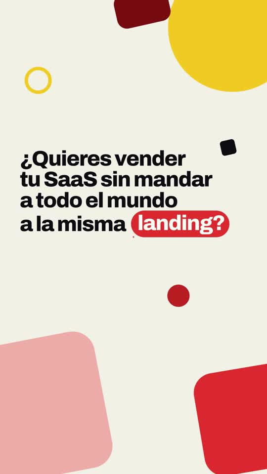
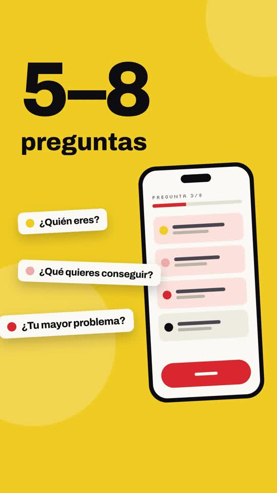
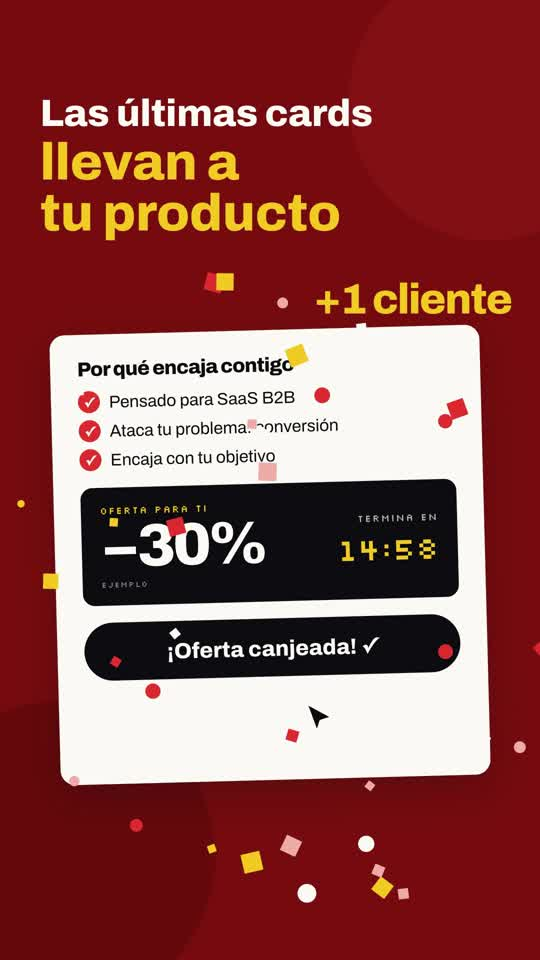
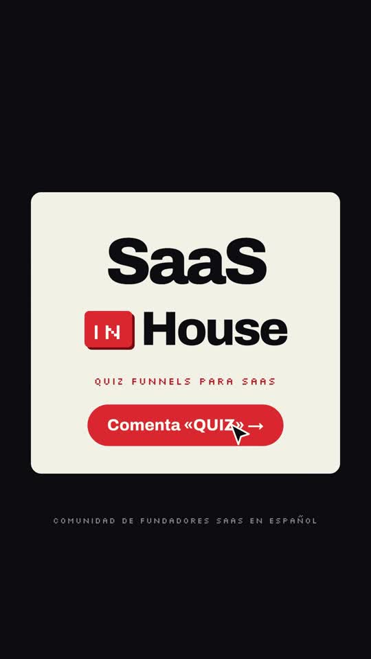

# Playbook: Colour-block promo (music only, kinetic text, no narration)

A fast, playful "self-promo" film. Every beat is one flat colour background with a heavy grotesk label plus one small flat-vector UI vignette (phone, browser, cards, chart, countdown) built in code. Hard colour transitions (iris, diagonal wipe, whip-slide with motion blur) cut on the music. It ends on a collage of every scene's card and a logo end card with a cursor clicking the CTA. **No voiceover, no AI video, and no generated images**: it is 100% HTML/CSS + GSAP in HyperFrames, plus ElevenLabs music and SFX.

Example: `../../x-batch/slvdev.mp4`. A 43.5s, 1080x1920 Spanish quiz-funnel promo for **SaaS in House**. The project is `template/`.

   

The original frames are `reference-original-app.jpg` and `reference-original-endcard.jpg`.

---

## 1. Source and what the format is

https://x.com/slvDev/status/2103569170075975986 (Slava S.): "opus 5.5 max, motion design, one prompt: *create 15+ sec self-promotion promo*". It's an 18s, 16:9, **silent** Claude self-promo: "What do you want to make?" → an app / a short story / a business plan / a game / a website / that 2 a.m. bug fix → word cloud → "Just ask." → card collage → "This ad was made by Claude, from a single prompt." → Claude end card with "Try it at claude.ai" clicked. There was no making-of beyond the one-prompt claim, and the replies were only compliments.

What makes it distinctive:
- one saturated colour per beat (cream, blue, yellow, green, coral, pink, ink);
- big soft bokeh circles drifting in the background;
- a heavy grotesk label with tight tracking, plus an italic serif for "literary" beats;
- each beat has one **miniature product vignette** that animates itself: rows filling a phone, pages writing, bars growing with a hopping coin, a pixel invader exploding into "+100", a cursor clicking "Get started";
- the transitions are the show: iris rings, diagonal wipes and whip-slides with heavy blur;
- the finale is a collage of all the beat cards, then a logo card with a cursor click.

## 2. Mapping to our script (beats → technique)

The brief's rule for formats without narration applies: **the base script is on-screen kinetic text + music**, with lightly condensed phrasing and the same message.

| t (s) | Beat (on screen) | Colour / transition | Vignette |
|---|---|---|---|
| 0–3.8 | "¿Quieres vender tu SaaS sin mandar a todo el mundo a la misma [landing?]" | cream; shapes pop + drift | red pill grows and the word types in (as "make?" does in the original) |
| 3.8–5.5 | "Haz esto." | **iris** to red; blush ring + gold dot expand | dot floods the screen gold and the text flips to ink |
| 5.5–10 | "En lugar de ~~pedir una demo~~ → crea un **Quiz Funnel.**" | **whip-slide** to ink | browser "Reserva una demo" button shakes and greys out; the quiz screen irises in **on the music drop (8.0s)** |
| 9.9–15.4 | "5–8 preguntas" | **diagonal wipe** to gold | phone with rows; question chips fly out (¿Quién eres? / ¿Qué quieres conseguir? / ¿Tu mayor problema?); progress 1/8→5/8 |
| 15.4–17.4 | "Pero no hagas solo preguntas." | **slide-up** to blush, on the music break | popping "?" glyphs |
| 17.4–22.4 | "Entre medias, *cards que suman*" + *"vale, esto tiene sentido"* | whip-slide to paper; giant serif "Aa" | Caso real / Dato / Resultado / Consejo cards stack in; red swash under the quote |
| 22.4–26.4 | "Según sus respuestas, un resultado personalizado" | iris to red | result card: profile rows, bars grow, gold ball hops bar to bar, "encaje 92%" counter |
| 26.4–28.4 | "Y aquí viene la parte importante." | whip to ink | z-space words + a radial word cloud (as in the original's word-cloud beat), then a zoom-through |
| 28.4–33.9 | "Las últimas cards llevan a tu producto" | iris to deep red | why-it-fits ✓✓✓, −30% offer, live countdown, cursor clicks "Canjear oferta" **on the music's return after the break**, confetti + "+1 cliente" |
| 33.9–38.4 | "Así no solo captas el lead. *Lo segmentas, lo educas y lo llevas a la compra.*" | whip to ink | collage of every beat's card flies in, dims and blurs behind the text |
| 38.4–43.5 | SaaS IN House end card | slide-up | wordmark assembles, cursor clicks "Comenta «QUIZ» →" |

## 3. Recipe

```bash
cp -R playbook/color-block-promo/template my-promo && cd my-promo
```

1. **Brand tokens** are in `:root` (`--cream --paper --red --red-d --deep --gold --blush --ink`), taken from `saas-in-house-website` (`src/styles/global.css`) and extended with a blush tint and a deep red so there are 7 background colours. Fonts are Archivo (labels), Silkscreen (tags, countdown) and Instrument Serif Italic (the "literary" beats).
2. **Music first, then cut on it.** Ask for a tempo, and say where you want the breaks:
   ```bash
   T=../playbook/color-block-promo/tools/el_audio.sh   # sequential, retries on 429
   $T music assets/music.mp3 "playful upbeat modern tech promo music, 120 bpm, bright plucky synths, punchy claps and snappy kick, quirky bouncy groove, confident and fun, clear downbeats for fast cuts, builds energy, brief stop then a satisfying final hit and short outro, no vocals" 42000
   for s in "whoosh.mp3|fast short airy whoosh swipe transition|0.8" "pop.mp3|soft bubbly UI pop, cartoon pop|0.5" "click.mp3|single crisp mouse click|0.5" "tick.mp3|short soft digital tick, clock tick|0.5" "chime.mp3|bright cheerful success chime with sparkle|1.5" "swoosh_up.mp3|playful rising swoosh riser short|1.0"; do IFS='|' read f p d <<< "$s"; $T sfx assets/$f "$p" $d; done
   ```
   Find the structure with an RMS print (0.5s windows). Ours had a sparse intro from 0–8s, a **drop at 8.0s**, breaks at **15.5s and 31.5s**, and an outro at 48s. Put the big reveals on the drop and the breaks. The music came back 60s long, so trim it and add a fade: `ffmpeg -i music.mp3 -t 43.5 -af "afade=t=out:st=41.6:d=1.9" music_cut.mp3`. Don't tween the `<audio>` volume, because the renderer owns media.
3. **Edit `index.html`.** One `<section class="scene clip">` per beat. Scenes alternate `data-track-index` 1/2 and **overlap the next scene by ~0.5s** so the incoming transition plays over the outgoing one; later sections in the DOM paint on top. Then:
   - change the copy;
   - retime the `tl` cues (the absolute seconds are in the comments `// S4 (9.9–15.4)`);
   - move the SFX `<audio data-start>`.
4. `npm run check` → `npx hyperframes snapshot --at …` → look → `npx hyperframes render -o ../out.mp4` (~60s for 43s).
5. QA **the mp4**: `ffprobe`, `volumedetect`, `ffmpeg -vf "fps=1,scale=216:384,tile=11x4"`, then full-size frames of every scene.

## 4. Helpers in the template (all in the `<script>`)

- `.kin` → every element with class `kin` is split into word `<span class="w">`s at load. `words(sel, t, gap, dur)` makes them rise out of a 14px blur with `back.out`.
- `enter(id, type, t, dur)` covers the incoming scene transitions:
  - `slide`: `xPercent 100→0` + `blur(28px)→0`, `expo.out`; this is the whip;
  - `up`: the same, vertically;
  - `iris`: `clipPath: circle(0px at 540px 960px) → circle(1160px …)`, where 1160 > the half-diagonal;
  - `wipe`: a diagonal `polygon(140% 0,140% 0,100% 100%,100% 100%) → polygon(0 0,140% 0,100% 100%,-40% 100%)`. Keep the point count equal so GSAP can interpolate.
- `leave(id, t)` pushes the outgoing scene back (x −22%, scale .94, blur 10).
- `drift(id, t0, t1)` gives slow seeded drift to every `.bk` bokeh circle in a scene.
- `click(cursor, ring, x, y, tIn, tClick, target)`: the cursor flies to (x, y), squashes, a ring pulses, and the target button bounces.
- **Seek-safe counters**: tween a proxy `{v}` and write `textContent` in `onUpdate`. Used for 92% and the 15:00 countdown.
- **Confetti**: 46 seeded squares and dots that burst radially (`expo.out`) and then fall and fade.
- **Hopping ball**: x linear per bar, `top` keyframes up/down per bar; the bar tops are computed from the bar heights.
- The seeded RNG (`rnd()`, Park–Miller) is used everywhere. There is no `Math.random`.

## 5. Gotchas

- **Font family names**: a `@font-face` called `"Serif"` was treated as the generic family at render time. Snapshots showed the serif, but **the mp4 fell back to a sans**. Name fonts distinctly (`"Instrument Serif"`), which is another reason to always check the final mp4.
- **The hidden `from` state of a future `fromTo` is applied immediately.** Stacked cards with `from y: 900` were visible early, poking into the frame. Use an offset that is truly off-screen (1500) or `opacity: 0`.
- `filter: brightness()` on stacked cards turned them muddy grey. Use scale alone for depth.
- A text pill with `overflow: hidden` and a fixed tween width clipped its "?". Size it ~10% wider than the text.
- Wide hook lines at 104px wrapped at 1080 width. 86–92px fits "tu SaaS sin mandar" + "a la misma [landing?]".
- `npm run check` reports ~20 `content_overlap` layout errors that are **intentional** (the stacked cards, the demo→quiz swap inside the browser window, tight serif line boxes). They are layout-audit errors, not render errors; the render proceeds. Snapshots confirmed they read fine. To silence them, put `data-layout-allow-overlap` on each card element, not only the parent.

## 6. Before publishing

- These are placeholders marked "ejemplo" on screen: "Ana 4→19 demos", "7 de cada 10", "−42%", "−30%" and the 15:00 countdown. Replace them with real data or keep the label.
- The "Comenta «QUIZ»" CTA needs a real deliverable.
- Cost for this example: $0 images; ElevenLabs ≈ 60s of music + 6 short SFX; no TTS.
