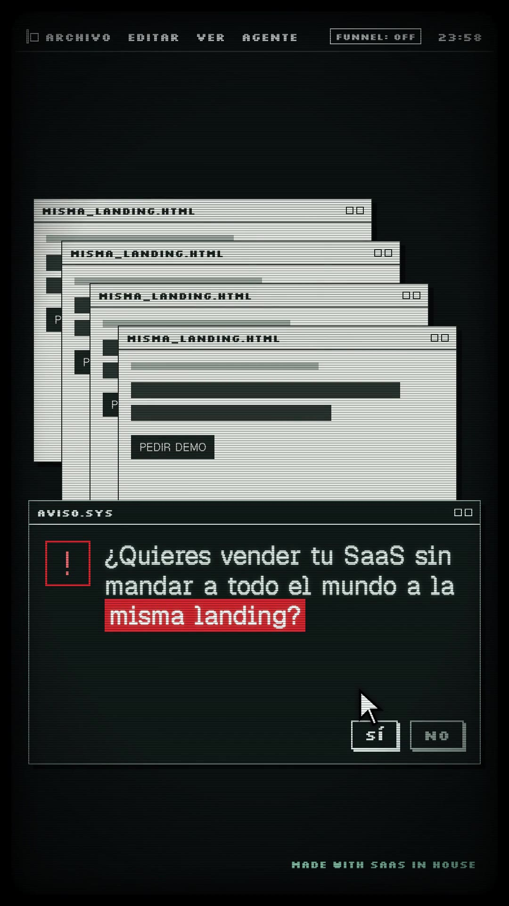
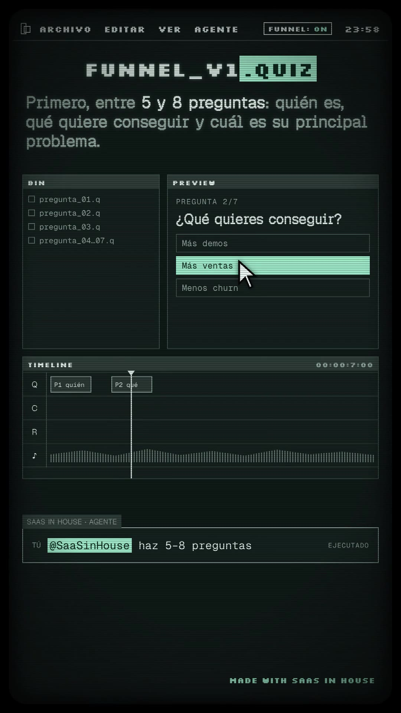
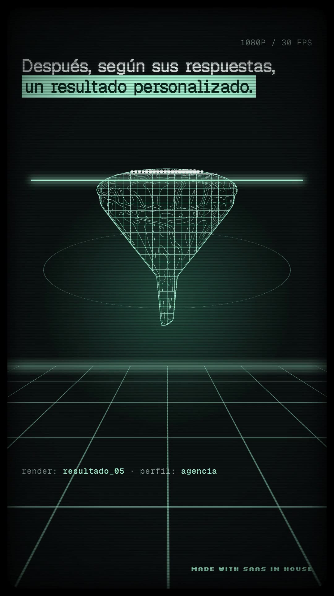
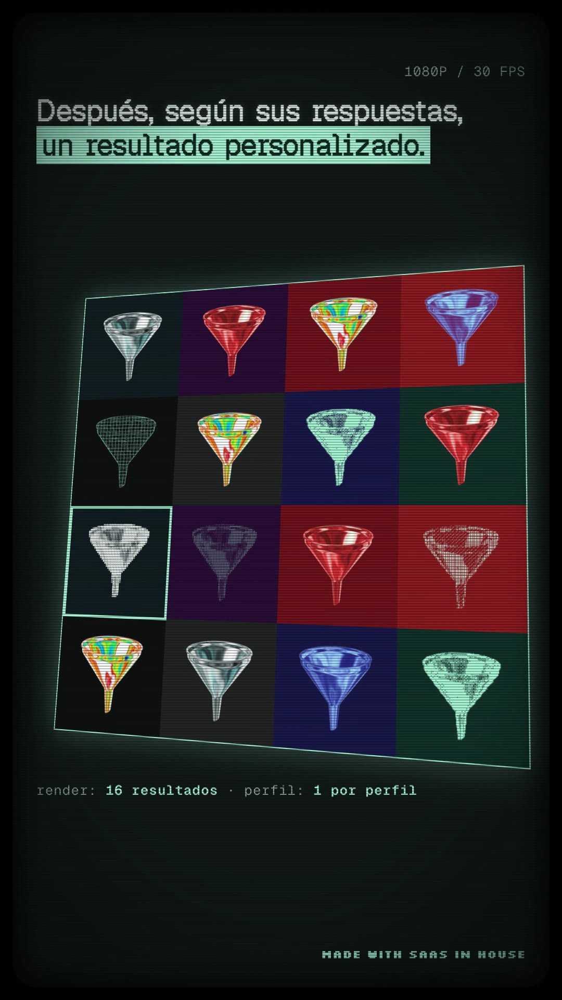
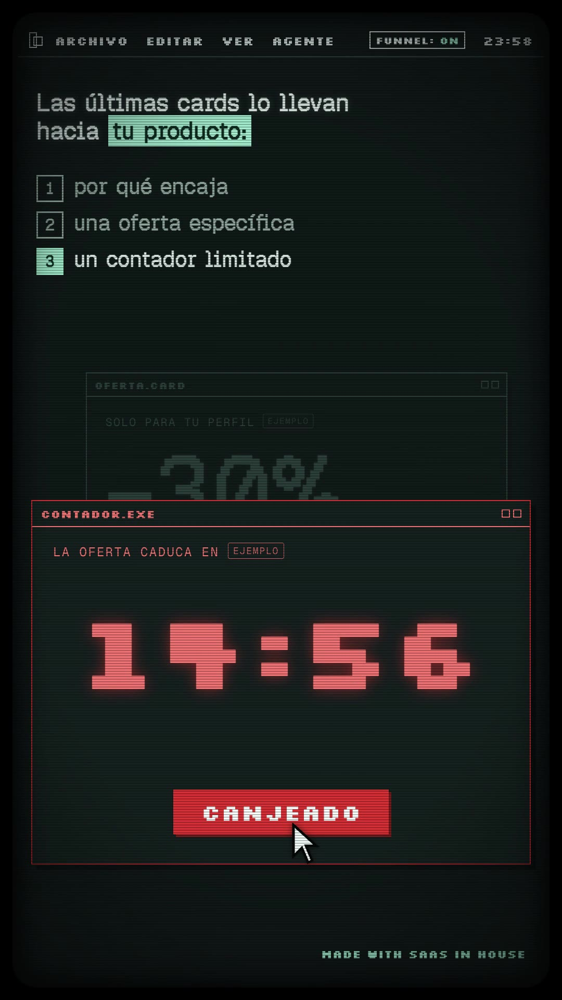
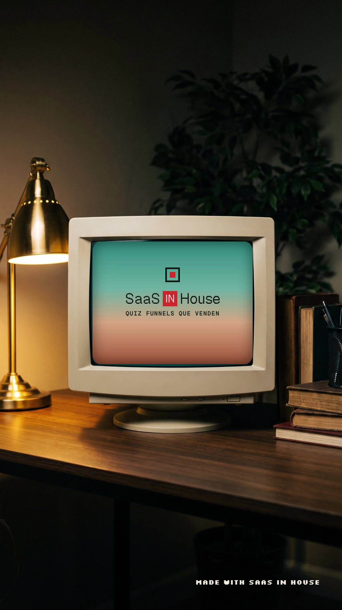

# Playbook: CRT desktop film (music only, 2 images)

A dark **retro-computer launch film** shot "inside" a CRT monitor: phosphor-grey UI on near-black with scanlines, a rounded bezel and a faint flicker; a chunky pixel menu bar (`ARCHIVO EDITAR VER AGENTE · FUNNEL: OFF · 23:58`); a big pixel **mouse cursor** that drives every beat (right-click → context menu, INSTALAR → progress bar, clicking quiz options, CANJEAR); paper-grey **dialog windows** that snap open like a CRT line; an **NLE-style editor** (BIN / PREVIEW / TIMELINE with tracks) where an **agent prompt** (`@SaaSinHouse …`) builds the funnel; then **one hero object re-rendered in many styles** (chrome, 1-bit dither, ASCII, wireframe, halftone, thermal, x-ray, brand red) with scan-wipes, a 4×4 wall of variants; and an end card on a **photo of a real CRT on a desk**. No voice: the base script is on-screen text. HyperFrames (HTML + GSAP), **2 Gemini images**, no AI video.

- **Reference:** Mirage, "Now Claude and ChatGPT can natively create Premiere (.PRPROJ) and After Effects (.AEP) files" (Tesseract open-source converters). https://x.com/trymirage/status/2107504042205139269 — 78s, 16:9, music only (whisper: no words), 234k views, ~2k bookmarks. Contact sheet: `reference-original-sheet.jpg`.
- **Ours:** `../../x-batch/trymirage.mp4`, 45.5s, 1080×1920, 30 fps, SaaS in House quiz-funnel script. Project: `../../x-batch/trymirage/project/` (= `template/`).
- **Closest older formats:** `../terminal-teaser/` (dark, mono/pixel, music-only dev teaser) and `../hero-object-film/` (one object stands for the idea). New here: the **CRT desktop metaphor** (menu bar, icons, context menu, dialogs, cursor), the **NLE editor + agent prompt** as the explainer surface, and the **render-style montage** of one object built from a single image with `tools/style_variants.py`.

     

## When to use it

- A **tool / agent / workflow** for a technical or creator audience ("it opens your files", "the agent does it for you"): the desktop + cursor + prompt vocabulary says "software" without needing real product screenshots.
- A message with **one central object that can take many forms** (one funnel → one result per profile; one file → many formats). The style montage is the hero moment.
- Avoid it for warm/consumer brands (it is cold and nerdy) or when you need a narrator (add a VO and keep the headlines as captions if so).

## Anatomy (original → ours)

| Time | Original (Mirage) | Ours (base script) |
|---|---|---|
| 0–3.6 | desktop: TESSERACT / PREMIERE PRO / AFTER EFFECTS icons, files | CRT power-on line; 4 `misma_landing.html` windows cascade; `AVISO.SYS` dialog with the hook (red highlight "misma landing?") |
| 3.6–6.4 | right-click → OPEN WITH › TESSERACT | **"Haz esto."** (Silkscreen 140px); icons SAAS IN HOUSE / QUIZ FUNNEL (red) / OFERTA; right-click `landing.html` → `ABRIR CON › QUIZ FUNNEL` |
| 6.4–9.6 | `FORMAT.SYS OPEN-SOURCE CONVERTERS [INSTALL]` | "En lugar de pedir una demo directamente," `pedir_demo.exe` (struck) behind `QUIZ_FUNNEL.SYS` "CREA UN QUIZ FUNNEL" → INSTALAR → stepped progress → menu bar `FUNNEL: ON` |
| 9.6–13.5 | Premiere-like `cut_v3.prproj` (BIN/SOURCE/PROGRAM/TIMELINE) + `@Tesseract cut it to the beat` | `funnel_v1.quiz` editor: BIN, PREVIEW cycles 3 questions (cursor picks an answer), Q-track clips land, prompt `@SaaSinHouse haz 5–8 preguntas` |
| 13.5–18.8 | `.aep` graph editor, `@Tesseract make it .aep` | (music drop) **"Pero no hagas solo preguntas."**, prompt `añade cards entre medias`, C-track cards drop between questions, CASO REAL card (ejemplo) → “Vale, esto tiene sentido.” |
| 18.8–24.1 | galloping horse re-rendered as wireframe, particles, chrome, thermal grid; zoetrope; 4×4 colour grid | chrome funnel bobbing over a perspective grid floor; scan-wipes through 8 renders, tag `render: resultado_05 · perfil: agencia`; 4×4 wall "16 resultados · 1 por perfil" |
| 24.1–27.3 | particle horse | (break) **"Y aquí viene la parte importante."** over a blurred point-cloud funnel + riser |
| 27.3–39.2 | stacked agent windows (CLAUDE / CHATGPT / AGENT_03) | checklist 1/2/3 + three stacked windows: `por_que_encaja.card` → `oferta.card` –30% → `contador.exe` 14:59…14:55, CANJEAR → CANJEADO (all `ejemplo`) |
| 39.2–42.0 | back to the desktop icons | "Así no solo captas el lead." icons Lo segmentas / lo educas / y lo llevas a la compra, file `LEAD.quiz` |
| 42.0–45.5 | real CRT on a desk, TESSERACT logo on a gradient | photo CRT (Gemini), pull-back from the screen; SaaS [IN] House + QUIZ FUNNELS QUE VENDEN on a teal→peach gradient |

Persistent layers (outside the scene clips, animated by the same timeline): `#menubar`, `#cursor`, `#foot` ("Made with SaaS in House", like the original's "Made with Tesseract"), `#flash` (a bright band that sweeps down on every cut + a 14px `steps(3)` horizontal jolt of `#root`), `#crt` (scanlines, vignette, bezel, flicker), `#power` (opening line).

## Look

| Token | Value |
|---|---|
| Background / panel / lines | `#0b1011` / `#111819` / `#3c4a47` |
| Phosphor text / dim | `#dfe9e5` / `#8fa29c` |
| Agent highlight | mint `#9fe8d0` on `#08201a` (the original's `@Tesseract` chip) |
| Brand accent | SaaS in House red `#e8382d` (replaces the original's purple Adobe icons) |
| Paper windows | `#e4e8e2`, ink `#1a2220`, 10px hard black shadow, striped title bar |
| Fonts | **Silkscreen 700** for UI chrome, short headlines, buttons, clock (chunky bitmap, has ¿ñáé…); **Geist Pixel Square** + `-webkit-text-stroke: 1–1.4px` for long headlines (thin at 1080p otherwise); Geist Mono for small UI text |
| CRT | `repeating-linear-gradient` scanlines (2px dark / 3px clear, 0.28), radial vignette, bezel = an inset box-shadow on a `border-radius:130px` box, 3% mint flicker (`steps(1)` yoyo, finite repeat) |

## Recipe

```sh
cp -R playbook/crt-desktop-film/template my-crt && cd my-crt
# 1) hero object (1 image, ~$0.03): a symmetric object on PURE BLACK, 1:1
python3 ../playbook/tools/gen_image_ar.py gen/hero.png "A single glossy liquid-chrome 3D funnel object ..., on a pure solid black background, no text, no floor" --ar 1:1
# 2) render-style variants + 4x4 grid (local, free)
python3 ../playbook/crt-desktop-film/tools/style_variants.py gen/hero.png assets 1024
#    -> assets/{chrome,dither,ascii,halftone,contour,thermal,points,xray,red,grid}.png
# 3) end-card photo (1 image, ~$0.03): real CRT on a desk, screen a flat colour, 9:16
python3 ../playbook/tools/gen_image_ar.py assets/crt.jpg "Photograph of a beige 1990s CRT monitor on a dark wooden desk at night, warm desk lamp ... its screen shows a flat solid dark teal colour with nothing on it, no text, no logos" --ar 9:16
#    then measure the screen rectangle (teal-pixel mask) and set #scr left/top/width/height + #photo transform-origin
# 4) music: reuse a ~47s bed with a clear drop (see x-batch/AUDIO-REUSE.md) or el_audio.sh music; trim + fade to the film
ffmpeg -i bed.mp3 -t 45.5 -af "afade=t=out:st=44.3:d=1.2" assets/music.mp3
# 5) edit copy in the <section>s, timings under each /* ==== Sn ==== */ block
npm run check && npx hyperframes@0.8.137 render -q draft -o renders/draft.mp4   # look at frames, then
npx hyperframes@0.8.137 render -o renders/final.mp4
```

Place the cuts on the music: we used the bed's drop (13.5s) for "Pero no hagas solo preguntas", its break (24.1–27.3) for "la parte importante" and the return (27.3) for the offer cards.

## The signature devices

- **winOpen()** = CRT window open: `tl.set(opacity 1, scaleY .02, scaleX .6)` then scaleX→1 (0.08s) then scaleY→1 (0.14s, power3.out). Use `tl.set` first, **not** `fromTo` (see gotchas).
- **Cursor**: one absolutely positioned SVG arrow (`shape-rendering: crispEdges`), `moveTo(x, y, at, d)` with power2.inOut and `click(at)` = scale 0.82 → 1 in 0.16s + `click.mp3`. Every interaction gets a visible state change on the click frame (menu item inverts, button fills, option turns mint).
- **Agent prompt bar**: `TÚ  [@SaaSinHouse] haz 5–8 preguntas … EJECUTADO`, typed char by char (`typeIn`), status appears after the last char. Swap the whole line (two stacked spans) on the next beat.
- **Editor timeline**: tracks Q / C / R / ♪ with clips that drop in (`y:-30 → 0`, back.out) on ticks/pops; a playhead moves with `x` across the whole scene.
- **Render-style montage**: 8 stacked PNGs; each switch = new layer `clipPath: inset(0 0 100% 0) → inset(0)` in 0.26s, a glowing `#scanbar` sweeps down with it (`y`), the previous layer is hidden after; the tag line updates on the same frame. Then a 3D-tilted 4×4 grid with a selection box that hops.
- **Real-CRT end card**: a photo whose screen is a flat colour; overlay an HTML `#scr` (gradient + wordmark + scanlines) on the measured screen rectangle; start at `scale 2.1` around the screen centre and pull back to 1 in 2s. Hide `#crt` overlay at that moment (the photo *is* the CRT).

## Gotchas

- **`fromTo` renders its start state immediately.** With windows that open later in the same clip, `fromTo({opacity:1, scaleY:.02})` showed every future window as a thin black bar from the start of the scene. Use `tl.set(...)` at the open time + `to()`; for repeated sweeps (`#flash`, `#scanbar`, `#root` jolt) add `immediateRender: false`.
- `npm run check` errors fixed: CSS `transform` on an element GSAP scales (`#power`, `#prog`) → move the initial value into a `fromTo`; tweening `left`/`top` (`#playhead`, `#scanbar`) → tween `x`/`y`.
- A generic `.bin div {opacity:0}` also hid the wrapper div, so the BIN list never showed: scope the selector to the items (`.bl div`).
- **Silkscreen's `%` looks like a `Z` at 190px** ("–30Z"); set big percentages in Geist Pixel Square with a 4px text-stroke. Silkscreen also lacks `→ ✓ ▶ ■` (Geist Pixel lacks `✓ ▶ ■ □`): draw boxes/checks in CSS.
- Geist Pixel Square is hairline-thin at 1080p: add `-webkit-text-stroke` (1–1.4px headlines, 4px for 200px numbers).
- Remaining `npm run check` contrast "errors" are intentional: dimmed windows behind the active one (opacity 0.18) and grey landing bars.
- The style variants need the hero on **pure black** (mask = luminance > ~0.04). A rotationally symmetric object (funnel, cup, cone, coin) hides the fact that it never truly rotates; we only bob it.
- The scene is 9:16 but the original is 16:9 and mostly empty space around centred UI: in vertical, fill the lower third (windows lower/taller, icons 220px) or it looks top-heavy.

## Cost

2 Gemini 3 Pro images via treg (hero funnel 1:1 + CRT photo 9:16, ~$0.03 each per `gen_image_ar.py`). 0 ElevenLabs: music and SFX reused (ElevenLabs was out of credits), no TTS. Local whisper (`npx hyperframes transcribe`) to confirm the reference had no speech. Render ~2–3 min on this Mac.

## Files

- `template/` — HyperFrames 0.8.137 project: `index.html`, `script.txt` (beat map), `assets/` (fonts Silkscreen-700, GeistPixel-Square, GeistMono; `hero-source.jpg`; 9 style PNGs + `grid.png`; `crt.jpg`; `music.mp3`; SFX).
- `tools/style_variants.py` — one hero image on black → chrome / dither / ascii / halftone / contour(wireframe) / thermal / points / xray / red PNGs + 4×4 `grid.png`.
