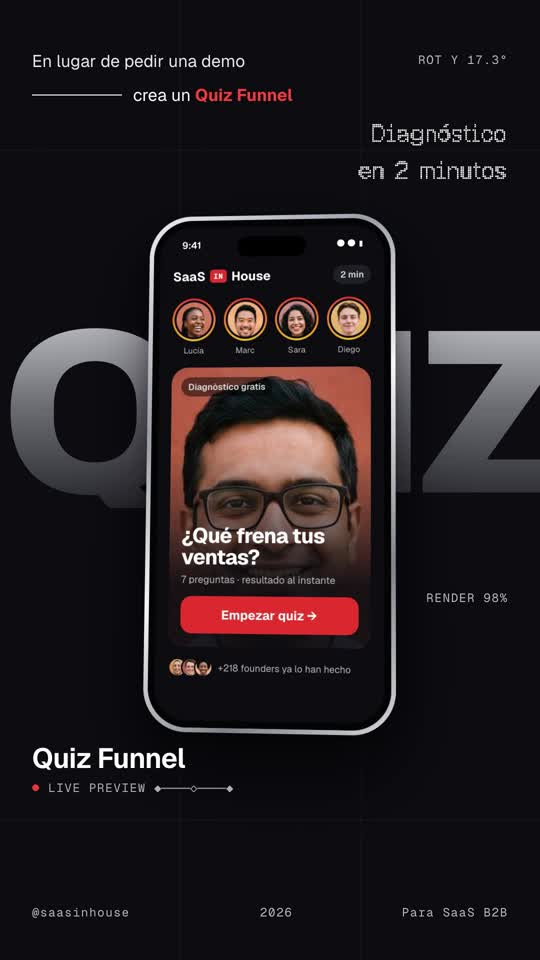
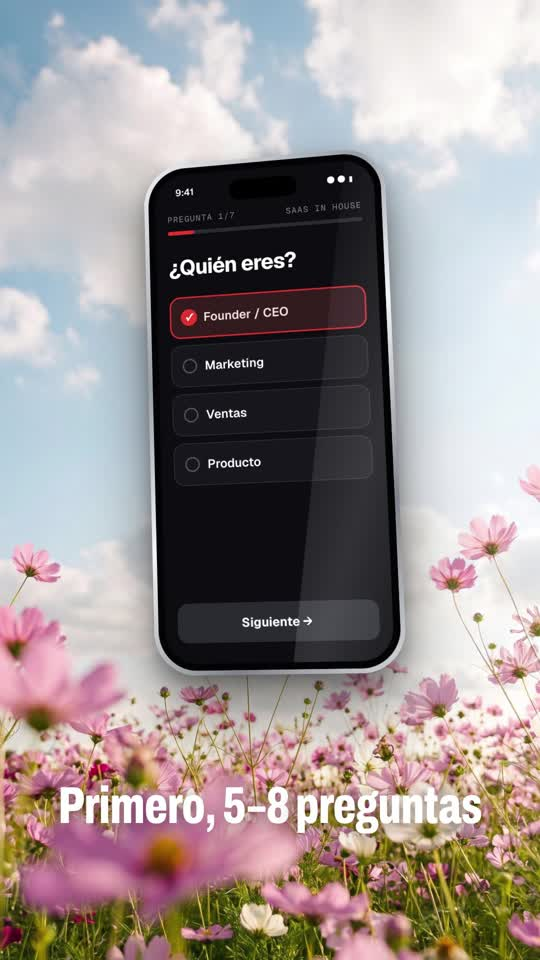
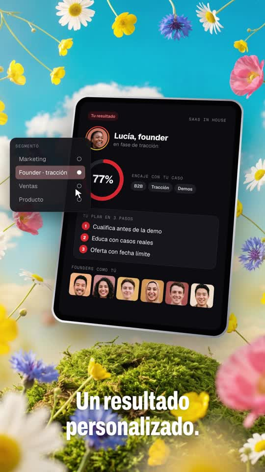
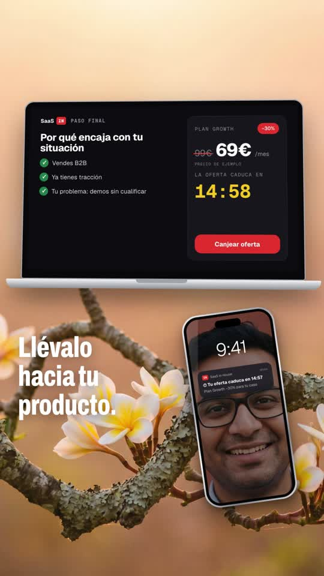

# Playbook: Device mockup film (3D devices over dreamy photos, dot-matrix type)

A premium "from flat to film" launch reel. **CSS 3D phones, laptops and tablets** that show your real product UI float over **dreamy photo backdrops**: a flower field, a desert at dusk, a mossy hill under flying flowers, a peach branch. They cut against **solid brand-colour "REC" slides** set in **dot-matrix LED type** that decodes from scrambled glyphs, and **dark HUD scenes** where a **giant grey word** sits behind the device. It ends on an **inflated, glossy brand surface** with the logo. Music only, no narration. Built with HTML + GSAP in HyperFrames, plus **6 Gemini images** and ElevenLabs music/SFX. **No AI video.**

Example: `../../x-batch/samuel-uiux.mp4` (46.5s, 1080x1920, Spanish, SaaS in House quiz-funnel script). The project is `template/`.

   

Original (16:9, 1 frame/s): `reference-original-sheet.jpg`.

This playbook is for **any coding agent (Claude Code, Codex, …) or a human**. Commands assume you are in the folder that contains `playbook/`.

---

## 1. What the format is

Reverse-engineered from the Swivel launch film by Samuel Irinyemi (https://x.com/samuel_uiux/status/2106308982918750435). It is 42.6s, 16:9, **music only** (Scribe heard just "[outro jingle]"), and the film was made in Swivel itself, a browser studio for 3D device mockups. Its grammar:
- photoreal backdrops with a device in the empty centre;
- a pixel/dot font for all statements, scrambled then decoded;
- blue full-bleed slides with REC / frame-counter HUD;
- black "spec" scenes with a giant grey word and corner labels;
- the device rotates slowly in every shot;
- a final logo on inflated blue tubes.

| Beat | Swivel (reference) | Ours (template) | Technique |
|---|---|---|---|
| Hook | "You designed it." decodes over a flower field next to a blank white slab | "¿Quieres vender tu / SaaS sin mandar a / …misma landing?" decodes in dark dots; a blank white phone rises | `decodeDot()`; phone `y` + `rotationX/Y` |
| Flat | "It's Flat" pill over a row of flat screens on blue | "La misma landing" → "Haz esto." pill over a tilted 2×2 grid of the **same** landing, each tagged FOUNDER / CMO / VENTAS / DEV; the phones fly up | grid `rotationX/Z` on a `perspective` stage; pill canvas resizes to its text |
| Giant word | "move" behind a phone, HUD "Real-time 3D device mockups", ROT X, RENDER 99% | "QUIZ" behind the quiz-start phone; "En lugar de pedir una demo ── crea un Quiz Funnel▌"; ROT Y and RENDER counters | `.giant` = Archivo 800 with a grey gradient `background-clip:text` |
| Device on photo | Phone over ocean/flowers, laptop opening on flowers | Phone answering Q1 → Q2 over the flowers (on the music drop); laptop opening on the desert with a "Caso real 4→19" card + DATO / CONSEJO floats | lid `rotationX -88→0` (origin bottom); `select()` puts a red ✓ border on an option |
| Counter | "15 / 27 devices. One design." dot digits, phones on both sides | Dot "5→8" + "preguntas para saber… 01 quién es / 02 qué quiere conseguir / 03 su principal problema", 2 tilted phones | `setDot()` steps at fixed times + a scale bump |
| REC slide | "Every screen, / Every angle, / All in motion." typed | "Casos reales, / datos, / resultados, / consejos." typed + «Vale, esto tiene sentido.» | `typeDot()` with a scrambled 3-char head |
| Tablet | Tablet on a mossy hill with flying flowers + a side panel | Result tablet (82% ring, plan in 3 steps, faces grid) + "Segmento" panel clicked by a cursor | SVG ring `stroke-dashoffset`; counter proxy |
| Statement | "YOUR DESIGN, FINALLY IN MOTION" + chips | "Y AQUI VIENE / LA PARTE / IMPORTANTE" + chips ENCAJE / OFERTA / CONTADOR | 3 decoded dot lines, last one brighter and bigger |
| Product | Laptop on a branch with flowers, the Swivel editor | Offer laptop (why it fits ✓×3, 99€→69€ −30%, 14:59 countdown) + phone lock screen with "Tu oferta caduca en 14:57" | proxy countdown; strike `scaleX` |
| Outro | Logo on inflated blue tubes, "Start free" | "No solo captas el lead." + giant SEGMENTA / EDUCA / VENDE, then the IN app icon + wordmark on red puffer tubes, "Comenta «QUIZ»" | puffer = 1 Gemini image; icon `rotationY 180→0` |

Brand mapping: Swivel blue → SaaS in House red `#e8382d` (slides and puffer); dark scenes `#0b0b10`; UI in Geist; HUD in Geist Mono; statements in **Geist Pixel Square** redrawn as dots; captions in Archivo 800 at `font-stretch: 68%` (the reference's condensed "Bring your own mockup").

## 2. Prerequisites

- `ffmpeg`, Node + `npx` (HyperFrames CLI pinned to `0.8.137`), and Python 3 with `numpy pillow`.
- `ELEVENLABS_API_KEY` in `~/.zshrc`, and the `treg` CLI for Gemini 3 Pro Image.
- HyperFrames basics: one paused GSAP timeline at `window.__timelines["main"]`, scenes as `<section class="scene clip" data-start data-duration data-track-index>`, and an `id` on every `<audio>`. No `Math.random`: the scramble uses a seeded `hash(i, step)`.

## 3. Recipe

```bash
cp -R playbook/device-mockup-film/template my-film
L=playbook/device-mockup-film/tools
```

**1) Images (6 calls, ~$0.18).** `bash $L/gen_backdrops.sh my-film/gen`, then `python3 $L/prep_images.py my-film/gen my-film/assets`.
- The calls produce `flowers`, `desert`, `hill`, `peach` and `puffer` backdrops, plus `faces` (a 3×3 sheet of founder portraits with white gaps, used for avatars and cards inside the UIs).
- Backdrop prompts ask for an "empty centre for a product": that space is where the device goes.
- To re-brand the outro, change the puffer colour in its prompt.

**2) Audio (sequential, with 429 backoff).** `bash $L/el_audio.sh my-film/assets` makes `music.mp3` (47s) and the SFX: `whoosh`, `scramble`, `tick`, `hit` and `chime`. Music models ignore exact timings, so **measure loudness** and move the scene cuts to the real drop and breakdown:
```bash
ffmpeg -v error -i my-film/assets/music.mp3 -ac 1 -ar 8000 -f s16le - | python3 -c "import sys,numpy as n;a=n.frombuffer(sys.stdin.buffer.read(),n.int16).astype(float);print([round(20*n.log10(n.sqrt((a[int(s*4000):int((s+1)*4000)]**2).mean())+1)) for s in range(len(a)//4000)])"   # 0.5s bins
```
Our track: a build until **13.5s** (hook, flat slide and QUIZ scene sit there), the drop at 13.5s (the phone flies onto the flowers with `hit`), a dip at ~24s (REC slide), the breakdown at ~39s (giant words), and the tail to 44.5s (logo).

**3) Edit `index.html`.**
- **Copy:** every `<section>` holds its own copy. The dot lines are canvases: change the text in the `dot(id, size, color, full)` registry and in the `typeDot/decodeDot` calls.
  - `full` sets the canvas width; pass `""` to let the canvas fit each string (used for the pill).
  - Keep a dot line ≤ ~18 characters at size 66 on 1080px.
- **UIs:** each screen is a JS template string: `landing()`, `quizStart()`, `question(n, q, opts, prefix)`, `caseScreen()`, `resultScreen()`, `offerScreen()` and `notifScreen()`.
  - `phone(id, html)` wraps any HTML in bezel, island and glare.
  - The laptop and tablet markup lives in the section.
- **Timing:** all times are absolute seconds in the `/* ---------- Sn ---------- */` blocks. SFX are `<audio>` tags at the top; keep their `data-start` in step with the scene blocks.
- **Brand:** `:root` tokens and the `.wm` wordmark.

**4) Check, look, render.**
```bash
cd my-film && npm run check
npx --yes hyperframes@0.8.137 snapshot --at 1.6,3.3,6.8,10.5,14.8,18.8,22.9,26.9,30,33.4,37.8,41.2,44.5 --no-end
npx --yes hyperframes@0.8.137 render -o ../my-film.mp4      # ~32s for 46.5s
ffmpeg -i ../my-film.mp4 -af volumedetect -f null - 2>&1 | grep mean_volume
```
Then pull frames from the **mp4** and look at them. Decode/typing frames are scrambled on purpose; check the frames after each line settles.

## 4. Gotchas we hit

- **Dot-matrix grid:** do not measure the font's pixel size at runtime. The first try measured the stem of "H" and sampled on a grid anchored at the canvas top-left, which gave hollow, broken letters ("r" read as "I").
  - Geist Pixel Square has **1 font pixel = 0.076 × font-size**, and every advance is a whole number of pixels.
  - So: draw at `x = m`, sample columns at `m·1.5 + k·m` and rows upward from the **baseline** (`base − m/2 − k·m`), plus a few rows below it for descenders.
  - Accents (ó, Í) and ¿ exist in the font.
- **Fonts and canvas:** a canvas drawn before the webfont loads draws in the fallback font, and the snapshot never redraws it. Fixes:
  - put a hidden `GPix` text node **inside `#root`** (outside it, `check` thinks it is the root and fails with `root_missing_composition_id`);
  - call `document.fonts.load("40px GPix")`;
  - only cache `D.last` once `document.fonts.check()` is true.
- **The flat grid scene** reads better with tags on each phone (FOUNDER / CMO / VENTAS / DEV): without them, "the same landing for everyone" is not obvious.
- **The `gen_image.py` poll** can fail on a transient `treg` error after the task was already submitted (and charged). Fetch the result with `treg call reapi.tasks.get --query id=<task>` instead of regenerating.
- **`check` false positives on 3D-rotated phones** (the notification read as overlapping): use `data-layout-ignore` on that element. The remaining contrast warnings are the muted grey labels inside the app UIs (intentional).
- **Don't claim "Empieza gratis"** (the reference's "Start free") unless the brand really has a free tier. We ended on `saasinhouse.com`.

## 5. Before publishing

- Every number marked "ejemplo" (4→19 demos, 7 de cada 10, 99€→69€ −30%) is a placeholder, and so are "Marc · Acme SaaS" and "Lucía".
- The faces are generated people (Gemini); none are real customers.
- "+218 founders" comes from the SaaS in House site; re-check it before posting.
- The CTA "Comenta «QUIZ» y te enseño cómo montarlo" needs a real deliverable.

## 6. Cost and time

- 6 images ≈ **$0.18** (5 backdrops + 1 faces sheet).
- ElevenLabs: 1 music track (47s) + 5 SFX, 0 TTS characters. Scribe on the reference: 43s.
- Render ~32s for 46.5s. A new film from the template takes ~1h, mostly rewriting the UI strings and retiming to the new music.
