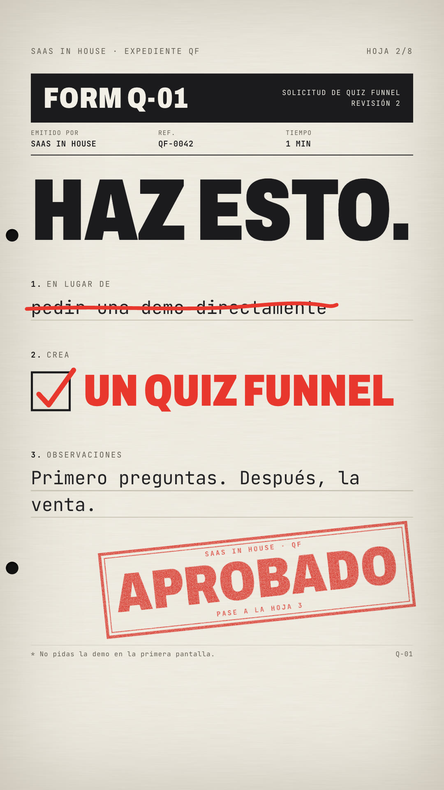
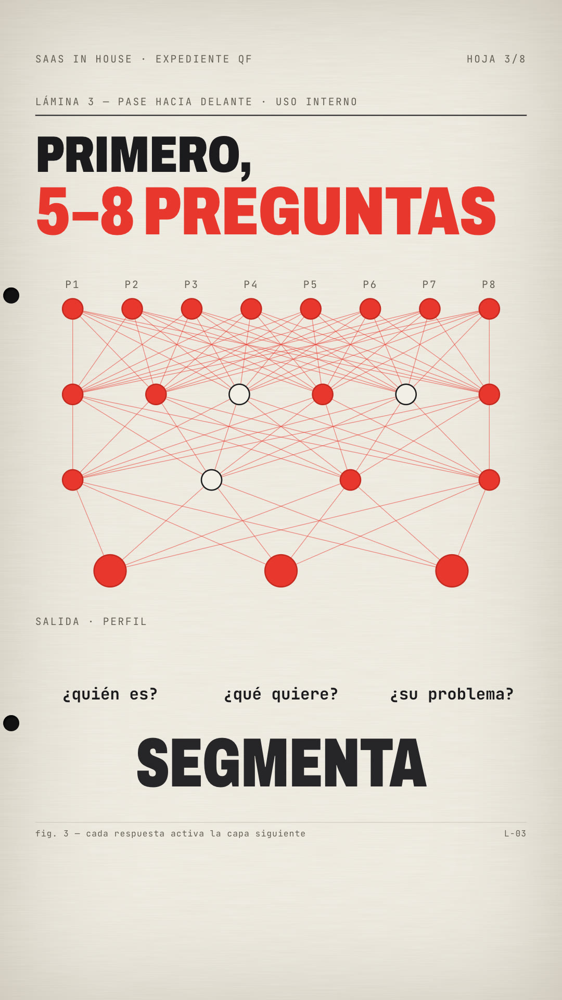
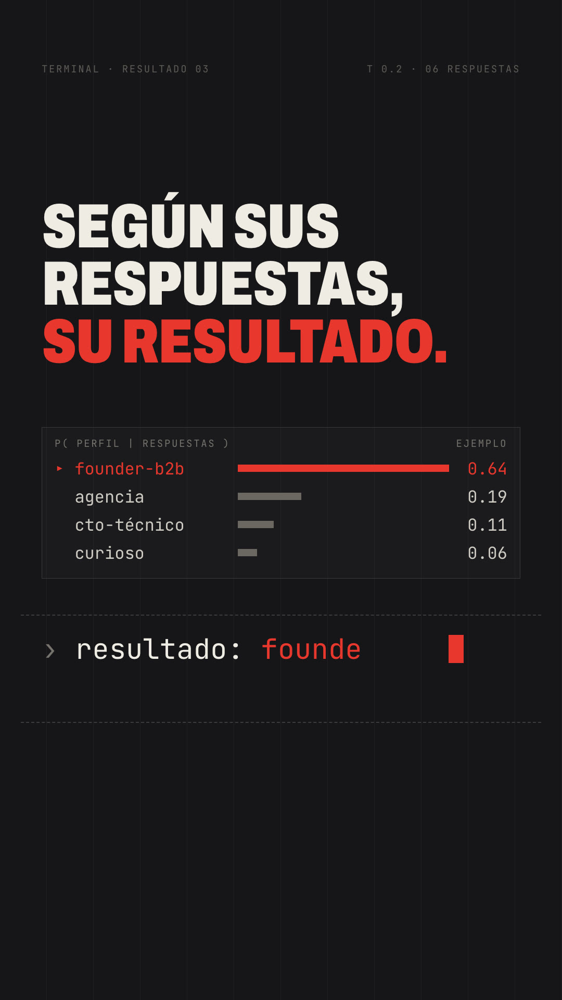
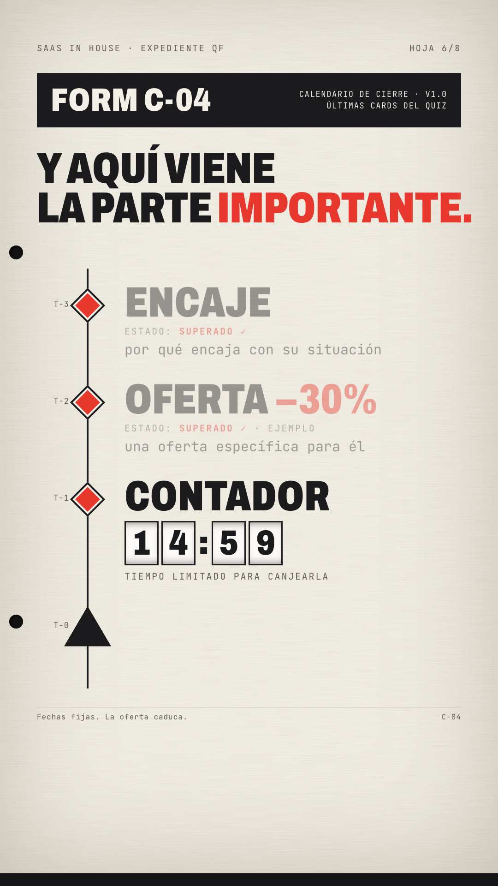

# Playbook: Form dossier film (`form-dossier-film/`, music only, zero images)

A film told as **a stack of official paperwork**. Every beat is a new sheet fed up from below: a form with typewritten fields, checkboxes and a rubber stamp; a technical plate with a node diagram that lights up layer by layer; an appendix flowchart that gets crossed out in red pen; a "cage" of black bars that drops into a dark terminal page with a probability table; a milestone review schedule with diamond chips and a rolling odometer; the form again, signed, stamped and filed. Cream paper, black condensed headers, one red ink colour.

- **Reference:** the 60–100 s "paper chapter" of @_mexicat's 156 s Opus-made lyric / motion-graphics film, reposted by @minchoi: https://x.com/minchoi/status/2104227722377757031 (16:9, set to a song). We copied the *techniques* of that chapter only: form-with-stamp, forward-pass diagram, crossed-out schematic with a handwritten note, vertical bar wipe, typed prompt with a next-token table, milestone chips, odometer digits. No lyrics, on-screen text, characters, masks, product names or logos from it.
- **First use:** `../../x-batch/minchoi-b/` → `x-batch/minchoi-b.mp4` (1080x1920, 46.0 s), SaaS in House quiz-funnel script as on-screen text.
- **Cost: $0.** No images, no TTS, **0 ElevenLabs calls**, no AI video. Music and SFX are reused.

   

## How it differs from `kinetic-hud-film` (same reference film)
| | kinetic-hud-film | form-dossier-film |
|---|---|---|
| Source | the whole film, voiced | only the 60–100 s paper chapter, music only |
| Stage | near-black HUD, one accent, wireframe 3D canvas | **cream paper is the stage**; one dark terminal page as the contrast beat (the inverse ratio) |
| Hero device | huge hero word per sentence (ghost / echo type) | **a document per idea**: form, plate, appendix, schedule; the message lives in fields, ticks, stamps and diagram labels |
| Transitions | hard cuts, flashes, glitches | **paper feed** (new sheet slides up over a sinking, dimming one) and a **cage-bar wipe** into dark |
| Motion vocabulary | spark trails, ring text, city scan | typewriter fill, X ticks, red-pen strike, stamp slam + shake, layer-by-layer forward pass, mirrored word flip, token-probability bars, odometer roll, letters drifting off a prompt |
Use kinetic-hud for an energetic voiced capabilities film; use this one when the story is a **process or a checklist** (approve / reject, step by step, "filed") and you want it to feel bureaucratic, precise and a little ironic.

## Beats (minchoi-b, 46 s, scenes `T = [0, 5.2, 9.6, 16.4, 23.6, 29.4, 38.0, 42.4, 46]`)
| t (s) | Sheet | What you see | Technique |
|---|---|---|---|
| 0–5.2 | FORM L-01 "Solicitud de demo para todo el mundo" | ¿LA MISMA LANDING PARA TODOS? slams in; question typed on ruled lines; Founder/CTO/Marketing/Curioso all X-ticked; destino `landing.html (la misma)`; stamp **SIN SEGMENTAR** | `line()`, `typeText()`, `tick()`, `stamp()` + camera shake |
| 5.2–9.6 | FORM Q-01 | **HAZ ESTO.**; "pedir una demo directamente" struck in red pen; red ✓ **UN QUIZ FUNNEL**; observaciones typed; stamp **APROBADO** on the music drop (8.5 s) | `trace()` strike + check |
| 9.6–16.4 | Lámina 3 "pase hacia delante" | PRIMERO, **5–8 PREGUNTAS**; 8→6→4→3 node network, nodes fill red row by row, edges tint; outputs ¿quién es? / ¿qué quiere? / ¿su problema?; mirrored **SEGMENTA** flips readable | SVG built in JS, deterministic `hash()` picks unlit nodes |
| 16.4–23.6 | Apéndice B | PERO NO HAGAS SOLO PREGUNTAS.; P1→P4 chain drawn, red X, Caveat "aburrido…"; new flow P1 / CASO REAL / P2 / DATO / P3 / CONSEJO; handwritten «vale, esto tiene sentido» with arrow | clip-path handwriting reveal |
| 23.6–29.4 | dark terminal | 12 black bars drop (cage wipe); SEGÚN SUS RESPUESTAS, SU RESULTADO.; `p( perfil | respuestas )` bars (ejemplo); prompt types `resultado: founder B2B`, then `→ su plan, a su medida`; letters drift up and fade | chars `display` toggled on time, exit tween per char |
| 29.4–38.0 | FORM C-04 calendario de cierre | Y AQUÍ VIENE LA PARTE IMPORTANTE.; vertical timeline, diamonds fill red with a blur whip: ENCAJE → OFERTA −30% (ejemplo) → CONTADOR odometer 15:00→14:57 → ▲ COMPRA | odometer = per-digit strips translated on each second |
| 38.0–42.4 | FORM Q-01 resultado | ASÍ NO SOLO CAPTAS EL LEAD.; X lo segmentas / lo educas / lo llevas a la compra; "SaaS in House" signature; stamp **LISTO PARA COMPRAR**; ARCHIVADO tab, estado → Archivado | |
| 42.4–46 | SaaS in House, última hoja | COMENTA / **QUIZ** (red, stamped in); "y te enseño cómo montarlo."; stamp POR DM; wordmark; ding | |

Persistent chrome on every sheet: top strip `SaaS in House · expediente QF · hoja n/8`, two punch holes, paper fibre (SVG `feTurbulence`), animated grain, footnote rule.

## Recipe
1. Copy `template/` into `x-batch/<slug>/` (or your project). It has fonts (Archivo variable `wdth`, JetBrains Mono, Caveat), SFX and the fitted bed.
2. Music: reuse a bed nobody in the batch has used; fit it with `tools/fit_bed.sh SRC assets/music.mp3 LEN ranges…` (wraps `playbook/tools/fit_music.sh`, also prints the first-3 s loudness). Put your strongest stamp on the bed's drop.
3. Edit `T` (scene starts) and each scene's `data-start = T[k] − 0.45` / `data-duration` (sheets overlap by the 0.45 s feed; alternate track 1/2 and raise `z-index`).
4. Write each beat as a document: one hero line (Archivo 900, `font-stretch:75%`, ≤ 2–3 lines), 2–4 fields, one physical action (tick, strike, stamp, sign, file). Read time: music-only, so keep every line on screen ≥ 1.5 s after it finishes typing.
5. `npm run check` → 0 errors. `npx --yes hyperframes@0.8.137 snapshot --at … --describe false` at every stamp and every scene change; look at them.
6. Render one at a time: `npx --yes hyperframes@0.8.137 render -o ../<slug>.mp4 -w 2 --quiet`.

## Gotchas (all hit while building minchoi-b)
- **Feed transition went black:** tweening `filter` from the implicit `none` to `brightness(0.55)` rendered the outgoing sheet black. Use `fromTo(prev, {filter:"brightness(1)"}, {…, immediateRender:false})`.
- **Typed prompt + caret:** characters hidden with `opacity:0` still take space, so the caret floats to the end of the line. Hide them with `display:none` and switch to `inline-block` on their time.
- **Stamps** are text on top of text by design: put `data-layout-ignore` on `.stamp` (the overlap/occlusion allow attributes are not enough, the stamp's own lines get flagged). Keep stamps fully inside 1080 px; a rotated 130 px stamp is ~620 px wide.
- Condensed caps still overflow fast: "5–8 PREGUNTAS" needed 128 px, "LA PARTE IMPORTANTE." 94 px. Check every hero at its widest line.
- Checkbox `X` glyphs inherit the row's tall `line-height`; give `.cb i` its own `line-height`.
- The bar wipe shows the next page's chrome under the bars unless the dark page content is held at opacity 0 until the bars close.
- Sheets inside clips overlap for 0.45 s; `check` reports a few warnings in those windows (two strips on top of each other). They are intentional.
- Numbers on the terminal and the −30% are illustrative and labelled `ejemplo`. Replace before posting.

## Cost and reuse (minchoi-b)
Images $0; ElevenLabs 0 calls; music `x-batch/saivion/project/assets/music.mp3` (its second use overall, first in batch 3); SFX from `x-batch/dzhng` (stamp, paper, ding), `x-batch/jordan` (scribble, key), `playbook/kinetic-hud-film` (type, thump, whoosh, click, blip, glitch).
