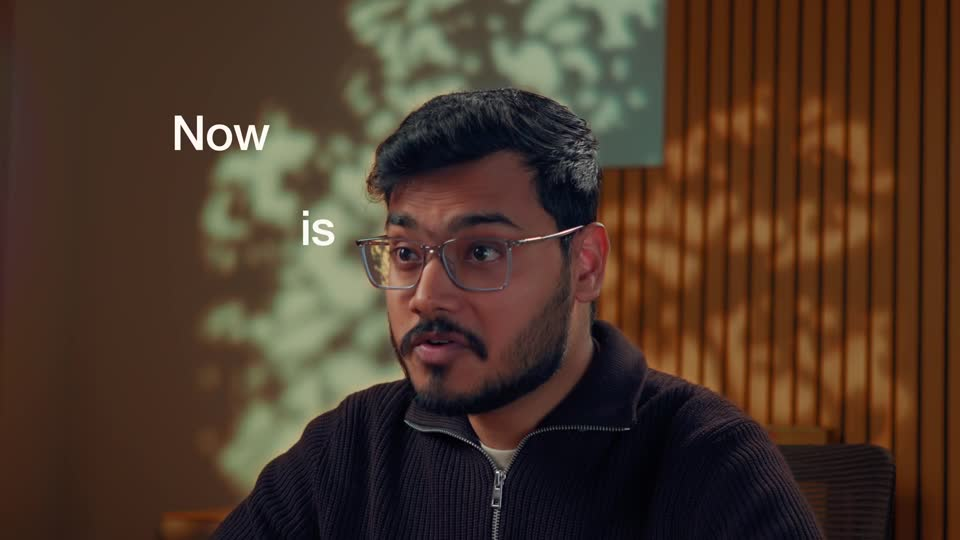
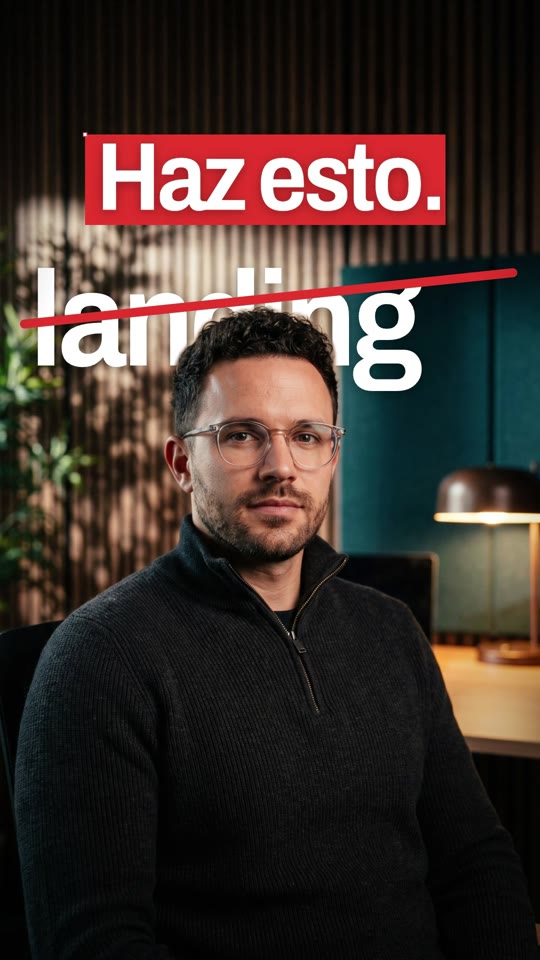
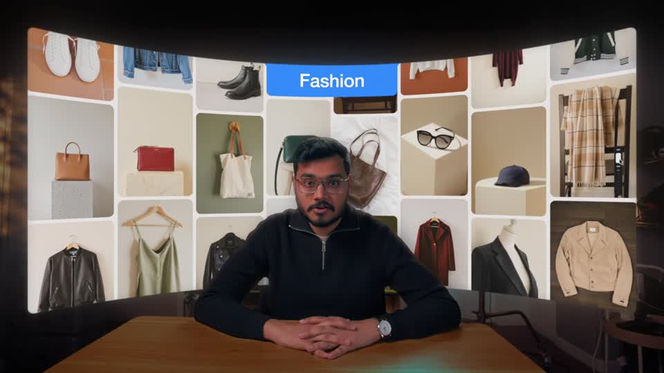
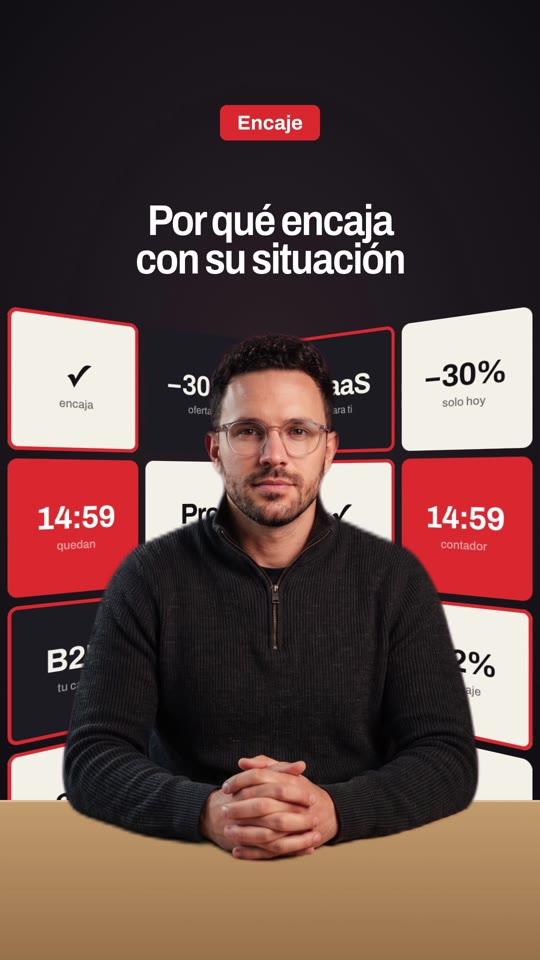

# Playbook: Founder talking-head with depth type (no camera, no AI video)

A founder-to-camera launch video: a person in a warm, moody office talks to camera while **big words slide in behind their head** (the head covers part of each word), small words type in front, and key words get a **Figma-style selection highlight** (red box with corner handles). Between talking shots, the video cuts to clean paper-white UI inserts (a giant number, an orbit of labels, cards, a chat input being typed), a full-bleed brand-colour `{ brace }` beat, a "desk + curved wall of cards" shot, and a minimal end card.

Everything is **one generated photo of a presenter, edited into variants**, plus HTML/GSAP in HyperFrames and ElevenLabs audio. **No AI video, no filming.**

Example: `../../x-batch/akshay.mp4`, a 57.5s, 9:16 SaaS in House quiz-funnel video in Spanish. The project is in `template/`.

| Original (Demoverse, 16:9) | Ours (9:16) |
|---|---|
|  |  |
|  |  |

Also see `reference-frame-insert.jpg` (paper insert) and `reference-frame-end.jpg` (end card).

---

## 1. What the format is

Reverse-engineered from Akshay Mehta's Demoverse launch (https://x.com/Akshay_MehtaAM/status/2107123489597805035: 64s, 16:9, 4K, 432k views). The original is a filmed founder plus an off-camera "interviewer" line, with kinetic type composited **between** the background plate and the person (rotoscoped), blue highlight boxes, `{ }` brace motifs, white UI-motion inserts and a curved product wall behind the founder at a desk.

| Beat | Original | Our version | Technique |
|---|---|---|---|
| Hook | "Gone is the era" (big "Gone" crossed out) behind the head | "¿Quieres vender tu SaaS sin mandar a todos a la misma…" small words in front, giant **landing** behind the head, red strike, then "**Haz esto.**" in a red selection box | layer order: plate → behind-text → cutout → front-text; strike is a `scaleX` bar |
| Off-camera question | Second voice: "So you're saying I can co-create…?", founder looks off-camera, dashed guides | Sara Martin 3: "Espera, espera… ¿o sea, que no pido una **demo** directamente?" on host B (3/4 angle, listening) | separate TTS voice; dashed `border` guides draw in with `scaleX/scaleY` |
| Answer | "Yes." | "No." giant, then **Quiz Funnel** in a selection box behind the head | `.sel` box + corner handles pop with `back.out` |
| Data insert | White card, "Posted to 999M" | Paper: "● Primero", giant **5–8**, "preguntas", then they fly up and an orbit appears: "Tu lead" pill + 3 question chips at their word times | `yPercent` roll-ins; dashed ellipses rotate |
| Talking beat | "{ but you }" | "Pero no hagas **{ solo }** **preguntas**" | punch-in 1.18→1.24 |
| UI insert | Jacket photo + "Change the pattern" chat input | 4 proof cards (Caso real / Dato / Resultado / Consejo) pop at their words; the chat bar types "Vale, esto tiene sentido" and the red send button pops | `textContent` per character; blinking caret with `tl.set` |
| Brand beat | Full blue "{ Evolve }", brand-dot orbit | Full red, white-dot rings expand and spin, "{ resultado }" + "personalizado" pill | seeded RNG for dot sizes/opacity |
| Talking beat | "creativity flow" with a drawn swoosh | "Y aquí viene la parte **importante**" + red SVG swoosh | `strokeDashoffset` draw |
| Desk + wall | Founder at a desk in front of a curved wall of product photos, top label "Fashion / Beauty / Furniture" | Desk cutout in front of two `rotateY` walls of quiz-UI tiles; the top label switches **Encaje → Oferta → Contador** on the words, matching tiles light up, and a 14:59 countdown ticks live | CSS `perspective` + `rotateY(±38°)`; tiles with `.hl` outlines per group |
| Payoff | "Download the link is in…" | "Así no solo captas **el lead**" → "**Lo segmentas,** **lo educas,** … **compra**" | selection boxes, giant behind-word turns red |
| End card | Paper, `← { co-create on Demoverse.ai } →` | Paper, `← { comenta QUIZ } →` typed + SaaS IN House wordmark | flickering square dots |

Audio: voiceover = two voices concatenated at absolute times, music bed at 0.2, SFX: whoosh (insert cuts), pop (highlight boxes, cards), tick (labels), typing (questions / chat bar / CTA), ding (send + end).

### The two tricks that make a still photo feel filmed
1. **Depth type**: the presenter photo is cut out with `hyperframes remove-background` (local model, free, ~1s per image). The full photo is the plate, the cutout sits on top, and the "behind" text lives between them. Plate and cutout are wrapped in `.cam` / `.camfg` and get the **same** transform, so slow push-ins keep them glued.
2. **Lip-flap**: one Gemini edit of the same photo with the mouth open. `tools/mouth_patch.py` aligns it (scale + shift search on the moustache band), colour-matches it and cuts a feathered mouth patch. In the composition, the patch opacity is set **per frame** from the founder-voice loudness envelope (`assets/mouth_env.json`, 30 fps). It reads as talking at phone size. Use it only on the front-facing shot; the 3/4 "listening" shot plays while the *other* voice speaks, so no lips are needed.

## 2. Prerequisites

- `ffmpeg`, Node + `npx` (HyperFrames CLI pinned to `0.8.137`), Python 3 with `numpy pillow`.
- `ELEVENLABS_API_KEY` (`source <(grep ELEVENLABS_API_KEY ~/.zshrc)`). **The key is shared:** make calls one at a time; `tools/tts_retry.py` backs off on 429.
- `treg` CLI for Gemini 3 Pro Image (`reapi.image-gen.gemini-3-pro-image`, $0.03 per image).
- Sound-generation `duration_seconds` must be **≥ 0.5** (0.3/0.4 returns HTTP 400 and the file is just a JSON error).

## 3. Recipe

```bash
cp -R playbook/founder-depth-type/template my-video && cd my-video
T=../playbook/founder-depth-type/tools; mkdir -p gen
```

**1) Presenter images (5 × $0.03 = $0.15).** Generate a base portrait, then make **edits of it** by passing its URL as a reference:
```bash
python3 $T/gen_image_ar.py gen/hostA.png "Photoreal cinematic portrait still from a startup founder interview film, vertical 9:16. <person>, seated, framed from mid-chest up, centered slightly low with lots of headroom (top 40% background), looking into the camera, mouth closed. Background: moody warm modern office, dark wooden slat wall, dappled leafy window light, dark teal panel, glowing lamp, shallow depth of field, amber/teal grade, 35mm film look. No text." > gen/hostA.url
A=$(cat gen/hostA.url)
python3 $T/gen_image_ar.py gen/hostA_open.png "Edit this exact photo. Keep EVERYTHING identical ... The ONLY change: the man is speaking mid-word, mouth slightly open showing a hint of upper teeth." $A
python3 $T/gen_image_ar.py gen/hostB.png "Same man as in the reference photo ... tighter medium close-up from his left side, turned three-quarters, looking off-camera, listening, mouth closed ..." $A
python3 $T/gen_image_ar.py gen/desk.png "Same man ... sits at a light oak table facing the camera, hands clasped, waist up, small in the lower-middle of a 9:16 frame (head at ~58% height) ... background flat pure magenta #FF00FF" $A
```
Headroom matters: the big "behind" words need the top ~35% of the frame to be background.

**2) Cutouts + mouth patch (free, local).**
```bash
for f in hostA hostB desk; do npx --yes hyperframes@0.8.137 remove-background gen/$f.png -o gen/${f}_cut.png; done
python3 $T/mouth_patch.py gen/hostA.png gen/hostA_open.png gen/hostA_mouth.png <mouthX> <mouthY> 150 95
```
Find the mouth centre by cropping the face (it was 790,1445 in a 1536×2752 image). Check the patch over the base before using it. Then resize everything to 1080 wide (1935 tall; the layers sit at `top:-7px`), save the plates as JPG and the cutouts as PNG, crop the mouth patch to its alpha bbox and put that bbox into `.mouth { left, top, width, height }`. For the desk shot generated on magenta, **despill** the cutout edge (limit R and B to G+8 where both exceed G) and erode the alpha by 1px, or you get a purple rim.

**3) Audio.** Script = the base script split into: founder hook → off-camera question (second voice) → founder answer. Spanish voices: Bruno Torres `SKjgN71N3MeGl4r2JbRt` (founder, speed 1.05), Sara Martin 3 `gD1IexrzCvsXPHUuT0s3` (question).
```bash
python3 $T/tts_retry.py "<hook>" audio/p1.mp3 audio/p1.json SKjgN71N3MeGl4r2JbRt 1.05
python3 $T/tts_retry.py "<question>" audio/p2.mp3 audio/p2.json gD1IexrzCvsXPHUuT0s3 1.08
python3 $T/tts_retry.py "<answer + rest>" audio/p3.mp3 audio/p3.json SKjgN71N3MeGl4r2JbRt 1.05
```
Place them at 0.3s, then +0.35s and +0.3s gaps (`adelay` + `amix normalize=0`) into `assets/vo.mp3`, shift each `words.json` by its offset, and compute the **founder-only** RMS envelope at 30 fps → `assets/mouth_env.json` (`clip((rms-0.015)/0.08, 0, 1)`). The exact script is in the akshay project (`x-batch/akshay/audio/`). Music: ElevenLabs `/v1/music`, "warm upbeat minimal electronic, soft plucked synths, light claps, no drops, no vocals", 58s. SFX: whoosh 0.8s, pop 0.5s, ding 1s; tick + type reused from `playbook/brand-film/template/assets/`.

**4) Edit `index.tpl`, then `python3 build.py`** (it inlines `mouth_env.json` into `index.html`; never keep a second `.html` with `data-composition-id` at the root, because `check` fails on multiple roots).
- All times are **absolute** (the VO starts at 0), so a cue is just the word's start from `words.json`.
- Talking-head scene = `.cam` (plate) → behind-text → `.camfg` (cutout + `.mouth`) → `.grade` → front-text. Call `cam("#sN", t0, t1, scaleFrom, scaleTo, ox, oy)` and `lips("sN-mouth", t0, t1)`. Use **ids**, not template-literal `querySelector`s: the HyperFrames bundler rejects those.
- Helpers: `inUp` (small words, blur-up), `inBig` (giant words, scale-down from blur), `selIn` (red box wipes in, then the corner handles pop), `out`.
- Paper inserts open with a horizontal `clipPath: inset(48% 0 48% 0)` → `inset(0)` wipe.
- Behind-words: keep them in the top ~40% (y 330–700), 220–300px, `font-stretch: 88%`. Let the head cover the **lower middle** of the word only; if it hides whole letters the word stops reading (we had to move "el lead" up 75px).

**5) Check → snapshot → render.**
```bash
npm run check
npx --yes hyperframes@0.8.137 snapshot --at 2.5,4.2,8.5,11.8,17.8,29.9,34.3,41.5,49.2,52.9,56.5 --no-end --describe false -o snaps
npx --yes hyperframes@0.8.137 render -o out.mp4 --quiet
```
Expected leftovers: `nested_structure_needs_subcomposition` warnings (fine for a single-file film), duplicate-image warnings (the same plate in several scenes), and contrast warnings on the wall tiles that sit behind the person.

## 4. QA

`ffprobe` (1080×1920, ~57.5s), `ffmpeg -af volumedetect` (mean ≈ −20 dB), then extract frames from the **mp4** at each beat and look: the cutout edge (no halo), the behind-word still legible, mouth patch has no seam, wall tiles don't collide with the top headline.

## 5. Costs (the akshay video)
- Images: 5 Gemini calls = **$0.15**.
- ElevenLabs: about 820 TTS characters, about 64s of music, 2 SFX (+ one Scribe transcription of the reference).
- Background removal: local, free.

## 6. Adapting it
- Another product: change the plate prompt (person, room), the copy in `index.tpl`, the wall tiles and the top-label groups (`.h1/.h2/.h3`), and the end-card CTA.
- A real founder: swap the generated stills for 2–3 real photos (same pipeline), or for real footage with `remove-background` on the video (outputs a transparent WebM). Drop the lip-flap then.
- Limits: it's still a still. Keep talking shots ≤ 4–5s, always with a push-in, and alternate them with inserts every 2–5s, like the original does.
