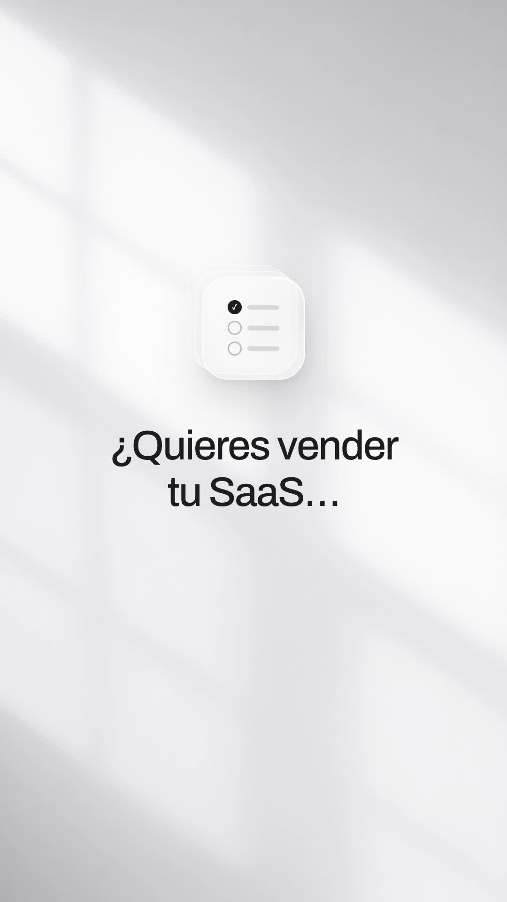
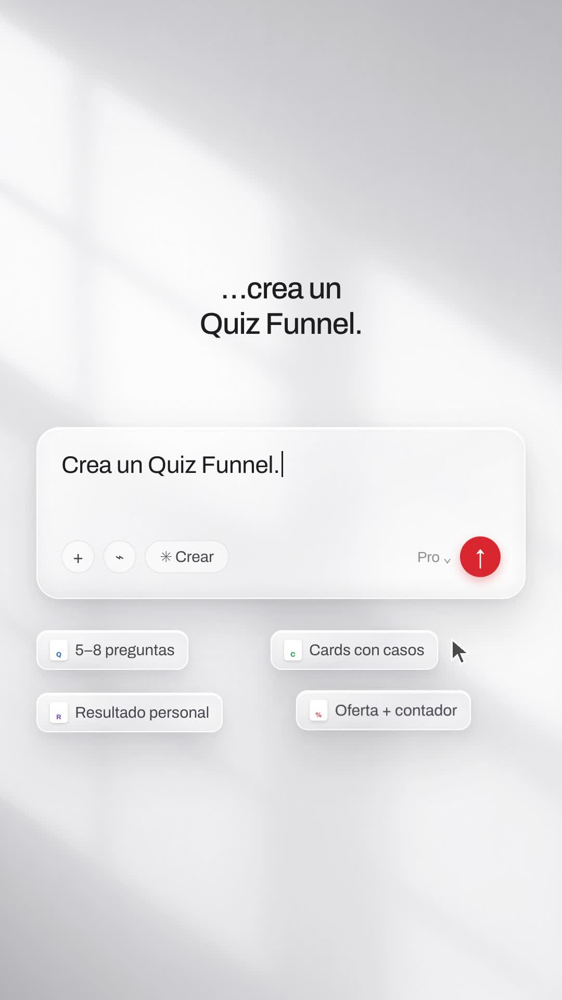
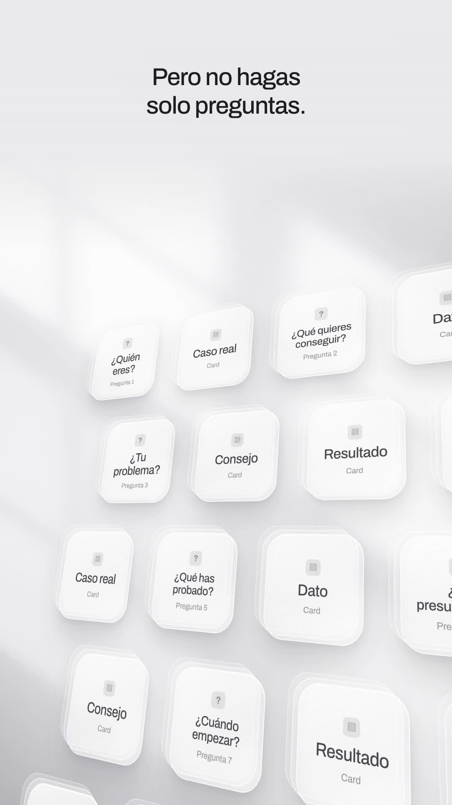
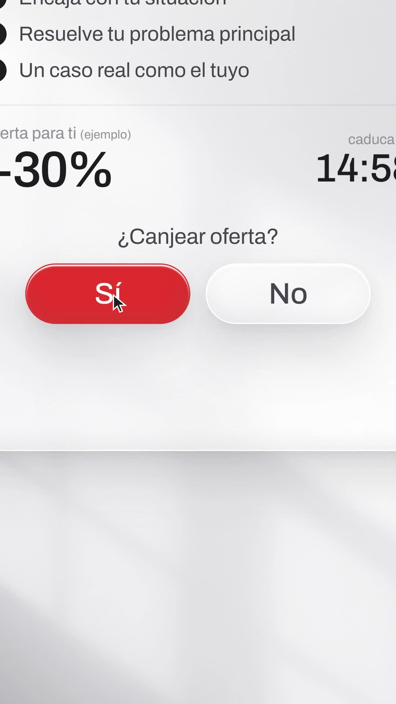

# Playbook: Frosted-glass launch film (monochrome glass UI, window light, word ticker)

A quiet, premium "introducing X" film in the style of Apple/Scandinavian product launches. Everything is **near-monochrome frosted glass on a grey wall lit by soft window light**. The words sharpen out of a blur. A **vertical word ticker** cycles the key word, with its neighbours faded above and below. A **glass prompt box** types, deletes and retypes, and file chips fly into it. A **tilted 3D wall of glass tiles** drifts past the camera. Scattered tiles converge into one stack. A glass "working" panel ticks off steps, the camera **zooms into a Sí / No choice** and the cursor clicks. A fanned stack of glass sheets glows. It ends on the **wordmark on pure white**. Music only, no narration. Built with HTML + GSAP in HyperFrames, plus **1 generated image** (the wall) and ElevenLabs music/SFX. **No AI video.**

Example: `../../x-batch/legora.mp4` (50s, 1080x1920, Spanish, SaaS in House quiz-funnel script). The project is `template/`.

   

The original (16:9), 1 frame per second: `reference-original-sheet.jpg`. Key frames: `reference-original-keys.jpg`.

This playbook is for **any coding agent (Claude Code, Codex, …) or a human**. Commands assume you are in the folder that contains `playbook/`.

---

## 1. What the format is

Reverse-engineered from Legora's "Introducing Skills" launch (https://x.com/WeAreLegora/status/2107078811925746132). It is 47s, 16:9, with a **music bed only** (Scribe hears just "[outro jingle]"). It got 68♥, 39 bookmarks and 4.6k views in its first day. The look is light-grey glass, with the only colour in file icons and a dark send button. Because the reference has no narration, our version is **on-screen text + music** (no TTS). The base script is split into short lines.

| Beat | Legora (reference) | Our version (template, times in s) | Technique |
|---|---|---|---|
| 1 Hook | Glass "skill" icon flips in, "Introducing Skills" blurs in | 0–3.2 glass quiz icon (✓ ○ ○) tumbles in, "¿Quieres vender tu SaaS…" | icon `fromTo rotationY -75 / rotationX 30 / z -400 / blur` → 0 with `expo.out` inside a `perspective` scene; `blurIn()` per word |
| 2 Ticker | "Teach the Agent your [standards / processes / preferences / craft…]" | 3.2–6.4 "…sin mandar a todo el mundo / a la misma [web / demo / **landing?**]" | `ticker(id, words, [[t,k]…], lineHeight)`: active word sharp, ±1 at opacity 0.22 + blur(3px) + scale 0.86, others 0 |
| 3 Statement | – | 6.4–8.4 "Haz esto." 130px | blurIn + slow scale 1→1.05 |
| 4 Prompt box | Glass input types the request; docx/pdf/xls chips fly in | 8.4–14 caption "En lugar de pedir una demo directamente…"; box types "Pedir una demo", greys it, deletes it, types "Crea un Quiz Funnel."; 4 chips fly in (5–8 preguntas, Cards con casos, Resultado personal, Oferta + contador); cursor clicks the red send button | `type(id, from, to, at, dur)` proxy tween; blinking caret `opacity` yoyo; chips `back.out`; everything flies up blurred on send |
| 5 Ticker 2 | – | 14–19.5 "Primero, 5–8 preguntas para saber…" + centred ticker [quién es / qué quiere conseguir / cuál es su problema] | same `ticker()`, centred host |
| 6 Tile wall | Endless tilted wall of glass icons, then labelled tiles (Commercial, Disputes & Claims…) | 19.5–25 20 glass tiles (questions "¿Tu problema? · Pregunta 3" alternating with cards "Caso real · Card") on a plane, rotated (−30°, 22°, −6°) and panning; captions "Pero no hagas solo preguntas." → "Entre medias: casos reales, datos y consejos." | `perspective:1500px` scene + `transform-style:preserve-3d` plane; one `fromTo` on rotation/x/y/z for the whole shot; an opaque grey gradient band at the top keeps the caption readable |
| 7 Converge | Tiles scatter, then stack into "Full Contract Negotiation Review" | 25–29 5 tiles float, 4 fly into the centre one, it bursts into a wide tile "“Vale, esto tiene sentido.”" | `x/y` deltas to the centre with `power3.in`, pulse, then `rotationY −40 → 0` reveal |
| 8 Working panel | Glass chat panel "Working" with a checklist + floating doc tables | 29–32.6 caption "Según sus respuestas, un resultado personalizado."; panel with a user bubble, "✳ Analizando" pulsing, 4 rows + "✓ Resultado personalizado"; 2 glass sheets drift | rows staggered 0.4s with blur→sharp; `.sheet` placeholders (grey bars) |
| 9 Statement | – | 32.6–35 "Y aquí viene la parte importante." | blurIn |
| 10 Yes / No | Camera zooms into "Proceed? [Yes] [No]" | 35–40.5 offer panel: ✓✓✓ why it fits, "−30% (ejemplo)", live countdown 15:00→14:56, "¿Canjear oferta?" [Sí][No]; zoom ×1.5 on the pills, cursor clicks Sí → it turns red | wrapper `#s10-zoom` with `transform-origin` at the pills; countdown via proxy `onUpdate`; `backgroundImage:"none"` before tweening `backgroundColor` (the glass gradient otherwise covers it) |
| 11 Doc stack | Stack of documents fans out, a white light flash | 40.5–44 8 glass sheets fan in 3D (`rotationY −38`), a radial white flash; "Así no solo captas el lead." | stagger + radial-gradient overlay opacity |
| 12 Ticker 3 | "Legal work, your way" | 44–47.2 "Lo [segmentas, / educas / llevas a la compra.]" on the music's final hit | `ticker()` left-aligned |
| 13 End card | Green "LEGORA" wordmark on white | 47.2–50 white, "SaaS [IN] House" assembles, glass pill "Comenta «QUIZ»" + "y te enseño cómo montarlo" | IN badge `back.out`, words slide in from the sides blurred |

**Visual rules:**
- Text is `#1d1d20` Archivo 480, letter-spacing −0.03em.
- Colour is only on the send button, the clicked "Sí" and the IN badge (brand red `#e8382d`).
- `.glass` = translucent white gradient + 2px white border + an inset top highlight + an inset bottom shade + a long soft shadow + `backdrop-filter: blur(18px)`.
- `.tile` adds two offset `::before/::after` layers to suggest thickness, like the reference's layered icons.

## 2. Prerequisites

- `ffmpeg`, Node + `npx` (HyperFrames CLI pinned to `0.8.137`), Python 3 with `pillow`.
- `ELEVENLABS_API_KEY` in `~/.zshrc`; `treg` CLI for Gemini 3 Pro Image.
- HyperFrames basics: one paused GSAP timeline at `window.__timelines["main"]`. Each scene is `<section class="scene clip" data-start data-duration data-track-index>`. Every `<audio>` has an `id`. No `Math.random`.

## 3. Recipe

```bash
cp -R playbook/frosted-glass-film/template my-film && cd my-film
T=../playbook/tools; L=../playbook/frosted-glass-film/tools
```

**1) Wall image (1 call, ~$0.03).**
```bash
python3 $T/gen_image.py wall.png "Photorealistic minimalist studio photograph: a smooth seamless pale cool-grey matte wall, empty, lit by soft natural window light coming from the upper left, casting large soft diagonal light beams and gentle blurred window-frame shadows across the wall, very soft gradients from light grey to almost white, calm, airy, premium, subtle, high key, no objects, no text, no people, vertical composition, very soft focus"
python3 $L/wall_grade.py wall.png assets/wall.jpg
```
`wall-source.png` in this folder is the one we used, so you can skip the call.

**2) Audio (sequential, with 429 backoff).** `bash $L/el_audio.sh assets` creates `music.mp3` and `whoosh/glass/key/click/chime.mp3`. ElevenLabs music often comes back **longer than asked** (we asked for 48s and got 62s). Do not stretch it. Splice it so the real outro survives:
```bash
ffmpeg -v error -i assets/music.mp3 -ac 1 -ar 8000 -f s16le - | python3 -c "import sys,numpy as n;a=n.frombuffer(sys.stdin.buffer.read(),n.int16).astype(float);print([round(20*n.log10(n.sqrt((a[s*8000:(s+1)*8000]**2).mean())+1)) for s in range(len(a)//8000)])"
bash $L/splice_music.sh assets/music.mp3 assets/music50.mp3 40.5 51.5 50   # A = cut point, B = start of the breath before the outro
```
Put the last ticker (beat 12) on the outro's final hit (44s in the template).

**3) Edit the story.** All copy is in the scene markup (`#s1-t`, `#s2-t`, ticker word arrays in the script, tile labels in `TILES`, rows in S8/S10). Times live in three places that must agree:
- the section's `data-start/data-duration`;
- the `tl` calls in the matching `/* ---------- Sx ---------- */` block;
- the `<audio>` SFX `data-start`s.

Rules of thumb:
- a blurIn line needs **≥0.8s fully sharp** before its `out()`;
- ticker steps ≥0.7s apart;
- one SFX per visible event (glass tap = tile/chip/ticker step, key = typing, click = cursor, whoosh = scene change, chime = result/logo).

**4) Check, snapshot, render.**
```bash
npm run check                         # must say 0 errors in the layout section
npx --yes hyperframes@0.8.137 snapshot --at 1.6,5.7,12.8,20.8,27.6,31.8,37.2,39.6,42,45.5,48.8 --describe false --no-end -o qa/snap .
npx --yes hyperframes@0.8.137 render -q delivery -o ../out.mp4 .   # ~50s on a laptop
```

**5) QA the mp4 itself.**
- `ffprobe` (1080x1920, 50.0s) and `volumedetect` (we got −19.2 dB mean, −2.6 dB max).
- Extract 12+ frames and look at them.
- Also scan for **black pixels** down the centre column. A wrongly cropped wall shows as black bands at the top and bottom of every scene *except* the white end card, and snapshots made it look like contact-sheet padding:
```bash
python3 -c "from PIL import Image;im=Image.open('f.jpg').convert('L');print(sum(im.getpixel((540,y))<30 for y in range(0,1920,4)))"
```

## 4. Gotchas

- **Caption over the tile wall:** the layout check flags every tile that passes under the caption, and `data-layout-allow-overlap` on the plane does not silence it, because the tiles' children are the offenders. The real fix is to keep the plane low (`top: 420px`, pan `y: −380`) and put an opaque grey band behind the caption.
- **Zoom framing:** with ×1.75 the two 300px pills overflowed 1080px. Keep `scale × (pill row width) < 1000`. The cursor tip is the SVG's top-left; aim it with the zoomed coordinates (template: `300, 800`).
- **Glass + colour:** `.glass` has a gradient `background-image`. To fill a glass element with colour, set `backgroundImage: "none"` first.
- **The `#s4-send` contrast warning** (1.78:1) only fires while the box blurs out. It is harmless.
- **20 structural warnings** (`nested_structure_needs_subcomposition`, file size) are expected for this single-file template.
- **Black bands:** see QA above. `tools/wall_grade.py` crops by width.

## 5. Cost (the example)

- 1 Gemini image ≈ $0.03.
- ElevenLabs: 1 music call (62s) + 5 SFX, no TTS, plus a Scribe pass on the reference to confirm it had no voice.
- No AI video.
