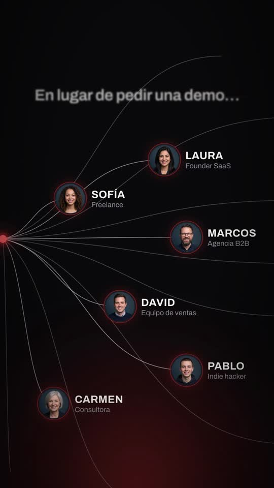
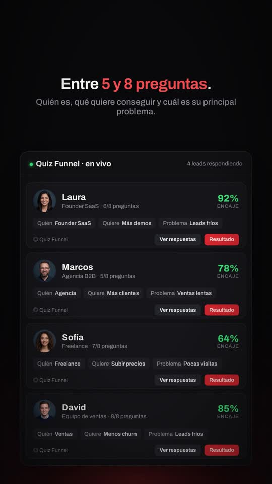
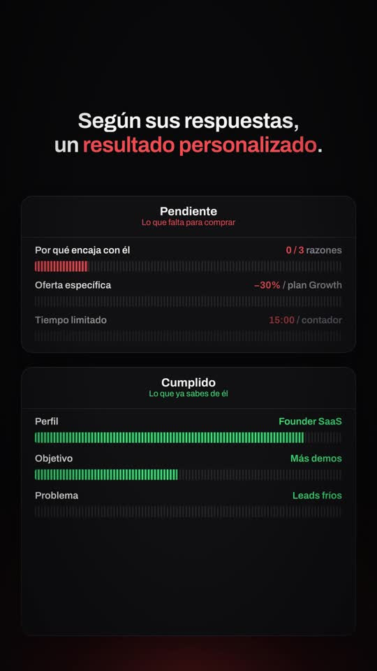

# Playbook: Glow signal film (dark product UI teaser, music only)

A quiet, premium **dark** product teaser. Near-black canvas, one warm glow rising from the bottom edge, a headline that arrives word by word (with an inline brand chip), a glowing dot that draws a line, a **wave pulse** running along it, and then a **burst of curved lines** that reach the leads. After that come a live "feed" panel the camera pushes into, an interleaved question/value-card stack, **Pendiente → Cumplido gate panels** with striped progress bars, and a wordmark end card with one line of copy. Everything is HTML/SVG + GSAP in HyperFrames. **There is no AI video and no voice.** The only generated image is one Gemini sheet with 6 avatars (~$0.03).

Example: `../../x-batch/trenchers.mp4`. A 38s, 1080x1920 SaaS in House quiz-funnel teaser in Spanish. The project is `template/`.

   

Original contact sheet (16:9, 1 frame/s): `reference-original.jpg`.

## 1. Source and what makes it distinctive

Reverse-engineered from **TrenchersAI "Watch Feed / Entry Check"** (https://x.com/TrenchersAI/status/2107010967393673449). It is 20s, 16:9 at 60fps, music only (Scribe returns just "[outro jingle]"). Its grammar:

| Beat | Trenchers (reference) | Ours (template, seconds) | Technique |
|---|---|---|---|
| Hook | "Why did my Agent [token] buy this?" types word by word on black with a blue horizon glow; the last word shrinks into a line | 0–4.4 "¿Quieres vender tu SaaS [IN] sin mandar a todo el mundo a la misma *landing?*". The other words blur away and "landing?" shrinks toward the dot | `words(host, tokens[], t0, step)`: each token is a span, blur(14px)→0. The inline chip is just a token holding HTML |
| Signal | A glowing blue dot draws a line with a travelling sine bump | 4.2–6.5 red dot, line extends, bump travels, "Haz esto." | SVG `path` `d` rebuilt in `onUpdate` from a proxy `{len, ph, amp}` (seek-safe) |
| Burst | Lines fan out from the dot to token nodes (avatar + ticker + name); the camera drifts | 6.5–11.6 14 cubic curves (6 to lead nodes, 8 strays), nodes pop with a red ring; "En lugar de pedir una demo…" (hand-drawn strike) → "Crea un Quiz Funnel." | `strokeDasharray = getTotalLength()`, tween `strokeDashoffset`; camera = `#cam3` scale 1→1.18 + x drift |
| Feed | A "Near entry" list of token cards; the camera zooms in and a ring cursor clicks "Entry check" | 11.6–17.4 "Quiz Funnel · en vivo" with 4 lead rows (avatar, persona, Quién/Quiere/Problema tags, Encaje %, buttons); zoom into Laura, ring clicks "Ver respuestas" | `#cam4` scale 0.96→1.42; the other rows dim and blur |
| (new) Interleave | — | 17.4–22.6 a scrolling stack: question card, red-glow value card (Caso real / Dato / Consejo), and so on; "“Vale, esto tiene sentido.”" pill | `#stack` y tween inside a masked container (`mask-image` fades top and bottom) |
| Gates | "Blocking / Gates to clear" (red striped bars) vs "Passing / Requirements met" (green) | 22.6–30.4 "Pendiente / Lo que falta para comprar" vs "Cumplido / Lo que ya sabes de él". The 3 profile rows fill green; then each pending gate (Por qué encaja, Oferta −30%, Tiempo limitado with a live countdown) fills, turns green and **moves into Cumplido**; "✓ Listo para comprar" | stripes = `repeating-linear-gradient(90deg, c 0 4px, c25% 4px 9px)`; fill = `clipPath: inset(0 X% 0 0)` (stripes don't distort); move = `y` delta between slots (never animate `top`) |
| Line | "A skipped trade shouldn't be a *mystery*." (accent word lavender) | 30.4–34 "Así no solo captas *el lead.*" → "Lo segmentas, lo educas y lo llevas directo *a la compra.*" | `words()` + per-word blur out |
| End | Eagle logo + "TrenchersAI", "Open **Entry Check** and see…", glow at full | 34–38 "SaaS [IN] House" lockup, "Comenta **«QUIZ»** y te enseño a montar el Quiz Funnel de tu SaaS.", glow at full | `glow(t, opacity, scaleY)` |

**Palette:** bg `#09090b`, panels `#111114`/`#16161a`, hairlines `#24242a`, brand red `#e8382d` (glow + accents), functional green `#2fd47a` and red `#ff5a4e` only for the gates. **Type:** Archivo (variable), with Silkscreen for the "IN" chip and the card labels.

**No voice:** the reference has none, so the base script lives in the captions (`#c2…#c6c`, `#hook`, `#p1/#p2`). If you want a VO, generate it with `playbook/tools/tts_with_timestamps.py` and move each cue onto its word start.

## 2. Recipe

```bash
cp -R playbook/glow-signal-film/template my-film && cd my-film
# music: ONE call. The key is shared, so run calls one at a time; tools/el_post.sh retries 429 with backoff
tools/el_post.sh assets/music.mp3 /v1/music '{"prompt":"dark minimal premium tech product teaser music, deep warm sub bass pulses, glassy ambient pads, soft ticking hi-hats and subtle granular glitches, slow build with tension, 100 bpm, gentle swell around 22 seconds, warm resolving outro chord with a soft shimmer ending cleanly at 38 seconds, no vocals","music_length_ms":38000}'
tools/el_post.sh assets/shimmer.mp3 /v1/sound-generation '{"text":"soft glassy digital shimmer swell, electric spark spreading outward","duration_seconds":1.5,"prompt_influence":0.6}'
# tick/pop/whoosh/impact are reused from ui-demo-film / brand-film. Avatars (1 call, ~$0.03):
python3 ../playbook/tools/gen_image.py avatars.png "Six separate circular profile-photo avatars arranged in a 2 columns by 3 rows grid with lots of empty space between them, not touching. ... dark moody blue-grey backdrop inside the circle ... Everything outside the circles is flat pure magenta #FF00FF, no shadows, no text."
python3 ../playbook/tools/cutout_grid.py avatars.png assets 260 av1 av2 av3 av4 av5 av6
npm run check && npx hyperframes snapshot --at 2.8,5.4,8.6,10.4,13.5,16.4,19.5,21.8,24.2,29.9,31.4,33.3,36.5 --no-end
npx hyperframes render -o ../my-film.mp4      # ~50s for 38s
```

**What to edit in `index.html`:**
- **Copy:** the `words("hook", [...])` tokens, the captions `#c2 #c3a #c3b #c4 #c5a #c5b #c6a #c6b #c6c`, the `words("p1"/"p2")` payoff, and the end card `#lock` / `#sub`.
- **Data:** `NODES` (burst nodes: position, avatar, name, persona), `LEADS` (feed rows), the `#stack` cards, and `GATES` (`[label, value html, "A"|"B", start fill %]`; A = Pendiente and moves to B at `27.0 + k`).
- **Look:** the brand colour is `--red` plus the `#glow` gradient. For a blue Trenchers-style look, swap both to `#2b4cff`.
- **SFX:** absolute `data-start` on the `<audio>` tags, one track index each.

## 3. Gotchas

- `gsap_non_transform_motion` is an **error** for tweening `top`. Move gate rows with `y: SLOT_B - SLOT_A`.
- An initial hidden state set with `tl.set(..., 0)` doesn't render at frame 0. `scene()` uses `gsap.set` for anything that starts hidden.
- Don't split the hook HTML on spaces: `<span class=...>` breaks. `words()` takes a **token array**.
- The striped fill uses `clipPath inset`, not `scaleX`, so the stripes keep a constant pitch.
- The remaining check infos (`#cam3`/`#stack` overflow, `#glow` off-canvas, gate rows overlapping mid-move) are intentional.
- The burst path lengths come from `getTotalLength()` at build time, so the paths must be in the DOM (inside the SVG) before you read them.

## 4. Before publishing

"+38% demos" and "7 de 10" are labelled **ejemplo**; replace them with real numbers. The −30% offer and the "Comenta «QUIZ»" CTA need a real deliverable.
