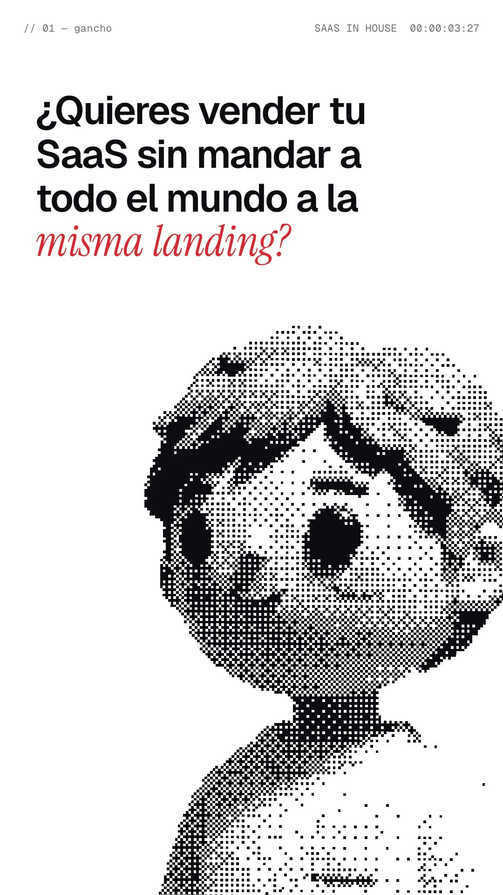
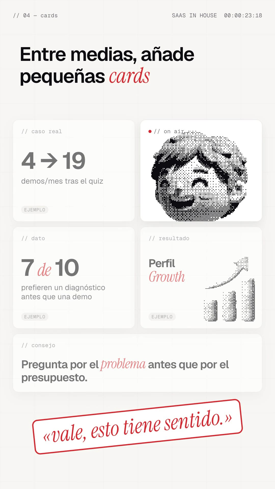
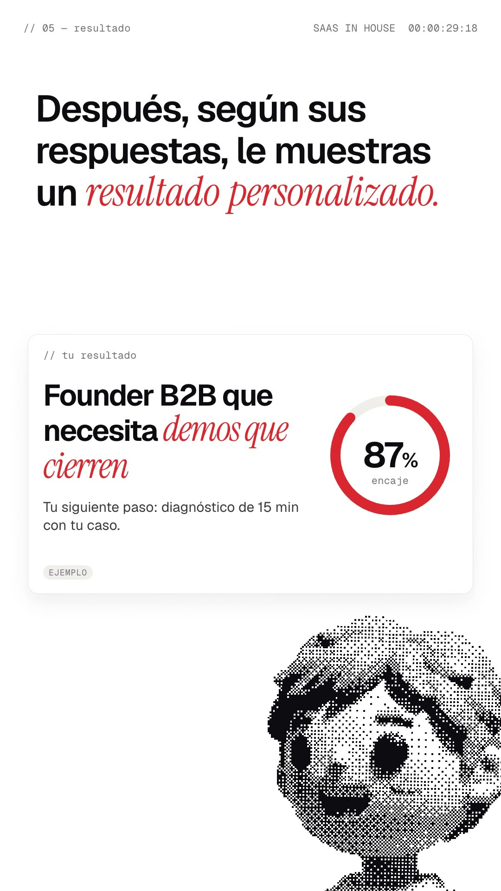
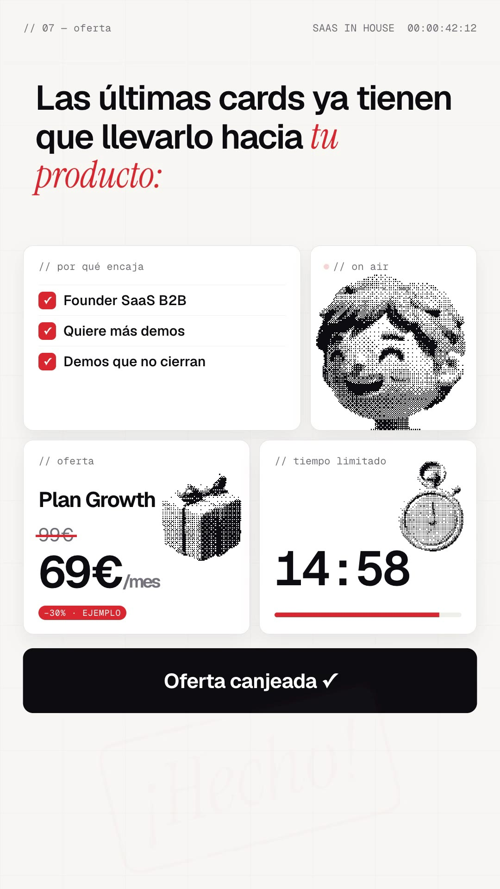

# Playbook: Halftone mascot film (1-bit 3D mascot + spoken headline + bento UI)

A fast, punchy product film with a voiceover. A **3D clay mascot printed as a 1-bit halftone** (ink dots on white) sits in the frame and "talks" (pose swaps on every word). The **spoken words appear as the headline, one word at a time**, in a heavy grotesk with key words swapped to a **red italic serif**. Scenes hard-cut between white, a full-bleed brand red, near-black, and a light grid "bento" of product tiles. A mono HUD (`// 03 — preguntas` … `SAAS IN HOUSE 00:00:13:15`) runs on top the whole time. Built in HyperFrames from HTML + GSAP, with 5 Gemini images and ElevenLabs audio. **No AI video.**

Example: `../../x-batch/achxvi.mp4` (53.3s, 1080×1920, Spanish, SaaS in House, quiz-funnel script). The project is `template/`.

   

Original (Pocketsflow, 16:9): `reference-original-pocketsflow.jpg`.

This playbook is for **any coding agent (Claude Code, Codex, …) or a human**. Commands assume you are in the folder that contains `playbook/`.

---

## 1. What the format is

Reverse-engineered from Chain's Pocketsflow promo (https://x.com/achxvi/status/2103918792845963545): 15s, 16:9, male VO over upbeat music, 9K♥, 8K bookmarks, 1.1M views ("Opus 5.5 did this in 15 minutes", so it is code-made motion graphics). The ingredients:

| Ingredient | Pocketsflow (reference) | Our version (template) | Technique |
|---|---|---|---|
| Mascot | Curly-haired 3D toy bust, ordered-dither halftone, black dots on white; idle / "pss" / wink / laugh | Our own clay founder mascot (Gemini), 4 poses, same 1-bit look | Gemini render on magenta → `tools/halftone_sprite.py` (key + shared crop + 8×8 Bayer dither, paper-white fill) → stacked `` poses swapped with `tl.set` opacity |
| Talking | Mascot cuts between expressions | Mouth flap on every VO word (talk at word start, idle just before its end, extra close mid-word on long words); wink/laugh reaction windows | `pose(name, t)` on `.mw img` (all mascots on screen flap together) |
| Headline | The VO words appear one by one ("Got something to *sell?*"), accent word in blue script | Same, Geist 600 84px, accents in **Instrument Serif Italic, brand red** | `headline(id, from, to, accents)` builds one span per word from `W` and fades/de-blurs it in at its word start |
| Colour blocks | White → full-bleed blue → white → black → white | White → **full-bleed red** → white → grid → white → black → grid → black → white | one `#bg` + `#grid` layer re-coloured with `tl.set` on each cut; scenes are plain divs shown/hidden with opacity |
| Product proof | Product cards drop in, phone store mock, bento tiles (checkout, upsell, subscriptions, payouts), "Handled." stamp | Pedir demo (struck) → Quiz Funnel card, phone quiz answered live (1/8 → 3/8), bento of cards (caso real / dato / resultado / consejo) with an "on air" mascot tile, result card + ring, offer bento (encaje ✓✓✓, 99€→69€, live 15:00 countdown, CTA click) | `.tile` cards with `// mono` labels; halftone 3D objects (`ob1–4`) inside the tiles |
| Stamp | Circled "Handled." in blue script | «vale, esto tiene sentido.», «¡Hecho!» in red italic, slammed in | `stamp(sel, t)`: scale 1.8→1, rotation −14→−6, `power4.in` + impact SFX |
| Whip band | Black band "Apple Pay / or pay by card" whips across with motion blur | "Pero no hagas solo *preguntas.*" band over the quiz scene | `#band` scaleY 0→1, text x 900→0 with `blur(14px)`→0, then out to the left |
| HUD | `// 01 — hook` top-left, `POCKETSFLOW 00:00:01:30` top-right | `// 0N — <beat>` and `SAAS IN HOUSE` + live timecode | a proxy tween over the whole film writes `00:MM:SS:FF` in `onUpdate` (seek-safe) |
| End | Serif wordmark with the mascot peeking over it, tagline, CTA pill, mono stats | SaaS **IN** House wordmark (site nav style), mascot peeking + winking, «Comenta QUIZ» pill, `saasinhouse.com` | mascot behind a white gradient + wordmark |

**Script beats** (shared quiz-funnel script, 138 words, 48.0s at speed 1.1, VO starts at 0.6s after a "psst" bubble):
S1 hook, white, mascot big (w0–13) · S2 red: "Haz *esto.*" giant, then "…crea un *Quiz Funnel*" with Pedir demo struck → Quiz Funnel card (w14–26) · S3 white: phone quiz answered on "quién / qué quiere / problema", step list `01 quién es…` (w27–48) · S4 black whip band (w49–53) · S5 grid bento: caso real, dato, resultado, consejo pop on their words, mascot "on air" tile, stamp on «vale, esto tiene sentido» (w54–73) · S6 answers chips fly into the result card, ring to 87% (w74–82) · S7 black "Y aquí viene la parte *importante.*" (w83–88) · S8 offer bento: ✓✓✓ on "encaja", strike 99€ on "oferta", countdown on "contador", CTA click + «¡Hecho!» on "canjearla" (w89–120) · S9 black: "Así no solo captas el *lead.*" / "Lo *segmentas*, lo *educas*… *compra.*" (grey words turn white) (w121–137) · S10 end card (4.5s, music only).

**When to use it:** a short, likeable explainer or launch with a voice, where a mascot gives the brand a face without filming anyone (and without a "real person" disclosure problem: the mascot is obviously a toy). It is close to **F2 UI launch reel** (headline + UI proof, light paper) and **H benchmark film** (voice-driven word reveals), but the halftone mascot, the colour-block cuts and the bento proof tiles make it its own look.

## 2. Prerequisites

- `ffmpeg`, Node + `npx` (HyperFrames CLI; the template pins `0.8.137`), Python 3 with `numpy pillow scipy`.
- `ELEVENLABS_API_KEY` (`source <(grep ELEVENLABS_API_KEY ~/.zshrc)`) and the `treg` CLI for Gemini images.

## 3. Recipe

```bash
cp -R playbook/halftone-mascot-film/template my-film && cd my-film
T=../playbook/tools; H=../playbook/halftone-mascot-film/tools
```

**1) Voice first** (everything is cued to word indices). Gabriel Blanco at 1.1 is close to the reference's quick, upbeat read. `tts_retry.sh` wraps `tts_with_timestamps.py` with 429/5xx backoff (the key is shared):
```bash
$EDITOR script.txt                     # numbers as words ("cinco"); DISPLAY in index.html turns them into "5" on screen
bash $H/tts_retry.sh script.txt assets RwzBDEn5f6FIgpAjH9YN 1.1
python3 -c "import json;w=json.load(open('assets/words.json'));print(' '.join(f'{i}:{x[0]}@{x[1]:.2f}' for i,x in enumerate(w)))"
```

**2) Music + SFX**, one call at a time with the canonical helper:
```bash
bash $T/el_audio.sh music assets/music.mp3 "upbeat playful modern tech promo music, bouncy plucked synths, punchy clean drums, light claps, confident startup launch video, clean ending, no vocals" 54000
ffmpeg -i assets/music.mp3 -t 53.3 -af "afade=t=in:d=0.3,afade=t=out:st=50.6:d=2.7" assets/music_cut.mp3
```
In our run the account had **no music credits left** (`401 insufficient_credits` on `/v1/music`), so the template reuses `ui-launch-film`'s bright launch bed and the existing pop / whoosh / click / tick / ding / type SFX, plus `brand-film`'s `impact.mp3` as `stamp.mp3`. Quiet SFX (click, type ≈ −34 dB) were boosted with `volume=12dB,alimiter=limit=0.9`.

**3) Mascot + objects** (5 images ≈ $0.15). Generate a base, then pose edits *of that URL* so they stay aligned:
```bash
python3 $T/gen_image_ar.py m_idle.png "A cute 3D vinyl-toy style mascot character, bust shot from mid-chest up: a friendly young founder character (clearly a toy, not a real person) with a big round head, short messy wavy hair, big round eyes, small smile, rosy cheeks, chunky knit sweater with a small square patch on the chest. Matte clay, soft studio light from the top-left with strong shading so it reads well in black and white. Facing the camera, slightly turned to the left, shoulders cut off by the bottom edge. No text, no logo. Background: perfectly flat solid pure magenta #FF00FF, no shadow on the background." --ar 3:4
KEEP="Keep EVERYTHING else identical to the reference image: same character, same size and position in the frame, same camera, same lighting, same clay material, same flat magenta background, no text."
python3 $T/gen_image_ar.py m_talk.png  "Edit this image: the character is now talking, mouth open mid-word in a friendly open oval shape. Only the mouth changes. $KEEP" --ar 3:4 "$BASE_URL"
python3 $T/gen_image_ar.py m_wink.png  "Edit this image: the character winks: one eye closed as a curved happy line, a slightly bigger smile. Only the eye and mouth change. $KEEP" --ar 3:4 "$BASE_URL"
python3 $T/gen_image_ar.py m_laugh.png "Edit this image: the character laughs happily: both eyes closed as upward happy arcs, mouth wide open in a big grin. Only the eyes and mouth change. $KEEP" --ar 3:4 "$BASE_URL"
python3 $T/gen_image_ar.py objects.png "A 2x2 grid of FOUR separate small 3D clay toy objects, matte clay, soft light from top-left with strong shading (must read well in black and white), lots of empty space, not touching. Top-left: a quiz card with three checkbox rows, one ticked. Top-right: a small rising bar chart with an arrow. Bottom-left: a gift box with a ribbon. Bottom-right: a classic stopwatch. No text. Background: perfectly flat solid pure magenta #FF00FF." --ar 1:1
# halftone them (the four poses MUST go in one call: they share one crop box, so swaps never jitter)
GAMMA=0.55 LO=6 HI=92 python3 $H/halftone_sprite.py assets 900 6 m_idle=m_idle.png m_talk=m_talk.png m_wink=m_wink.png m_laugh=m_laugh.png
HUEKEY=1 SPLIT=1 GAMMA=0.85 LO=4 HI=95 python3 $H/halftone_sprite.py assets 300 4 ob=objects.png    # -> ob1..ob4
```
The originals we used are in `template/sources/` (re-halftone them with other settings for free).

**4) Wire the cues.** `index.html` reads `W` (words) and cues everything by word index: `w(i)` = start of word *i* + `OFF` (0.6s). For a new script, edit:
- the `headline(id, from, to, accents)` ranges per scene (accents = word indices drawn in red italic serif), and `DISPLAY` for caption-only spellings;
- `STARTS` (scene cuts, a word index each), `MPOS` (mascot position/width per scene), `REACT` (wink/laugh windows);
- the tile pops (`pop("#t-case", w(60))`, …) and `sfx.json` (`[file, word index, offset, volume]`).
Then embed words + SFX and check:
```bash
python3 build.py          # writes W into index.html and the <audio id="sfxN"> tags from sfx.json
npm run check             # 0 errors; see §5 for the overlap warnings that are intentional
npx hyperframes snapshot --at 0.3,4,8,13.5,16.4,22.5,29.4,31.5,41.6,47.5,51.5
npx hyperframes render -o ../my-film.mp4
```

**5) QA the mp4**, not only snapshots: `ffprobe` (1080×1920, 53.3s), `ffmpeg -af volumedetect` (ours: mean −18.1 dB, max −1.7 dB), and extract 8–10 frames and look at them.

## 4. Anatomy of `template/index.html`

- **Layers (bottom → top):** `#bg` (scene colour) · `#grid` (bento grid paper) · `#m` global mascot (`#m` > `#m-b` breathing > `#m-x` sway/entrances > 4 imgs) · scene divs `#s1…#s10` (transparent, content only) · `#band` whip band · HUD.
- **Cuts:** the `SC` table (`[id, , bg, hud label, hud colour]`) + `STARTS` → one loop sets scene opacity, background, grid, HUD label/colour and a 24px settle. Hard cuts 0.1s before the word, like the reference.
- **Mascot:** one global mascot moved per scene by `MPOS` with a `back.out` rise; scenes 5/8 use a second copy inside the "on air" tile, the end card a third. `pose()` targets `.mw img`, so every copy flaps in sync.
- **Headline:** words are built from `W`, so the screen text always matches the voice. Accent spans use `.a` (Instrument Serif Italic 1.1em, red; cream on the red scene). Grey variant `.hl.grey` for the "second voice" line, tweened to white on the payoff word.
- **Counters:** timecode, quiz progress, ring %, countdown, all proxy objects + `onUpdate` (seek-safe, deterministic).
- `build.py` keeps the HTML free of hand-typed audio times: SFX are word-indexed in `sfx.json`.

## 5. Gotchas we hit

- **Never name a `@font-face` family `"Serif"`.** Snapshots showed Instrument Serif, but the final render fell back to a synthetic italic Geist (a generic-family clash). Use a unique name (`InstrumentSerif`). Always check the *rendered mp4* frames.
- **Gemini's "pure magenta" comes back muted pink** (~#c03a80), and cast shadows come back dark magenta. `halftone_sprite.py` samples the key colour from the corners for the mascot and, with `HUEKEY=1`, keys on the b/g ratio so contact shadows under objects drop out.
- **Tone curve matters more than dot size.** A straight dither of tan skin is a grey mush; stretch tones inside the silhouette (`LO`/`HI` percentiles) and lift with `GAMMA` 0.5–0.6 so the face reads white with sparse dots and the eyes stay solid ink. Cell 6px on a 900px sprite ≈ the reference.
- `pixelated` rendering (`image-rendering: pixelated`) keeps dots crisp when the sprite is scaled; don't scale above 1:1 by much or the cells look blocky.
- The whip band text must fit 1080px *in its final font*: 78px for "Pero no hagas solo preguntas.".
- `npm run check` reports `content_overlap` for the band over S3, the % over the ring and the 128px S7 headline lines touching. Those are intentional and look right in frames; contrast warnings remain on the dimmed bento tiles after the stamp (by design).
- ElevenLabs music can be out of credits while TTS still works: keep a reusable bed (any `playbook/*/template/assets/music*.mp3`).

## 6. Rights and content

- The mascot is our own generated toy character, not a person and not the Pocketsflow mascot; keep it obviously a toy. Don't copy another brand's mascot.
- Every invented number carries an `ejemplo` chip: 4 → 19 demos/mes, 7 de 10, Perfil Growth, 87% encaje, Plan Growth 99€ → 69€ (−30%), the 15:00 countdown. Replace them with real ones or keep the label.
- The CTA «Comenta QUIZ y te enseño cómo montarlo» needs a real deliverable before posting.

## 7. Cost and time (achxvi.mp4)

| Item | Amount |
|---|---|
| Gemini 3 Pro Image via treg | 5 images (base + 3 pose edits + object sheet) ≈ **$0.15** |
| ElevenLabs TTS | 845 characters (one take) |
| ElevenLabs music / SFX | 0 new (music credits exhausted; reused beds/SFX) |
| Scribe | 1 transcription of the 15s reference |
| Render | 1m32s on an M4 Pro, 31.7 MB |
| Agent time | ~1.5 h including the playbook |
