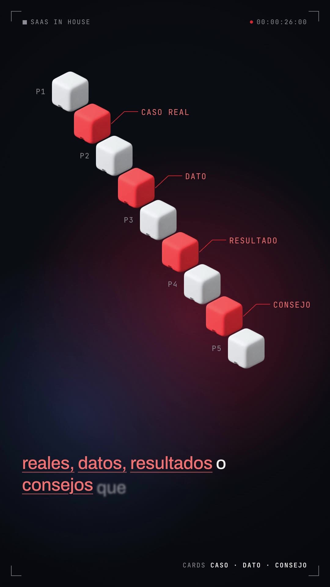

# Hero-object film (voice)

One **white 3D object** stands for the idea, a calm narrator explains it, and the object multiplies, splits and sleeps in an **isometric field of cubes** on a dark navy/maroon glow. Product-film HUD in the corners, captions bottom-left that rise in word by word with the key words underlined in the accent colour, and one **light "blueprint" interlude** with an exploded line drawing and mono callouts.



- **Reference:** "boxd in 60 seconds" by @boxd_sh (https://x.com/boxd_sh/status/2104537788859216343, 60s, 16:9, narrated, ~310k views). The original's frame is in `original-boxd-26s.jpg`.
- **Ours:** `../../x-batch/boxd.mp4`, 58.9s, 1080×1920, SaaS in House quiz-funnel script.
- **Use it for:** explaining *one concept* (a product, a method, "a Quiz Funnel") as an object you can copy, fork, sort and switch off. Calm, premium, developer-friendly. Pick H (`benchmark-film/`) instead when the story is results and proof, D (`trace-film/`) for a process with logs.
- **Cost:** 1 Gemini image ($0.03, the hero cube) + ~1,100 TTS characters + 1 music call + 2 SFX calls. Everything else (the field, the blueprint, cards) is code.

## 1. Anatomy (canvas 1080×1920, 30 fps)

| Element | Spec |
|---|---|
| Background | `#0a0c13` + two big radial glows (maroon `rgba(150,38,52,.55)`, navy `rgba(36,52,96,.55)`) drifting slowly across the whole film (`#g1`, `#g2`) + vignette |
| HUD | 4 corner brackets (36px inset), top-left `■ SAAS IN HOUSE`, top-right red dot + running timecode `00:MM:SS:FF`, bottom-right one status per scene (`VISITANTES 214 · EJEMPLO`, `FUNNEL 01`, `PREGUNTAS 5–8`, `SEGMENTOS 3`, `ESTADO UN LEAD`, `OFERTA ACTIVA`…). JetBrains Mono 21px, letter-spaced |
| Captions | Archivo 58px/500 at left 72, top 1480, max 2 lines. Chunks break at `. ? :`, at a comma after 24+ chars, or at 44 chars. Every word rises in (`y 18→0`, blur 6→0, 0.35s) at its own start time. Keywords (`KEY` set of word indices) are accent + underlined. Colours are CSS vars `--cap/--key` flipped with `tl.set` on the light scene |
| Hero object | `assets/cube.png`: soft matte white rounded cube with a notch, cut from magenta with `tools/key_neutral.py`. `cube_red.png` = the same cube tinted in code (no second image) |
| Cube field | Two canvases (`#fa` blurred 2.5px for the "far" cubes, `#fb` crisp) drawn by `drawField(T)`, a **pure function of time** called from one master proxy tween, so it is seek-safe. `cube(ctx,x,y,s,col,a)` draws an isometric cube from 3 faces (top lighter, right ×0.68) with round-joined strokes for soft corners |
| Light interlude | `#ebeae6` paper + faint dot grid, exploded stack of 5 plates (SVG iso polygons), dashed iso bounding box, leader lines (`strokeDashoffset`) to mono callouts, big light-weight number `5–8` with a rule, like the original's `<10 ms` |
| Terminal bars | dark rounded bar, square bullet, `tú $` prompt, typed text + blinking block caret; the wrong command gets a red strike |

## 2. Beat map we used (cues by word index, `t(i) = W[i][1] + VO`)

| Scene | Script | Visual |
|---|---|---|
| S1 0–4.45 | ¿Quieres vender tu SaaS sin mandar a todo el mundo a la misma landing? | 120 maroon cubes (a few white) stream and shrink into one "Pide una demo" landing slab; visitor counter (ejemplo) |
| S2 | Haz esto. | empty glow, one small white square pops |
| S3 | En lugar de pedir una demo directamente, crea un Quiz Funnel. | `pedir-demo --a-todos` struck in red on "demo"; `crear quiz-funnel` typed; hero cube pops on "Quiz" with a thump |
| S4 (light) | Primero haces entre cinco y ocho preguntas… quién… qué quiere… problema. | stacked plates slide apart on "cinco"; `5` then `–8`; callouts 01–04 on their words |
| S5 | Pero no hagas solo preguntas. Entre medias, añade cards con casos reales, datos, resultados o consejos… «vale, esto tiene sentido». | 5 white "question" cubes packed on a diagonal; on "Entre medias" gaps open; a red cube flies into each gap on casos / datos / resultados / consejos with a labelled leader line; chat bar types «vale, esto tiene sentido» |
| S6 | Después, según sus respuestas, le muestras un resultado personalizado. | iso grid drops in, then splits into 3 coloured segments (white / red / slate) with labels A/B/C + "SEGMENTOS · EJEMPLO" |
| S7 | Y aquí viene la parte importante. | the field turns grey (hibernates), one hero cube stays lit with a ring pulse |
| S8 | Las últimas cards… producto… por qué encaja… oferta específica… contador… canjearla. | 3 dim card skeletons appear on "cards", each lights up on its word: why it fits (ejemplo), Plan Growth −30 % (ejemplo), `00:14:59` ticking + cursor clicks "Canjear →" |
| S9 | Así no solo captas el lead. Lo segmentas, lo educas y lo llevas directamente hacia la compra. | `quiz-funnel run ✓ lead captado`; cube in a frame, lines draw to Segmenta / Educa / Compra (red); cube glides toward Compra |
| S10 | (music) | cube + SaaS IN House wordmark, "QUIZ FUNNELS QUE VENDEN", faint maroon field below |

## 3. Recipe

```bash
cp -R playbook/hero-object-film/template my-video && cd my-video
source <(grep ELEVENLABS_API_KEY ~/.zshrc)
# 1) voice (shared key: this script retries 429/5xx, never run TTS calls in parallel)
python3 ../playbook/founder-depth-type/tools/tts_retry.py "$(cat assets/script.txt)" assets/vo.mp3 assets/words.json qUPtETgSYRhCRb2pfOla 1.04 0.55
#    calm read came out 58.7s; we sped it up 6% instead of re-generating (free, pitch kept):
ffmpeg -i assets/vo.mp3 -af atempo=1.06 vo2.mp3 && python3 -c "import json;w=json.load(open('assets/words.json'));json.dump([[a,round(b/1.06,3),round(c/1.06,3)] for a,b,c in w],open('assets/words.json','w'),ensure_ascii=False)" && mv vo2.mp3 assets/vo.mp3
python3 ../playbook/tools/embed_words.py index.html assets/words.json --full
# 2) music + SFX, sequential
T=../playbook/tools
bash $T/el_audio.sh music assets/music.mp3 "calm minimal ambient electronic product film score, soft warm synth pads, gentle pulsing low arpeggio, subtle glassy textures, slowly building, clean modern tech launch, no vocals" 58000
bash $T/el_audio.sh sfx assets/thump.mp3 "soft deep sub bass thump with a short airy shimmer, an object materialising, clean minimal UI" 1.0
bash $T/el_audio.sh sfx assets/swell.mp3 "soft rising airy whoosh swell, cinematic minimal transition" 1.5
#    blip / click / type / whoosh / chime are reused from benchmark-film
# 3) hero object (1 image), then key it
python3 $T/gen_image_ar.py cube.png "A single premium product render of a soft matte white rounded cube (like a tiny minimalist computer), three-quarter isometric view from slightly above, generously rounded edges, one small rounded notch in the bottom-left front corner, a thin seam line around the lower part like a lid. Soft diffuse studio light from the upper left, pure clean white plastic, no logo, no text. Centered, ~55% of the frame width, whole object visible with margin. No ground shadow. Background: perfectly flat solid pure magenta #FF00FF." --ar 1:1
python3 ../playbook/hero-object-film/tools/key_neutral.py cube.png assets/cube.png 900 1.05
# 4) edit index.html: B = scene starts (also the <section> data-start/duration), KEY = keyword indices, cues t(i)
npm run check && npx hyperframes snapshot --at 2.5,9,15,24,33.5,36,47,53,57.5
npx hyperframes render -o ../my-video.mp4
ffmpeg -ss 56 -i ../my-video.mp4 -af volumedetect -f null - 2>&1 | grep mean_volume   # the ending alone, see gotchas
```

Scene boundaries: `B.sN = t(first word of the beat) − 0.1…0.15`. The section `data-start`/`data-duration` are static numbers; recompute them (and `B`, `END`, the `<audio>` durations) from `words.json` whenever the voice changes.

## 4. Gotchas

- **Magenta spill on a white object.** Gemini's magenta bounced onto the cube and made it pink. `tools/key_neutral.py` rebuilds a neutral object from the spill-free **green channel** and takes alpha from `min(R,B) − G`. Only for white/grey objects; for coloured ones tint in code (`cube_red.png` was made from the white cube).
- **Field = pure function of time.** Every cube's position/colour is computed from `T` and a seeded `rng`; nothing is stored between frames, so seeking and parallel render workers agree. Keep it to ~250 cubes × 3 faces; no per-cube `ctx.filter` (the blur is a CSS filter on the whole far canvas).
- **Keep the field out of the caption band** (y > ~1440): the first draft spawned stream cubes down to y 1890 and they sat under the words.
- **The ElevenLabs music died at ~51s of 58** (and had a near-silent break at ~33s): the lockup was almost silent. Probe the track in 1–2s windows, then splice a loud section on the end with two WAV files + `acrossfade` (a single-filtergraph `asplit/atrim` on the mp3 returned a 39–47s file twice):
  `ffmpeg -i src.mp3 src.wav; ffmpeg -i src.wav -t 49.2 a.wav; ffmpeg -ss 36 -t 12 -i src.wav b.wav; ffmpeg -i a.wav -i b.wav -filter_complex "[0][1]acrossfade=d=1.2,afade=t=out:st=56.6:d=2.3" -t 58.9 music.mp3`
- **Light scene contrast:** HUD and captions flip with `tl.set("#hud", {color, "--hb"})` / `tl.set("#caps", {"--cap","--key"})`; dark-scene greys under `#8a8894` fail the 4.5:1 check.
- **Dim-then-light cards:** a second `fromTo` on an element that already faded in must use `immediateRender: false`, or its *from* state jumps the card back at time 0.
- **Blueprint leader lines** cross the plates (as in the original). If you want them clean, anchor each line on the plate's right edge and keep the callouts at x ≥ 600.
- **Numbers:** visitor counter, segments, "SaaS B2B con leads fríos", "Plan Growth −30 %" are invented and carry an `EJEMPLO` chip / label. The countdown starts at 14:59 and ticks in real time (reaches ~14:47).

## 5. Files

- `template/` HyperFrames 0.8.137 project (`index.html`, `assets/`: vo, words, script, music (spliced), thump, swell + 5 reused SFX, cube.png, cube_red.png, Archivo, JetBrains Mono, Silkscreen).
- `tools/key_neutral.py` neutral-object magenta key with spill removal.
- `reference-frame-*.jpg` frames from our mp4 (2.5s stream, 13s blueprint, 26s interleave, 35.5s hibernate, 46.5s offer); `original-boxd-26s.jpg` the reference.
