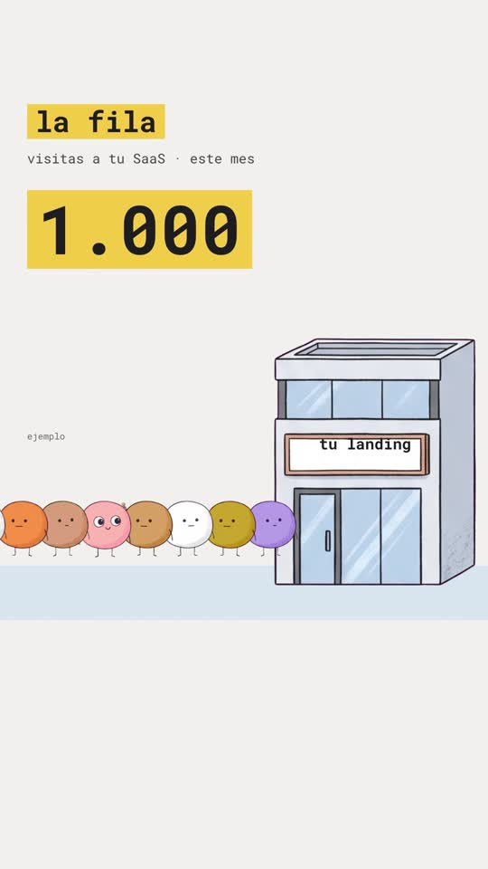
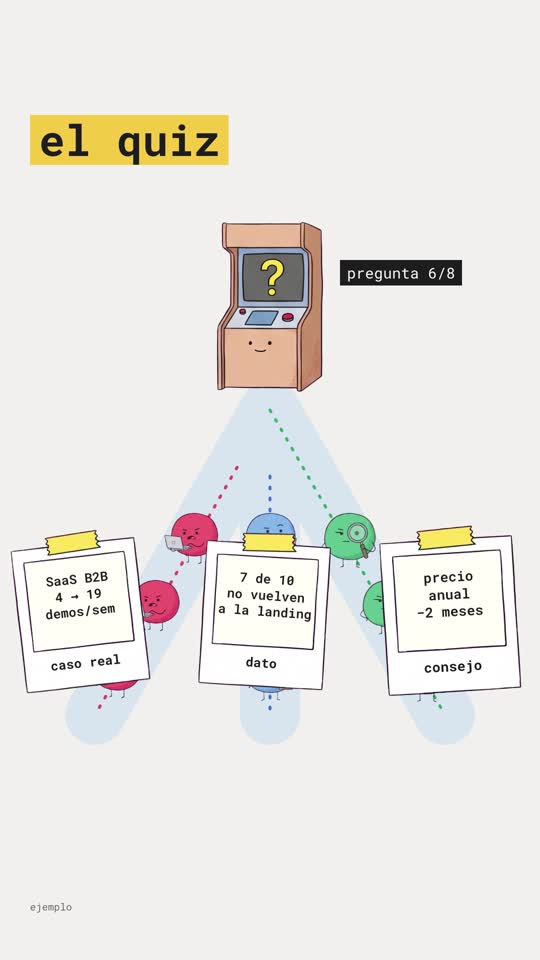

# Playbook E: Illustrated data explainer

A warm, editorial "data documentary" look in the style of Jorge Galindo's housing-crisis video:
- cute hand-drawn **blob characters** that queue, walk with little hops, react, and ride charts;
- houses, buildings and props drawn in the same style;
- **data as part of the drawing**: unit grids of dots, line charts drawn live with a character on the tip;
- Roboto Mono labels on yellow highlights and black/colour tags, over a paper-white background with pale-blue panels;
- smooth, bouncy transitions.

All motion, charts and text are code (HTML + SVG + GSAP in HyperFrames). The illustrations are **two generated image sheets** (characters + props, ~$0.03 each) cut out automatically. **No AI video.**

Example: `../../sih-fila-film.mp4`. A 57.6s, 9:16 explainer for **SaaS in House**: "la fila" of 1,000 visitors at the same landing → 2 in 100 convert → the types in the queue → the quiz splits the queue into lanes → cards and offers → the chart changes → "misma fila, mismo tráfico, distinta puerta". The project is `template/`.

 

This playbook is for **any coding agent (Claude Code, Codex, …) or a human**. Commands assume you are in the folder that contains `playbook/`.

---

## 1. What the format is

**Reference:** https://x.com/JorgeGalindo/status/2106751366685409474, "La crisis de vivienda en España", 7.5 min, 16:9 + vertical, 1.7M views on X, ~750k on Instagram. The author explained how he made it (https://x.com/JorgeGalindo/status/2107191572999667881). This is worth reading, because the process matters more than the tool:

- **He owned the narrative and the data.** He gave Claude a detailed narrative structure, ~100 lines of background, 8–9 charts, and his data sources. The script came out fast because he knew what to say.
- **He set the visual language up front:** "MUY visual y gráfico, pero con datos"; recurring ideas (houses, queues, magnitudes, numbers and charts that grow and shoot up); Roboto Mono; his chart palette; no voice yet; "first give me the script and 2–3 frames to validate".
- **The first visual tests were bad.** What fixed them was a **moodboard of screenshots** from videos and charts he liked, then exact **hex colours**, then a **20-second test clip** before the full video. He kept asking for smooth, dynamic, bouncy transitions.
- **He fact-checked every number** independently.
- **Voice last:** an ElevenLabs clone of his own voice (trained on 2h+ of good recordings). The mp3 went back to Claude to assemble the video, which was shortened by ~45s to fit the audio.
- **Effort:** ~36h elapsed, ~4h of his full attention, a Claude Max subscription.

**Our cheaper, faster route:** a short vertical (~1 min) instead of 7.5 min. Characters and props come from **image generation with his frames as the style reference**, and everything else is code, in one pass.

| Element | How we build it |
|---|---|
| Blob characters (8: 3 "types" with props + 5 plain) | 1 Gemini image sheet on magenta, cut with `cutout_grid.py`; colour variety via CSS `hue-rotate` on the plain ones |
| Props (shop, quiz kiosk, house, polaroid, stanchion, stopwatch) | 1 Gemini sheet, same way; labels like "tu landing" are HTML text placed on the blank sign |
| Walking | `walk()`: x/y tween + `hops` (y −14px, ±3° yoyo) on the inner image |
| Queue ropes, lanes, charts, grids | SVG paths/lines drawn with `strokeDashoffset`; dots are divs that pop in |
| Character riding the chart | GSAP `keyframes` through the chart points, in sync with the line draw |
| Labels | `.hl` (yellow highlight, bold), `.tag` (black / blue / red / green), `.sub`, `.note` (sources, "ejemplo") in Roboto Mono |
| Transitions | `popIn()` = `back.out(2.4)` scale + fade; bands/lanes grow; scenes end by fading their texts |

**Palette:** paper `#f1f0ec`, ink `#1d1d1f`, yellow `#f6c945`, blue `#3f72e0`, red `#e0475b`, green `#2fa866`, pale panel `#d7e4f0`, gridlines `#cddbe9`, note grey `#66666b`.

## 2. Prerequisites

- `ffmpeg`, Node + `npx` (HyperFrames CLI; the template pins `0.8.137`), Python 3 with `numpy pillow scipy`.
- `ELEVENLABS_API_KEY` (`source <(grep ELEVENLABS_API_KEY ~/.zshrc)`), plus the `treg` CLI for 2 images (~$0.06).
- HyperFrames basics: one paused GSAP timeline at `window.__timelines["main"]`; scenes are `<section class="scene clip" data-start data-duration>`; every `<audio>` has a unique `id` (`sfx()` creates them); seeded `rnd()`, never `Math.random`; local `@font-face` fonts.

## 3. Recipe

```bash
cp -R playbook/illustrated-data/template my-film && cd my-film && T=../playbook/tools
```

**1) Narrative first** (the author's main lesson). Write the beats as data and one recurring metaphor. Ours: *queue → same door → 2/100 → types → quiz splits the queue → cards → offers → chart → same queue, different door*. Pick the 1–3 numbers that carry the story, and mark them "ejemplo" unless they're real and sourced.

**2) Script + voice** (~150 words ≈ 55s). We used Guillermo Brazález (`qUPtETgSYRhCRb2pfOla`, Spain Spanish, calm narrator) at speed 1.08. With a cloned voice of the author, use its voice id instead.
```bash
source <(grep ELEVENLABS_API_KEY ~/.zshrc)
python3 $T/tts_with_timestamps.py assets/script.txt assets qUPtETgSYRhCRb2pfOla 1.08
python3 -c "import json;w=json.load(open('assets/words.json'));print(' '.join(f'{i}:{x[0]}@{x[1]}' for i,x in enumerate(w)))"
```

**3) Illustration sheets.** The style reference is a public image of the look you want: we used the author's published frame grid `https://pbs.twimg.com/media/HT4yb2jXgAAja7z.png`. Use your own moodboard image for a different look.
```bash
REF="https://pbs.twimg.com/media/HT4yb2jXgAAja7z.png"
python3 $T/gen_image.py assets/sheet_characters.png "In the exact illustration style of the reference image (cute round blob characters with tiny stick legs and small arms, simple dot eyes and small mouths, slightly wobbly hand-drawn thin dark outlines, flat soft colors with subtle crayon texture), draw EIGHT separate full-body blob characters, all facing the viewer, standing, arranged in a grid of 2 rows by 4 columns with lots of empty space between them, none touching. 1) yellow blob, curious happy face, 2) red blob holding a small open laptop, hurried stressed face, 3) blue blob holding a clipboard, skeptical face, 4) green blob holding a big magnifying glass, suspicious face, 5) purple blob, neutral face, 6) orange blob, neutral face, 7) white blob, neutral face, 8) pink blob, neutral face. All the same size. Background: perfectly flat solid pure magenta #FF00FF. No text, no shadows, no ground." "$REF"
python3 $T/gen_image.py assets/sheet_props.png "In the exact illustration style of the reference image (slightly wobbly hand-drawn thin dark outlines, flat soft colors, subtle crayon texture, friendly editorial illustration), draw SIX separate objects arranged in a grid of 2 rows by 3 columns with lots of empty space between them, none touching, all fully visible: 1) a small modern three-storey shop building with a big glass entrance door and a blank sign board above the door, 2) a friendly quiz kiosk booth with a screen showing a big yellow question mark, 3) a small cozy house with a green front door and a red roof, 4) an empty white polaroid photo frame with a strip of yellow tape on top, 5) a single brass queue stanchion post with a short red velvet rope hanging from it, 6) a cartoon stopwatch. Background: perfectly flat solid pure magenta #FF00FF. No text anywhere, no shadows, no ground." "$REF"
python3 $T/cutout_grid.py assets/sheet_characters.png assets 300 c_yellow c_red c_blue c_green c_purple c_orange c_white c_pink
python3 $T/cutout_grid.py assets/sheet_props.png assets 520 p_shop p_kiosk p_house p_polaroid p_stanchion p_watch
```
**Check the printed object count**: `cutout_grid.py` warns when it finds fewer objects than names (see gotchas). The model laid out the 8 characters as 4 rows × 2 columns, not 2 × 4. The tool names objects in reading order either way, so check the cut PNGs visually.

**4) Music + SFX** (one SFX call at a time):
```bash
curl -s -o assets/music.mp3 https://api.elevenlabs.io/v1/music -H "xi-api-key: $ELEVENLABS_API_KEY" -H "Content-Type: application/json" \
  -d '{"prompt":"light playful explainer music for an animated data documentary, plucky pizzicato and soft marimba, gentle bouncy rhythm, curious and warm, low intensity background, no vocals","music_length_ms":58000}'
sfx(){ curl -s -o "assets/$1" -w "$1 %{http_code}\n" https://api.elevenlabs.io/v1/sound-generation -H "xi-api-key: $ELEVENLABS_API_KEY" -H "Content-Type: application/json" -d "{\"text\":\"$2\",\"duration_seconds\":$3,\"prompt_influence\":0.7}"; }
sfx pop.mp3 "cute soft cartoon pop, bubbly" 0.5
sfx steps.mp3 "many tiny cartoon footsteps shuffling, light and cute" 2
sfx ding.mp3 "small bright bell ding, cartoon" 0.8
sfx swoosh.mp3 "soft cartoon swoosh transition" 0.8
sfx wrong.mp3 "soft cartoon disappointed boing descending" 1
curl -sL -o assets/RobotoMono.ttf "https://github.com/google/fonts/raw/main/ofl/robotomono/RobotoMono%5Bwght%5D.ttf"
```

**5) Edit `index.html`.**
- **Timing.** Cues use `t(wordStart)` with `VO = 0.3`. Scene `data-start`s sit on the first word of each beat. The root `data-duration` is the voice length + ~2.5s.
- **Helpers** (top of the script):
  - `spr(parent, name, x, y, width, style)` places a cut-out PNG, positioned by transform;
  - `tag(parent, text, x, y, cls, style)` creates labels;
  - `popIn(el, at)` and `fadeOut(el, at)`;
  - `walk(el, x, y, at, dur)` walks with hops;
  - `sfx(file, at, vol, dur)`.
- **Scenes:**
  - S1: the queue (ropes, stanchions, shop with the HTML sign, counter, speech bubble, "?" marks, 10×10 unit grid, U-turn walk-off with `scaleX: -1` + grayscale);
  - S2: "el reparto" (band, 3 hero types with colour tags and speech-bubble needs);
  - S3: quiz kiosk, 3 SVG lanes, characters split by type, polaroid cards, offer houses + stopwatches;
  - S4: the line chart with a rider;
  - S5: the closing lines, CTA and logo.
- **The sign on the shop** is HTML over the blank board: measure the board on the cut PNG (here ~41–56% of its height, ~11–79% of its width) and place the text there.
- **Polaroid content** is a div *behind* the polaroid PNG (its photo area is transparent after keying: 10–90% x, 9–73% y).

**6) Check, look, render.**
```bash
npm run check          # 0 errors. Expected warnings: escaped_container (characters walking off-screen) and rotation_pivot_drift (hop rotation while the parent moves)
npx hyperframes snapshot --at 4.6,10.2,13.9,15.7,26.0,30.5,33.5,39.5,44.4,47.9,51.4,56.5 --no-end
npx hyperframes render -o ../my-film.mp4        # ~52s for 57.6s
ffmpeg -i ../my-film.mp4 -af volumedetect -f null - 2>&1 | grep mean_volume
```
Then grab a frame from the **final mp4** at the end of every scene. The chart label covering the rider only showed up there.

## 4. Gotchas we hit

- **`cutout_grid.py` dropped the thin stanchion** (its pixel area was under 20% of the biggest object), so every later name shifted by one and the stopwatch was saved as `p_stanchion`. The threshold is now 4% and the script warns on a count mismatch. Always check the montage.
- **Number formatting:** `toLocaleString("es-ES")` prints `1000`, without the dot, for 4-digit numbers. Use `String(n).replace(/\B(?=(\d{3})+(?!\d))/g, ".")` → `1.000`.
- **Text over generated props** needs measuring. Our first sign text landed on the windows, not on the board.
- **The unit grid overlapped the building**: keep data graphics in their own column (grid x 60–580, building x 600+).
- **Labels covering the chart rider**: put the end-value labels above and to the left of the last point; the rider sits at the point.
- **Contrast**: grey notes `#8a8a8f` on paper failed (3.0:1); `#66666b` passes.
- **Big labels near the edge** ("2 de cada 100" at x=700) get cut. Keep `.hl` tags left-aligned at x≈60, or measure their width.

## 5. Before publishing

- Every number on screen in the template is an **example** (1.000 visits, 2/100, 4 → 19 demos, 7 de 10, 2% → 6,8%) and is labelled "ejemplo". Replace it with sourced data, and fact-check as the author did.
- **The style is inspired by Jorge Galindo's video**, with his published frames as the image reference. Style isn't copyrightable, but don't reuse his exact characters or frames. Our characters are newly generated.
- The CTA promises "te enseño cómo montarlo". Have it ready.

## 6. Cost and time

- 2 images (~$0.06), plus ElevenLabs: ~830 characters of TTS, a 58s music track, 5 SFX.
- Render ~52s. A new 1-minute film from the template is ~1–2h of agent time, most of it scene choreography (positions, walks, timings). A longer piece (several minutes, like the original) means more scenes and more iteration on a moodboard and a 20-second test clip first, exactly as the author did.
