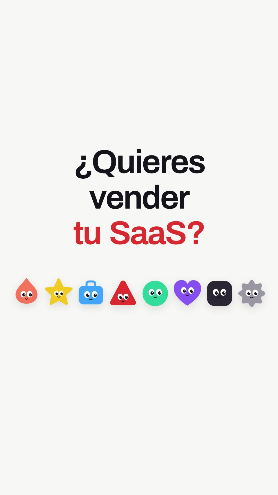
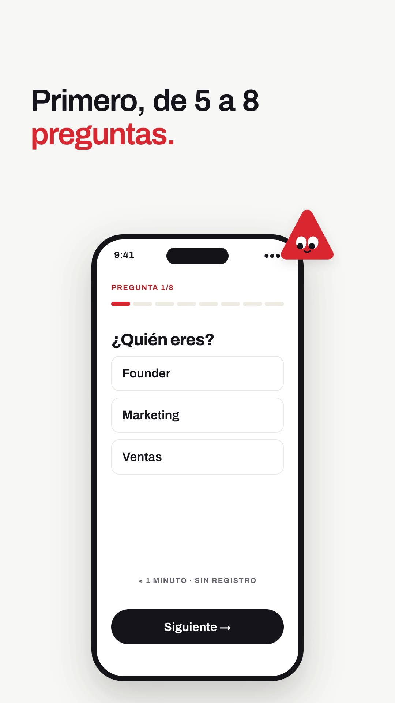
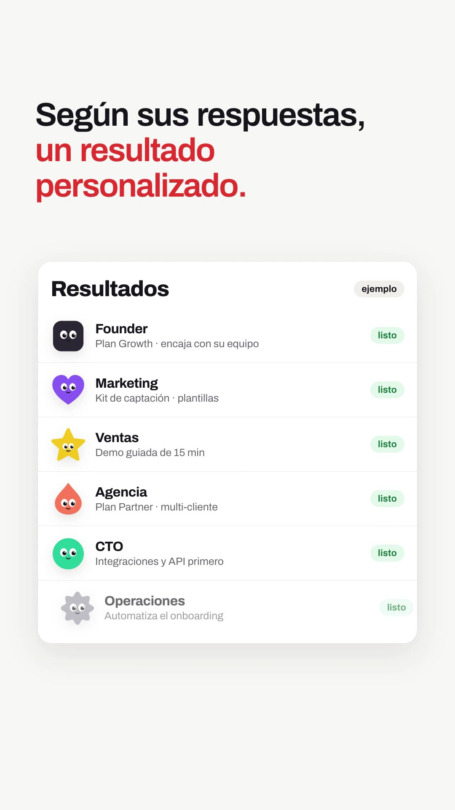
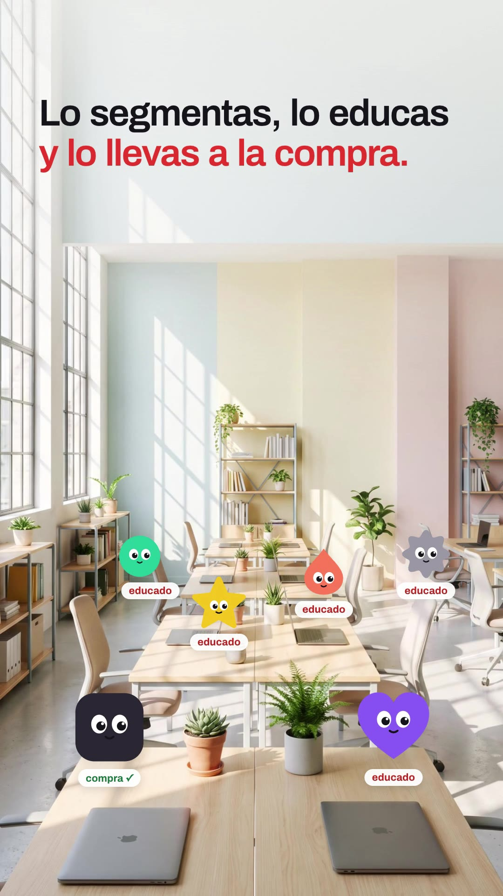

# Playbook: Mascot cast film (flat SVG mascots + Cue-style two-line captions + phone UI)

A friendly, premium launch film on a **light grey canvas**. A **cast of flat geometric mascots with googly eyes** (triangle, star, heart, drop, circle, rounded square, gear, bag) carries the story: they line up, get bored, pop next to UI cards, sit at desks in a photo, and close the film in a row. Every beat has a **two-line caption** (line 1 ink, line 2 brand red) whose words **rise out of a mask**. Under it, **phone / card UI** answers itself. Two photo backdrops (a dusk desk and an office) add the "real world" beats. **Music only, no AI video, no voice.** All mascots are code (SVG), so the cast costs $0.

Example: `../../x-batch/cueagents.mp4` (54.5s, 1080×1920, Spanish, SaaS in House quiz-funnel script). The project is `template/`.

   

Original (Cue by Manus, 16:9, 1 frame/s): `reference-original-sheet.jpg`.

**Relation to existing formats.** It belongs to the Part F family. It is closest to **F1 UI launch film** (`../ui-launch-film/`: light canvas, UI builds under captions) and borrows the "cast" idea of **F6 Airy launch** (`../airy-launch/`, felt puppets). What is new here, and the only things this folder documents in depth: (1) the **code-built SVG mascot system** (`mascot()`, `blink`, `look`, bored eyes, `castRow`), (2) the **masked word-rise two-line caption** (`cap()`), which does not need word timings because there is no VO, and (3) **mascots placed into a Gemini photo** with label pills that change state. For the rest (UI cards, quiz answering, offer + countdown, logo lockup, SFX) follow `../ui-launch-film/PLAYBOOK.md`.

This playbook is for **any coding agent (Claude Code, Codex, …) or a human**. Commands assume you are in the folder that contains `playbook/`.

---

## 1. What the format is

Reverse-engineered from **"Meet Cue"** by Cue Agents / Manus (https://x.com/CueAgents/status/2104589146153181192): 75s, 16:9, music only, 1.8M views, 3.1k♥, 1.5k bookmarks. Its grammar:

| Ingredient | Cue (reference) | Ours (template) | Technique |
|---|---|---|---|
| Canvas | Flat `#f4f4f4`, no texture | `#f6f6f4` | flat background |
| Cast | 9 flat agents (blue triangle, star, heart, drop, gear-blob, bag…) with big white eyes, they blink and look around | 8 shapes in brand-friendly colours, hero = **red triangle**; eyes blink, look, half-lid "bored" | `mascot(el)` builds an SVG from `data-k` (shape) + `data-c` (colour); `.eyes` group per mascot gets `scaleY` (blink/bored) and `.pup` pupils get `x/y` (look) |
| Captions | "Your personal team of / **AI agents.**": 1–2 lines, left (next to UI) or centred (statements), accent line in blue; letters rise from a mask | Same, accent = brand red `#e8382d`; 84px top-left over UI, 118–156px centred for statements | `cap(host, [[text, accent?]...], at, outAt, stagger)`: each word in `.wm` (overflow hidden) → `.wi` `yPercent 110→0` |
| UI | iPhone mocks: contact card, call screen, booking, payment Allow/Deny, Agents list, group chat | Landing "Pedir demo" (struck + ✗), quiz on a phone answered with tap ripples, proof cards with mascots, "Resultados" list (= Cue's Agents list), plan + offer + countdown + "Canjear oferta" → green ✓ | plain HTML/CSS, `pop()`, `.tap` ripple |
| Dark beat | "Every QR code out there… could be an agent." white on black | "Y aquí viene… / …la parte importante." with a ?→! app icon | scene background `#0b0a0d` |
| Photo beats | Café with a QR code; street of shops with agents above each shop + labels | Dusk desk (behind the offer phone, blurred, slow push-in); office with 6 mascots on desks + labels that change *segmentado → educado → compra ✓* | 2 Gemini 9:16 images, `scale 1.08→1` push, white top gradient for the caption |
| Outro | "Give it a **cue**." + cast row; logo; "by manus" | "Dale un **quiz**." + cast row → hero mascot + SaaS IN House wordmark + "comenta «quiz»" | |

**Beats (54.5s):** S1 hook + cast (0–3.4) · S2 same landing, everyone bored (3.4–8) · S3 "Haz esto." hero wink (8–9.6) · S4 demo struck → Quiz Funnel (9.6–14.2) · S5 phone quiz Q1–Q3 (14.2–21) · S6 statement (21–22.8) · S7 proof cards with mascots, ✓ + nod (22.8–29.6) · S8 Resultados list (29.6–34.6) · S9 dark beat (34.6–37.2) · S10 dusk phone: fit ✓✓✓, offer, countdown, canjear (37.2–45) · S11 office cast (45–49.6) · S12 "Dale un quiz." + logo (49.6–54.5).

## 2. Prerequisites

`ffmpeg`, Node + `npx` (HyperFrames 0.8.137), Python 3, `treg` CLI (images). **No ElevenLabs needed**: music + SFX are reused (see §3.1).

## 3. Recipe

```bash
cp -R playbook/mascot-cast-film/template my-film && cd my-film && T=../playbook/tools
```

**1) Audio (music only).** The template's bed is `playbook/ui-launch-film/template/assets/music.mp3` (59s light electronic launch music) cut to the film length with a fade:
```bash
ffmpeg -y -i ../playbook/ui-launch-film/template/assets/music.mp3 -t 54.5 -af "afade=t=in:d=0.3,afade=t=out:st=52.3:d=2.2" assets/music_cut.mp3
```
SFX (whoosh / pop / click / tick / chime) are the ui-launch-film ones, in `assets/`. If you have ElevenLabs credits, regenerate with `$T/el_audio.sh` (429 backoff). Music volume 0.85 (nothing to duck under).

**2) Images (2 × ~$0.03).**
```bash
python3 $T/gen_image_ar.py gen/office.png "Photorealistic wide shot of a bright modern startup coworking office interior seen at eye level, sunny daylight through big windows, pastel walls, light wooden desks in rows with closed laptops and small plants, several empty chairs, shelves, no people at all, calm clean airy look, soft colors, sharp focus, vertical composition with the floor and desks in the lower half and open wall space in the upper third, no text, no logos" --ar 9:16
python3 $T/gen_image_ar.py gen/dusk.png "Photorealistic close view of a wooden desk next to a large window overlooking a city skyline at blue-hour dusk with warm lights in buildings, a ceramic coffee cup and a closed notebook on the desk, warm table lamp glow, shallow depth of field, cinematic, calm, no people, no text, no logos, vertical composition with empty space in the middle of the frame" --ar 9:16
for f in office dusk; do ffmpeg -y -i gen/$f.png -vf scale=1080:-1 -q:v 3 assets/$f.jpg; done
```
Ask for **empty wall space in the upper third** (caption zone) and **desks in the lower half** (mascot zone). After a new office image, re-place the mascots: edit the `DESK` array `[shape, colour, x, y, size, label]` (bigger = closer to camera).

**3) Edit `index.html`.** No word timings: every cue is an absolute second. Per scene:
- `cap("sN-cap", [["línea 1"], ["línea 2", true]], at, outAt)`. Keep a line ≤ ~26 characters at 84px (≈ 860px); the second (accent) line carries the punch word. Leave ~2.0–2.4s per caption (reading time without voice).
- Mascots: any `<div class="m" data-k="tri|star|heart|drop|circle|square|gear|bag" data-c="#hex">` with a width/height becomes a mascot on load. Animate with `mpop(sel, at)`, `blink(sel, at)`, `look(sel, at, x, y)` (pupils, in SVG units ±5), `hop`, `bob`, and "bored" = `tl.to(eyesOf(sel), {scaleY: .45, transformOrigin: "50% 100%"})`. Wink = animate only `eyesOf(sel) + " g:first-child"`.
- `castRow(hostId, y, size, n, prefix)` lays out a row of the 8-shape cast across the width.
- UI copy is plain HTML. Keep "ejemplo" on every invented number (caso real, dato, resultados, oferta).

**4) Check, look, render.**
```bash
npm run check     # 0 errors; the 14 structure warnings (file size, nested sections) are expected
npx hyperframes snapshot --at 1.8,5.2,10.9,15,19,26.2,32.8,35.2,43,48.9,53.8 --no-end
npx hyperframes render -o ../my-film.mp4      # ~66s for 54.5s
```
Then pull frames from the final mp4 and look at them.

## 4. Gotchas we hit

- **`fromTo` renders its start state at build time.** A tap ripple `fromTo({opacity:.9}→{opacity:0})` scheduled at 18s showed a grey dot from t=0. Add `immediateRender: false` to the *to* vars of any `fromTo` whose start state is visible.
- **A strike line drawn over caption 1 stays on screen for caption 2** if it lives outside the caption group. Fade it out at the caption's `outAt`.
- **Mask-rise captions trip the layout linter** (`container_overflow` of `.wi` in `.wm` during the rise). Mark `.wm` with `data-layout-allow-overflow` (done in `cap()`). Also mark full-bleed photos (`data-layout-allow-overflow`) and stacked button states (`data-layout-allow-overlap`).
- `wm` needs `padding-bottom` + matching negative margin, or descenders (g, p, q, comma) get clipped by the mask.
- Lines wrap at ~26 chars at 76px+: "sin mandar a todo el mundo" needed 66px.
- SVG eye groups: GSAP needs `transformOrigin: "50% 50%"` (blink) or `"50% 100%"` (bored lids) or they scale from the SVG origin.
- Don't put `Math.random` in the mascot builder (deterministic render); the gear outline is a cosine formula.

## 5. Before publishing

- All numbers (4→19 demos, 7 de 10, 99€→69€, −30%, 14:59) are placeholders labelled "ejemplo"/"oferta de ejemplo"; replace with real data or keep the label.
- The mascots stand for **lead types**, not real customers. There are no generated people in this format.
- The CTA "comenta «quiz»" needs a real deliverable behind it.

## 6. Cost and time

2 Gemini images ≈ **$0.06**; ElevenLabs **0 chars** (music/SFX reused); render ~66s on a laptop. About 1.5 h end to end including analysis.
