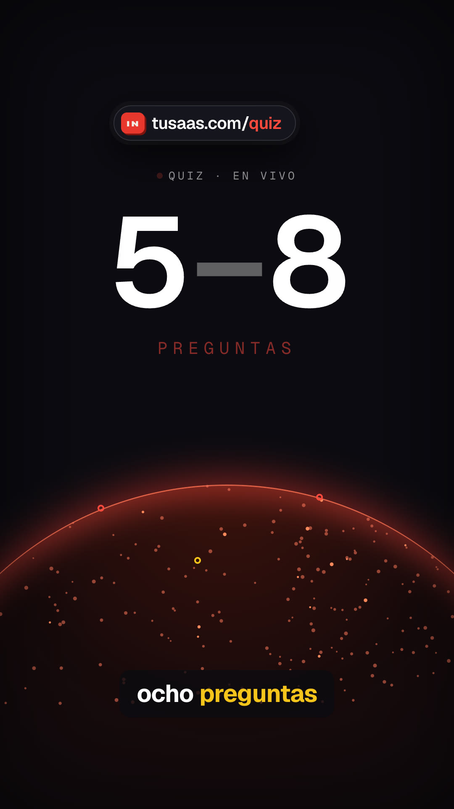
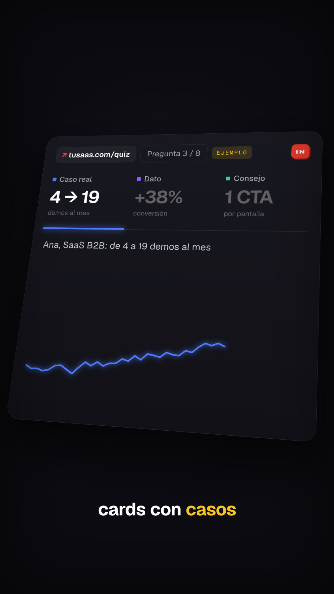
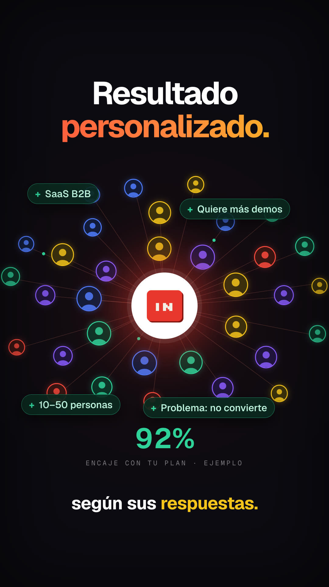
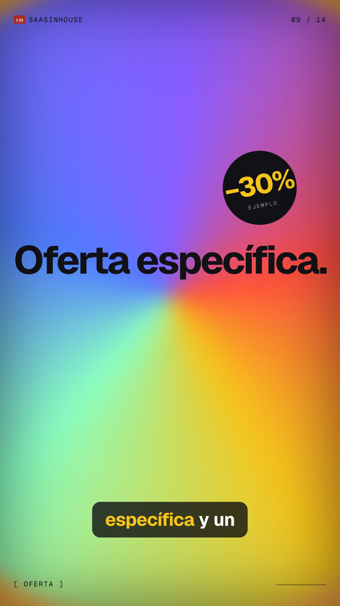
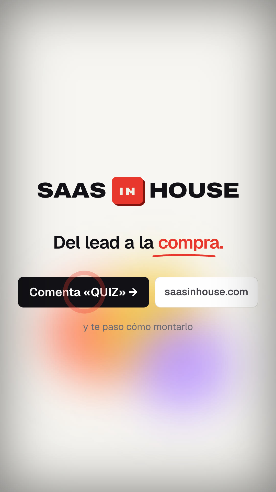

# Playbook: Metric-story reel (voice + bed, zero images)

    

A dark, fast SaaS launch reel where **one product object travels through every beat**. A long ugly URL types itself, collapses into a short pill, and the pill drives an odometer over a glowing planet. A 3D-tilted dashboard card cycles tabs with toasts, then a network forms around the brand mark. After that comes a burst of one-word colour-block cards, and a brand-colour iris collapses into the logo on a light end card with a gradient bloom. Everything is HTML/CSS/SVG + GSAP in HyperFrames: **no generated images, no AI video**. It uses a reused VO, a reused music bed and 2 new SFX.

Example: `../../x-batch/steventey.mp4` (35.5 s, 1080x1920, Spanish, SaaS in House, Quiz Funnel script). Project: `../../x-batch/steventey/`; template: `template/`.

## 1. Reference and what we kept

- **Reference:** Steven Tey (@steventey), https://x.com/steventey/status/2103625902211088880. It's a 15.1 s, 16:9 (1920x1080, 60 fps) launch promo for his link-management SaaS, music + SFX only, with 42k views and 292 bookmarks. Making-of from the author of the prompt, who replied in the thread: one Opus 5.5 prompt sent in the product's repo, *"make a dynamic 15-second motion graphics video that shows what an incredible motion designer you are, like it's your showreel for a résumé. go all out. it should be a launch saas video for <site>"*. This is the same prompt family as format L `motion-showreel/` and G4 `color-block-promo/`. Contact sheet (6 fps): `original-contact-sheet.jpg`.
- **Original beats (15 s):**
  1. A long UTM URL types in monospace under "YOUR LINKS, TODAY · 151 CHARS".
  2. It squeezes into a light line, a grey flash, and becomes a short-link pill.
  3. Radar rings pulse, and an orange dotted planet rises with a rolling odometer of clicks; arcs fly to dots on the planet.
  4. A 3D-tilted analytics card with 3 tabs (clicks/leads/sales): the chart redraws in blue → violet → green, then a hover tooltip and stacked "new lead / new sale" toasts.
  5. "Grow with partners." over an avatar network around the logo, green "+$" chips and a payout counter.
  6. ~0.3 s word cards, each with its own look: white, pixel grid, orange typed, outline, conic gradient, violet on white, green $-rain, "One platform".
  7. The logo zooms out of a circle onto white, then the wordmark, "Turn clicks into revenue." with an underlined word, and 2 buttons over a pastel bloom.
- **Kept:** the beat order and every technique above, the card chrome (mark top-left, `NN / 14` top-right, `[ LABEL ]` bottom-left, a hairline bottom-right), the 3D card + tab colour cycling, the odometer columns, the network constellation, the iris → end card with the underline.
- **Changed / original:**
  - 9:16 and 35.5 s, because the narration needs the time.
  - The story is our Quiz Funnel: long landing URL → `tusaas.com/demo` struck → `tusaas.com/quiz` → "5–8 preguntas" odometer → tabs *Caso real / Dato / Consejo* → toasts "«Vale, esto tiene sentido»" → result network with answer chips + "92% encaje" → cards *Lo importante / Últimas cards / Tu producto / Oferta específica / 14:58 Tiempo limitado / Captas el lead / Lo segmentas / Lo educas / Directo a la compra* → SaaS IN House end card.
  - Brand palette (dark `#0b0b10`, red `#e8382d`, gold, cream) instead of the original's orange/violet.
  - Abstract silhouette avatars (no faces).
  - No third-party logos or marks: the original's logo, wordmark and avatars are not used anywhere.
  - Captions (≤3 words, active word gold) because ours is narrated.

**Closest formats:** L `motion-showreel/` (same one-prompt showreel genre, but a chapter HUD and one technique per chapter) and G4 `color-block-promo/` (colour cards with vignettes, music only). This format differs because **a single product object (link → pill → metric → card → network → logo) carries the whole film**, and because of the **word-card burst** synced to the VO's last 10 s.

## 2. Beat map (template; film time = word time + 0.3)

| t (s) | VO anchor | What you see | Technique (`index.html`) |
|---|---|---|---|
| 0–3.72 | "¿Quieres vender…landing?" | grid bg, long URL types (caret right, old chars dimmed), live char counter; sub-line turns red on "landing" | proxy `{n}` tween with `onUpdate` → `textContent` + `left` shift (seek-safe); mask-image fades edges |
| 3.36–3.72 | – | URL squeezes (`scaleX .03` + `blur brightness(3)`), glowing streak, flash | `#s1-streak`, `flash()` |
| 3.72–7.42 | "Haz esto… crea un Quiz Funnel" | pill blur-pops inside 4 radar rings; "Pedir una demo →" ghost button gets a red strike + pill shake; slot rolls `demo → quiz`; second ring burst; "Quiz Funnel." | `.slot` roll (`y −62`), SVG `stroke-dashoffset` strike, ring `fromTo` with `immediateRender:false` for the 2nd burst |
| 7.42–12.54 | "entre cinco y ocho preguntas… su problema" | planet rises (420 seeded dots, right-heavy cluster, slow rotation), odometer columns spin and stop on **5** at "cinco" and **8** at "ocho"; 3 arcs land with ring pings and question chips | `odoCol()` = 30-digit stack, `roll()` to index 25/28; arcs `pathLength=1` |
| 12.54–18.13 | "cards con casos reales y datos… tiene sentido" | 3D card enters from `rotX 38 rotY −26 z −500` and settles; tab bar slides blue → violet → green on "casos", "datos", "pensar"; each chart redraws; tooltip; 3 toasts on "vale" | `perspective` scene + `rotationX/Y/Z`; 3 seeded series; bar `x` + `background` tween |
| 18.13–21.44 | "un resultado personalizado según sus respuestas" | white core + IN badge, ~30 avatar nodes on 3 elliptic rings with lines, heading word by word, green dots travel inward, 4 "+" chips, odometer "92%" | nodes built in JS, seeded; dots = `attr cx/cy` tweens |
| 21.44–32.15 | "Y lo importante… directo a la compra" | 9 full-bleed cards cut on the words (1.0–1.9 s each): black/red, paper + fanned cards, red typed, rotating conic + sticker, gold countdown + digit rain, grey→white "Captas el lead.", violet on white, outline, pixel grid | `.card` + `.chrome`; `blurIn()`; typed via proxy; conic div `rotation`; pixel grid = 300 seeded squares |
| 32.15 | music's final hit | red iris collapses (`scale 1 → 0`) while the IN badge shrinks from ×3.2 | `#s8-iris` |
| 32.15–35.5 | (VO ends 32.95) | SAAS [IN] HOUSE (words clip-reveal out of the badge), "Del lead a la compra." + red underline, buttons "Comenta «QUIZ» →" / "saasinhouse.com", "y te paso cómo montarlo", click ripple, pastel bloom drifting | `clip-path inset` tween; blurred divs |

## 3. Recipe

```bash
cp -R playbook/metric-story-reel/template my-reel && cd my-reel
```

1. **Voice (reuse, no TTS).** Any base-script VO works; ours is `playbook/whiteboard-ad/template/vo.mp3` (Bruno Torres, 32.7 s), and `words.json` is its alignment. Swap: `python3 ../playbook/metric-story-reel/tools/inject_words.py new_words.json index.html` prints `index:word@start`. Then fix the word **indexes** in the script (`T2 = t(14)` "Haz", `T3 = t(26)` "Primero", `T4 = t(43)` "Entre", `T5 = t(59)` "Después", cards `t(66) t(69) t(73) t(79) t(83) t(87) t(93) t(96) t(99)`, odometer stops `t(28)`/`t(30)`, arcs `t(34) t(36) t(39)`, tabs `t(47) t(50) t(54)`, toasts `t(55)`). For a new take, get times with local `npx --yes hyperframes@0.8.137 transcribe vo.mp3 -m large-v3 -l es` and **check them against `silencedetect`** (see Gotchas).
2. **Music (reuse a bed).** We used the robj3d3 showreel bed (`x-batch/robj3d3/project/assets/music.mp3`, 128 BPM, final hit at 30.0 s, dead by 30.5 s). Insert one bar so the hit lands on the last words: `XF=0.06 FADE=0.4 FADEIN=0.02 bash playbook/tools/fit_music.sh src.mp3 assets/music.mp3 34.85 0-24.375 22.5-end` (hit at 31.8 s in the file; `data-start=0.35` → 32.15 s on the film). Under the end card, `assets/pad.mp3` = the bed's quiet break `12.5–15.0` with fades, at volume 0.5, so the CTA isn't silent.
3. **SFX.** Library: type, glitch, swoosh_in, impact, chime, whoosh, pop, click, blip, ding, tick. New (2 ElevenLabs calls via `playbook/tools/el_audio.sh sfx`): `odometer.mp3` *"fast mechanical odometer counter digits rolling, rapid small ratchet clicks"* 1.5 s, and `toast.mp3` *"soft modern app notification ping, short glassy two-note UI pop"* 0.6 s. The toast came back at −40.7 dB: run `FIX=1 INPLACE=1 playbook/tools/sfx_normalize.sh`.
4. **Copy.** Card words live in the `<section class="card">` blocks; tab values, toasts, chips and the `URL_TXT` constant are in plain HTML/JS. Keep invented numbers next to an `EJEMPLO` tag.
5. `npm run check` (0 errors) → `npx --yes hyperframes@0.8.137 snapshot --at <10+ beats> --describe false` → look → fix. Render one at a time: `npx --yes hyperframes@0.8.137 render -o out.mp4 -w 2 --quiet`.

## 4. Cost

$0 images (0 generated). 2 ElevenLabs SFX calls (~2 s of audio). VO, music and the other SFX reused. No AI video.

## 5. Gotchas

- **`fromTo` renders its start state at build time.** Our click ripple showed on the end card from frame 0, and the inactive tab values showed blurred before their turn. Add `immediateRender:false` to any `fromTo` whose start state shouldn't apply before it plays, or to a second `fromTo` on the same element (the ring re-burst).
- **Whisper word starts were ~0.4–0.5 s early** on this take (it put "Haz" at 2.94; `silencedetect` shows speech resuming at 3.49). The take's own alignment (`words.json`) matched the waveform, so check any transcript against `ffmpeg -af silencedetect=n=-35dB:d=0.12` before syncing cuts.
- **Snapshot runs replace the whole `snapshots/` folder:** keep the frames you need (reference frames) before re-running a partial `--at` set.
- The "–" in a 300 px odometer has a tall glyph box that triggers `content_overlap` with the label above. It's marked `data-layout-ignore`, and so is the digit rain behind the countdown.
- The slot width must fit the widest word ("demo" clipped to "demc" at 128 px; 150 px is fine at 54 px Geist).
- The end lockup at 108 px Archivo (stretch 118%) touched both edges; 84 px / 112% fits with margin.
- The bed dies 0.5 s after its hit, hence the pad layer. A local `amix` check gave −18.5 dB mean for the body and −30.6 dB for the end card before SFX.
- 9 contrast warnings stay on purpose (dim inactive tabs, chrome labels, toast "ahora").

## 6. Before publishing

- Example data to replace or keep labelled: "Ana, SaaS B2B: de 4 a 19 demos al mes", "+38% conversión", "1 CTA por pantalla", "Sem. 6 · 19 demos", "ana@ejemplo.com", "92% encaje", "−30%", "14:59/14:58", `tusaas.com` URLs.
- The CTA "Comenta «QUIZ» … y te paso cómo montarlo" promises a deliverable: make sure it exists.
- The music bed is also in `x-batch/robj3d3.mp4` (2 videos now). The VO take is also in `feijen-whiteboard`, so don't post them back to back.
