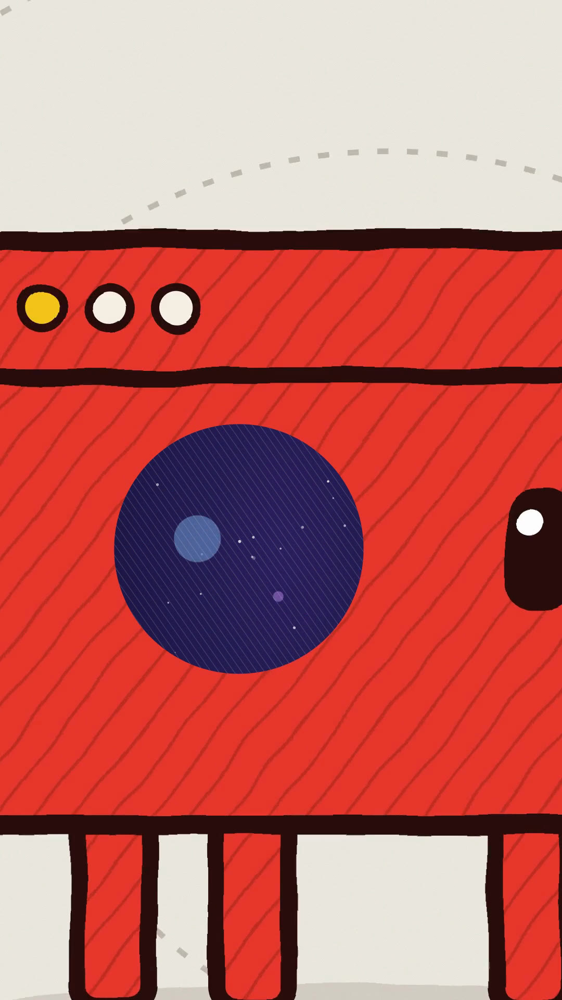
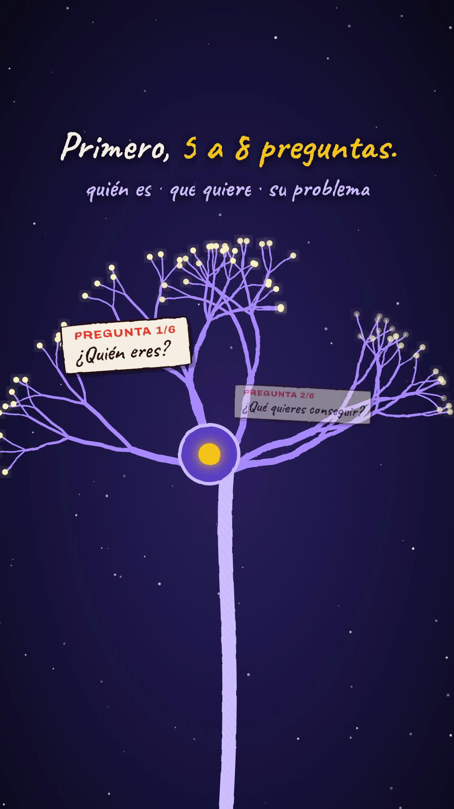
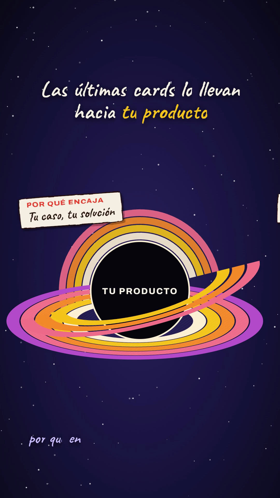

# Playbook: Mind-trip film (a block mascot, a dive into its head, a montage of wonders)

A wordless, charming **"look inside the mind"** short. A small hand-drawn block mascot walks onto warm paper, stops, has an idea, and the camera **dives through its eye** into a dark, starry inner world. A fast montage of hand-drawn *wonders* follows (cosmic thought-cloud, a neuron growing, a DNA helix, a prism splitting light, a sunflower spiral, a galaxy collapsing into a black hole, concentric rings, a beam of light, earthrise over the moon), then an iris opens **back out onto the paper**, where the mascot is happy (^ ^ eyes, arms waving).

- **Reference:** @devteamdrew, "Made with @claudeai Opus 5.5", https://x.com/devteamdrew/status/2102436464323661880 (32s, 16:9 1920x1080, 24 fps, **music only**, 9.8K likes, 4.2K bookmarks, 1.8M views). See `reference-original.jpg`.
- **Our version:** `../../x-batch/devteamdrew.mp4`, 45.0s, 1080x1920. The mascot is a red block with a **browser bar** (your SaaS/landing); every wonder is one beat of the quiz-funnel script, which is written as handwritten on-screen text.
- **Cost:** **$0**: 0 images, 0 TTS characters, 0 ElevenLabs calls. Everything is procedural SVG + GSAP; music and SFX are reused from earlier projects (see §4).

   

This playbook works for any coding agent or a human. Run commands from the folder that contains `playbook/`.

## 1. What makes the format

| Trait | How we reproduce it (no AI video, no images) |
|---|---|
| Cute block mascot on paper, thin ground line | `mascot(parent)` builds it in SVG: brand-red rounded body + **browser bar with 3 dots**, 2 arms, 4 legs, pill eyes with a highlight, hidden `happy` ^ ^ eyes. `walk(m, t0, dur)` swings legs ±14° (`svgOrigin` at the hip) and bobs the body |
| Hand-drawn texture | SVG `pattern#hatch` (diagonal ink lines, 20% opacity) laid over every fill as a second copy of the shape; `#hatchL` (white lines) on dark scenes; paper = `#f2efe6` + `feTurbulence` grain rect |
| Lines "alive" | Line boil: 3 displacement filters swapped on `#root[data-b]` at 8 fps (same trick as `pencil-loop`) on `.boil` groups. Keep it off big particle groups (render cost) |
| Dive into the head | S1 camera `scale: 14` with `svgOrigin` = the eye; S2 opens with `iris()` = `clip-path: circle(0 → 2300px at eye)` |
| The wonders | All procedural, deterministic (seeded `rnd()`, never `Math.random`): orbits drawn with `stroke-dashoffset` (`draw()`); neuron = recursive branches drawn by depth with glowing tips; DNA = two sine paths + coloured rungs, whole group translated in x (reads as rotation); prism = beam path + 6 polygons revealed with `clip-path inset`; sunflower = 34 petals + 330 golden-angle seeds; galaxy = 520 dots in a `scale(1 .42)` group that spins and shrinks; black hole = back arcs + squashed ring disc + black core + front arcs; countdown rings scale in with stagger; beam = gradient rect + glow rising, falling streaks; earthrise = hatched earth rising behind a cratered moon ellipse |
| Back out, happy | S10 opens with an iris from the earth's centre onto paper + rays + dashed circles; mascot ^ ^ waves; wordmark + slogan |

## 2. Script → beats (45s, music only)

| Time | Wonder | Text (handwritten Caveat, word-by-word clip reveal) |
|---|---|---|
| 0–5.4 | mascot walks in, ripple on "Haz esto." | ¿Quieres vender tu SaaS sin mandar a todo el mundo a la misma landing? · Haz esto. |
| 5.4–10.8 | dive through the eye → colour clouds + orbits + star | En lugar de ~pedir una demo~ directamente… · …crea un Quiz Funnel. |
| 10.2–15.8 | neuron grows; question cards at tips | Primero, 5 a 8 preguntas (quién es · qué quiere · su problema) |
| 15.2–19.8 | DNA helix; CASO REAL / DATO / RESULTADO (ejemplo) / CONSEJO cards | Pero no hagas solo preguntas · Entre medias: cards… · "vale, esto tiene sentido" |
| 19.2–24.8 | prism: one white beam (everyone) → rainbow → Resultado A/B/C | Después, según sus respuestas… un resultado personalizado |
| 24.2–27.8 | sunflower spiral (music builds at ~19–24s) | Y aquí viene la parte importante. |
| 27.2–33.8 | galaxy collapses → black hole "TU PRODUCTO"; 3 offer cards spiral in; countdown rings 14:59→14:57 (OFERTA · EJEMPLO) | Las últimas cards lo llevan hacia tu producto · …y un contador para canjearla |
| 33.2–37.6 | beam of light rises, "LEAD captado" | Así no solo captas el lead. |
| 37.0–41.6 | earthrise | Lo segmentas, / lo educas / y lo llevas a la compra. |
| 41.0–45 | paper, happy mascot, SaaS IN House | Segmenta. Educa. Vende. · Quiz Funnels que venden. |

## 3. Recipe

```bash
cp -R playbook/mind-trip-film/template my-trip && cd my-trip
$EDITOR index.html     # each scene is a block marked // ===== S? ·
npm run check          # 0 errors; warnings are only file size + sfx slot length (harmless)
npx hyperframes@0.8.137 snapshot --no-end --at 1.5,4.6,5.8,9.5,13.5,18.6,22.8,26,30.3,32.4,35.5,40,43.5 -o snaps
npx hyperframes@0.8.137 render -o ../out.mp4                    # ~47s for 45s
ffmpeg -i ../out.mp4 -c:v libx264 -crf 19 -preset slow -pix_fmt yuv420p -c:a aac -b:a 192k -movflags +faststart ../final.mp4
```
Helpers in `index.html`: `stage(sec)` (1080x1920 SVG in a section), `el(parent, tag, attrs)`, `paperBg / nightBg(s, stars)`, `draw(path, t, dur)`, `popIn / fade / xfade / iris(sec, x, y, t)`, `caption(text, t0, t1, {top, size, color, hl, strikeAt})` with `*gold word*` and `~struck word~`, `card(html, x, y, rot)` (screen-space, `<b>LABEL</b>` + `<i>EJEMPLO</i>` tag), `sfx(file, t, vol)`, `mascot()` + `walk()`.

**To swap a wonder:** keep each scene to one big centred object (y≈900–1400), text at the top (y≈300–550) and cards/chips around the object. Pick the object as a *metaphor* for the beat (branches = questions, prism = segmentation, gravity = product pull, beam = lead captured).

## 4. Audio (reused, no ElevenLabs)

ElevenLabs was out of credits, so: music = `playbook/airy-launch/template/assets/music.mp3` (45s, airy piano/plucks, builds ~19s, resolves ~36s, tail fades by 43s — it fits this arc exactly); SFX: whoosh/pop/tick/chime from airy-launch, impact from `sih-quiz-film`, pencil/wiggle from `pencil-loop`. Mix: music 0.85, whoosh on every scene change, pencil on each caption, pop on cards, impact on the black hole, tick per countdown second, chime on star/prism/logo. Final: −19.5 dB mean, −1.8 dB peak. For a fresh track, prompt something like "dreamy whimsical wonder music, soft piano and plucks, slow build into a cosmic swell, gentle happy resolution, no vocals" via `playbook/tools/el_audio.sh`.

A VO variant is easy (reuse `playbook/whiteboard-ad/template/vo.mp3` and its word times), but the reference is wordless: the charm is the visual surprise, so we kept it music-only.

## 5. Gotchas

- **CSS custom props via `Object.assign(style, {"--hl": …})` silently do nothing**: use `style.setProperty("--hl", c)`. Without it the highlight colour and the strike-through (a `linear-gradient(var(--hl))` background) vanished.
- **GSAP `scale` on an SVG `<g>` that already has a `transform` attribute replaces it** (the end mascot lost its `scale(1.9)`). Put the static transform on an outer group and animate an inner one.
- Captions on dark scenes need a text-shadow where they cross bright shapes (beam, rings); better, keep text in the top band.
- Cards that fly into the black hole must be gone before the countdown rings appear (they lingered over the rings at 32.4s): fly in fast (0.7s + 0.7s) and fade the black hole as the rings come in.
- Two-line captions push into a sub-caption below; keep the main line to one line (≤ ~26 chars at 92px) when a sub-line follows.
- Everything is deterministic: seeded PRNG at the top; the countdown uses stacked spans toggled with `tl.set(display)`.
- Don't copy the reference's mascot (it's Anthropic's Claude character). Ours is a brand-red block with a browser bar; any brand can swap colour + "face" detail.
