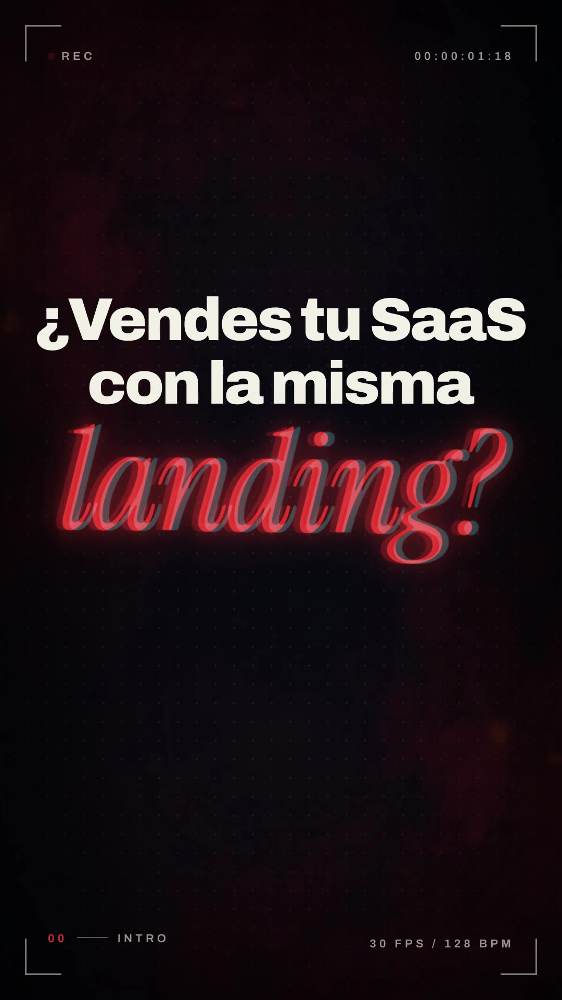
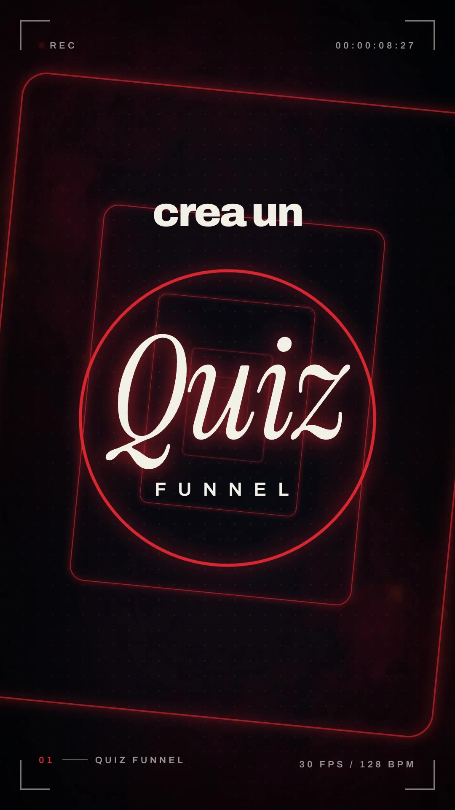
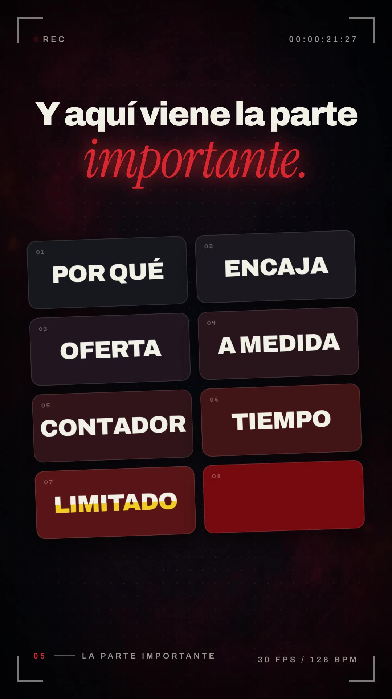
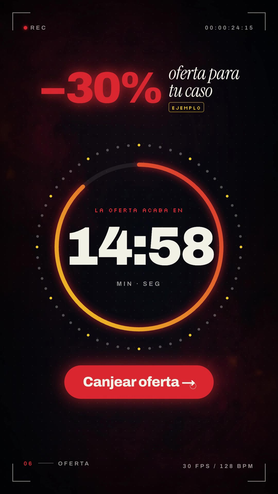

# Playbook: Motion showreel (format L, music only)

   

A dark, fast **"motion designer's showreel"**: every beat is a numbered chapter that shows off one motion technique (3D camera tunnel, spring physics, shape morph, kinetic type, timing ring, rolling counters). The whole film sits inside a **camera viewfinder HUD** (corner brackets, blinking ● REC, a running timecode, `30 FPS / 128 BPM`, and a chapter label `01 —— QUIZ FUNNEL` that glitches to the next one on every cut). Every cut lands on a bar line of a 128 BPM track. Built in HyperFrames (HTML + GSAP), with 2 generated images and ElevenLabs music/SFX. Our example: `../../x-batch/robj3d3.mp4` (32.0s, SaaS in House, Quiz Funnel script). Project: `template/`.

## 1. Reference and what we kept

- **Reference:** Rob Hallam (@robj3d3), "Sonnet 5.5 max effort": *"make a dynamic 15-second motion graphics video for SuperX that shows what an incredible motion designer you are, like it's your showreel for a resume. go all out."* https://x.com/robj3d3/status/2104649947610239253 (15.0s, 16:9 1920x1080 60fps, music only, 43k views, 471 bookmarks). Contact sheet: `reference-original-sheet.jpg`.
- **Original beats:** "Make it *move.*" with RGB-split type that collapses into a light line → 3D fire emoji with sparks → SuperX lockup → one gold flash frame → 3D camera tunnel with "TIMING / WEIGHT" flying past and "DEPTH", "*feel*" in a ring → a tweet card (spring physics) with a heart burst that bends into an arc → bars that morph into a glowing line chart → "128 BPM" ring → tilted grid of 8 tiles, each word animated differently (SCALE, SLIDE, SPIN, STRETCH, DROP, BLUR, SPLIT, glitch) → stacked counters "11,294+ *creators* / 400K+ *posts sent* / 5B+ *impressions*" with a shockwave ring → lockup + "Get started free".
- **Kept:** the viewfinder HUD, chapter numbering, the black/red/ember palette with smoke and dot grid, italic serif × heavy grotesk pairing, every technique above (one per chapter), the gold flash frame, sparks, camera shake on impacts, cuts on the bar line.
- **Changed:** 9:16; 32s instead of 15s so the base script fits as on-screen text; chapter labels name the **funnel step** (QUIZ FUNNEL, PREGUNTAS, PRUEBA, RESULTADO, LA PARTE IMPORTANTE, OFERTA, VENTA) instead of the technique, so the HUD also carries the message; the fire emoji became a generated glossy red 3D "?" emblem (brand red, quiz theme); SuperX counters became "Segmentas+ / Educas+ / Vendes+" (words, not invented totals).

**Closest older formats:** C `brand-film/` (dark launch film, glitch-in, neon ring draw, sparks-free) and G4 `color-block-promo/` (music-only kinetic promo). L differs by the **showreel framing** (HUD + numbered technique chapters) and by the density: one new technique every 2 bars, nothing repeats.

## 2. Beat map (template, 128 BPM, bar = 1.875 s)

| t (s) | Chapter | What happens | Technique (in `index.html`) |
|---|---|---|---|
| 0–3.75 | 00 intro | "¿Vendes tu SaaS / con la misma / *landing?*" lands line by line on beats 0, 1, 3; glitch stutters; at 3.2 the block squashes into a bright line that pinches to a point | `.rgb` lines get red + cyan `mix-blend: screen` ghosts that converge (x ±46 → 0); collapse = `scaleY .02` + `brightness(3)`, then a glowing `#s0-line` `scaleX → .01` |
| 3.75–5.63 | 00 | emblem pops with 44 sparks + shake, "Haz *esto.*", glow pulses on the beat; **gold flash frame** 5.47–5.6 | `sparks()`; `shake()`; `#flash` full-frame gold layer above scenes |
| 5.63–9.38 | 01 quiz funnel | 26 rounded rects stream toward the camera (tunnel, slow roll); "UNA" and "DEMO" fly through the lens, DEMO struck in red; "crea un" + "*Quiz*" slams in, a ring draws around it, "FUNNEL" | rects spawn every half beat, `scale .06→2.4 power2.in`; fly-by = `fromTo scale .15→1` then `to scale 5 + blur 24`; SVG circle `stroke-dashoffset` |
| 9.38–12.5 | 02 preguntas | "5–8" elastic pop, *preguntas*; 3 question cards spring up on beats with squash; progress bar 1/8→3/8; card 3 gets ✓; all cards drop out with gravity | `elastic.out(1,.55)` from `y:900`; squash `to scaleY .86 yoyo`; drop `power3.in` with rotation |
| 12.5–15.0 | 03 prueba (music break) | "Pero no solo *preguntas.*"; a social-style "Caso real · EJEMPLO" card tilts up, its text lights word by word; heart burst + ring + sparks; pill "“vale, esto tiene sentido”"; riser into the drop | `rotationX 35 → 0`; word opacity stagger; heart scale + colour |
| 15.0–18.75 | 04 resultado | 6 bars spring up (drop at 15.0), morph into dots (16.35), a red→gold line draws through them with a white comet, ring + sparks at the top; "Tu resultado · Plan Growth · 92% · EJEMPLO" card; "Resultado *personalizado.*" | bars tween `height/width/borderRadius/x` into dots; `polyline` with real cumulative length; comet position from a proxy `{v}` via `along(v)` |
| 18.75–22.5 | 05 la parte importante | headline + tilted 2×4 tile grid; each tile word uses a different technique: POR QUÉ scale · ENCAJA slide · OFERTA spin · A MEDIDA stretch · CONTADOR drop (letters bounce) · TIEMPO blur · LIMITADO split (two clipped halves) · CANJEAR glitch (tile turns red) | `gsap.set` the grid `rotationX 22, rotationZ -5` in a `perspective` scene; split = `clipPath inset(0 0 50% 0)` / `inset(50% 0 0 0)` copies |
| 22.5–26.25 | 06 oferta | "−30% *oferta para tu caso* EJEMPLO"; 60-dot ring that pulses on every beat; gradient arc depletes; "14:59" counts down; "Canjear oferta →" with cursor click + ripple, button flashes gold | countdown from proxy (`floor(v)` → mm:ss, seek-safe); `to scale 1.035 yoyo` per beat |
| 26.25–30.0 | 07 venta (break at 28.2) | "Así no solo captas *el lead.*"; "Segmentas+ / Educas+ / Vendes+" roll in letter by letter like counters, red "+" spins in, italic sub-line, shockwave ring per row; camera pushes and then zooms through with blur + riser | `.roller` → each letter in an `overflow:hidden` span, `yPercent 110 → 0` stagger |
| 30.0–32.0 | 08 saas in house | final hit: emblem + sparks + shake, "SaaS [IN] House", "Del lead a la *compra.*", "Comenta «QUIZ»", saasinhouse.com | same helpers |

Persistent layers: `#bg` (smoke plate drifting/scaling over 32s, 36px dot grid, inset-shadow vignette), `#hud` (z 30), `#flash` (z 40).

## 3. Recipe

```bash
cp -R playbook/motion-showreel/template my-reel && cd my-reel && T=../playbook/tools
```

1. **Script → on-screen text.** No narration (like the reference). Condense the script to ~10 beats of ≤ 6 words per line (`script.txt`). One chapter = one idea = one technique. Put invented numbers under an `.ex` "ejemplo" chip.
2. **Music first** (the cuts depend on it). Ask for an exact BPM and structure, then read the loudness curve:
   ```bash
   bash $T/el_audio.sh music assets/music.mp3 "<prompt with 'exactly 128 BPM', 'drops every 8 bars', 'big impact hit ... ending at 32 seconds'>" 33000
   python3 ../playbook/motion-showreel/tools/music_rms.py assets/music.mp3
   ```
   Ours came back 33.0s with the drop at 0 and 15.0 (exactly 8 bars), a break 12.5–15.0, fills at 7.0 and 22.0, a break 28.2–30.0 and the final hit at 30.0 (tail to ~31.5). Put the quiet "proof" beat in the first break, the lockup on the final hit. Keep `BEAT = 60/128`, `BAR = 4*BEAT` in the script and time beats as multiples.
3. **SFX** (sequential, `el_audio.sh` handles 429): we generated only `sparks` and `riser`; whoosh/tick/pop/click/chime/glitch/impact were copied from older templates. `pop.mp3` was −47 dB, so we boosted it: `ffmpeg -i pop.mp3 -af "volume=24dB,alimiter=limit=0.9" pop_n.mp3`.
4. **Images** (2 × ~$0.03, prompts in `template/prompts.md`): a 9:16 smoke plate (`$T/gen_image_ar.py --ar 9:16`, then scale/crop to 1080x1920) and a 3D emblem on magenta (`--ar 1:1` → `$T/cutout_grid.py gen/emblem.png assets 620 emblem`). Swap the emblem for your brand's object (the original used a 3D fire emoji).
5. **Edit `index.html`.** Scene `data-start`/`data-duration` = bar lines. Chapter labels live in the `CH` array (`[time, "01", "name"]`). Copy lives in each `<section>`. SFX `<audio>` tags carry absolute times: move them with the cuts.
6. **Check, look, render, QA the mp4:**
   ```bash
   npm run check
   npx hyperframes snapshot --at 1.6,3.4,4.9,6.3,8.9,11.9,14.6,17.8,21.9,24.5,28.0,31.5
   npx hyperframes render -o ../my-reel.mp4          # ~35–55s for 32s
   ffmpeg -i ../my-reel.mp4 -af volumedetect -f null - 2>&1 | grep mean_volume
   ```
   Then pull frames from the **mp4** (not just snapshots), including mid-spring moments (10.9, 11.4) and the flash (5.52).

## 4. Helpers in the template

- `sparks(sel, cx, cy, n, t, r0, r1)`: n gold→red streaks radiate from a point (seeded RNG, rotation = travel angle).
- `shake(sel, t, amp)`: 6 decaying 40ms jitters on a scene's `.cam` wrapper (every scene has one, so the shake never fights the section's own tweens).
- `glitchIn(sel, t)`: `skewX 18 + blur + saturate(2)` → clean in `steps(5)`; the cut transition.
- `words(sel, t)`: `.kin` word split, blur-rise per word.
- RGB-split: any `.rgb` element gets two coloured ghosts automatically.
- Timecode and countdowns: proxy objects `{v}` + `onUpdate` that write `textContent` from `v` (seek-safe).

## 5. Gotchas we hit

- **RGB ghosts copied their own siblings.** Building the 2nd ghost from `el.textContent` after appending the 1st doubled the text ("landing?landing?" wrapped to a second line). Read the text once before the loop.
- **Moving a DOM block by string slicing broke the nesting** (cards ended up inside the progress-bar wrapper and vanished). After any scripted HTML move, re-read the block and look at an mp4 frame of that scene.
- **Draw order:** the progress bar sat after the cards in the DOM and painted over card 3 during the spring overshoot. Put "underlay" elements before the cards.
- **Width:** Archivo 880 at 132px ("¿Vendes tu SaaS") and 170px ("Segmentas+") touched the frame edges at 1080px; 116px / 150px fit with margin.
- **Inline-block spans lose the space between them** ("Hazesto."): add `margin-left` on the second span.
- `letterSpacing` tweens are a lint error: animate `scaleX` + blur instead.
- Repeated `fromTo` on one element → lint warning; use `to` for the second tween (squash, pulses, comet proxy).
- `npm run check` keeps ~8 `content_overlap` layout "errors" from the tight sans/serif line stacks (line boxes overlap, glyphs don't). Verified visually in the mp4; the render still runs. `data-layout-allow-overlap` on the parent does not silence child spans.
- The final second is the music's tail (−43 dB from 31.0s); whole-file volume is fine (−16.4 dB). If you need a loud ending, ask the music prompt for the hit ~1.5s before the end and don't cut later.

## 6. Before publishing

- "Caso real" card (4 → 19 demos), "Plan Growth · 92%", "−30%" and "14:59" are **ejemplo** placeholders and are labelled so on screen. Replace them with real data or keep the label.
- The CTA "Comenta «QUIZ»" promises a deliverable: make sure it exists.
- The emblem is a generated object, no people appear.

## 7. Cost and time

- Images: 2 × ~$0.03 = **~$0.06**. ElevenLabs: 1 music track (33s) + 2 SFX; **0 TTS characters**.
- Render ~30–55s for 32s at 30 fps. Building from the template: ~1h, mostly rewriting copy per chapter and moving SFX times.
