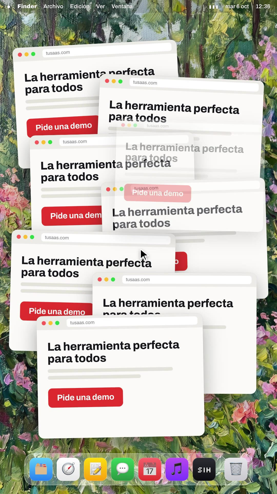
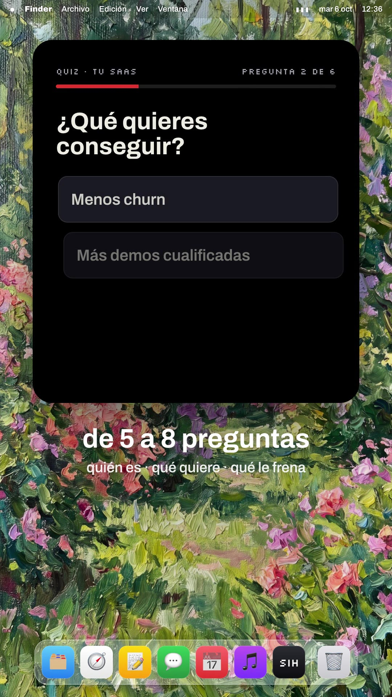
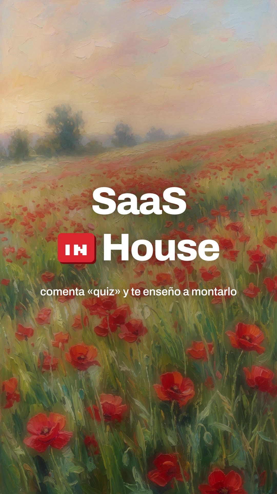

# Playbook: Notch teaser (painted-desktop launch teaser)

A calm, premium "Mac launch teaser". White text fades in from blur over a blurred **impressionist painting**. A **slot-machine list** of lines with app-style icons rolls past a fixed label. A desktop fills up with chaos. Then the **notch** at the top of the screen grows into a pill with the product name, gets clicked, and **drops down into the product UI**. It ends on a checklist and the wordmark on a second painting. Music + UI SFX only. **No voiceover and no AI video.** It is built in HyperFrames from 2 Gemini images + ElevenLabs music/SFX, for about $0.06 in images.

Example: `../../x-batch/liu8in.mp4` (44.0s, 1080×1920, Spanish, SaaS in House quiz-funnel script). The project is `template/`.

   

Works for **any coding agent (Claude Code, Codex, …) or a human**. Commands assume you are in the folder that contains `playbook/`.

---

## 1. What the format is

Reverse-engineered from the NotchBrowser teaser shared by Bin Liu (HyperFrames / HeyGen): https://x.com/liu8in/status/2104360119849083093. The original is 27s, 16:9 and silent (−78 dB). It was made with Claude Code + HyperFrames. Original frames: `original-roll.jpg`, `original-desktop.jpg`.

| Beat | Reference (NotchBrowser) | Our version (template) | Technique |
|---|---|---|---|
| Hook + roll | "in the AI era, the hard part is" big → shrinks to a small label; ~25 pains with app icons roll past, the middle row sharp and the others blurred | "a tu SaaS llega" → 13 visitor types ("un fundador con prisa", "una CTO que compara precios" … "tu próximo gran cliente"); accelerates, then slows and lands | `driveRoll()`: one proxy `p` tweened between integer indices; each row gets `translateY(d·84)`, opacity `1−|d|·k` and `blur(|d|·3.2 + frac·9)`, so it motion-blurs while moving. Header shrinks with `scale` + `y` (not `fontSize`/`top`) |
| Statement | "don't make your browser one of them" | "¿y los mandas a todos / a la misma landing?" | `blurIn()` per line: opacity 0→1, blur 16→0, y 18→0 |
| Chaos desktop | Sharp painting as wallpaper, macOS menu bar + dock, windows everywhere | 11 identical "La herramienta perfecta para todos · Pide una demo" windows pile up; cursor wanders; all blur out | `.win` cards with `back.out` pops (seeded rotation); `#desk` layer = menu bar + glass dock (CSS squircles + emoji, no real app logos) |
| Product reveal | Black notch pill "NotchBrowser" + cursor | Notch → pill "Quiz Funnel" → click | one persistent `#notch` div: tween `width/height/borderRadius` + `y`; centred with `xPercent:-50` |
| Product UI | Browser drops out of the notch | The notch grows into a dark brand panel: quiz (3 questions, red select fill + tick), then result, then offer with a live countdown and a clicked CTA | `openPanel()` / `closePanel()` morph the same element; content layers `.nlayer` fade in; countdown = proxy + `steps()` + `onUpdate` |
| Cards roll | — | "pero no solo preguntas. entre medias, cards con" → casos reales / datos / resultados / consejos → "“vale, esto tiene sentido.”" | the same `driveRoll()` |
| Feature checklist | ✓ tiny 1.7 mb, ✓ native… | "así no solo captas el lead:" ✓ captas el lead ✓ lo segmentas ✓ lo educas ✓ y lo llevas a la compra | SVG circle + check path `stroke-dashoffset 44→0` |
| End | "NotchBrowser / launching soon" | "SaaS [IN] House" + "comenta «quiz» y te enseño a montarlo" on a poppy field | second painting; Silkscreen red `IN` chip |

**Background rule:** text beats use the **pre-blurred** painting (`*_blur.jpg`, Gaussian 22px, done in PIL, not with a CSS filter). Desktop beats crossfade to the **sharp** painting + `#desk`. `bgMode("blur"|"sharp"|"poppy", t)` handles both crossfades. The whole `#bg` slowly drifts from scale 1.08 to 1.0.

**Type:** Archivo 560–680, letter-spacing −0.02em, white with a soft shadow. (The reference uses SF Pro; Archivo is our brand font and reads the same.) Captions under the panel (`.under`) carry the script's key phrase on UI beats.

**Narration:** the reference has none, so per the batch brief the base script lives as on-screen text + music. To add a voice, run `tts_with_timestamps.py` and shift the beats to word times. Text beats need ~1.6–2s each, so the voice would set the pace.

## 2. Prerequisites

- `ffmpeg`, Node + `npx` (template pins HyperFrames `0.8.137`), Python 3 with `pillow numpy`.
- `ELEVENLABS_API_KEY` in `~/.zshrc`; the `treg` CLI for the Gemini images (~$0.03 each).
- HyperFrames rules: one paused timeline at `window.__timelines["main"]`; `class="clip"` sections with `data-start/duration/track-index`; every `<audio>` has an `id`; seeded RNG only; local fonts. The linter rejects tweening `top/left/marginLeft/fontSize` (use `x/y/scale/xPercent`), and CSS `transform` on anything GSAP scales (set the initial `scaleX` with `tl.set(…, 0)` instead).

## 3. Recipe

```bash
cp -R playbook/notch-teaser/template my-teaser && cd my-teaser && T=../playbook/notch-teaser/tools
# 1) two paintings (9:16). gen_image.py here = the shared one with SIZE env (default 9:16)
SIZE=9:16 python3 $T/gen_image.py /tmp/garden.png "A vertical 9:16 impressionist oil painting in the style of Claude Monet: a sunlit garden path between lush flowering bushes and tall trees, dappled light, pink, coral, lilac and yellow blossoms, visible thick brush strokes and canvas texture, no people, no text, no frame"
SIZE=9:16 python3 $T/gen_image.py /tmp/poppies.png "A vertical 9:16 impressionist oil painting in the style of Claude Monet: a wild poppy field on a gentle hill under a soft warm summer sky, many vivid red poppies … no people, no text, no frame"
python3 - <<'EOF'
from PIL import Image, ImageFilter
for n in ['garden','poppies']:
    im=Image.open(f'/tmp/{n}.png').convert('RGB').resize((1080,1935),Image.LANCZOS).crop((0,7,1080,1927))
    im.save(f'assets/{n}.jpg',quality=90); im.filter(ImageFilter.GaussianBlur(22)).save(f'assets/{n}_blur.jpg',quality=88)
EOF
# 2) music + SFX: sequential, with 429 backoff (shared key)
$T/el_audio.sh music assets/music.mp3 "minimal elegant product launch music like an Apple keynote teaser: soft felt piano motif, warm airy synth pads, gentle plucked pulse, light finger snaps entering after 8 seconds, hopeful and calm, slowly builds, a soft lift around 30 seconds, gentle resolved ending, no vocals" 44000
$T/el_audio.sh sfx assets/whoosh.mp3 "soft airy whoosh transition, gentle, short" 1.0
$T/el_audio.sh sfx assets/tick.mp3  "single soft UI tick, short subtle click, clean" 0.5
$T/el_audio.sh sfx assets/pop.mp3   "soft rounded UI pop, bubble appearing, macOS notification style" 0.6
$T/el_audio.sh sfx assets/click.mp3 "mouse click, single crisp trackpad click" 0.5
$T/el_audio.sh sfx assets/ding.mp3  "gentle bright success chime, single short soft bell" 1.0
$T/el_audio.sh sfx assets/impact.mp3 "soft cinematic low boom with airy shimmer tail, logo reveal" 2.0
for f in assets/*.mp3; do echo $f $(ffmpeg -i $f -af volumedetect -f null - 2>&1 | grep -o 'max_volume: [-0-9.]*'); done
#   ↑ normalise any SFX that comes back near-silent (our tick was −41 dB): ffmpeg -i tick.mp3 -af "volume=34dB,alimiter=limit=0.9" t.mp3
ffmpeg -i assets/music.mp3 -af "afade=t=in:d=0.4,afade=t=out:st=42.2:d=1.8" -t 44 m.mp3 && mv m.mp3 assets/music.mp3
# 3) edit index.html (see §4), then
npm run check
npx hyperframes snapshot --at 2.6,5,9.6,15.9,18.5,24.3,29.2,34,38.8,43.5
npx hyperframes render -o ../my-teaser.mp4
ffmpeg -i ../my-teaser.mp4 -af volumedetect -f null - 2>&1 | grep mean_volume
```

## 4. Anatomy of `template/index.html`

- **Layers (bottom→top):** `#bg` (4 painting imgs + shade) → text sections `s1…s13` (track 1) → `#desk` (menu bar + dock) → `#notch` (pill + `.nlayer` panels `#L-quiz`, `#L-res`, `#L-off`) → captions `u7/u9/u11` (track 2) → `#cursor`.
- **Helpers:** `blurIn/blurOut(sel, t)`; `bgMode(mode, t)`; `buildRoll(id, items)` + `driveRoll(rows, [[t, index]…], rowH)`; `openPanel(t, layer)` / `closePanel(t, layer)`; `pick(qsel, optIndex, t)` / `staggerOpts(qsel, t)`; `sfx(file, t, vol, dur)`, which creates one `<audio id=sfxN>` per hit (HyperFrames picks the dynamically created tags up; verified in the render).
- **Retargeting to a new script:** change the roll arrays (`visitors`, `cards`), the `.say` lines, the quiz/result/offer content, the checklist and the logo text. Then shift the beat times. Every beat is a block `// ===== Sx … (start–end) =====` with absolute seconds. Keep each section's `data-start/data-duration` matching its block.
- The roll's step times are generated: `gap` starts at 0.5s, shrinks ×0.82 down to 0.22s, and grows ×1.22 for the last 4 items, so it lands like a slot machine. One tick SFX per step.

## 5. Lessons / gotchas

- The linter's `content_overlap` hits on the window pile and the roll are intentional. `data-layout-allow-overlap` on the parent does not silence them; they are not errors (`0 error(s)`).
- Put the roll label far enough above the list (`roll top 990`, label scaled to 0.44 at y+40), and fade rows above the centre faster (`0.6`) than rows below, or they collide with the label.
- The panel must fit its content (we cut it from 1180 to 1000px tall; it looked empty).
- In `bgMode("poppy")` turn on **both** the sharp and the blurred poppy images. Otherwise un-blurring at the end reveals the garden underneath.
- Check every SFX with `volumedetect` before building; ElevenLabs sometimes returns a near-silent file.
- Put "EJEMPLO" on invented offers/numbers (the −30% offer is a placeholder).

Cost of the example: 2 Gemini images ≈ $0.06; ElevenLabs = 1 music track (44s) + 6 SFX; no TTS.
