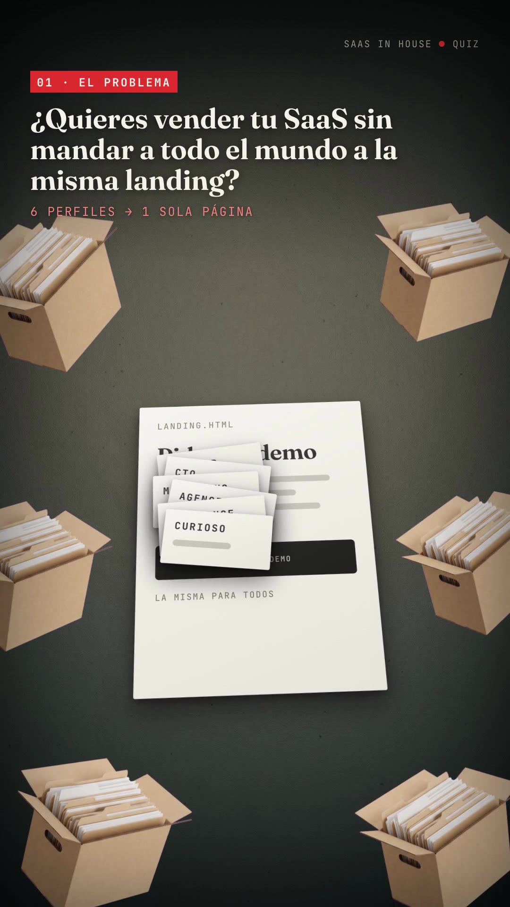
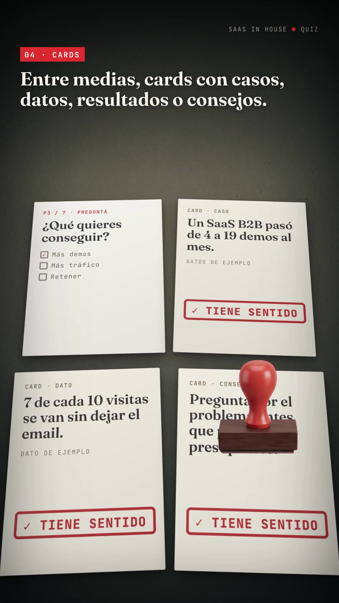
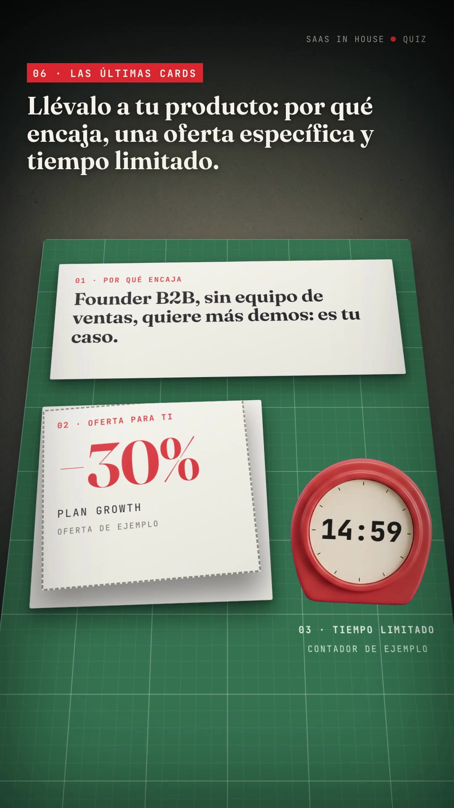

# Format L: Paper-desk film (`paper-desk-film/`, music only)

A calm, tactile "stop-motion on a desk" explainer. Every idea becomes a **physical office object on a dark slate desk**: paper sheets, index cards on a red thread, kraft title cards with label-maker tape, rubber stamps that leave red imprints, scissors cutting a coupon, a kitchen timer counting down, receipts printing from little black printers. Small top-left captions: a red mono tag (`03 · PREGUNTAS`) plus one bold serif sentence. No voice.

- **Reference:** jevgrep v0.4 launch by @dzhng (https://x.com/dzhng/status/2104405629993676961, 40s, 16:9, music only). The original is a real 3D render (Blender-like): file boxes in a ring, a relevance bar chart of paper strips, "RELEVANT / IN SCOPE" stamps on code sheets, scissors + paperclip, a cutting mat with a guillotine, receipts and a "30% LESS COST" stamp, kraft end card with `npm i` tape.
- **Ours:** `../../x-batch/dzhng.mp4`, 1080×1920, 49.5s, SaaS in House quiz-funnel script as on-screen text.
- **How it's faked without 3D or AI video:** one CSS-perspective "desk plane" per scene (`rotationX: 24°`) holding HTML paper sheets with layered box-shadows; upright props (stamp, scissors, timer, file boxes) are **Gemini cut-outs placed in screen space** on top, positioned with a small `proj()` function that maps plane coordinates to screen pixels; camera = 2D drift/scale on a `.cam` wrapper + a vertical "dolly" pan with blur between scenes.

  

## When to use it

- You want a **warm, crafted, "made by hand" feel** for a process explanation (filter → judge → cut → result), especially for a technical audience that's tired of glossy UI films.
- The message has **verbs you can act out with office objects**: stamp (approve/validate), cut (trim/offer coupon), pin + thread (sequence), print a receipt (cost/outcome), drop into a box (archive/segment), timer (urgency).
- Closest older formats: D (trace film, also calm/technical, but abstract) and B/J (hand-made boards). Pick L when you want physical props instead of drawings.

## Beat map (SaaS in House version, 49.5s)

| t (s) | Scene | Device |
|---|---|---|
| 0–4.7 | `#s1` hook | 6 file boxes drop in a ring; 6 "visitor" slips (Founder, CTO, Marketing…) fly onto ONE `landing.html` sheet. Sub-caption "6 perfiles → 1 sola página" |
| 4.7–10.4 | `#s1` title card | Kraft card slides over the pile: "Haz esto." → "Quiz Funnel v1"; black tape "NO PIDAS UNA DEMO." + red tape "CREA UN QUIZ FUNNEL." |
| 10.4–16.6 | `#s3` questions | 7 index cards land zig-zag, pushpins drop, the red thread draws card to card (dash offset by real segment lengths), ✓ ticks |
| 16.6–24.2 | `#s4` cards between | Question sheet + Caso / Dato / Consejo sheets (`ejemplo`); rubber stamp hits 3× → "✓ TIENE SENTIDO"; sub «vale, esto tiene sentido» |
| 24.2–29.8 | `#s5` result | Paper bar chart "respuestas → segmento", dashed "encaje" threshold, winner bar turns red; result sheet + paperclip |
| 29.8–39.6 | `#s6` the important part | Push-in onto a green cutting mat; fit card, −30% coupon (dashed), scissors cut along it and the coupon lifts; kitchen timer 15:00 → 14:56 with tick SFX |
| 39.6–44.8 | `#s8` receipts | Two printers: "LANDING ÚNICA 1 de 4" vs "QUIZ FUNNEL 4 de 4" (rows tick in sync with the caption); stamp "LEAD → CLIENTE" |
| 44.8–49.5 | `#s9` end card | Kraft card "SaaS in House", tapes "QUIZ FUNNELS PARA SAAS" / "COMENTA «QUIZ»", stamp "✓ HECHO" |

## Recipe

Run from the folder that contains `playbook/`. Copy the template first: `cp -r playbook/paper-desk-film/template my-film && cd my-film`.

1. **Images (2 × ~$0.03).** Prompts used (`T=../playbook/tools`):
   ```sh
   python3 $T/gen_image_ar.py src/desk.png "Top-down cinematic 3D render of an empty dark desk surface: matte slate grey-green linoleum with fine felt-like grain and tiny specks, a soft warm overhead light pool in the centre fading into a dark vignette at the edges. Calm, muted, moody, like a miniature tabletop stop-motion set. Absolutely no objects, no paper, no text, no logos." --ar 9:16
   python3 $T/gen_image_ar.py src/props.png "Sheet of 6 separate 3D-rendered desk props on a perfectly flat solid pure magenta #FF00FF background, arranged in a 3 by 2 grid with lots of empty space between them, nothing touching, no cast shadows on the background, soft studio lighting, matte miniature tabletop style. Row 1: (a) an open kraft cardboard file box ... packed with white and beige paper folders; (b) a rubber stamp with a glossy red-orange (#e8382d) bulb handle on a dark brown wooden block, side view; (c) open scissors with red-orange handles, seen from above. Row 2: (d) a silver paperclip, top view, large; (e) a round red-orange mechanical kitchen timer seen from the front with a plain blank cream dial face and no numbers; (f) a red-orange pushpin, three-quarter view. No text anywhere." --ar 1:1
   ```
   Then: `python3 $T/cutout_grid.py src/props.png src/cut 700 o1 o2 o3 o4 o5 o6` → box, stamp, scissors, timer, pin. **The thin paperclip is dropped by the blob finder**; crop it by hand from the sheet and key it (snippet in the report / see `template/assets/clip.png`). Grade the desk darker: PIL `Brightness 0.62`, `Color 0.9` → `assets/desk.jpg` (the raw plate is too bright behind white captions).
   Keep the prop palette to the brand red (#e8382d) so every prop reads as "SaaS in House".
2. **Audio (ElevenLabs, sequential).** `bash $T/el_audio.sh music assets/music.mp3 "<warm minimal felt piano + wooden plucks, ~96 bpm, no vocals>" 50000`, plus SFX: `stamp` (0.8s), `paper` slide, `drop`, `snip`, `tick` (3s kitchen timer), `ding`, `box` thump. **Two SFX came back near-silent** (stamp −62.9 dB, drop −52.5 dB): re-prompt with "loud … close mic" and/or normalise with `volume=12dB,alimiter=limit=0.9`. Always run `volumedetect` on every SFX.
3. **Edit `index.html`.** Captions live in `#hud` (`.cap` blocks: tag + `.txt.kin` + optional `.sub`); each is timed with `cap("#cN", tin, tout)`. Scenes are `<section class="scene clip">` with `.desk` img → `.cam` → `.stage` (perspective 1800px) → `.plane` (sheets). Change the script in `script.txt` and the copy inside sheets.
4. `npm run check` → `npx hyperframes@0.8.137 snapshot --at 3.6,8.9,15.5,22.9,28.5,37.5,43.8,48.5 --no-end` → look → `npx hyperframes@0.8.137 render -o renders/out.mp4` → re-encode `-crf 21` (raw render is ~47 MB for 50s; CRF 21 → ~18 MB).

## Anatomy / helpers (all in `template/index.html`)

- `proj(px, py)` — plane coords → screen coords (same TILT/PERS/OY constants as the `.plane` set). Use it to drop **screen-space props exactly onto a plane spot** (stamp contact point, scissors path, timer). Keep `.cam` drift *outside* this math: props and plane share the `.cam` wrapper, so the mapping stays valid while the camera moves.
- `stamp(stampSel, impSel, px, py, t, w)` — stamp hovers in (t−0.55), slams (t−0.2 → t), the imprint pops `scale 1.25 → 1` at t, stamp lifts at t+0.1. Call it several times with the same stamp element to walk it across sheets; put the SFX at exactly t.
- `land(el, t, from, rot)` — sheet slides/drops onto the desk with a rotation settle.
- `pan(outId, inId, t)` — camera dolly between scenes (out goes `yPercent −100`, in comes from `+100`, both blurred).
- `.imp` imprint style: thick red border + `mix-blend-mode: multiply` so it looks inked into the paper.
- Receipts "print" from a black printer bar: an `overflow:hidden` slot with the sheet tweened `yPercent −100 → 0` with `ease: "steps(8)"` (stepped = thermal-printer feel). Rows fade in afterwards in reading order (see gotcha).
- Kitchen timer countdown: proxy object `{v: 900}` tweened to 896 with `onUpdate` writing `m:ss` into a div laid over the blank dial; plus a tiny rotation yoyo for the "ticking" shake.
- Label-maker tapes: `.tape.k` (black) / `.tape.rd` (red), revealed with `scaleX 0 → 1` from the left.

## Gotchas we hit

- **Printing direction:** tweening a receipt `yPercent` from −100 shows its *bottom* rows first (COMPRA before CAPTAS). Slide the blank receipt out, then reveal the rows in order.
- `cutout_grid.py` drops thin objects (paperclip). Crop + key them manually.
- A colour tween from transparent on a ✓ glyph triggers `text_not_painted`; animate an inner element's opacity instead.
- The `.cam` drift scale pushes the kraft card's left edge off-frame at 1.08; keep end-scale ≤ 1.03 on full-width cards.
- `content_overlap` errors for the visitor-slip pile and the "Haz esto" → "Quiz Funnel" swap are intentional (render proceeds). `data-layout-allow-overlap` is on every `.sheet`, but the checker still flags their inner text.
- Imprint text must fit the sheet: at 52px "LEAD → CLIENTE" overflowed the receipt; 36px fits a 400px receipt.
- Snapshots taken mid-stamp show the stamp covering text; that's the motion, not a bug. Check frames ±0.3s.

## Before publishing

- `ejemplo` placeholders: "Un SaaS B2B pasó de 4 a 19 demos al mes", "7 de cada 10 visitas…", "−30% plan growth", the 15:00 countdown. Replace with real data or keep the label. Profiles/answers (Founder B2B, 2–10…) are illustrative, no people are shown.
- «Comenta QUIZ» needs a real deliverable.
- Cost: 2 Gemini images ≈ $0.06; ElevenLabs 50s music + 9 SFX calls (2 redone); 0 TTS characters.

## VO variant

Music-only reads text-heavy at ~50s. To add a narrator: write the base script to `script.txt`, run `python3 ../playbook/tools/tts_with_timestamps.py` (Spanish voice e.g. Guillermo Brazález `qUPtETgSYRhCRb2pfOla`), embed words with `../playbook/tools/embed_words.py`, and retime each `cap()` / scene start to word indices; drop music to ~0.25.
