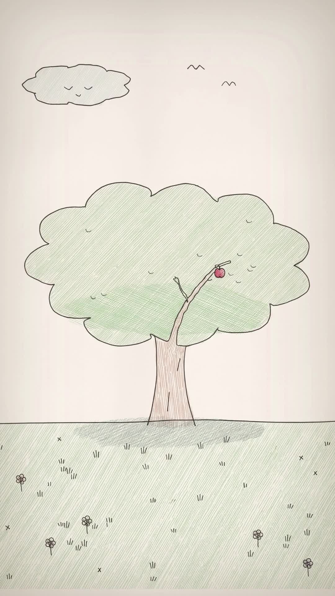
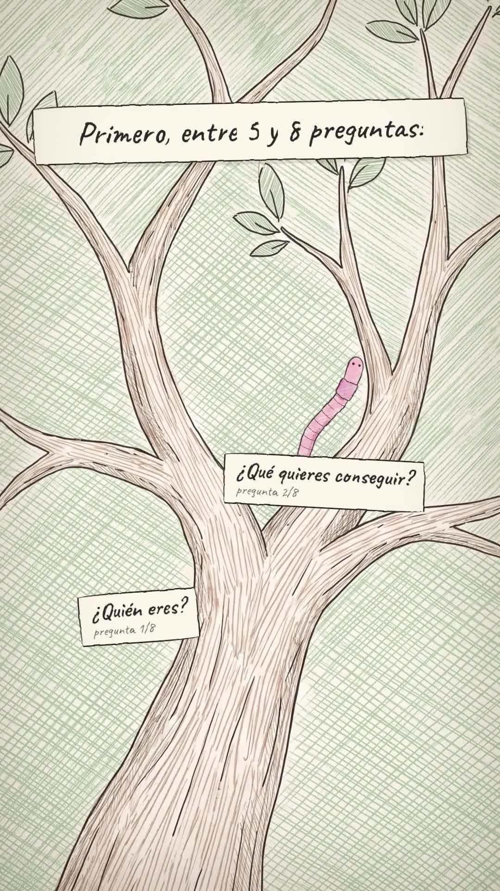
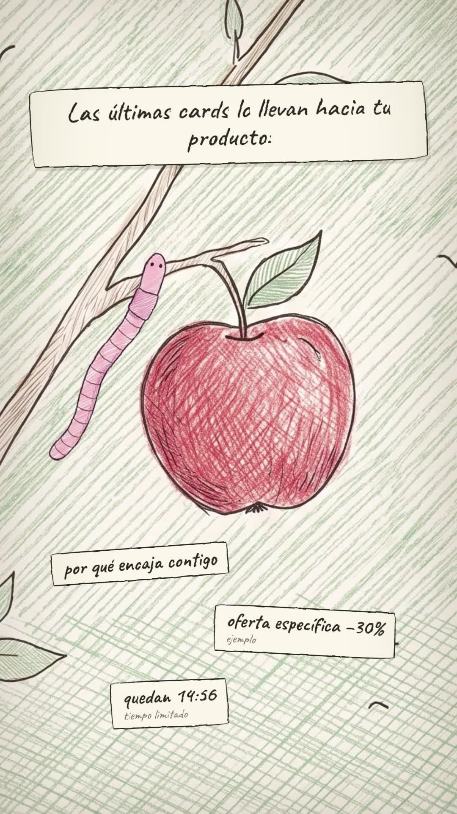
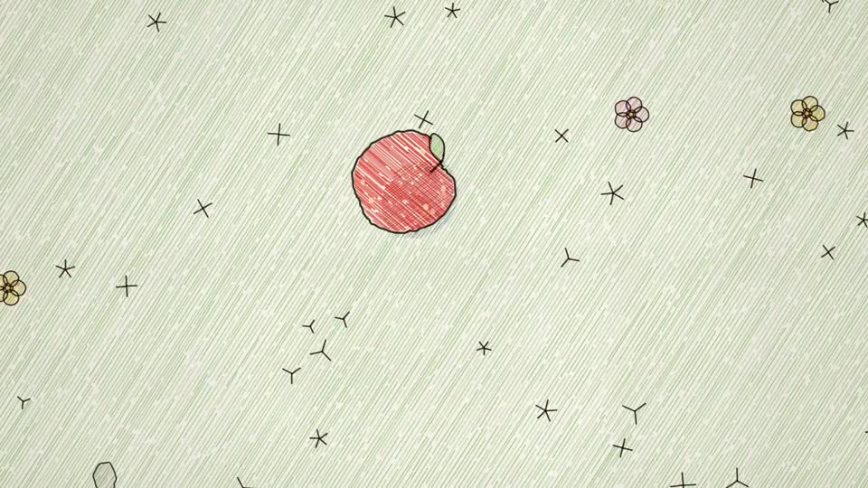

# Playbook: Pencil loop (coloured-pencil storybook, one continuous camera, seamless loop)

A quiet, hand-drawn **coloured-pencil picture book**. One small character (a pink worm) travels through a single world while the camera follows it: wide meadow → down to the ground → up the trunk → through the branches → to the apple → pull back to the **exact first frame**, so the video loops. There is **no narration**: the script is handwritten on paper slips, with soft music and tiny SFX.

- **Reference:** https://x.com/israelfemiojo/status/2107371585606656234 ("Gravity on loop, by Opus 5.5"). 28s, 16:9, music only (Scribe returns just `[outro jingle]`). An apple falls from a tree, a worm finds it, climbs the trunk (day → night → day), crawls out along the branch and puts the apple back, and the camera returns to the opening wide shot.
- **Our version:** `../../x-batch/israelfemiojo.mp4`, 52.0s, 1080x1920. The worm is the lead and the tree is the quiz funnel. The hole everybody walks into is "la misma landing", the branches are the questions, the note cards on the leaves are cases, data and tips, the apple is the personalised result and then the offer with a countdown.
- **Cost:** 6 Gemini 3 Pro images via treg (~$0.18). ElevenLabs: 1 music track (52s) + 7 short SFX, and no TTS characters.

   

This playbook works for any coding agent or a human. Run the commands from the folder that contains `playbook/`.

## 1. What makes the format

| Trait | How we reproduce it (no AI video) |
|---|---|
| Coloured-pencil look: wobbly ink lines, diagonal hatching, warm paper | 5 Gemini **background plates** (2:3, 2K), all made with the **tweet thumbnail as the style reference** |
| One continuous world and a moving camera | Each plate sits inside a `.cam` div. `view(cam, zoom, u, v)` puts image point (u, v) at the screen centre, and GSAP tweens `x/y/scale` between views. Scenes cross-fade 0.6s on alternating tracks, after a push-in "into" the next plate |
| A tiny character that inches along | 3 worm poses + 1 beetle cut from **one magenta sheet**. `crawl()` follows a list of (u, v) points, rotates the sprite along each segment, and squashes it (`scaleY` 0.86 yoyo) like an inchworm |
| "Alive" hand-drawn lines | **Line boil**: 3 SVG `feTurbulence + feDisplacementMap` filters with different seeds, swapped on `#root[data-b]` at 8 fps through `tl.set` (deterministic). This applies to sprites, notes and captions (`.boil`) |
| Loop | The last scene starts zoomed onto the apple in the wide plate and pulls back to `view(1, .5, .5)`. Captions and the logo fade out before 52s, so the **last frame = the first frame** |
| Wordless | The script is written on **paper slips** (Caveat 62–92px, irregular border-radius = wobbly outline), revealed word by word with `clip-path` (like writing), plus a pencil-scribble SFX |

## 2. Recipe

```bash
cp -R playbook/pencil-loop/template my-loop && cd my-loop && T=../playbook/tools
source <(grep ELEVENLABS_API_KEY ~/.zshrc)
```

**1) Story as one journey through one world.** Choose one metaphor that the camera can travel through (a tree, a river, a city street), map each script beat to a place on it, and make the ending return to the opening shot.

**2) Plates** (one per place, 2:3 vertical). The same style prefix every time, with the reference frame URL as `image_urls`:
```bash
REF="https://pbs.twimg.com/amplify_video_thumb/2107371475741061120/img/VPWqJthK4-IsTFs-.jpg"
STY="In the exact illustration style of the reference image: soft coloured-pencil drawing on warm off-white paper, thin wobbly black ink outlines, dense diagonal pencil hatching for fills, pale sage green grass, light brown wood, muted gentle colours, children's picture book, calm and minimal."
python3 $T/gen_image.py assets/src/wide.png "$STY Vertical portrait composition. A single round leafy tree standing in a wide meadow, the tree centred, trunk base at about 68% of the image height ... One small red apple ... No people, no animals, no text." "$REF"
# also: ground (top-down meadow with a hole), trunk (close-up, grass at the bottom), branches (forking decision tree), apple (diagonal branch + one apple)
for f in wide ground trunk branches apple; do ffmpeg -y -i assets/src/$f.png -q:v 3 assets/$f.jpg; done
```
Then **map coordinates**: draw a 10×10 or 20×20 grid over each plate (`ffmpeg ... drawgrid=w=35:h=52.15`), look at it, and write down the (u, v) of the branch lines, the hole, the apple and so on. The worm paths are lists of those points.

**3) Sprites**: one sheet on magenta, then cut:
```bash
python3 $T/gen_image.py assets/src/sprites.png "$STY Draw SIX separate small items in a grid of 2 rows by 3 columns ... 1) pink earthworm crawling horizontally ... 2) same worm stretched straight vertically, head at top ... 3) same worm curled happily ... 4) small grey beetle from above ... 5) blank note card ... 6) small red apple. Background: perfectly flat solid pure magenta #FF00FF. No text, no shadows." "$REF"
python3 $T/cutout_grid.py assets/src/sprites.png assets 420 w_crawl w_climb w_happy beetle note apple_s
```
**Check the names**: the tool names objects in reading order by their top edge, so the tall vertical worm came first. We had to swap `w_crawl`/`w_climb`.

**4) Music + SFX** (sequential calls; on 429, wait 20–60s and retry):
```bash
curl -s -o assets/music.mp3 https://api.elevenlabs.io/v1/music -H "xi-api-key: $ELEVENLABS_API_KEY" -H "Content-Type: application/json" \
  -d '{"prompt":"gentle whimsical storybook music for a hand-drawn coloured-pencil animation, soft music box, plucked ukulele and glockenspiel, light brushed percussion, warm and curious, calm steady tempo, a sweet little rise near the end and a short cheerful outro jingle in the final 3 seconds, no vocals","music_length_ms":52000}'
# sound-generation: pencil scribble 0.8s, soft pop 0.5s, clock ticks 2s, apple bite 0.7s, chime 1.2s, meadow birds 8s, squishy wiggle 1s
```

**5) Build**: edit the scene blocks in `index.html` (each one is marked `// ===== S? ·`). Its helpers are:
- `bg(cam, plate, s)`: the plate at image scale `s`. Use 0.76–0.8 for full plates, or ~0.86 when the plate has a drawn frame border you need to crop;
- `camSet / camTo(cam, zoom, u, v, at, dur, ease, cy)`: camera moves;
- `spr(cam, sprite, u, v, width)` and `crawl(sprite, cam, [[u, v]…], t0, dur)`: the character;
- `note("ui", html, x, y, rot)`: a pinned card in **screen px** (fixed while the camera moves). `note(cam, …, u, v)` instead sticks the card to the world (used for the "QUIZ FUNNEL" sign on the trunk);
- `caption(text, t0, t1, top, size, rot)`: a handwritten slip with a scribble SFX;
- `sfx(file, t, vol)`: a sound effect.

**6) Check, look, render, compress:**
```bash
npm run check                                   # 0 errors; overflow infos come from the zoomed cams (intended)
npx hyperframes snapshot --no-end --at 2,7.5,12,21,31.5,36,44.6,50.2 -o snaps
npx hyperframes render -o ../out.mp4            # ~1 min for 52s; the raw file is ~146 MB
ffmpeg -i ../out.mp4 -c:v libx264 -crf 19 -preset slow -pix_fmt yuv420p -c:a aac -b:a 192k -movflags +faststart ../final.mp4   # ~57 MB
```
QA: ffprobe (1080x1920), `volumedetect` (we got −23.8 dB mean, music only), and frames from the **final mp4**. Compare the first and last frames by eye: they must match for the loop.

## 3. Gotchas

- **Cards attached to the world drift off-screen** when the camera pans or zooms (at zoom 1.75 they are cut off and oversized). Questions, cards, offers and the timer are now in screen space (`note("ui", …)`) and fade at the end of their scene.
- **Worm off the branch:** the path points must come from the grid overlay of *that* plate. Guessed points made the worm float in the air.
- **Plates with a drawn frame:** Gemini drew a rectangle border on 2 of 5 plates (branches, apple). Use `bg(..., 0.86)` and keep the camera's (u, v) inside about 0.1–0.9, or the border and white paper show at the edges.
- **Emoji** (⏳) in Caveat are not reliable in the render, so use words ("quedan 14:59").
- **Countdown** = stacked spans toggled with `tl.set(display)`. That stays deterministic when HyperFrames seeks, while `tl.call`/`onUpdate` text changes are not.
- **treg** sometimes answers "database pool is saturated" while polling. The image task still finishes, so re-poll `reapi.tasks.get --query id=<task>` instead of paying for a new generation.
- Numbers in cards ("−30%") are labelled "ejemplo". Replace them before posting.

## 4. Variations

- Add a calm narrator (Sara Martin 3 `gD1IexrzCvsXPHUuT0s3`, or Guillermo Brazález) via `tts_with_timestamps.py` and hang the caption times on word starts. The format stays the same.
- Day → night tint (as in the original): add a `filter: hue-rotate(...) brightness(.7)` tween on a scene's `.cam` during the climb.
- Other journeys: a paper boat down a river (stages = locks), a snail through a garden, an ant carrying a crumb to the nest.
