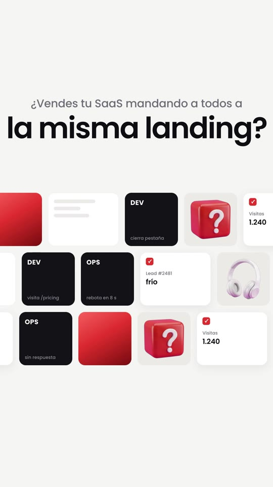
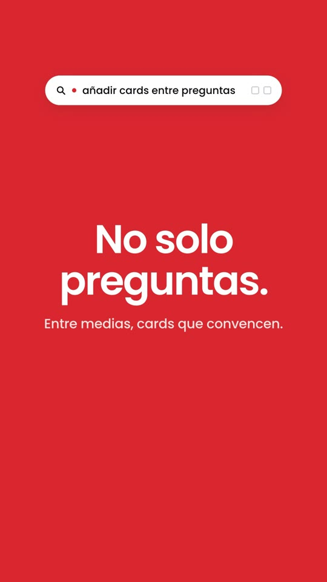
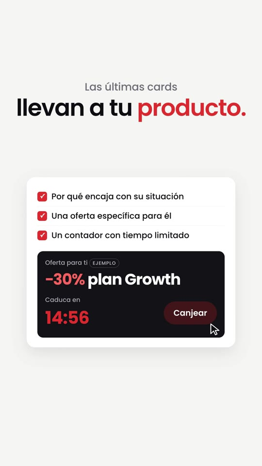

# Playbook: Search-bar launch film (music only)

   

A clean fintech-style product film. **A search/command bar is the spine of the film**: in each beat it types a query, and the scene under it answers that query. Around the bar: a blurred-card cold open on coloured slates, a tilted mosaic of tiles, flying 3D tiles, a full-bleed brand-colour takeover, a network of profiles, an offer panel with a countdown, fast alternating one-line slates, a tile orbit and a logo end card with two buttons. Light grey canvas, white UI cards, black tiles, **one accent colour** (brand red `#e8382d` here; the reference used blue). Poppins SemiBold. There is **no voiceover**: the base script is on-screen text over music and small UI SFX. HyperFrames + GSAP plus **one** Gemini image. **No AI video.**

- **Reference:** @FacundoMarino1, Wallbit promo "made directly with Claude (Opus)", https://x.com/FacundoMarino1/status/2104578830450966955 (39.5s, 16:9, music only). See `reference-original.jpg`.
- **Ours:** `../../x-batch/facundomarino.mp4`, 44.0s, 1080×1920, project `../../x-batch/facundomarino/`.
- **Closest existing formats:** F2 `../ui-launch-reel/` (light canvas, text-first, music only) and G4 `../color-block-promo/` (one flat colour per beat). What is new here: the **persistent search bar that types each beat's query**, the **blurred-card cold open with a tiny file name**, the **tilted mosaic → zoom-through**, the **circle-wipe colour takeover** and the **network diagram**. Use this format when the product has (or can pretend to have) a search/command interface, or when you want an "Apple / fintech keynote" calm instead of F2's punchy pixel type.

## 1. Anatomy (canvas 1080×1920, 30 fps, 44.0s)

| Beat | Time | What happens | Base-script line |
|---|---|---|---|
| S0 cold open | 0–3.0 | 3 slates × 1s (red, ink, grey). Each has a heavily blurred UI card (CSS `filter: blur(14px)`, slow scale + rotation), one white word that sharpens out of blur, and a tiny file name top-left (`landing_para_todos.html`) | hook, as pain words |
| S1 hook + mosaic | 3.0–8.0 | small grey line + big headline word by word; 3 rows of mixed tiles (black persona tiles, red gradient tiles, white data cards, object photos, skeleton cards) drifting left; at 6.0 the strip **tilts −32°**, then **zooms through** (scale 3.2, fade) into the drop | "¿…sin mandar a todo el mundo a la misma landing?" |
| S2 drop | 8.0–10.1 | logo mark spins in, wordmark, "Haz esto." (music drop is at 8.0s) | "Haz esto." |
| S3 | 10.0–14.1 | the **search bar** grows from a line (scaleX), placeholder, types the query, a seeded particle burst; tiles fly in from both sides above/below the headline and get sucked into the bar at 13.4 | "En lugar de pedir una demo, crea un Quiz Funnel." |
| S4 | 14.0–18.6 | huge "5–8" (300px Bold), chips, 2×4 black question tiles, one red | "5 y 8 preguntas… quién es, qué quiere, su problema" |
| S5 takeover | 18.5–22.6 | a 2000px red circle grows from below (scale 0→2.0) behind the bar; big white "No solo preguntas." | "Pero no hagas solo preguntas." |
| S6 | 22.5–26.6 | 20-tile mosaic dims to 10%; red-outlined group + label pill; 4 value cards (all invented numbers tagged **EJEMPLO**); black quote bubble | "cards con casos reales, datos, resultados o consejos… 'vale, esto tiene sentido'" |
| S7 network | 26.5–30.6 | result card in the middle, SVG curves drawn with `strokeDashoffset` to 6 profile nodes; one path turns red | "según sus respuestas, un resultado personalizado" |
| S8 | 30.5–32.1 | dark slate | "Y aquí viene la parte importante." |
| S9 | 32.0–37.1 | headline + white panel: 3 check rows, black offer block (−30% **ejemplo**), proxy-object countdown, cursor clicks "Canjear" | "las últimas cards… oferta específica… contador" |
| S10 | 37.0–40.5 | fast slates on the beat: light (strike-through) → ink → light → red | "no solo captas el lead. Lo segmentas, lo educas y lo llevas a la compra." |
| S11 | 40.4–44.0 | 14 tiles orbit the headline (proxy angle + `onUpdate`), then the end card: mark, wordmark, tagline, red + outline buttons | CTA |

**The search bar** (`#sb` inside the `#sbw` clip, track 2, 10.0–30.6s, `z-index: 50` so it sits on top of every scene, including the red takeover): magnifier SVG, a red status dot, a `.q` box with one absolutely-positioned `<span>` per query (`#q0` placeholder … `#q4`), two outline icons. `typeQ(id, t, cps)` turns the span into per-character spans, hides the other queries at `t`, shows characters one by one with `tl.set(display:inline)`, then blinks a caret with a finite `repeat`. Add a query = add a `<span id="qN">` and call `typeQ`.

**Tiles** come from one factory, `makeTile(kind, w, h)` (`blk` persona tile, `red` gradient, `card` white data card with a check, `img` object photo on a light tile, `sk` skeleton). The mosaic, the flying tiles, the dimmed value mosaic and the orbit all reuse it, which keeps the film visually coherent. Every "random" placement uses the seeded `rnd()` (deterministic renders).

## 2. Recipe

```bash
cp -R playbook/search-bar-film/template my-film && cd my-film
T=../playbook/tools
# 1) music (one call; the key is shared, el_audio.sh handles 429s and skips existing files)
FORCE=1 bash $T/el_audio.sh music assets/music.mp3 "Modern minimal fintech product launch music, clean electronic, crisp plucked synth arpeggio, soft sub bass, tight minimal percussion with claps, confident and optimistic, Apple keynote style, steady 116 bpm, builds slightly at the end and resolves with a clean final hit, no vocals" 46000
#    then find the drop: 0.5s RMS windows (snippet in §4). Ours: dip at 6.0, drop at 8.0, fade from 41.0 → film = 44.0s.
# 2) SFX: type/pop/tick/whoosh/ding are reused from ui-launch-reel; 2 new ones:
bash $T/el_audio.sh sfx assets/swoosh_in.mp3 "fast soft digital swoosh with a light shimmer, UI transition" 0.8
bash $T/el_audio.sh sfx assets/blip.mp3 "tiny soft glassy UI blip, single" 0.5     # came back at -39 dB → +18 dB (see gotchas)
# 3) the one image (~$0.03): 6 product objects on magenta, cut into PNGs
python3 $T/gen_image_ar.py gen/objects.png "Product photography sheet: a 3x2 grid of SIX separate small objects, … Background: perfectly flat solid pure magenta #FF00FF everywhere. No text, no logos, no magenta or pink on the objects." --ar 3:2
python3 $T/cutout_grid.py gen/objects.png assets 360 a b c d e f   # then LOOK and rename: the order came back different
# 4) edit index.html: brand colours in :root, copy in the sections, queries in #sb, times in the cue blocks
npm run check                     # 0 errors (warnings about file size / nesting are fine)
npx hyperframes snapshot --at 1.5,4.8,6.6,9.3,12.5,17.6,20.5,25.6,29.5,31.3,36.4,40,43
npx hyperframes render -o ../my-film.mp4
ffmpeg -i ../my-film.mp4 -af volumedetect -f null - 2>&1 | grep mean_volume
```
The full prompt for the object sheet is in `../../x-batch/facundomarino.report.md`; the sheet we got is `template/prompts/objects-sheet.png`.

Fonts: Poppins Medium/SemiBold/Bold from `github.com/google/fonts/raw/main/ofl/poppins/` (OFL), registered as `"PoppinsSIH"` (never name a font like a generic family). Archivo + Silkscreen are for the SaaS in House wordmark, copied from `../brand-film/template/assets/`.

## 3. Adapting it

- **Another brand:** change `--ac`, `--ac-hot`, `--ac-deep` and the cold-open gradients; the takeover circle uses `--ac`. Keep one accent only: the reference's discipline (grey + black + one blue) is what makes it look expensive.
- **Another script:** keep one query per idea; the query should be what a *user would type* ("5 a 8 preguntas", "resultado personalizado"), and the scene under it is the answer. 4–5 queries is the right amount; the bar fades out before the slates (30.2s).
- **Voice variant:** add `tools/tts_with_timestamps.py` narration and key `typeQ`/`wordsIn` times to word starts; drop the music to ~0.25.
- **Shorter cut (~30s):** drop S8 and S11's orbit, merge S4 into S3.

## 4. Gotchas we hit

- **Flying tiles covered the headline.** Restrict their target y to bands above/below the text (`band ? 1150+… : 400+…`), never a uniform spread.
- **Circle takeover did not cover the frame:** a circle anchored too low leaves the top light and white text becomes unreadable. Centre it ~200px below the frame middle and scale until the radius > distance to the far corners (2000px circle, top 700, scale 2.0).
- **`content_overlap` false positives:** Poppins' glyph boxes at 100–300px are taller than `line-height: 1.04`, so the audit flags line 1 vs line 2 of every headline. A parent `data-layout-allow-overlap` did **not** silence it; we set the attribute on each word span inside `splitWords()` and on `#s4-n`/`#s4-t`. Check visually.
- **Stacked slates (S10) really overlapped** in the audit because the earlier slate stayed at opacity 1 under the next one: hide the previous slate 0.02s after the next one cuts in.
- **White word on a light blurred card** failed contrast (2.26:1) on the grey slate: darken that card's gradient.
- **`cutout_grid.py` order ≠ prompt order** (the model laid out watch, cube, phone, gift, headphones, magnet). Make a check strip and rename.
- **Near-silent SFX:** `blip.mp3` came back at −39 dB; `ffmpeg -i blip.mp3 -af "volume=18dB,alimiter=limit=0.9"`.
- The network curves go card-edge → node-edge with control points at the midpoint; because the nodes sit close to the card in 9:16, they read as a bracket/tree rather than the reference's wide curves. For true curves, narrow the result card or push the nodes out.

Music drop finder:
```bash
python3 - <<'E'
import subprocess,numpy as np
a=np.frombuffer(subprocess.run(["ffmpeg","-v","error","-i","assets/music.mp3","-ac","1","-ar","8000","-f","s16le","-"],capture_output=True).stdout,np.int16).astype(float)
print(" ".join(f"{i/2:.1f}:{20*np.log10(np.sqrt((a[i*4000:(i+1)*4000]**2).mean())+1):.0f}" for i in range(len(a)//4000)))
E
```

## 5. Rights and content

- Our own brand only; the reference's Wallbit look (layout ideas) is imitated, not its assets or logo.
- Every invented number carries an **EJEMPLO** chip (×2 demos, 68%, +32%, −30% plan Growth). Replace them with real data or keep the chip.
- No generated people: personas are text tiles ("FOUNDER", "CMO"), so nothing can be mistaken for a real customer.
- The CTA «Comenta QUIZ» needs a real deliverable before posting.

## 6. Cost and time

- 1 Gemini 3 Pro image via treg ≈ **$0.03**.
- ElevenLabs: 1 music track (46s) + 2 SFX; **0 TTS characters**. Other SFX reused.
- About 1h of agent time; the render takes ~66s on this Mac.
