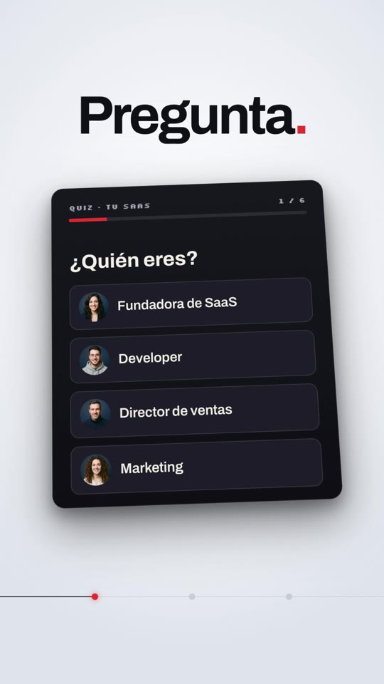
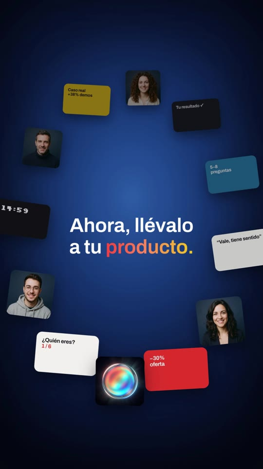
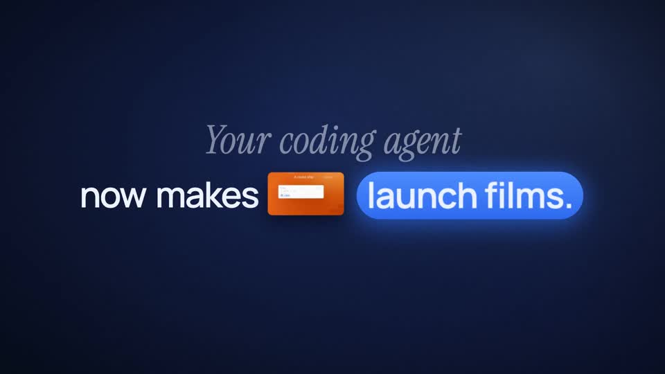
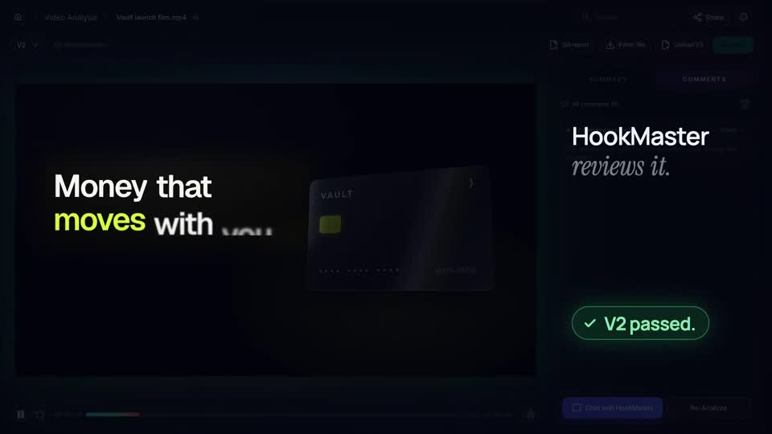

# Playbook: serif launch film (navy glow, italic serif × heavy sans)

A premium "SaaS launch film" look. Deep navy backgrounds with a centre glow alternate with pale studio "chapter" cards. Each line pairs a light **italic serif** phrase with a **heavy grotesk** phrase, and the key word sits in a **glowing pill**. Words rise in one at a time out of a blur. Dark UI cards float in 3D, tilt and dolly. Other beats: a ring of tiles orbits a headline, a "fixed headline + cycling word" showcases three panels, a strike-through list shows "the old way", and the end card puts the wordmark over a blurred wall of tiles. There is **no voiceover**: the script is on screen over an upbeat house/keynote track with small UI SFX. Everything is HTML + GSAP in HyperFrames, plus **2** Gemini images. **No AI video.**

Example: `../../x-batch/pranav.mp4`. A 48.0s, 1080×1920 Spanish quiz-funnel film for **SaaS in House**. The project is in `template/`.

   

Original (16:9):  

This playbook is for **any coding agent (Claude Code, Codex, …) or a human**. Commands assume you are in the folder that contains `playbook/`.

---

## 1. What the format is

Reverse-engineered from Pranav Joshi's "HookMaster Motion" launch film (https://x.com/pranavclickks/status/2105771789368607213, the reply that carries the video of https://x.com/pranavclickks/status/2105759537986937301). It is 65s, 16:9 and music-only: Scribe hears only "[upbeat music] Turn it up". The author says it was made by Claude Code with their MCP harness ("AE camera motion, null objects, deep glow… rebuilt as rules your agent follows"), on HyperFrames/Remotion.

| Element | Original | Ours (9:16) | Technique |
|---|---|---|---|
| Dark background | Royal-navy radial glow, heavy vignette | `.navy`: `#2a5aa8 → #173a7c → #0b1a42 → #050a1c` + inset shadow | CSS radial-gradient + `::after` inset box-shadow |
| Light background | Pale studio white/lilac | `.studio`: `#fff → #f3f4f8 → #dfe3ec` | CSS |
| Type pairing | Italic serif (grey-blue) + bold grotesk (white) | **Instrument Serif Italic** `#b9c3dd` + **Archivo** 640–720 | local `@font-face` (OFL fonts) |
| Key word | Electric-blue glowing pill | Brand-red pill `.pill` with a 60px + 140px red glow | `box-shadow` stack; `pillPop()` = blur + `back.out` scale + pop SFX |
| Text reveal | Words rise out of a blur, staggered | `words(sel, t, stagger)` on `.split` lines (auto-split into `.w` spans) | `fromTo {y:34, blur 14px, opacity 0}` |
| Inline object | A tiny product card sits between words | `.chip-card` (mini landing) between "a la" and the pill | inline-block + `back.out` pop |
| Chapters | "Recon." / "Build." / "Direction." with a blue period and a progress line with dots | "Pregunta." / "Educa." with a red period + `.rail` (track, `.rfill`, nodes) | `scaleX` on `.rfill`; node `scale` pop |
| UI cards | Dark rounded cards, deep shadow, 3D tilt that settles | `.ui` inside `.persp` (perspective 2200px): quiz, toggles, result, offer | `fromTo {rotateX:30, y:200}` → settle → slow `sine.inOut` drift |
| Cursor | Clicks a connector toggle | Turns off "Pedir una demo" + "Misma landing", turns on "Quiz Funnel" | `cursorTo()`, `press()`, `toggle()` (knob `x`, never `left`) |
| Orbit | Tiles circle "Here's what it makes." | Ring of 12 tiles (personas, orb, offer, quiz bits) around "Ahora, llévalo a tu producto." | proxy `{a, r}` tweened with `onUpdate: placeOrbit` (ellipse, depth scale/brightness/zIndex); no DOM measurement |
| Cycling word | "A launch film for / dev tools. → SaaS. → portfolios." with a swapping showcase | "Las últimas cards: / por qué encaja. → una oferta concreta. → una cuenta atrás." with 3 panels | blur in/out word + panel flies in with `rotateY` |
| Old way | Strike-through "Record every screen." + isometric screens | "Solo captar el lead." struck, then 3 lines + iso stack of cards | `.strike` `scaleX` 0→1; `#iso` `rotateX(52) rotateZ(-32)` + `z` stagger |
| End card | Logo, serif "Your code in.", gradient "A launch film out.", CTA pill, blurred wall of UI | Wordmark SaaS [IN] House, serif "Entra una visita.", gradient "Sale un cliente.", "Comenta «QUIZ»" CTA with a sheen | `#wall` (tile grid, `blur(14px)`, opacity .35) drifting up |
| Camera | Constant slow push-ins, blur cuts | `camera(id, start, dur)`: scale 1→1.07, then a 0.25s blur/scale exit | one wrapper `.cam` per scene |
| Audio | Upbeat house track, no VO | ElevenLabs music (122 bpm house/keynote, 50s → trimmed to 48s with a fade) + 6 SFX | cuts land on bar lines (`1.53 + 1.95·k` s for this track) |

## 2. Recipe: new film from a script

1. **Write the beats** (8–10 scenes, ~2–6s each). Each beat gets one serif + sans pair. Chapters get a one-word title with a coloured period. Keep the numbers in the cards labelled `EJEMPLO` until they are real.
2. **Music first** (shared key → sequential calls with 429 backoff):
   ```sh
   bash playbook/serif-launch-film/tools/el_audio.sh music assets/music.mp3 "Upbeat confident modern product launch track, punchy four-on-the-floor electronic house beat, bright synth stabs, plucky arpeggio, ... instrumental, no vocals, 122 bpm" 50000
   ffmpeg -i assets/music.mp3 -t 48 -af "afade=t=out:st=46.6:d=1.4" assets/music_cut.mp3
   ```
   Find the beat grid and put scene cuts on bar lines:
   `python3 -c "import librosa;y,sr=librosa.load('assets/music_cut.mp3');t,b=librosa.beat.beat_track(y=y,sr=sr);print(t,librosa.frames_to_time(b,sr=sr)[:12])"`.
   SFX (`whoosh tick pop click ding impact`) are reused from `template/assets/`. Make new ones with `el_audio.sh sfx OUT "text" SECONDS`.
3. **Images (≤2, ~$0.03 each)** via `playbook/tools/gen_image.py` with `SIZE=1:1`:
   - personas: "A 2x2 grid of four separate square studio portrait photos … plain muted dark navy blue background in every photo … Thin black gutters". Split them with `python3 playbook/serif-launch-film/tools/split_grid.py personas.png 2 2 assets/persona 400`;
   - hero object: "A single glowing iridescent glass orb … pure black background". Centre-crop it and show it with `mix-blend-mode: screen` so the black disappears on dark cards.
4. **Build**: copy `template/`. Edit the scene `<section>`s (`data-start`/`data-duration` = bar lines) and the timeline blocks, which carry the same `S#` comments. Helpers: `words`, `blurIn`, `blurOut`, `pillPop`, `camera`, `toggle`, `cursorTo`, `press`, `pickOpt`, `placeOrbit`, `sfx`.
5. **Check**: `npm run check`. The remaining flags are intentional: `content_overlap` on `#iso` and on `#wall` vs the logo; contrast on the blurred wall and the orbit mini-tiles (decorative); `nested_structure_needs_subcomposition` (single-file by choice). Fix any **real** overlap; the proof cards originally overlapped and had to become a 2×2 grid.
6. **Snapshot**: `npx --yes hyperframes@0.8.137 snapshot --at 3.6,10.6,12.6,20,26.9,33.9,38.1,43.4,46.9 --no-end .`, then look at the contact sheet.
7. **Render**: `npx --yes hyperframes@0.8.137 render -o ../out.mp4 .` (~35s for 48s). QA on the mp4: `ffprobe`, `volumedetect`, frames at the busiest moments.

## 3. Gotchas learned

- **Never tween `left`/`top`**: toggle knobs use `x`. The checker flags layout-property motion as stutter.
- **Don't put `transform` in CSS** for anything GSAP scales (`.rfill`, `.strike`, `.qbar i`). Use `fromTo` so GSAP owns the transform. Option highlight = `opacity` + `clipPath` wipe.
- **Orbit callbacks must not measure the DOM**: store tile sizes (`d._w`, `d._h`) at build time. Split `r` (radius) and `a` (angle) into separate tweens so the ring reaches full size in 1s while it keeps rotating.
- **Text over orbit**: give the centre text `z-index: 300` and use an ellipse wide enough (`450 × 600`) that side tiles clear the text.
- **Rotated iso stacks clip easily** at 1080 wide: `scale(0.9)` and centre by eye in a snapshot.
- Silkscreen (pixel) digits read badly at 170px ("4"). Big numbers use Archivo 800 `tabular-nums`.
- Instrument Serif comes from `github.com/google/fonts/raw/main/ofl/instrumentserif/InstrumentSerif-Italic.ttf`.

## 4. Cost (example)

2 Gemini 3 Pro images ≈ **$0.06**. ElevenLabs: 0 TTS characters, 1 music generation (50s). SFX reused. Render is local.

## 5. Variants

- **With voice**: add ElevenLabs TTS with timestamps (`playbook/tools/tts_with_timestamps.py`) and key every `words()` call to word times. Keep the music under −18 dB.
- **Blue original look**: swap `.pill` to `linear-gradient(#4f8bff,#2f62ff)` with a blue glow and `.dot` to blue. Brand blue `#2676AC` also works.
