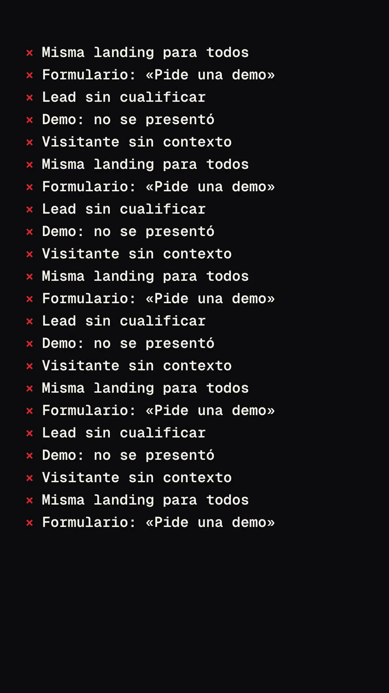
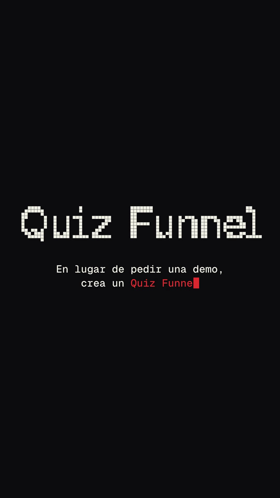
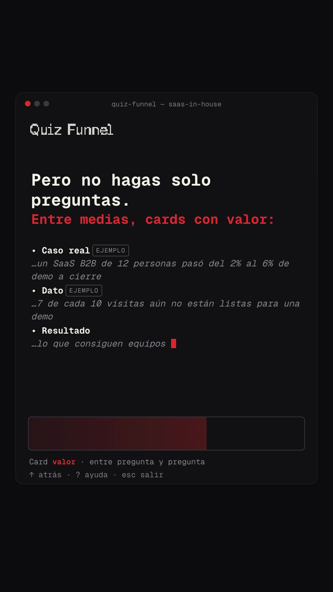
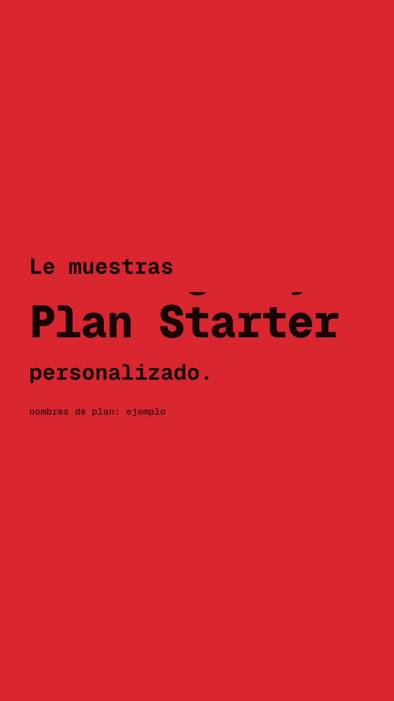
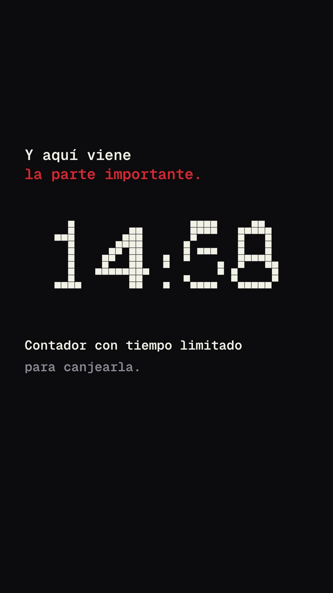

# Playbook: Terminal teaser (music only, zero images)

A near-black **CLI launch teaser**: everything is monospace, the only colour is the brand red. A wall of red `×` errors stacks faster and faster, a typed `$ haz esto` bursts into a **swarm of pixel squares that assemble into the pixel wordmark**, the wordmark shrinks into the title bar of a **terminal window** where a quiz is answered at the prompt and value cards "stream" like an agent thinking, a hard cut to a **full-bleed red card with a slot-roll word**, a **pixel-block dissolve** back to black, a **giant pixel number that assembles, scatters and re-forms** (−30% → 14:59 countdown), a `✓` list that answers the opening `×` list, and a wordmark typed letter by letter with a ghost cursor over `$ comenta QUIZ`.

**No voiceover**: the base script lives on screen, over a dark electronic bed + small UI SFX. **No images at all** ($0 treg). Everything is HTML + GSAP + one `<canvas>` in HyperFrames.

- **Reference:** "Introducing the new Freebuff CLI" by @jahooma (https://x.com/jahooma/status/2104619086579990583, 22s, 16:9, music only, 117k views). Contact sheet of the original: `reference-original-sheet.jpg`.
- **Ours:** `../../x-batch/jahooma.mp4`, 42.3s, 1080×1920, 30 fps.
- **Closest existing formats:** F5 `glow-signal-film/` (dark, music-only teaser) and F2 `ui-launch-reel/` (Geist Pixel typed headlines). What is new here: the CLI vocabulary (error stack, prompt box + status line, streamed "thinking" log), the **particle text engine**, the colour-card slot roll and the pixel-block dissolve.

    

## When to use it

A product or tactic for a **technical / founder audience** that wants a "this is a dev tool" feel, short and punchy. It is the cheapest format in the playbook (music + 2 SFX ≈ 1 music call, $0 images). It is text-heavy at 42s: for paid ads consider a 25s cut (drop S5 or S8).

## Anatomy (original → ours)

| t (s) | Original (Freebuff) | Ours (SaaS in House) | Device |
|---|---|---|---|
| 0–2.6 | — | Hook typed, `misma landing?` in red, block cursor | `typeIn()` |
| 2.6–6.3 | `× API key required` … stack accelerating, scrolls | `× Misma landing para todos`, `× «Pide una demo»`… 5 lines cycled, gap ×0.84 per line (0.32 → 0.055s), `$ haz esto` typed | container `y` jumps so the last line stays ≤ y 1420 |
| 6.3–9.6 | `$ freebuff` explodes into green/white pixels → pixel wordmark + tagline | swarm out of the typed line → pixel **Quiz Funnel**, subline "En lugar de pedir una demo, crea un Quiz Funnel." | canvas `assemble()` |
| 9.6–15 | wordmark shrinks into a terminal window; "10 models. One command." model line cycles | wordmark flies into the window header; "Entre 5 y 8 preguntas." + 3 questions answered in the prompt box, status line `Pregunta 1/8 · …`, ✓ history | stacked `.ans` / `.q` layers toggled with `tl.set` |
| 15–20.5 | "Watch it think." streamed italic log + progress bar | "Pero no hagas solo preguntas." + 4 streamed cards (Caso real / Dato with `EJEMPLO` chips / Resultado / Consejo), red progress bar, `› «vale, esto tiene sentido»` | `typeIn(..., 90 cps)` |
| 20.5–25.6 | "It replaces\|" typed → lime card "It replaces [OpenCode/Codex/Cursor…] for free." → glitch → dot dissolve | "Después, según sus respuestas…" → red card "Le muestras [Plan Starter/Scale/Agency/Growth] personalizado." → glitch → block dissolve | slot roll in an `overflow:hidden` box; `blocks()` on canvas |
| 25.6–33.2 | giant pixel `$0` + "No API key. No credit card." → dissolves | "Y aquí viene la parte importante." → pixel **−30%** (red) → scatters → **14:59** re-forms and counts down | `assemble()` / `scatter()` / `settled()` |
| 33.2–37 | — | "Así no solo captas el lead." ✓ Lo segmentas / Lo educas / Lo llevas a la compra | answers the × stack |
| 37–42.3 | wordmark typed letter by letter (grey ghost), `$ npm install -g freebuff`, url | **SaaS [IN] House** typed with ghost, `$ comenta QUIZ`, saasinhouse.com | `.l` spans 0.35 → 1 opacity |

## Recipe

```bash
cp -R playbook/terminal-teaser/template my-teaser && cd my-teaser
T=../playbook/tools
# 1) music (one call; the key is shared: sequential only, el_audio.sh backs off on 429)
bash $T/el_audio.sh music assets/music_raw.mp3 "Dark minimal electronic tech product launch teaser, 118 bpm, tight punchy kick, glitchy digital hi-hats, deep synth bass pulse, short bit-crushed arpeggios, tense first 6 seconds, energetic build, clear drop around 16 seconds, confident and clean, ends with a short final hit and ring out at 42 seconds, no vocals" 43000
bash $T/el_audio.sh sfx assets/swarm.mp3 "digital pixel particles swarm swoosh, glittery data bits rushing together into place, short electronic" 1.6
bash $T/el_audio.sh sfx assets/err.mp3 "short soft terminal error beep, low digital blip" 0.5   # came back -31 dB: +8 dB + limiter
```
2) **Splice the music so the drop lands on the swarm.** The track came back **61s** (not 43) with a quiet 15s intro and the drop at 16.0s. We took `9.6–47.1s` (drop → video 6.4s) and crossfaded into the real outro `55.6–61.0s`:
```bash
ffmpeg -i assets/music_raw.mp3 -filter_complex "[0]atrim=9.6:47.1,asetpts=PTS-STARTPTS[a];[0]atrim=55.6:61.0,asetpts=PTS-STARTPTS[b];[a][b]acrossfade=d=0.6[o]" -map "[o]" assets/music.mp3
```
Find your own drop with a 1s RMS scan (a numpy one-liner over `ffmpeg -f s16le` output) and set the root `data-duration` to the spliced length (42.3s).
3) Edit `index.html`: the copy lives in the HTML sections (`#hook`, `ERR[]`, `#win` children, `#red`, `#s7`, `#s8`, `#lock`), the times in the script blocks under each `/* ==== Sn ==== */` header, and the canvas beats in `paint(t)`.
4) `npm run check` → `npx hyperframes snapshot --at …` → `npx hyperframes render -o ../out.mp4`. QA the final mp4 (ffprobe, volumedetect, 6+ frames).

## The particle text engine (the signature device)

All canvas work is in `paint(t)`, a **pure function of time** driven by one proxy tween over the whole film (`tl.fromTo(PX, {t:0}, {t:END, …, onUpdate: () => paint(PX.t)})`), so any frame can be sought and parallel render workers agree.

- `targets(str, size, cy)` draws the string in **Geist Pixel Square** on an offscreen canvas and samples the font's own pixel grid (1 font pixel = `0.076 × size`, anchored at the pen x and the baseline, same trick as G3 `device-mockup-film`). It returns the square centres; strings wider than 940px are auto-shrunk. Results are cached **only once `document.fonts.check("40px GPix")` is true**, otherwise an early frame would cache the fallback font forever. A hidden `#fontwarm` node inside `#root` forces the font to load.
- `assemble(T, u, origin, colour, seed)`: every square bursts out of `origin` (first 30% of `u`), then converges on its target with a per-square seeded delay and a small perpendicular swirl; in flight squares are red/cream at 55–100% alpha, landed squares take the final colour.
- `settled(T, colour)` draws the landed text; the countdown just calls it with a new string each second (`14:59 → 14:57`).
- `scatter(T, u)` throws squares outward while shrinking and fading. Overlap `scatter(A)` with `assemble(B)` for a morph (−30% → 14:59).
- `blocks(u, colour)`: 60px grid squares switched on by `hash(i,j) < u`, the pixel dissolve from the red card to black.
- The wordmark → window header move is the same `QF` targets drawn with a scale (1 → 0.29) and translation, so the header is **the canvas**, not an HTML copy (no font-metric matching needed).
- Determinism: `hash(a,b)` integer hash, no `Math.random`.

## Gotchas

- **`npm run check` reports ~7 `text_occluded` errors "inside #px"**: the auditor treats the full-frame transparent canvas as opaque. `data-layout-ignore` / `data-layout-allow-occlusion` on the canvas did **not** silence it in 0.8.137 (the attribute is per text element, not inherited). We verified visually in snapshots and in the final mp4 that nothing is covered; accept them or mark each listed text element with `data-layout-allow-occlusion`.
- The slot roll: a word that slid out above the clip box still counts as overlapping text for the auditor. `tl.set(opacity: 0)` it right after it leaves.
- Typing: `wrapChars()` wraps every character (keeping inner `<span class="ac">` accents) in `.ch {display:none}` and `typeIn()` flips them to `inline`, so the **block cursor follows the text**. Keep `<br>` out of the wrapped list (a `<br>` set to `display:block` breaks the layout).
- Stacked prompt-box layers (`#ph`, `#a1..#a4`) start hidden with `gsap.set` (a `tl.set` at 0 does not render frame 0).
- The music's first 6s are a quiet build (-27 dB mean over the first 3s even after +6.8 dB gain on 0–6.2s). The typing/error SFX carry the hook; if your track is quieter, boost that window more or pick a track that starts strong.
- Muted grey on `#111114` needs `#7d7c84` or lighter (contrast check).
- Copy rules: the "Caso real" and "Dato" figures carry `EJEMPLO` chips, `−30%` carries an "−30% ejemplo" chip, the plan names say "nombres de plan: ejemplo". Replace with real numbers before posting.

## Cost

| Item | Amount |
|---|---|
| Images | **0** (no treg spend) |
| ElevenLabs | 1 music call (43s requested, 61s returned) + 2 SFX; 1 Scribe call on the reference (no speech) |
| Reused SFX | type, tick, whoosh, glitch, pop, ding (from `ui-launch-reel/`), shimmer (from `glow-signal-film/`) |
| Render | ~45–90s on an M-series Mac |
