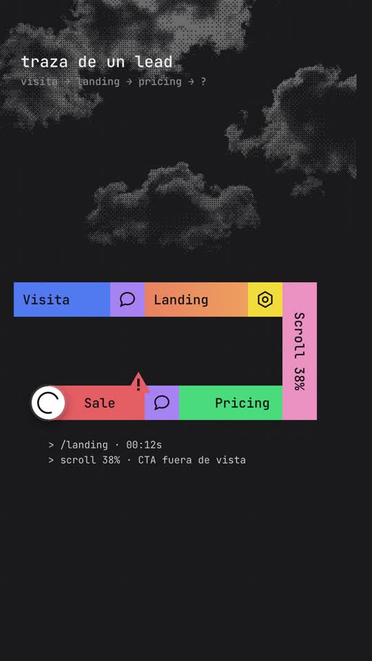
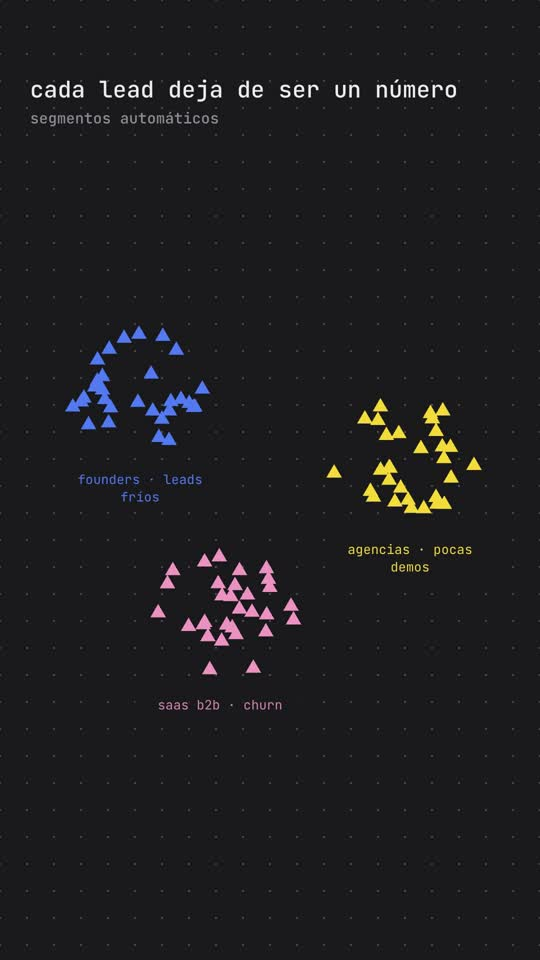

# Playbook D: Trace / data explainer film

A calm, technical "product-launch" explainer in the style of Laminar's flow-1 film:
- a charcoal screen with a faint grid and monospace type;
- a **snake of chunky coloured blocks** (a journey or trace) that grows block by block with a ring cursor riding its tip;
- blocks that open into logs with red-highlighted errors and ⚠ badges;
- thousands of grey traces streaming past;
- halftone pixel clouds behind a monospace title;
- a JSON-style result card with pills;
- coloured triangles that **cluster into segments** on a dot grid;
- a monospace benchmark chart, a terminal-style CTA and the logo.

Built with HTML + GSAP in HyperFrames, plus one generated photo (clouds, dithered by code) and ElevenLabs audio. **No AI video.**

Example: `../../sih-trace-film.mp4`. A 44s, 9:16 quiz-funnel explainer for **SaaS in House**, with a calm Spanish narrator. The project is `template/`.

 

This playbook is for **any coding agent (Claude Code, Codex, …) or a human**. Commands assume you are in the folder that contains `playbook/`.

---

## 1. What the format is

Reverse-engineered from Laminar's flow-1 launch (https://x.com/skull8888888888/status/2107138967644541129: 74.5s, 16:9, narrated). Their story is "agent traces hide errors → cheap models miss them → flow-1 finds and clusters them". Ours maps **agent trace → a lead's path through your funnel**:

| Beat (VO) | Laminar (reference) | Our version (template) | Technique |
|---|---|---|---|
| 1 "Este es el camino de un lead… cada clic deja un rastro… te dice por qué" | Agent trace as a coloured block snake (Thinking/Read/Write/Bash + icon squares), a cursor ring, blocks expanding into logs with red highlights, ⚠ | Visita → Landing → Scroll 38% (vertical turn) → Pricing → **Sale** ⚠, then a log: "abandona: no ve su caso" | `snake()` helper: blocks `scaleX/scaleY` from 0 along their direction; orb tweens to each leading edge; `logPanel()` lines fade in |
| 2 "todos llegan a la misma landing… la mayoría se pierde" | Thousands of grey traces, cost bar | 15 grey trace rows scrolling at different speeds; ⚠ pops on ~78% of them; counter "1.000 → 21" (ejemplo) | each row its own linear `x` tween; seeded RNG for speeds and which rows fail |
| 3 "Ahora imagina un quiz" | "flow-1" over halftone clouds | "quiz-funnel" + blinking block cursor over dithered clouds, twinkling pixel stars | `dither_image.py` PNG, `image-rendering: pixelated` |
| 4 "Cinco a ocho preguntas… casos reales y datos" | — | Quiz snake: Pregunta 1/2 → **Caso real** (vertical) → Pregunta 3 → **Dato** → Pregunta 4 (vertical), log + green ✓ | same `snake()` |
| 5 "Cada respuesta te dice quién es, qué quiere, qué le duele" | Signals orb + JSON result card (`is_hallucination: true`, `severity: critical`) | Blue orb with spinner + `[quiz]` log; white card: perfil `founder_saas`, objetivo `mas_demos`, problema `leads_frios · crítico` + explanation | pills pop on their words |
| 6 "un resultado y una oferta… un contador" | Yellow cost bar with $ coin | Resultado (green) → Oferta −30% (gold) blocks; yellow bar shrinking with a € coin + 14:59 countdown | proxy counter + `scaleX` bar + coin `x` in sync |
| 7 "deja de ser un número. Lo segmentas, lo educas, lo llevas a la compra" | Coloured triangles clustering into patterns; benchmark bars | 90 triangles scatter, then fly into 3 labelled segments; "conversión a demo" bars 2,1% vs 6,8% (ejemplo) | each triangle: pop at a random spot, then tween to `cluster center + polar offset` |
| 8 "Comenta QUIZ…" | "Use Laminar CLI…" card, logo | Terminal card `> comenta QUIZ▌`, "y te enseño cómo montarlo", SaaS in House lockup | blinking cursor via `tl.set` |

Palette: bg `#19191b`, grid lines `rgba(255,255,255,.045)`, blocks blue `#4d7cf6`, orange gradient `#f2895f→#f5a35a`, yellow `#f6d433`, purple `#a98bf7`, pink `#f29cc4`, green `#3fc87a`, red `#f06a62`, grey traces `#3a3a3f`. Font: JetBrains Mono (variable TTF from google/fonts). The brand appears only in the final lockup.

## 2. Prerequisites

- `ffmpeg`, Node + `npx` (HyperFrames CLI; the template pins `0.8.137`), Python 3 with `numpy pillow`.
- `ELEVENLABS_API_KEY` (`source <(grep ELEVENLABS_API_KEY ~/.zshrc)`), plus the `treg` CLI for one image (~$0.03).
- HyperFrames basics: one paused GSAP timeline at `window.__timelines["main"]`; scenes are `<section class="scene clip" data-start data-duration>`; every `<audio>` has a unique `id` (the template generates SFX `<audio>` tags in JS with ids); no `Math.random` (use the seeded `rnd()`); local `@font-face` fonts.

## 3. Recipe

```bash
cp -R playbook/trace-film/template my-trace && cd my-trace && T=../playbook/tools
```

**1) Script + voice.** A documentary pace: ~100 words ≈ 40s, one sentence per beat. We used Bruno Torres (`SKjgN71N3MeGl4r2JbRt`, Spain Spanish, calm) at speed 1.08, close to Laminar's narrator:
```bash
source <(grep ELEVENLABS_API_KEY ~/.zshrc)
python3 $T/tts_with_timestamps.py assets/script.txt assets SKjgN71N3MeGl4r2JbRt 1.08
python3 -c "import json;w=json.load(open('assets/words.json'));print(' '.join(f'{i}:{x[0]}@{x[1]}' for i,x in enumerate(w)))"
```

**2) Clouds**: one photo, dithered by code:
```bash
python3 $T/gen_image.py assets/clouds_source.jpg "Dramatic soft cumulus clouds floating in a pure black night sky, high contrast black and white photograph, several separate cloud puffs with lots of black empty space between them, centered composition, no horizon, no text."
python3 $T/dither_image.py assets/clouds_source.jpg assets/clouds_dither.png 1080 3 0.16
```

**3) Music + SFX** (run the SFX calls one after another):
```bash
curl -s -o assets/music.mp3 https://api.elevenlabs.io/v1/music -H "xi-api-key: $ELEVENLABS_API_KEY" -H "Content-Type: application/json" \
  -d '{"prompt":"calm minimal ambient electronic music for a technical product launch film, soft pulsing synth arpeggio, warm pads, gentle beat that builds slightly in the middle, clean and thoughtful, no vocals","music_length_ms":44000}'
sfx(){ curl -s -o "assets/$1" -w "$1 %{http_code}\n" https://api.elevenlabs.io/v1/sound-generation -H "xi-api-key: $ELEVENLABS_API_KEY" -H "Content-Type: application/json" -d "{\"text\":\"$2\",\"duration_seconds\":$3,\"prompt_influence\":0.7}"; }
sfx blip.mp3 "soft short digital UI blip, clean minimal, like a block snapping into place" 0.5
sfx whoosh.mp3 "soft airy whoosh transition, subtle" 1
sfx alert.mp3 "short soft error alert tone, minimal UI warning beep" 0.6
sfx chime.mp3 "gentle positive UI success chime, minimal" 1
curl -sL -o assets/JetBrainsMono.ttf "https://github.com/google/fonts/raw/main/ofl/jetbrainsmono/JetBrainsMono%5Bwght%5D.ttf"
```

**4) Edit `index.html`.**
- **Timing.** All cues use `t(wordStart)` with `VO = 0.3`, so read the word starts from `words.json`. Scene `data-start`s sit on the first word of each beat. Set the root `data-duration` to about the voice length + 3s.
- **Snakes.** Edit the segment lists passed to `snake(worldId, segs, orbStart)`. Each segment is `{x, y, w, h, color|icon, label, dir: "r"|"l"|"d", at}`. The geometry rules:
  - horizontal blocks are `h: 100`; icon squares are `100×100` (`icon: "hex"` yellow or `"chat"` purple);
  - a vertical turn block (`dir: "d"`) is 100 wide and sits after the last block of a row;
  - the next row runs back with `dir: "l"`;
  - leftward blocks get extra left padding automatically, because the orb parks on their left edge.
- **Logs, badges, cards.** Use `logPanel(worldId, x, y, lines, at, step)` and `badge(worldId, x, y, at, "warn"|"check")`. Highlights: `<span class="r">` (red) or `"g"` (green); `<span class="tag">` is grey.
- **Copy.** Edit the HTML of S2 (counter), S5 (card keys, pills, explanation), S6 (offer label, countdown), S7 (`SEG` names, colours, cluster centres; benchmark bars) and S8 (terminal and logo).
- **SFX.** `snake()` and `badge()` add a blip or alert automatically. Add more with `sfx(file, at, volume, duration)`.

**5) Check, look, render:**
```bash
npm run check                    # 0 errors; size/nesting warnings are fine
npx hyperframes snapshot --at 2.5,7.2,12.8,16.0,21.9,25.9,31.0,34.0,37.6,42.5 --no-end
npx hyperframes render -o ../my-trace.mp4        # ~45s for 44s
ffmpeg -i ../my-trace.mp4 -af volumedetect -f null - 2>&1 | grep mean_volume
```
Also pull a few frames from the **final mp4** at the busiest moments (stream, clusters). Two of our bugs only showed up there.

## 4. Gotchas we hit

- **The trace stream ran out**: rows built from 9 repeats scrolled past their own end, leaving the right half empty with ⚠ badges floating in space. Build rows much longer than the distance they travel (we use 22 repeats ≈ 5,000px for ~1,800px of travel).
- **The stream overlapping the counter card** triggers `content_overlap` errors. Keep rows inside their area (15 rows × 82px from y=300 ends at ~1,530; the card starts at 1,600).
- **The orb covered the label** on leftward blocks ("Sale" read as "ale"). Fixed with `paddingLeft: 104px` on `dir: "l"` blocks.
- **The countdown showed 15:00 for a second**: start the proxy at `899`, not `899.99` (`Math.ceil`).
- **Dither speckle in the black sky**: clip the dark tones (`floor` 0.16) before dithering, and bias the Bayer thresholds by +0.5/16.
- **Cluster labels hidden under triangles**: place labels at `cy + 175`, outside the max cluster radius (130px × 0.75 vertically).
- Logs at 25px were too small on a phone; use 29px+ for logs and 46px for headings.

## 5. Before publishing

- Numbers in the stream counter (1.000 → 21), the case ("4 → 19 demos/sem"), the "7 de 10" fact and the benchmark (2,1% vs 6,8%) are **examples**, labelled "ejemplo" on screen. Replace them with real data where possible.
- The CTA promises "te enseño cómo montarlo". Have that ready.

## 6. Cost and time

- 1 image (~$0.03), plus ElevenLabs: ~560 characters of TTS, a 44s music track, 4 SFX.
- Render ~45s. A new film from the template is ~1–2h of agent time, mostly snake layouts and re-timing to the new voice.
