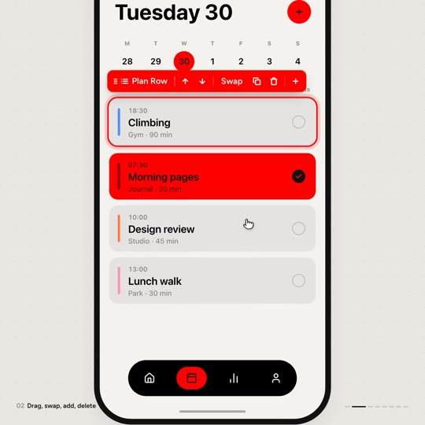
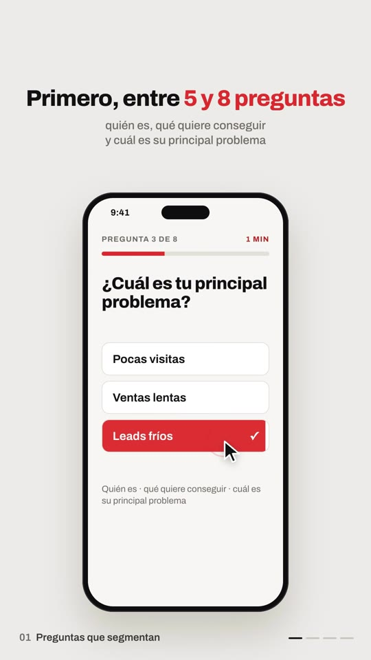
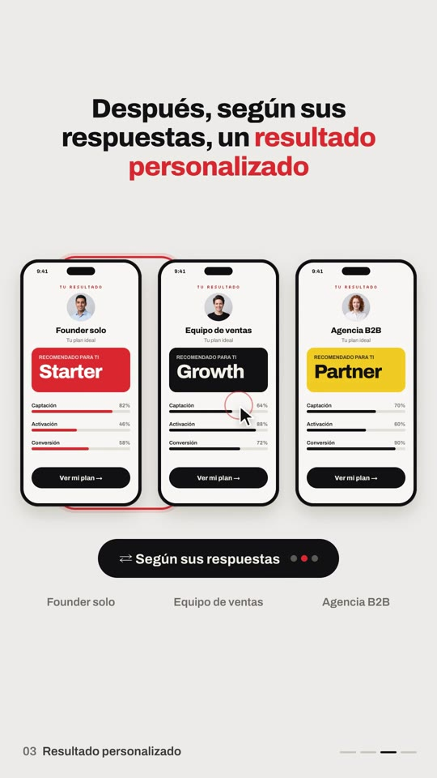
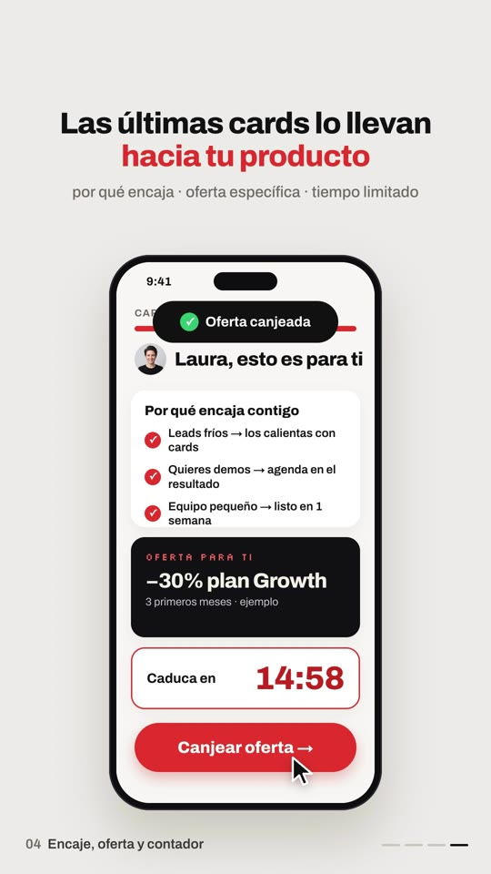
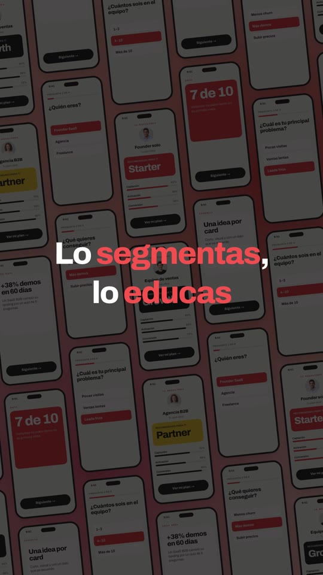

# Playbook: UI demo film (product walkthrough on a phone, music only)

A quiet, Apple-style product walkthrough. An app icon pops in. A phone mockup on a warm grey background is "used" by a cursor that taps, selects, inserts and swaps UI. Numbered chapter captions sit bottom-left with progress dashes bottom-right. Three phones show variants, a tilted grid of every screen pulls back, the grid dims for the payoff line, and it ends on a logo end card. **Everything is HTML/CSS + GSAP in HyperFrames.** There is no AI video and no voice. The only generated images are 4 avatar portraits (one Gemini call, ~$0.03).

Example: `../../x-batch/saivion.mp4`. A 46s, 1080x1920 SaaS in House quiz-funnel demo in Spanish. The project is `template/`.

    

## 1. Source and what makes it distinctive

Reverse-engineered from **SwiftPieces Playground** by @saivion (https://x.com/saivion/status/2107158999267504298): 39s, 1:1, music only (Scribe returns just "[outro jingle]"). Its beats:
icon → "Introducing SwiftPieces / *Playground*" (blurred red word) → black "Remix any app" pill → app gallery → phone list screen with **selection outline + red toolbar** (Plan Row ↑ ↓ Swap ⧉ 🗑 +) → three phones side by side, "Shuffle" themes → code view → "Build" sheet → tilted grid of screens on a pink gradient → dimmed "SwiftPieces Pro" → end card with the icons. A small "02 Drag, swap, add, delete" chapter label sits bottom-left, with progress dashes bottom-right.

| Beat | Our version (template, seconds) | Technique |
|---|---|---|
| Intro 0–2.3 | Red "IN" squircle icon, "Presentamos / Quiz Funnel / *by SaaS in House*" (blur-in red) | `back.out` pop; blur 18px → 0 |
| Hook 2.6–5.2 | The script's question, word by word, last words red | words built from an array, `inUp` per word |
| Haz esto 5.2–8.3 | Grey "Pedir una demo" pill gets struck through; black "Crear Quiz Funnel" pill is clicked and blows up | strike = `scaleX` 0→1; click = cursor scale + ripple |
| 01 Preguntas 8.3–13.5 | Phone flies up; the cursor answers 3 questions (red fill wipes in), progress bar 1/8→4/8 | `clipPath inset()` wipe; questions slide in on x |
| 02 Cards 13.5–22 | Editor list ("Mi Quiz Funnel"): select a row → red toolbar → click **+** → rows below shift down, a value card (Caso real / Dato / Consejo) pops in with a red flash; "“Vale, esto tiene sentido.”" pill | rows absolutely positioned at slot `240+94k`; shifts use **absolute** `y` values (seek-safe) |
| 03 Resultado 22–27.4 | 3 mini phones (Starter/Growth/Partner by persona), red ring jumps between them, "⇄ Según sus respuestas ● ● ●" pill; the middle phone zooms into the full phone | minis are the full-size phone at GSAP `scale: 0.5` (origin 0 0); zoom = `scale 1, x/y` to the S6 phone position |
| 04 Oferta 27.4–36 | "Por qué encaja contigo" ticks, dark −30% offer card, live countdown, "Canjear oferta" click → "Oferta canjeada" toast | countdown proxy + `onUpdate` |
| Payoff 36–41 | 7×7 grid of every screen (built in JS from the same screen builders), tilted, pulling back on a red/pink gradient; white pill "Así no solo captas el lead."; dim; "Lo segmentas, lo educas y lo llevas directo a la compra." | one container scaled 1.05 → 0.36, rotation −10 → −6 |
| End 41–46 | "Monta tu Quiz Funnel", icon, SaaS IN House lockup, url, CTA "Comenta «QUIZ»" | |

**No voice:** the reference has none, so the base script is the **headline captions** (`#c1…#c8` in the `#ui` overlay section) plus the chapter labels. Captions sit in the top band (150–530px) and the phone sits below it (top 560). If you want a VO, generate it with `playbook/tools/tts_with_timestamps.py` and move the cue times onto the word starts (see `brand-film`).

## 2. Recipe

```bash
cp -R playbook/ui-demo-film/template my-demo && cd my-demo
source <(grep ELEVENLABS_API_KEY ~/.zshrc)
# music (ONE call; shared key → sequential, 429 backoff in tools/el_post.sh)
../playbook/ui-demo-film/tools/el_post.sh assets/music.mp3 /v1/music '{"prompt":"minimal upbeat modern product launch music like an Apple app reveal, soft plucky marimba and synth arpeggios, light finger snaps, warm bass, 112 bpm, small lift around 35 seconds, short bright outro ending cleanly at 46 seconds, no vocals","music_length_ms":46000}'
../playbook/ui-demo-film/tools/el_post.sh assets/pop.mp3 /v1/sound-generation '{"text":"soft satisfying UI pop","duration_seconds":0.5,"prompt_influence":0.7}'
# tick.mp3 + whoosh.mp3 are reused from brand-film. Avatars (optional, ~$0.03):
python3 ../playbook/tools/gen_image.py avatars.png "Four separate circular profile photo avatars ... 2 by 2 grid ... flat pure magenta #FF00FF background ..."
python3 ../playbook/tools/cutout_grid.py avatars.png assets 300 av1 av2 av3 av4
npm run check && npx hyperframes snapshot --at 1.6,7.3,10.2,16.4,19,24.6,30.9,34.6,37.5,40.3,43.5 --no-end
npx hyperframes render -o ../my-demo.mp4      # ~70s for 46s
```

**What to edit in `index.html`:**
- **Copy:** captions `#c1…#c8`, chapter labels `#h1…#h4`, the hook array `HOOK`, the quiz questions (`#q1…#q3` static, plus `QS` for the grid), the editor rows `#R0…#R4` / inserts `#I1…#I3`, personas `PERS`, the offer screen `#offer`, the payoff `#p1…#p3`, and the end card.
- **Timing:** every cue is an absolute second in the script. Cursor moves are `cur(x, y, t, dur)` and clicks are `click(x, y, t)` (scale + ripple); both use **canvas coordinates**. The phone screen origin is (256, 576), so a screen point (sx, sy) is at (256+sx, 576+sy).
- **SFX:** the `<audio>` tags carry absolute `data-start` times. Keep them on the click / pop / whoosh moments, one `data-track-index` each.

## 3. Gotchas

- `gsap_css_transform_conflict`: an element with CSS `transform: scale()` that GSAP also tweens is a lint **error**. Set the scale in GSAP (`fromTo(..., {scale:.5}, {scale:.5, ...})`) instead.
- **Layered UI on purpose** (a toolbar over the row above it, a toast over the status bar, a pill over the phone) trips `content_overlap`. Add `data-layout-allow-overlap` to the overlay *and* to its inline children (e.g. the toast's ✓ badge).
- When a new screen layer covers an older one (result → offer), **fade the old layer to 0**. Otherwise the audit flags dozens of overlaps behind it.
- `.av img` at 104% with negative margin triggers `container_overflow`. Use 100%; Gemini avatar cutouts have a faint magenta rim, but it is invisible at that size.
- Wide display text inside phone cards wraps at 54px+. `−30% plan Growth` needs ≤46px with `nowrap` inside a 504px card. Check this in the **final mp4**, because a snapshot taken mid-animation can hide it.
- One residual contrast warning (light grey text on a dark card) is a false positive; the checker samples the wrong background.
- The grid (49 full phones) is heavy but renders fine (~70s total for 46s at 1080x1920).

## 4. Before publishing

The case stats (+38% demos, 7 de 10) and the −30% offer are **illustrative**. The offer card says "ejemplo"; replace these with real numbers or keep them labelled. The CTA "Comenta «QUIZ»" needs a real deliverable.
