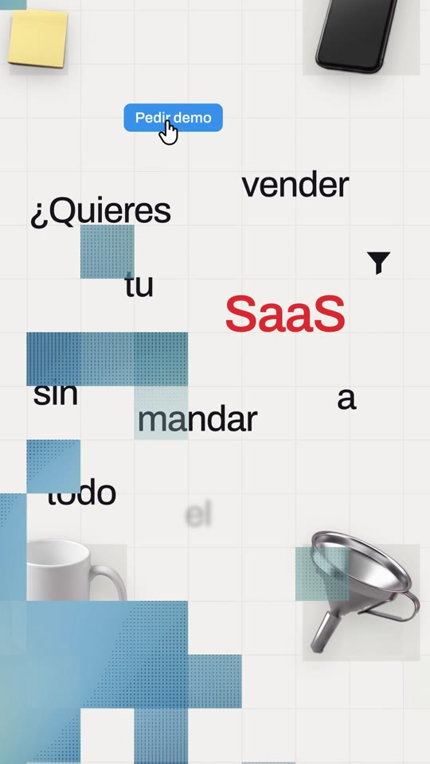
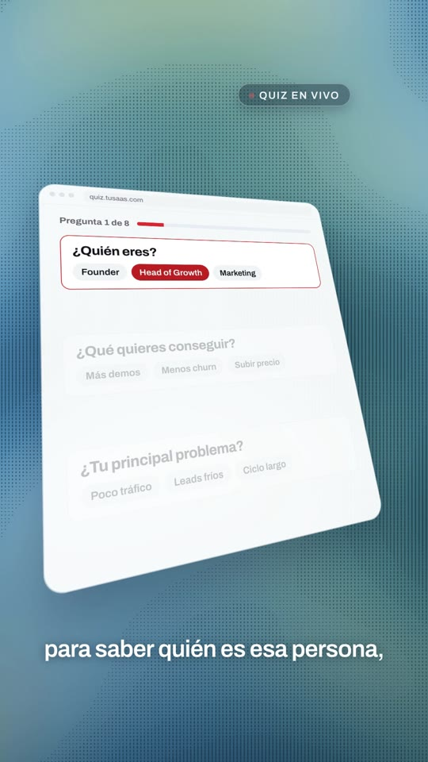
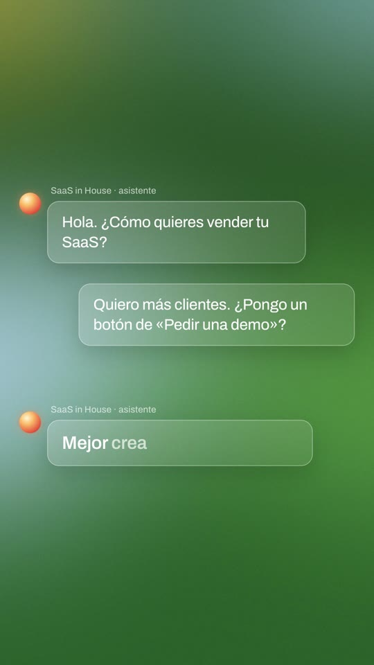
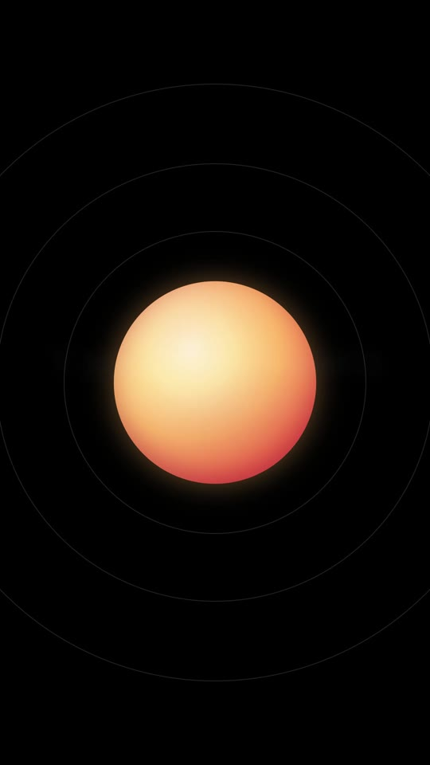
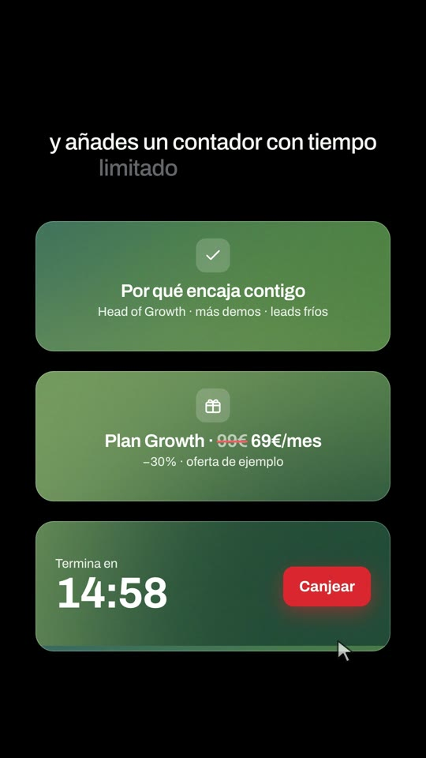

# Playbook: UI launch film, scatter variant, mosaic look (F1 → scatter → mosaic · voice)

A variant of the **scatter variant** ([`../ui-launch-film-scatter/PLAYBOOK.md`](../ui-launch-film-scatter/PLAYBOOK.md)), which is itself a variant of **F1 UI launch film** ([`../ui-launch-film/PLAYBOOK.md`](../ui-launch-film/PLAYBOOK.md)). Read both first: scene map, scatter `sword()`, captions, tilted glass cards, circle → orb beat, countdown/cursor helpers and the "ejemplo" rules are the same. **This file documents only what is different.**

Example: `../../x-batch/elevenlabs.mp4` (57.0s, 1080x1920, Spanish, SaaS in House quiz-funnel script). Project: `template/`.

    

Original (16:9 contact sheet, 1 frame/s): `reference-original-sheet.jpg`.

## 1. Reference, and why this is a variant

ElevenLabs "Introducing Reception, an AI receptionist platform for small businesses" (https://x.com/ElevenLabs/status/2100262886916358361, 32.9s, 16:9, music + voice; 2.3M views, 6k bookmarks). Beat list: scattered words "Someone's calling to make an appointment / to book a job / But nobody's around to pick up" on an off-white grid with photoreal product cut-outs; **pixel-mosaic dissolves** into **halftone blue-green panels** with ringing desk phones + an "INCOMING CALL" glass pill; "Until now" in a warm blurred circle → a glowing orb with rings on black; **frosted chat bubbles** (live call transcript) over a blurred green gradient; "Stop missing calls and opportunities" with grey→white words and a drawn outline; three **gradient agent cards**; "Reception.ai" rising over a glowing horizon line.

The `ui-launch-film-scatter` folder was built from **@notdwd's "synced remake" of this exact film**, so the timing skeleton (scatter → panel → circle/orb → chat → scatter … → dark act → wordmark) was already there. What notdwd's remake changed, and this variant restores, is the *look* of the original.

## 2. What is different from the scatter variant

| | ui-launch-film-scatter (notdwd) | **This variant (mosaic)** |
|---|---|---|
| Paper scenes | white + dot grid, glossy 3D icons + code mini-UI chips | warm paper `#f1f0ec` with a **135px square grid** (`paper.png`); **photoreal product cut-outs on grey grid-cell squares** (`obj(layer, name, col, row, cells, t)`); black **glyph** motif (the original's phone icon → funnel / ?) and a **blue button + hand cursor** chip (`bbtn()`, the original's "book" chip); regular-weight (470) words |
| Transitions | diagonal clip-path `sweep()` | **`mosaic(id, at, plate)`**: 9×16 tiles of 135px, snapped to the paper grid, filled with the *incoming* plate (`background-position = -x -y`), pop in diagonal-biased random order over 0.36s, the incoming scene starts underneath at `at`, tiles drop out over 0.4s. One `<section class="mosaic">` per cut (z-index 50) + a `glitch.mp3` |
| Panels | blue gradient "sky" with line art | **halftone sky** (`halftone.png` 1080×2200, made in code): wavy blue/teal/olive gradient + vertical dash halftone in the dark bands, drifting slowly (`htScene()`); a dark **glass pill** with a blinking red dot ("18 visitas · 1 landing", "Quiz en vivo", "Resultado listo") = the original's INCOMING CALL pill; bottom scrim + white captions, accent words in a red chip |
| Circle / orb | blue circle → blue glass orb | **warm** circle (`blurC.png` red/orange/yellow, background drifts) → cream/peach glowing orb with thin rings, like the original |
| Chat | typed iPhone chat with keyboard | **frosted transcript bubbles** over `blurA.png` (green forest + yellow + sky corners): assistant label + orb avatar, the visitor's line appears word by word (new words pale, then white), the assistant's answer "Mejor crea un Quiz Funnel." is synced to the voice with "Quiz Funnel." turning gold |
| Proof beat | 4 cards | same 4 cards on the halftone + a dashed **"+ añade una card"** placeholder while "añade pequeñas cards" is said (otherwise the panel sits empty for ~2.7s) |
| Dark act | glass "price cards" with blue glow | three **gradient agent cards** (`blurB.png`, each a different crop, slowly panning, 22% black overlay for contrast) with a line icon in a translucent square: Por qué encaja / Plan Growth 99€→69€ (ejemplo) / live 15:00 countdown + Canjear click; line text reveals **grey → white** per word |
| Ending | glowing wordmark | wordmark **rises from behind a glowing green horizon line** (overflow-hidden mask whose bottom is the line), radial green glow below |
| Voice | Bruno Torres, fresh TTS | **reused** Guillermo Brazález VO + `words.json` from `../ui-launch-film/template/assets/` (ElevenLabs was out of credits; same 138-word script, same word indices) |
| Timing | hard-coded section times | **`tools/build.py`**: `index.tpl` declares named times from word times (`s2 = w(10) - 0.15` …) and uses `{{expr}}` in every `data-start`/`data-duration`; swapping the voice = re-run build, nothing else |
| Images | 1 Gemini sheet (icons) | **2 Gemini sheets** (12 photoreal objects, 3:2) ≈ $0.06; all backgrounds are code (`tools/make_plates.py`, free) |

Scene map (word index cues, `T.sN` from the TIMES block): S1 paper "¿Quieres vender tu SaaS sin mandar a todo el mundo" (phone, notes, mug, funnel) · mosaic · S2 halftone tilted landing + 18 dots sucked in, caption "a la misma landing?" · S3 warm circle "Haz esto." → orb · S4 frosted chat · mosaic · S5 paper "Primero haces entre cinco y ocho preguntas" (clipboard, lens, laptop) · mosaic · S6 halftone quiz card 1→3/8 · mosaic · S7 paper "Pero no hagas solo preguntas." + red strike (megaphone, mouse, hourglass) · mosaic · S8 halftone placeholder → 4 proof cards (EJEMPLO) → bubble "vale, esto tiene sentido" · mosaic · S9 paper "Después, según sus respuestas" (gift, clock, mug) · mosaic · S10 halftone result 82% (ejemplo) · S11 warm circle "Y aquí viene la parte importante." → orb · S12 gradient cards + countdown + click · S13 "Así no solo captas el lead." grey→white, drawn outline, Segmenta./Educa./Vende. · S14 horizon wordmark + "comenta «quiz»".

## 3. Recipe (differences only)

```bash
F=playbook/ui-launch-film-scatter-mosaic; T=playbook/tools
cp -R $F/template my-film && cd my-film
# 1) voice: reuse a base-script VO + words.json (or make one with ../tools/tts_with_timestamps.py)
cp ../playbook/ui-launch-film/template/assets/{vo.mp3,words.json} assets/
# 2) backgrounds (free): halftone.png, paper.png, blurA/B/C.png — edit colours at the top of the script
python3 ../$F/tools/make_plates.py assets
# 3) objects: 2 sheets of 6 photoreal products on magenta, 3 cols x 2 rows (prompts in section 5)
python3 ../$T/gen_image_ar.py objA.png "<prompt A>" --ar 3:2
python3 ../$F/tools/cut_cells.py objA.png assets 3 2 520 ob_phone ob_laptop ob_mug ob_notes ob_clock ob_mouse
# 4) times from words → index.html, then the usual loop
python3 ../$F/tools/build.py          # run in the project folder; edit index.tpl, never index.html
npm run check && npx --yes hyperframes@0.8.137 render -o out.mp4 .
```

Music: the scatter template's bed fades out at 48s; for a 57s film it was spliced in ffmpeg (0–40s + 32–45s + 46.5–54.5s outro, `acrossfade`), see the report. Check the last 3s on their own with `volumedetect`.

## 4. Gotchas (new in this variant)

- **Gemini draws white gutter lines** between the cells of a "3×2 grid of objects" sheet, so `../tools/cutout_grid.py` sees one blob. `tools/cut_cells.py` splits by the grid first, insets 4%, keeps the largest blob.
- **Magenta spill on chrome / glass / white plastic** (funnel, megaphone, gift, lens) survives the edge despill; `cut_cells.py` also pulls R and B down to G wherever both exceed it. The glass hourglass still keys poorly; use it small.
- The template file must **not** end in `.html` (`index.tpl`): a second root-level HTML with `data-composition-id` is a `multiple_root_compositions` error.
- Mosaic tiles must be **snapped to the paper grid** (x = 135c − 68, y = 135r − 110) or they read as a glitch rather than as the grid "flipping". The halftone plate is 2200px tall and its `.htbg` sits at top −140px, so tiles add 140px to their y offset.
- When a statement beat ends on a long word ("importante."), fade the text from that word's time (`w(88) + 0.5`), not from the next scene start, or the last word is gone before it is said.
- `hyperframes check` keeps intentional contrast warnings: proof cards dimmed + blurred behind the bubble, and words mid grey→white reveal. The 3D-tilted quiz card needs `data-layout-allow-overlap` on the card, rows *and* option rows.
- Halftone scenes are busy: captions need the bottom scrim and white 60px text; accent words go in a solid red chip (pale-pink text failed at 2.4:1).
- Render dedup is disabled by `tl.call()` (button label swap, quiz counter); 57s rendered in ~50s on an M-series Mac anyway.

## 5. Object prompts (both sheets, ~$0.03 each)

"Product photography sheet: six separate photorealistic studio objects arranged in a 3 columns by 2 rows grid with lots of empty space between them, none touching, each object fully visible and slightly rotated, soft studio lighting with gentle shadows on the object only, on a perfectly flat solid pure magenta (#FF00FF) background. Objects: 1) … 6) …. Clean, premium, minimal, Apple-style product renders. No text, no logos, no labels."
A: black smartphone, open silver laptop, white mug, yellow sticky notes, red twin-bell alarm clock, black mouse. B: chrome kitchen funnel, white megaphone, white gift box with red ribbon, hourglass with orange sand, magnifying glass, white clipboard.

## 6. Cost (elevenlabs.mp4)

2 Gemini images ≈ $0.06 · ElevenLabs 0 characters (VO, music and SFX reused) · render ≈ 50s.
