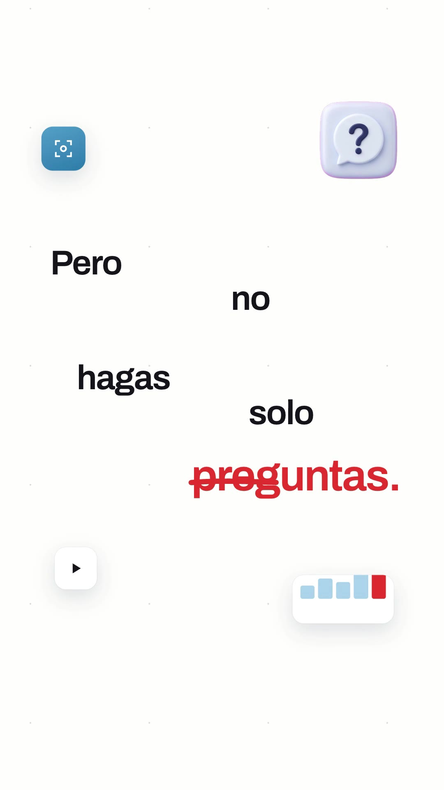
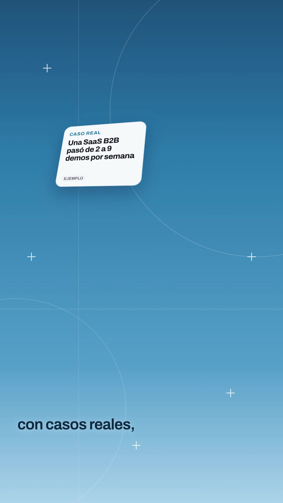
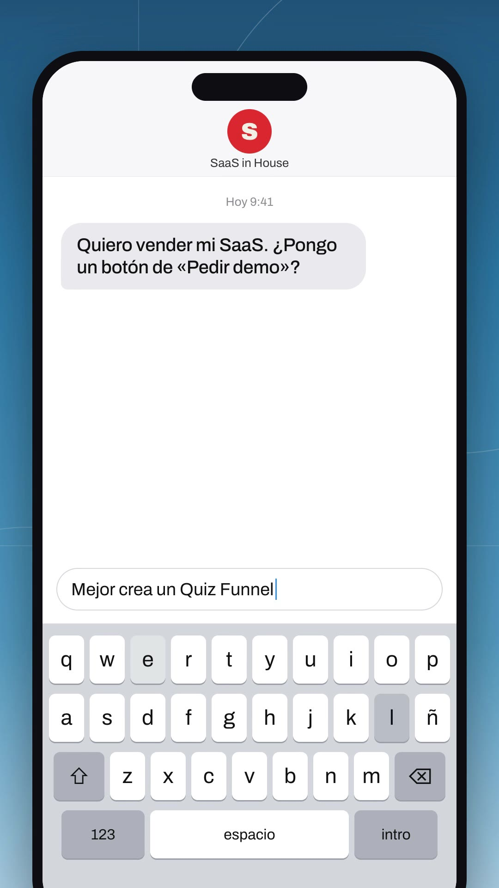
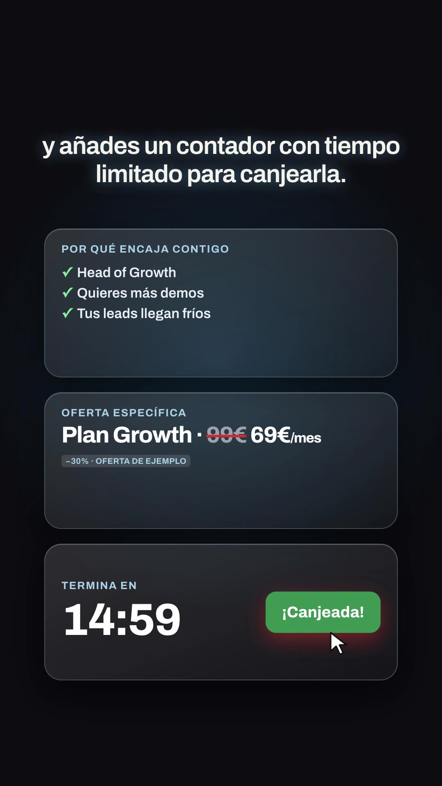

# Playbook: UI launch film, scatter variant (F1 variant · voice)

A variant of **F1 UI launch film** ([`../ui-launch-film/PLAYBOOK.md`](../ui-launch-film/PLAYBOOK.md)). Read that first: prerequisites, voice step, `w(i)` word cues, `embed_words.py`, cursor/countdown helpers and the "ejemplo" rules are all the same. **This file documents only what is different.**

Example: `../../x-batch/notdwd.mp4` (56.0s, 1080x1920, Spanish, SaaS in House quiz-funnel script). Project: `template/`.

   

Original (16:9 contact sheet, 1 frame/s): `reference-original-sheet.jpg`.

## 1. Reference

"Frame by Frame" launch video by @notdwd (https://x.com/notdwd/status/2105373513104392552, 34s, 16:9, 60fps, male voiceover + upbeat bed). The author says it was made with Opus 5.5 in "a few prompts, $0" and posts a long "synced remake" prompt in the replies: copy a reference film's timing frame by frame, swap every image/word/colour. Tweet: 42♥, 49 bookmarks, 3.4k views.

Transcript: "Someone's always launching. To ship a new product. To drop a feature. To announce something. But nobody's around to watch. Until now. [music: phone chat] Launch videos for dirt cheap. We remake any launch video for your brand frame by frame…"

## 2. What is different from F1

| | F1 ui-launch-film | **This variant** |
|---|---|---|
| Words | one caption line above the UI, words sharpen from blur | **scatter**: on white "paper" scenes every word lands at its *own* spot on the canvas (`sword(layer, i, x, y, acc, size)`), the whole layer drifts/zooms like a slow camera; floating mini UI chips + glossy 3D icons pop around the words (`chip(...)`) on a faint dot grid |
| UI | cards build on the same light canvas | **alternating rhythm**: white scatter line → *slanted sky sweep* → a **tilted 3D glass screen** on a blue sky panel (line-art circles, "+" sparkles) with a small caption at the bottom → back to white scatter |
| Transitions | cuts + whoosh | `sweep(sel, at)`: the incoming scene is revealed by a diagonal clip-path edge (the reference's tilted sky "beam") |
| Statement beats | big centred caption | **"Until now" device**: text inside a huge blue circle on near-black; the circle shrinks into a **glass orb** with faint rings (boom SFX); the orb then grows/opens into the next scene (`clipPath: circle()`) |
| Signature UI | quiz / result / offer cards | **phone chat**: full-height iPhone, grey incoming bubble, the answer is *typed* into the field char by char with the matching keyboard key flashing, then sent as a blue bubble + "Entregado" + typing dots |
| Ending | light logo card | **dark act**: glow text (white + blue text-shadow) over near-black with a blue radial glow, dark glass "price cards" (here: why it fits ✓✓✓, offer 99€→69€, live countdown + Canjear click), a glowing outline rect that draws itself around "Segmenta. Educa. Vende.", glowing wordmark |
| Colours | red/gold on cream | brand blues from the SaaS in House site (`#2676AC`, `#4F9AC9`, `#a9d0ea`) for the sky, red `#e8382d` accents, `#0b0b10` night |
| Images | 12 headshots + 6 icons | **1 Gemini image**: 6 glossy 3D icons (funnel, ?, target, stopwatch, chart, gift) in blue/white/red, cut with `tools/cutout_grid.py` (≈ $0.03). Every other chip is code (mini bars, toggle, play button, frame icon, waveform) |

Scene map (14 sections, `w(i)` cues): S1 scatter "¿Quieres vender tu SaaS" · S2 sky: tilted landing "La misma landing para todo el mundo", 18 dots sucked in · S3 circle "Haz esto." → orb · S4 phone chat "¿Pongo «Pedir demo»?" → typed "Mejor crea un Quiz Funnel." · S5 scatter "Primero haces entre cinco y ocho preguntas" · S6 sky: tilted quiz card, 3 questions picked on cue, progress 1→3/8 · S7 scatter "Pero no hagas solo preguntas." + red strike · S8 sky: 4 proof cards (Caso real/Dato/Resultado/Consejo, all tagged EJEMPLO) → big blue bubble "vale, esto tiene sentido" · S9 scatter "Después, según sus respuestas" · S10 sky: result ring 82% (ejemplo) · S11 circle "Y aquí viene la parte importante." → orb (music lift) · S12 dark offer cards + countdown + click · S13 "Así no solo captas el lead." → drawn rect + Segmenta/Educa/Vende · S14 glowing wordmark + "comenta «quiz»".

## 3. Recipe (differences only)

```bash
cp -R playbook/ui-launch-film-scatter/template my-film && cd my-film && T=../playbook/tools
source <(grep ELEVENLABS_API_KEY ~/.zshrc); export ELEVENLABS_API_KEY
python3 $T/tts_with_timestamps.py script.txt assets SKjgN71N3MeGl4r2JbRt 1.08   # Bruno Torres (wrap in a 429 retry loop)
python3 $T/embed_words.py index.html assets/words.json
# SFX one at a time with the canonical helper
for a in "whoosh|soft airy swoosh transition, light and clean, UI motion|1.0" "pop|soft bubbly UI pop, small card appearing, gentle|0.5" \
         "key|iphone keyboard typing, quick soft key taps, about eight taps|1.6" "send|imessage sent swoosh sound, short airy whoosh up|0.6" \
         "recv|message received notification, soft clean two-note ding|0.6" "boom|deep cinematic sub boom impact with soft airy tail, clean|2.0" \
         "tick|clock ticking, three quick soft ticks, digital countdown|1.5" "chime|bright clean logo reveal chime, sparkling shimmer, short|2.0"; do
  IFS='|' read n p d <<<"$a"; bash $T/el_audio.sh sfx assets/$n.mp3 "$p" $d; done
python3 $T/gen_image_ar.py gen/icons.png "Six separate glossy 3D app-style icons on a perfectly flat solid pure magenta #FF00FF background, arranged in a grid of 3 columns by 2 rows with a lot of empty space between them, every icon fully visible and not touching. Each is a rounded-square 3D app icon tile, soft studio lighting, clay-glossy render, slight three-quarter tilt, premium Apple-style. Colors: frosted white and sky blue #4F9AC9 tiles with bright red #E8382D accents and dark navy details. Icons: 1) a funnel with three dots falling in, 2) a speech bubble with a question mark, 3) a target with an arrow in the center, 4) a stopwatch, 5) a bar chart going up, 6) a gift box with ribbon. No text, no letters, no shadows on the background." --ar 3:2
python3 $T/cutout_grid.py gen/icons.png assets 300 ic_funnel ic_q ic_target ic_clock ic_chart ic_gift
npm run check && npx --yes hyperframes@0.8.137 render -f 30 -o out.mp4 .
```

**Music:** the ElevenLabs account ran out of music credits during this run, so the bed is **reused** from `../ui-launch-film/template/assets/music.mp3` (59s, upbeat light electronic with a lift ~33s that lands on the S11 orb). If you generate one, ask for a tension build into a darker drop where your "la parte importante" orb sits.

**Editing the scatter scenes:** per scene, place each word with `sword("sN-l", i, x, y, accent?, size?)`. Rules that read well at 1080x1920: 3–7 words per scene, 78px Archivo 640, accent words in red at 100–110px, zig-zag x between ~110 and ~600, y steps of 90–180px inside the 520–1200 band; put 4–6 chips in the corners (`chip(layer, html, "ico"|"chip", x, y, w, h, t)`), staggered 0.2–0.3s after the scene starts. The layer gets one linear `scale 1→1.1` drift per scene.

**Editing the sky panels:** one tilted `.glass` card per panel with `tilt(sel, at, dur, from, to)` (rotationX/Y/Z + scale; it settles flatter over the scene) and a short `caption()` at the bottom. Overlap scenes 0.1–0.2s and give each a higher `z-index` + its own `data-track-index` so `sweep` can reveal it over the previous one.

## 4. Gotchas

- Captions under the sky panel sit on the *light* bottom of the gradient: white text fails contrast (2:1). Use navy `#0e2740` with dark-red `#a01d14` accents.
- `hyperframes check` flags `content_overlap` inside a 3D-tilted card (projected boxes overlap). Mark the card `data-layout-allow-overlap`.
- Never tween `left/top` (`gsap_non_transform_motion` error): the crowd dots fly with `x/y` deltas.
- The phone chat: reset the field text with `tl.call` at the send time and hide it with `tl.set(opacity 0)`, because renders seek frame by frame; the keyboard flash is a `background` yoyo on the key whose id is `k-<char>`.
- The reference's "until now" circle text is centred while hidden words still take space, so a half-revealed line looks left-aligned for a moment; acceptable, or split lines manually.
- Keep "EJEMPLO" tags on every invented number (proof cards, 82% result, 99€→69€ offer).

## 5. Cost (notdwd.mp4)

1 Gemini image ≈ $0.03 · ElevenLabs TTS ≈ 760 chars + 8 SFX · music reused (0) · render ≈ 4 min on an M-series Mac.
