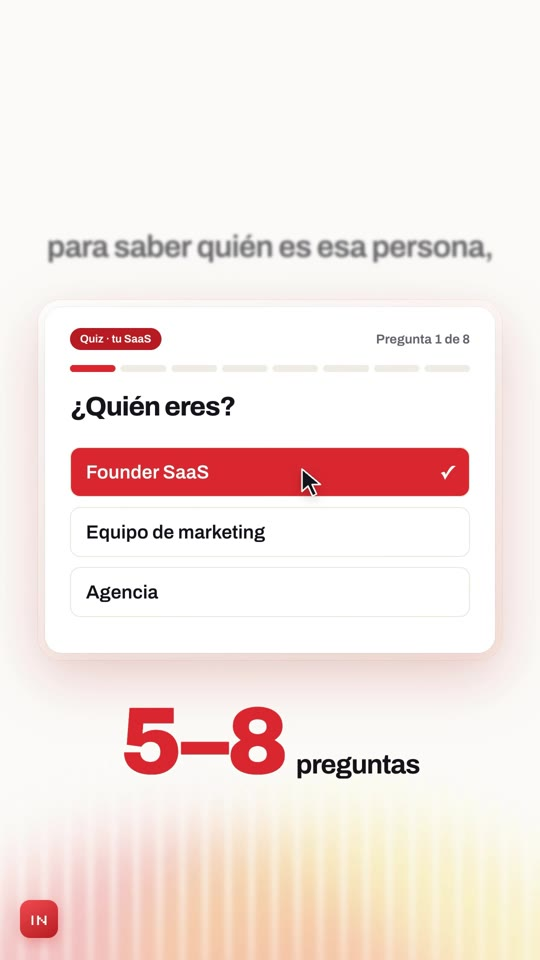
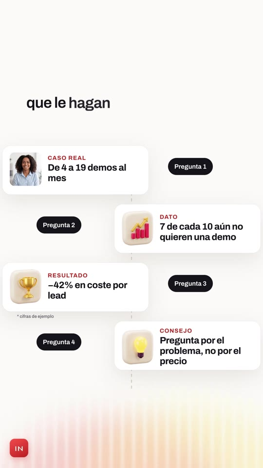
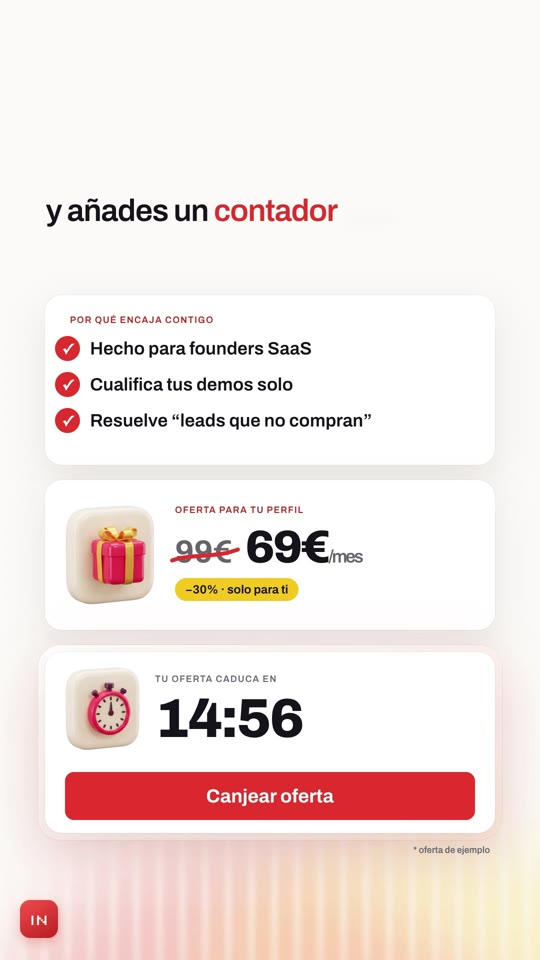

# Playbook: UI launch film (light, product UI built live, word-by-word captions)

A calm, premium SaaS launch film on a **light canvas**. A voiceover drives everything. Each line appears as a caption above the UI, word by word, sharpening out of blur. Under it, **product UI builds itself** (cards, a quiz, a chart, a timeline, a countdown), driven by a fake cursor that clicks on cue. Handwritten notes write themselves next to the UI. A soft striped glow wave breathes at the bottom. A small app icon sits in the corner, and the film ends on the logo lockup. Built with HTML + GSAP in HyperFrames, plus 2 Gemini images and ElevenLabs audio. **No AI video.**

Example: `../../x-batch/sethfowler.mp4` (58.4s, 9:16, Spanish, SaaS in House, quiz-funnel script). The project is `template/`.

   

Original look (Retti V2, 16:9): `reference-original-retti.jpg`.

This playbook is for **any coding agent (Claude Code, Codex, …) or a human**. Commands assume you are in the folder that contains `playbook/`.

---

## 1. What the format is

Reverse-engineered from Seth Fowler's **Retti V2** launch (https://x.com/sethfowIer/status/2107176672046756001). It is 75s, 16:9, with a male voiceover and an upbeat light electronic bed, and it got 257♥, 467 bookmarks and 48k views; replies call it a "banger launch video". The ingredients:

| Ingredient | Retti (reference) | Our version (template) | Technique |
|---|---|---|---|
| Canvas | White, blue striped glow wave at the bottom | Off-white `#fbfaf7`, brand **red/gold** glow wave | 3 blurred blobs (`filter: blur(70px)`) drifting with finite sine yoyos, plus a vertical-stripe overlay (`repeating-linear-gradient` + blur + mask). The intensity (`opacity`, `y`) changes per beat with `glow(at, opacity, y)` |
| Captions | One line above the UI, words appear blurred/grey and sharpen; key word coloured (`drop` in pink) | Same, 62px Archivo 620, accent words in brand red. Big-statement beats use 116px centred | `caption(hostId, groups, sceneEnd)`: groups of word indices, each word `fromTo` blur(10px)→0 at its word time, and the group blurs out before the next one |
| UI that builds itself | Retention chart draws, timeline blocks pop, link field types | Landing page, quiz card answered live, insight cards, result card with a score ring, offer card, countdown, lead timeline | `pop(sel, at, from)` (blur + back.out), counters via proxy `onUpdate`, bars `scaleX` 0→1 |
| Cursor | Arrow clicks buttons | SVG arrow per scene, `fromTo` into place, `click()` scale yoyo + click SFX | coordinates are frame pixels (cursor tip = element top-left) |
| Handwriting | "and tells you what to fix before you publish" + arrow | "el mismo mensaje para todos", "vale, esto tiene sentido", "hecho para ti", red strikes over "Pedir demo" and "99€" | Caveat font revealed with `clipPath: inset(0 100% 0 0 → 0)`; SVG paths drawn with `strokeDashoffset` (`draw(id, at, dur)`) |
| Crowd grid | Wall of creator thumbnails "in your niche" | 12 founder headshots that get sucked into one landing; blurred crowd behind "la parte importante" | one Gemini image, 12 tiles cut out with `cutout_grid.py` |
| Price strike | "$5000 → $49" | "99€ → 69€/mes −30%" | hand-drawn SVG strike + `back.out` pop |
| App icon | Mascot icon bottom-left, then centred at the end | Red "IN" app icon bottom-left, then centred, then the wordmark + CTA | `.appicon` |

**Script beats** (shared quiz-funnel script, 138 words, 53.9s at speed 1.08):
S1 the hook (crowd → one landing) · S2 "Haz esto." big · S3 strike "Pedir demo" → Quiz Funnel card + click · S4 quiz card answered live (Q1–Q3, progress 1→3/8, "5–8 preguntas") · S5 "Pero no hagas solo preguntas." big · S6 zig-zag of cards between questions (Caso real / Dato / Resultado / Consejo) + "vale, esto tiene sentido" · S7 answers fly into the "Tu resultado" card (ring to 78%) · S8 "Y aquí viene la parte importante." over a blurred crowd · S9 fit card ✓✓✓ → offer strike → live countdown → "Canjear oferta" click · S10 lead card + Segmenta/Educa/Compra timeline with playhead → "Pago completado" · S11 icon + wordmark + "Comenta «QUIZ»".

## 2. Prerequisites

- `ffmpeg`, Node + `npx` (HyperFrames CLI; the template pins `0.8.137`), Python 3 with `numpy pillow scipy`.
- `ELEVENLABS_API_KEY` (`source <(grep ELEVENLABS_API_KEY ~/.zshrc)`), and the `treg` CLI for Gemini images.

## 3. Recipe

```bash
cp -R playbook/ui-launch-film/template my-film && cd my-film && T=../playbook/tools
```

**1) Voice** (audio first; everything is cued to word times). We used Guillermo Brazález at speed 1.08: a calm, clear male voice like Retti's narrator.
```bash
source <(grep ELEVENLABS_API_KEY ~/.zshrc)
python3 $T/tts_with_timestamps.py script.txt assets qUPtETgSYRhCRb2pfOla 1.08
python3 tools/embed_words.py      # writes [word,start] pairs into index.html between /*W*/ markers
python3 -c "import json;w=json.load(open('assets/words.json'));print(' '.join(f'{i}:{x[0]}@{x[1]}' for i,x in enumerate(w)))"
```
Every cue in `index.html` is `w(i)`, the absolute start of word *i* (it includes the 0.3s VO offset). If you change the script, **re-map the word indices** in the `caption(...)` groups and the cues. That is the main edit.

**2) Music + SFX**, one call at a time (the key is shared, so on 429 wait 20–60s and retry):
```bash
call(){ for i in 1 2 3 4 5; do c=$(curl -s -o "$1" -w "%{http_code}" "$2" -H "xi-api-key: $ELEVENLABS_API_KEY" -H "Content-Type: application/json" -d "$3"); echo "$1 $c"; [ "$c" = 200 ] && return; sleep $((20+i*10)); done; }
call assets/music.mp3 https://api.elevenlabs.io/v1/music '{"prompt":"bright modern tech product launch music, light upbeat electronic, airy plucked synths, soft four-on-the-floor kick, clean claps, optimistic and minimal like an Apple or Linear launch video, gentle lift around 33 seconds, soft clean ending at 58 seconds, no vocals","music_length_ms":59000}'
sfx(){ call "assets/$1" https://api.elevenlabs.io/v1/sound-generation "{\"text\":\"$2\",\"duration_seconds\":$3,\"prompt_influence\":0.7}"; }
sfx whoosh.mp3 "soft airy swoosh transition, light and clean, UI motion" 1.0
sfx click.mp3 "single crisp mouse click, clean UI click" 0.5
sfx pop.mp3 "soft bubbly UI pop, card appearing, gentle" 0.5
sfx tick.mp3 "clock ticking, three quick soft ticks, digital countdown" 1.5
sfx chime.mp3 "bright clean logo reveal chime, sparkling shimmer, short" 2.0
```
Set the music length to the film length (VO + ~4.5s for the logo). The music sits at volume 0.2 under the voice.

**3) Images** (2 Gemini calls, ~$0.06 in total):
```bash
python3 $T/gen_image.py gen/avatars.png "A sheet of 12 separate square profile photos arranged in a grid of 3 columns by 4 rows on a perfectly flat solid pure magenta #FF00FF background, with wide empty magenta gaps between them, no photo touching another. Each photo is a rounded-corner square headshot of a different startup founder or SaaS customer looking at the camera, natural friendly expression, modern office or home-office background softly blurred, soft daylight, realistic photography, diverse ages, genders and ethnicities, casual-professional clothing. No text, no borders, no shadows on the magenta."
python3 $T/cutout_grid.py gen/avatars.png assets 300 av1 av2 av3 av4 av5 av6 av7 av8 av9 av10 av11 av12
python3 $T/gen_image.py gen/icons.png "Six separate glossy 3D app-style icons on a perfectly flat solid pure magenta #FF00FF background, arranged in a grid of 2 columns by 3 rows with a lot of empty space between them, every icon fully visible and not touching. Each is a rounded-square 3D app icon tile, soft studio lighting, clay-glossy render, slight three-quarter tilt, premium Apple-style. Colors: warm cream white tiles with bright red #E8382D and gold #F5C51B accents and dark ink details. Icons: 1) a red speech bubble with a white question mark, 2) a bar chart going up in red and gold, 3) a gold trophy, 4) a glowing yellow lightbulb, 5) a red gift box with gold ribbon, 6) a red stopwatch. No text, no shadows on the background."
python3 $T/cutout_grid.py gen/icons.png assets 320 ic_q ic_chart ic_trophy ic_bulb ic_gift ic_clock
```
Paste the cut-outs onto white and look at them before using them. The handwriting font is **Caveat** (OFL, from `github.com/google/fonts/raw/main/ofl/caveat/Caveat%5Bwght%5D.ttf`), already in `assets/`.

**4) Edit `index.html`.**
- Scene sections `#s1…#s11`: put `data-start`/`data-duration` on the first word of each beat (`w(i)`, minus ~0.2s).
- `caption("sN-cap", [{a, b, acc:[…], big}], sceneEnd)` per scene. `a..b` is a word-index range shown together, `acc` lists the red words, and `big:true` gives the centred statement style (S2/S5/S8 put it inside a `.bigwrap`).
- The UI copy is plain HTML inside each section. Mark invented numbers with "ejemplo" (the template has "* cifras de ejemplo" and "* oferta de ejemplo").
- SFX `<audio>` tags carry absolute times: whoosh on scene cuts, pop on card entries, click on cursor clicks, tick at the countdown, chime on the logo.
- `glow(at, opacity, y)` raises the wave on statement beats and the logo (1, −80…−220) and lowers it under busy UI (0.4–0.55, +100…160).

**5) Check, look, render.**
```bash
npm run check          # 0 errors; the 14 "nested_structure_needs_subcomposition" warnings are fine
npx hyperframes snapshot --at 2,3.9,4.9,9.7,13.9,17.5,19.2,28.8,33.6,35.2,41.6,46.9,53.8,57 --no-end
npx hyperframes render -o ../my-film.mp4        # ~85s for 58s
ffmpeg -i ../my-film.mp4 -af volumedetect -f null - 2>&1 | grep mean_volume   # ours: -21.9 dB
```
Open the snapshot contact sheets **and** frames pulled from the final mp4.

## 4. Gotchas we hit

- **Contrast audit**: grey labels need `#67646e` or darker on white. Brand red `#e8382d` behind small white text fails, so use `#c42a20` for red chips. Cream on red in the wordmark chip failed, so use white on `#c42a20`.
- **`content_overlap`**: the 110px countdown digits overlapped their small label above them. `margin-top: 14px` fixed it.
- A container drifting upward (`#s6-stack y:-50`) raises `container_overflow`. Add `data-layout-allow-overflow`.
- **Cursor timing**: the cursor has to *arrive* before the click time. `fromTo(..., duration 0.7)` must start ≥0.7s before the click. Our first render clicked "Canjear" with the cursor still in flight.
- Answering a quiz option: wipe in a red `.sel` overlay with `clipPath: inset(0 100% 0 0)→0`. Swap questions with x ±80 + opacity, and update the counter with `tl.set(el, {textContent})`.
- Don't add `tl.set(opacity:0)` before a `fromTo` on the same element: `fromTo` already renders its start state, and the extra set triggers lint noise.
- Long hook lines (14 words) wrap to 3 lines at 62px within 960px. The caption box is bottom-anchored (`.cap` top 190, height 340), so the text grows upward and never hits the UI starting at y≈590.

## 5. Before publishing

- The case/data/result numbers (4→19 demos, 7 de 10, −42%) and the offer (99€→69€, −30%, 15:00) are **placeholders** marked "ejemplo". Replace them with real data or keep the label.
- The headshots are AI-generated people, not real customers. Don't present them as testimonials.
- The CTA "Comenta «QUIZ»" needs a real deliverable behind it.
