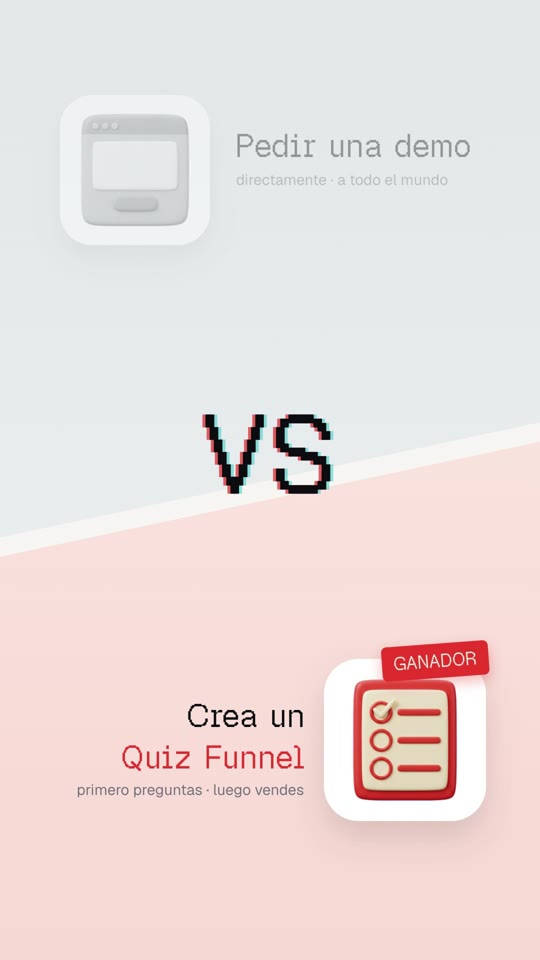
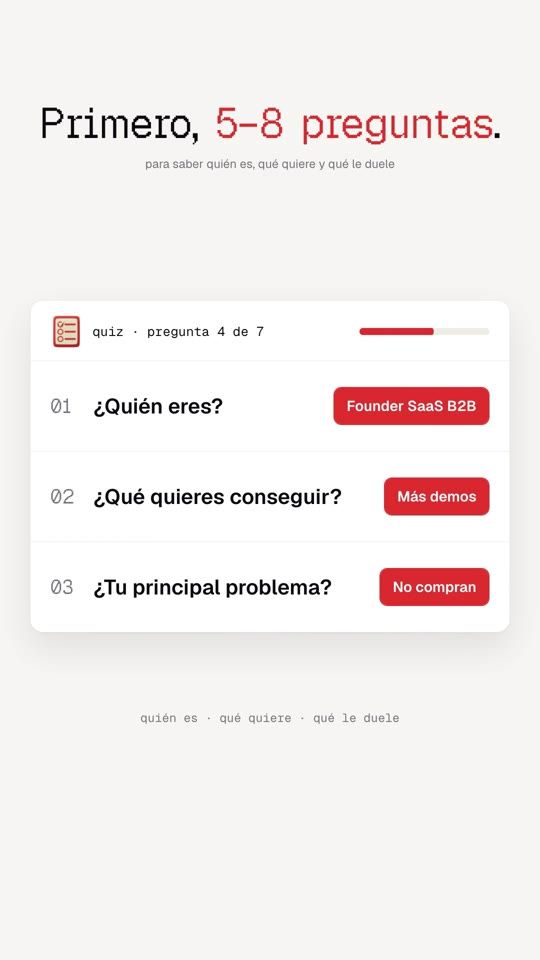
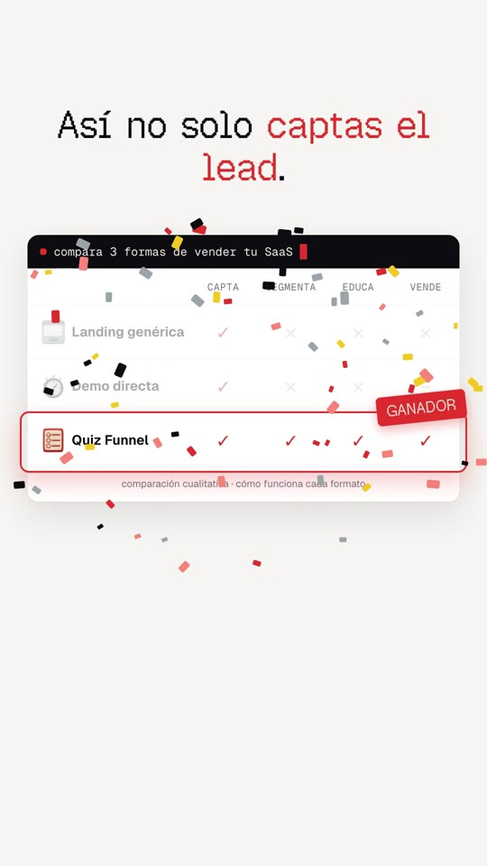
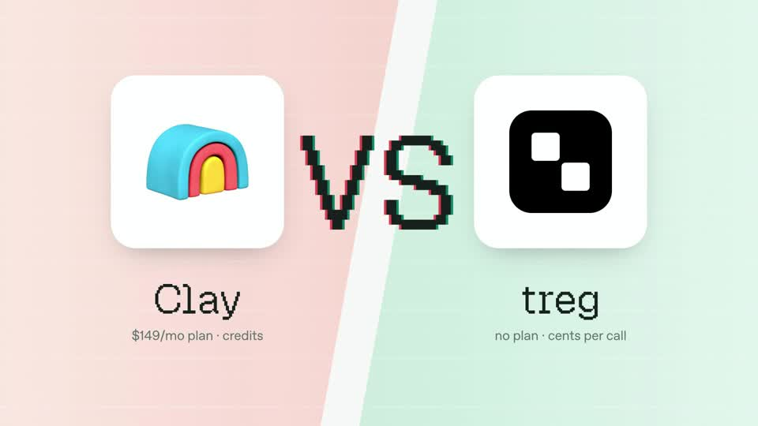
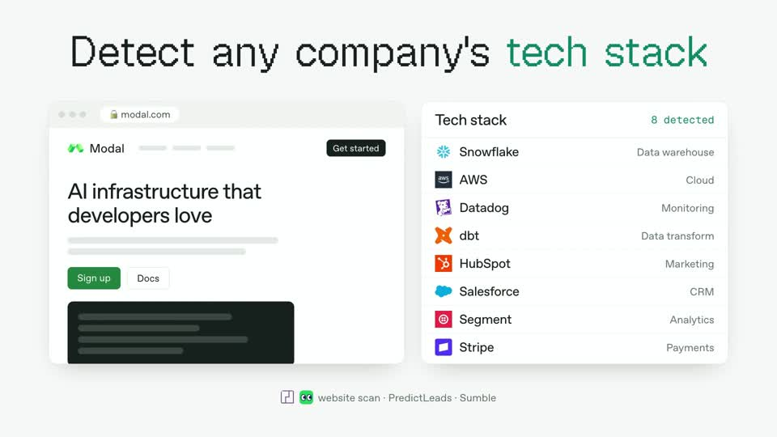

# Playbook: UI launch reel (light pixel-mono "product launch" film)

A clean, light product-launch reel: one pixel-mono headline per beat, typed letter by letter, with **one accent phrase** in the brand colour. Under it sits a "proof" UI mock: a VS split, a quiz card, social-style cards, a result card, an offer stack with a live countdown, and a comparison table where the winning row gets a **GANADOR** badge and confetti. There is **no voiceover**. The script lives on screen, over an upbeat music bed and small UI SFX. Everything is HTML + GSAP in HyperFrames, plus **one** Gemini image (4 glossy 3D icons). **No AI video.**

Example: `../../x-batch/jasonzhou.mp4`. A 43.5s, 1080×1920 Spanish quiz-funnel reel for **SaaS in House**. The project is `template/`.

   

Original (16:9):  

This playbook is for **any coding agent (Claude Code, Codex, …) or a human**. Commands assume you are in the folder that contains `playbook/`.

---

## 1. What the format is

Reverse-engineered from Jason Zhou's "OpenSource Clay killer" launch for treg (https://x.com/jasonzhou1993/status/2107423956395589784). It is 40s, 16:9, music only ("outro jingle" per Scribe), with 167k views and 2.8k bookmarks. Its grammar:
- a typed headline, then a **benchmark proof**;
- bars race in, the winning row lifts out with a WINNER badge and confetti, and the losers dim;
- the run is "Feature headline → UI mock" × 6, then a logo + terminal CTA.

| Element | Original | Ours (9:16) | Technique |
|---|---|---|---|
| Background | `#f6f7f7` near-white, no texture | warm paper `#f6f5f1` | flat `background` |
| Headline | **Geist Pixel Square**, mixed case, one green phrase, types in per character | Geist Pixel Square 84–116px, accent = brand red `#e8382d`, 2 lines max | `typeIn()` splits into `.ch` spans and `tl.set(opacity:1)` per char at `cps` |
| UI type | Inter/Geist-like sans + mono labels | Geist (variable) + Geist Mono | local `@font-face` |
| Cards | white, 1px border, big soft shadow, 20–26px radius | same (`.card`) | CSS |
| VS split | diagonal red/green halves, glossy 3D icon tiles, RGB-split pixel "VS" with jitter | grey (loser) top / red-tint (winner) bottom, diagonal; "VS" with red/cyan text-shadow; loser greys out, GANADOR on winner | `clip-path` polygons; `tl.set` x/skew jitter frames |
| Winner beat | rest dims, winner row scales up inside a coloured ring, WINNER ribbon, confetti | `#r3-ring` + `.winner` (rotated −6°) + `confetti()` (seeded) | `back.out` pops, confetti = 70 divs: burst 0.55s, then gravity fall 1.4–2s |
| Highlights | yellow marker on key phrases inside social cards | `.hlt` gold marker, `background-size` 0→100% | CSS gradient background |
| Terminal CTA | dark bar `$ set up treg — treg.to/llms.txt` with cursor | `$ comenta QUIZ — te enseño a montarlo` + red block cursor | `typeIn(..., flow=true)` so the cursor follows |
| Logo | small icon + wordmark | SaaS **IN** House wordmark (Archivo 860 + red Silkscreen chip) | from `saas-in-house-website/src/components/Nav.astro` |
| Audio | one music track, no voice | ElevenLabs music (44s, 118 bpm marimba/synth) at 0.75 + whoosh/pop/tick/ding/confetti/glitch/type SFX | `<audio id>` per cue |

**Beat map (template):** S1 typed hook + 5 identical grey landing icons → S2 "Haz esto." → S3 VS → S4 quiz card (3 Qs, answers fill red, progress x/7) → S5 statement → S6 three proof cards + "Vale, esto tiene sentido." pill → S7 result card with ticks → S8 statement → S9 why-it-fits / offer / live 14:59 countdown + button → S10 comparison table → GANADOR + confetti + payoff line → S11 logo + terminal.

Rhythm rule (from the original): **alternate a "statement" beat (headline alone, ~1.5s) with a "proof" beat (headline + UI, 4–6s)**. Statement beats are what make it feel like a launch film rather than slides.

## 2. Prerequisites

- `ffmpeg`, Node + `npx` (HyperFrames CLI; the template pins `0.8.137`), Python 3 with `numpy pillow scipy`.
- `ELEVENLABS_API_KEY` (`source <(grep ELEVENLABS_API_KEY ~/.zshrc)`) for music + SFX.
- `treg` CLI for the icon sheet (~$0.03).
- Fonts are bundled. To get them again: `npm pack geist` contains `dist/fonts/geist-pixel/GeistPixel-Square.woff2` (also Circle/Grid/Line/Triangle variants), `geist-sans/Geist-Variable.ttf` and `geist-mono/GeistMono-Variable.ttf` (OFL). Archivo + Silkscreen come from `playbook/brand-film/template/assets/`.

## 3. Recipe

```bash
cp -R playbook/ui-launch-reel/template my-reel && cd my-reel && T=../playbook/tools
```

**1) Copy.** Write one headline per beat in `script.txt` (≤ ~40 characters, so it fits 2 lines at 84px; Geist Pixel is ~0.6em per char, so ~19 chars per line at 84px). Wrap the accent phrase in `<b>` inside `index.html`. Long sentences of the base script become the *subline* (`.foot`) or the card copy, not the headline.

**2) Icons (one image).** Glossy 3D "clay" icons on flat magenta, 2×2, not touching:
```bash
python3 $T/gen_image.py icons.png "A 2x2 grid of FOUR separate soft 3D clay-style app icons objects (no tile background), glossy matte plastic like Apple emoji, lots of empty space between them, NOT touching, flat pure magenta #FF00FF background. Top-left: dull grey browser window (the loser). Top-right: red #e8382d + cream quiz card with checkboxes. Bottom-left: red stopwatch. Bottom-right: red gift box. No text, no pink on the objects."
python3 $T/cutout_grid.py icons.png assets 520 ic_landing ic_quiz ic_timer ic_gift
```
Make the "loser" grey and desaturated, and the "winner" in the brand colour. The colour contrast tells the story.

**3) Audio (sequential, 429 backoff).** The ElevenLabs key may be shared, so never fire calls in parallel:
```bash
source <(grep ELEVENLABS_API_KEY ~/.zshrc)
req(){ for a in 1 2 3 4 5 6; do code=$(curl -s -o "$1" -w "%{http_code}" "$2" -H "xi-api-key: $ELEVENLABS_API_KEY" -H "Content-Type: application/json" -d "$3"); echo "$1 $code"; [ "$code" = 200 ] && return 0; [ "$code" = 429 ] && sleep $((20+a*10)) || return 1; done; }
req assets/music.mp3 https://api.elevenlabs.io/v1/music '{"prompt":"bright minimal tech product launch jingle, light and optimistic, plucky marimba and soft synth arpeggio, clean claps and shaker, warm sub, steady 118 bpm, small lift every few bars, gentle bright resolved ending at 43 seconds, no vocals","music_length_ms":44000}'
sfx(){ req "assets/$1" https://api.elevenlabs.io/v1/sound-generation "{\"text\":\"$2\",\"duration_seconds\":$3,\"prompt_influence\":0.7}"; }
sfx whoosh.mp3 "soft quick airy swoosh transition, clean UI" 0.8
sfx pop.mp3 "soft UI pop click, bubbly, short, clean interface" 0.5
sfx tick.mp3 "crisp short UI checkbox tick click" 0.5
sfx type.mp3 "fast light keyboard typing, mechanical keys, a few keystrokes" 1.6
sfx confetti.mp3 "celebration confetti burst with sparkly chime, short party popper" 1.5
sfx ding.mp3 "bright positive notification ding, success chime" 1.0
sfx glitch.mp3 "short digital glitch stutter, data bleep" 0.6
```
Want a voice anyway? Add a `tts_with_timestamps.py` VO and move each scene's `data-start` to the word times. That would no longer be the original format, which is silent apart from music.

**4) Edit `index.html`.** Every scene is a `<section class="scene clip" data-start data-duration>` on track 1. Every cue is an absolute second in the `<script>` (there are no word times, since there is no VO). When you change a scene's start, shift its cues **and** its `<audio>` SFX `data-start`s. The helpers:
- `typeIn(sel, t0, cps, flow)` types a headline at `cps` chars/s; `flow=true` for terminal lines with a trailing cursor;
- `up(sel, t, d, y)` fades and slides a card up; `pop(sel, t)` is a back-out scale pop;
- `blink(sel, t0, t1)` blinks a cursor; `confetti(hostId, t, n, cx, cy)` is a seeded burst;
- the countdown is a proxy tween with `onUpdate` writing `mm:ss` (deterministic).

Root `data-duration`, `END` and the music `data-duration` must match.

**5) Check → look → render → verify the mp4.**
```bash
npm run check          # must be 0 errors; the "subcomposition / file too large / duplicate img" lint warnings are fine
npx hyperframes snapshot --at 2.9,7.8,13.5,20.5,24.8,32.5,36.5,42.5    # look at snapshots/
npx hyperframes render -o ../my-reel.mp4
ffprobe -v error -show_entries format=duration:stream=width,height -of compact ../my-reel.mp4
ffmpeg -i ../my-reel.mp4 -af volumedetect -f null - 2>&1 | grep mean_volume   # ≈ -20 dB
for t in 1.2 5.8 11.8 18.6 23.6 31.8 36.4 41.5; do ffmpeg -y -loglevel error -ss $t -i ../my-reel.mp4 -frames:v 1 -vf scale=360:-1 q_$t.jpg; done
```

## 4. Gotchas we hit

- **Headlines wrap to 2 lines** at 84px in 9:16. Put headline + subline in one `.stack` flex column, or the subline collides with line 2 (the `check` flagged `content_overlap`).
- **GSAP `fromTo`**: a property only in the *from* vars is not animated. Confetti stayed invisible during the burst until `opacity: 1` was added to the *to* vars as well.
- **Typing cursor**: hidden-by-opacity chars still take space, so a trailing cursor sits at the line end. Use `typeIn(..., flow=true)` (display none → inline).
- **The winner ring** is absolutely positioned. Recompute its `top` if you change table row heights (top bar 74 + header 80 + rows 120 each).
- Muted text needs `#75727c` or darker on white for 4.5:1 contrast. Small grey "ejemplo" chips stay a warning, which is acceptable.
- Leave the bottom ~25% light. The IG/TikTok UI covers it, and the original's airiness is part of the look.
- **Claims:** keep table and proof copy qualitative or true (+218 founders is from the site). Label anything invented (`ejemplo` chip). "Plan Growth −30%" and the case card are placeholders to replace before posting.

## 5. Cost (this example)

- 1 Gemini 3 Pro image = **$0.03**;
- ElevenLabs: 44s music + 7 short SFX (no TTS characters);
- render ≈ 30s on a laptop GPU.
