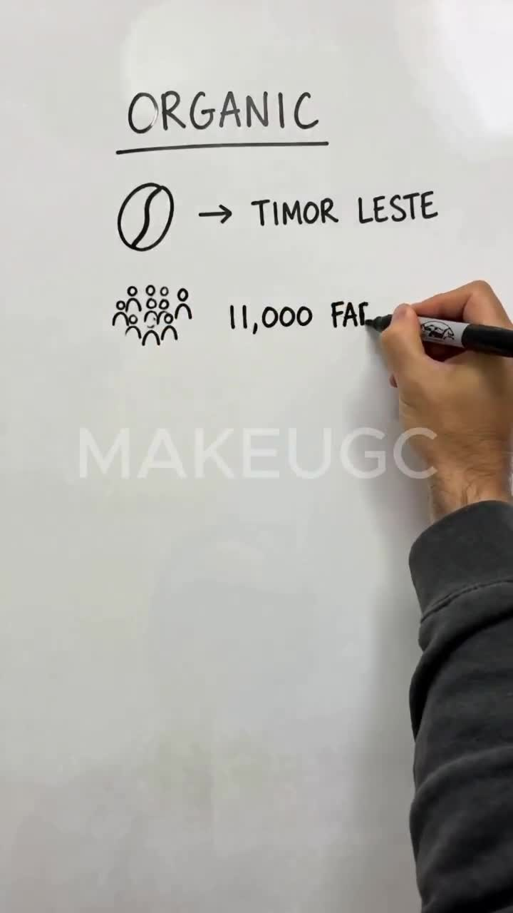
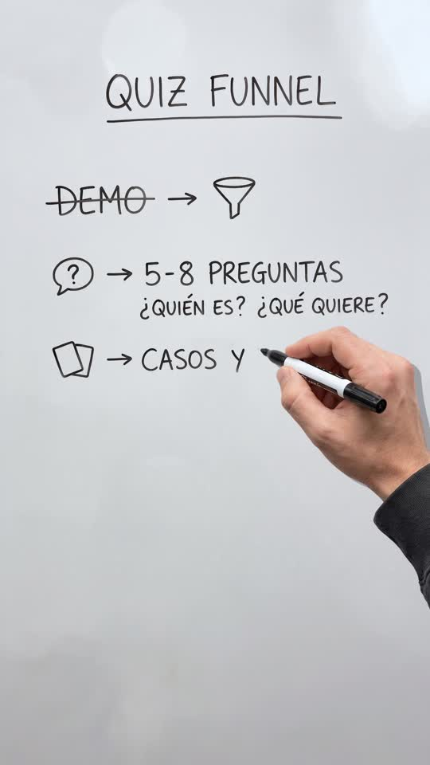
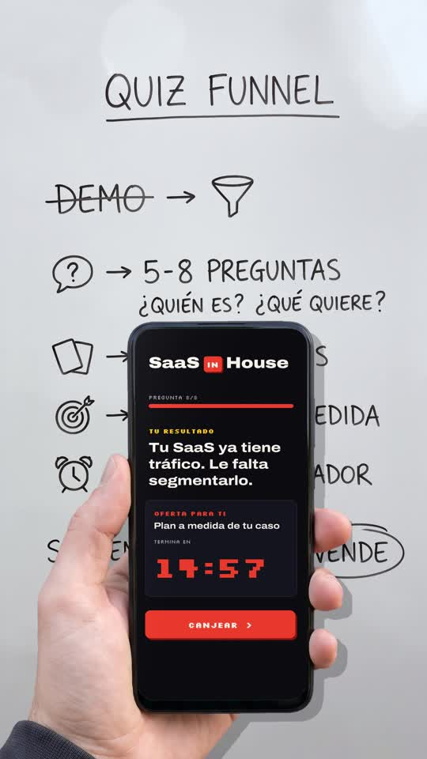

# Playbook: Whiteboard ad

A real-looking hand with a black marker writes a short list (icon → words) on a white board while a casual voice reads it. At the end a second hand holds up a phone that covers the bottom of the board. On the phone's screen, code draws a live **SaaS in House** quiz-funnel result with a ticking countdown. Example: `../../x-batch/feijen-whiteboard.mp4` (36s). Project files: `template/` (`config.json`, images, audio, fonts, `prompts.md` with every prompt used).

This playbook is for **any coding agent (Claude Code, Codex, …) or a human**. Commands assume you are in a copy of `template/`; `T=<path>/playbook/whiteboard-ad/tools`.

  

**Source:** https://x.com/spwfeijen/status/2083148303064072633 (Stijn Feijen / MakeUGC, "whiteboard style" ad, 15s, 9:16, 2.6k views, 38 bookmarks).
- The original is an AI-generated UGC ad: a man's hand in a charcoal sweatshirt writes "ORGANIC / bean → TIMOR LESTE / people → 11,000 FARMERS / ↓ FAIR PROFIT" while a male voice explains it.
- In the last 1.5s a hand holds the coffee bag up over the bottom of the board.
- The author doesn't share the method; the prompt is gated ("comment WHITEBOARD").

It is the sibling of `../chalkboard/` (same reveal technique), with the colours flipped: dark ink on white instead of white chalk on green. It adds the "hold up the product" ending.

## 1. What makes the format

| Element | Spec |
|---|---|
| Frame | 1080×1920, 30fps. A white dry-erase board fills the **entire** frame (no frame or wall), shot straight on, with soft glare at the top and grey falloff toward the bottom corners |
| Board content | One big underlined title, then rows of `icon → SHORT WORDS`, everything left-aligned and in uppercase marker hand-lettering, with lots of white space. The last row is a takeaway with one word circled |
| Hand | A right hand holding a black marker with a white label, plus a charcoal sweatshirt sleeve. It enters from the right, follows the ink, rests down-right during pauses and leaves bottom-right |
| Ending | A second hand (left, same sleeve) raises "the product" from the bottom and holds it over the lower half of the board. Our product is a phone running the quiz funnel: result → offer → countdown ticking down live |
| Audio | A casual, fast UGC voice (male in the original). No captions: the board *is* the caption. Quiet lo-fi bed, soft marker squeaks only while writing, and a small whoosh when the phone comes up |
| Pacing | The voice reads the board in drawing order. Pauses are cut to ≤0.32s (`tighten_gaps.py`). The original is 15s/4 rows; ours is 36s/7 rows, about the maximum before the board gets crowded |

## 2. Build route (no AI video): about $0.09 in images

1. **Script** (`script.txt`) in board order. ~95 words ≈ 33s at speed 1.1 with Bruno Torres.
2. **Voice + word timings**, then tighten the pauses:
   ```bash
   source <(grep ELEVENLABS_API_KEY ~/.zshrc)
   python3 ../tools/tts_with_timestamps.py script.txt . SKjgN71N3MeGl4r2JbRt 1.1   # shared tool → vo.mp3, words.json
   mv vo.mp3 vo_raw.mp3; mv words.json words_raw.json
   python3 $T/tighten_gaps.py vo_raw.mp3 words_raw.json vo.mp3 words.json          # 35.4s → 32.7s
   python3 -c "import json;w=json.load(open('words.json'));print(' '.join(f'{i}:{x[0]}@{x[1]}' for i,x in enumerate(w)))"
   ```
   The ElevenLabs key is shared, so wrap calls in a retry loop (on HTTP 429, wait 20–60s) and never fire calls in parallel.
3. **Finished board** ($0.03, 9:16, using the reference thumbnail as a style ref). The exact prompt is in `template/prompts.md`. Ask for "fills the ENTIRE frame edge to edge (no frame, no wall)", "left-aligned starting 15% from the left", row-by-row text "spelled exactly", and "no hand, no marker, no watermark". **Read the image and check every word and accent.** Gemini got all 8 rows right on the first try.
   ```bash
   python3 $T/gen_image_916.py board_final.png '<prompt>' "https://pbs.twimg.com/ext_tw_video_thumb/2083148272097447936/pu/img/uasngR1nLNYclMyq.jpg"
   ```
4. **Empty board, in code (free, aligned to the pixel)**. Don't spend a Gemini edit on it: on a smooth white board a normalized-convolution fill erases the ink perfectly and leaves faint ghosting, like a real whiteboard.
   ```bash
   python3 $T/erase_board.py board_final.png board_empty.png
   ```
5. **Hands** ($0.03 each, `IMG_SIZE=2:3`, on flat magenta; prompts in `template/prompts.md`). Reuse `template/hand_marker.png` and `template/hand_phone.png` unless you need a different look.
   - The writing hand: marker pointing **up-left** (the renderer takes the top-left-most opaque pixel as the pen tip), long sleeve to the bottom-right corner.
   - The phone hand: phone upright, facing the camera, with a **pure green screen**.
   ```bash
   python3 $T/key_sprite.py hand_marker_raw.png hand_marker.png
   python3 $T/key_sprite.py hand_phone_raw.png hand_phone.png --screen screen.json    # + hand_phone_screen.png mask
   ```
6. **Element boxes + timing** in `config.json`:
   ```bash
   python3 $T/whiteboard_boxes.py board_final.png board_empty.png suggest boxes.jpg
   python3 $T/whiteboard_boxes.py board_final.png board_empty.png check config.json check.jpg
   ```
   - Each element is `{name, box (board px), kind text|drawing, lines, start, dur}`. **Order = pixel priority**: list icons first, then the strike-through line (a thin band over "DEMO", so it's drawn *after* the word), then the circled word (so the oval box doesn't swallow its letters), then everything else.
   - Split every row into `icon` → `arrow` → `words` and start each part on its word in `words.json`: icon ~0.55–0.8s, arrow ~0.2s, text ~0.09–0.12s per character.
   - It's fine to leave the hand resting during a spoken aside (we write nothing during "vale, esto tiene sentido" or "Así no solo captas el lead"). The original does the same.
   - `geometry`: `scale = 1080 / board_width`, `ox = 0`, `oy = (1920 − board_h × scale) / 2`. For a 1536×2752 board that is 0.703125 / 0 / −8.
   - Hand: `hand_scale` 0.56, `arm_angle_deg` 27 (the sleeve's tilt in the source), `sprite_rotate_deg` 12.
   - `reveal`: `start` (≈ the last stroke + 0.35s), `rise` 0.55s, `scale` 0.92, `phone_center_x` 560, `phone_top` 830 (keeps the title + first two rows visible), `countdown_s` 899 (→ "14:59", ticking), `ui` (fonts dir + optional copy overrides; see `tools/phone_ui.py`).
   - `duration` = the last word + ~4s, which gives a ~3s hold on the phone.
7. **Preview, render, mix**:
   ```bash
   python3 $T/render_whiteboard.py config.json prev --preview 1.5,8.6,10.5,20,26.5,32.4,33.2,35.5
   python3 $T/render_whiteboard.py config.json silent.mp4          # ~65s for 36s on an M-series Mac
   python3 $T/mix_whiteboard_audio.py config.json silent.mp4 vo.mp3 music_bed.mp3 marker_sfx.mp3 pop_sfx.mp3 ../out.mp4
   ```
   Music, marker and whoosh prompts are in `template/prompts.md` (`/v1/music` 38s, `/v1/sound-generation` 10s + 1s).
   **ElevenLabs music has its own outro** (ours faded from ~31s, which made the reveal hold go silent at −41dB). Build `music_bed.mp3` by crossfading `music[0:28]` into `music[14:28]`; the command is in `prompts.md`.
   QA: `ffprobe` (1080×1920, 36.0s), `volumedetect` on the whole file (−21dB mean) **and on the reveal hold** (−27dB), plus 12 frames from the mp4.

## 3. Tools (`tools/`, all new for this format)

| Tool | What it does |
|---|---|
| `render_whiteboard.py` | A fork of `../tools/render_chalk.py`. Ink alpha = `empty − final` (dark ink); the marker tip = top-left-most opaque sprite pixel; the hand enters and rests from the right; plus the `reveal` block (phone sprite eases up with a cubic ease-out and a tiny overshoot, idle sway ±4px, soft shadow; the green-screen mask is filled with `phone_ui.make_screen()`, cached per second so the countdown ticks) |
| `phone_ui.py` | The SaaS in House screen: grid background, wordmark "SaaS [IN] House" (Archivo 900 + Silkscreen chip, red #e8382d), "PREGUNTA 8/8" progress, gold "TU RESULTADO" + headline, offer card with a Silkscreen countdown `MM:SS`, red "CANJEAR >" button. Copy is overridable through `ui` |
| `key_sprite.py` | Magenta key + full despill (`min(R,B) − G`) + 1px erode. `--screen` separates the pure-green phone screen into a mask + box |
| `erase_board.py` | Empty board from the finished one (dilated dark-ink mask, 3-scale normalized-convolution fill, plus grain) |
| `tighten_gaps.py` | Cuts every pause > 0.42s down to 0.32s and shifts `words.json` to match |
| `whiteboard_boxes.py` | `chalk_boxes.py` for dark ink |
| `gen_image_916.py` | `gen_image.py` with an `IMG_SIZE` aspect (default 9:16) |
| `mix_whiteboard_audio.py` | VO + music (lifts after the voice for the reveal hold) + gated marker SFX + a whoosh at `reveal.start` |

## 4. Gotchas

- **Magenta fringe**: the first cutout left a 1px pink rim on the sleeve, visible on white. Fixed in `key_sprite.py` (full despill + erode). Always check a full-size frame with the hand over white.
- **The marker must point up-left in the hand image**, or the tip detection grabs a knuckle. If you change the hand, preview a writing frame and check that the tip sits on the ink front.
- **The board has no frame**, so `oy` can be slightly negative. The edge-replicate padding hides any 1–8px gap.
- **The strike-through and the circle** are separate drawing elements with priority boxes. Without them, the strike appears letter by letter and the oval gets "written" together with VENDE.
- **The phone covers the takeaway row** at the end. That's intentional and matches the original (the bag covers "FAIR PROFIT"), but keep the hook/title rows above `phone_top`.
- **Countdown copy**: "14:59" and the result text are illustrative. Put the real offer in `ui` before using it in an ad.
- The ElevenLabs key is shared by parallel workers: make sequential calls with a retry loop.
- **Check the audio of the ending on its own.** The music track's outro made the last 3s nearly silent, and the whole-file volumedetect didn't show it.

## 5. Cost (feijen-whiteboard)

- Images: board + 2 hands = 3 × $0.03 ≈ **$0.09** (the empty board is made in code).
- ElevenLabs: 587 characters of TTS, a 38s music bed, 2 SFX (10s + 1s).
- No AI video. Re-renders are free (~65s render + 2s mix).
