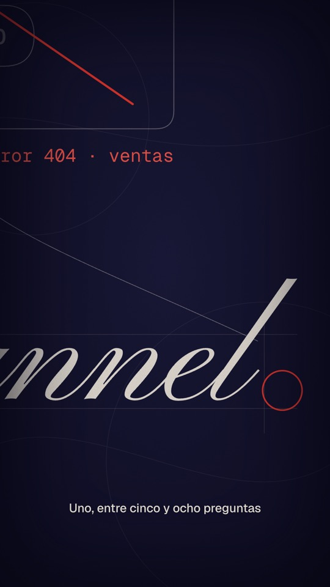
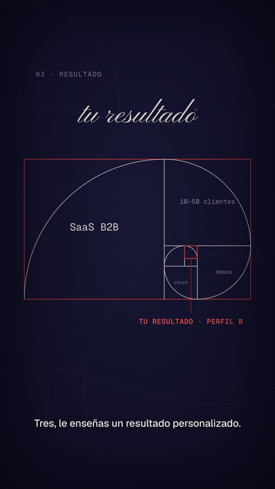
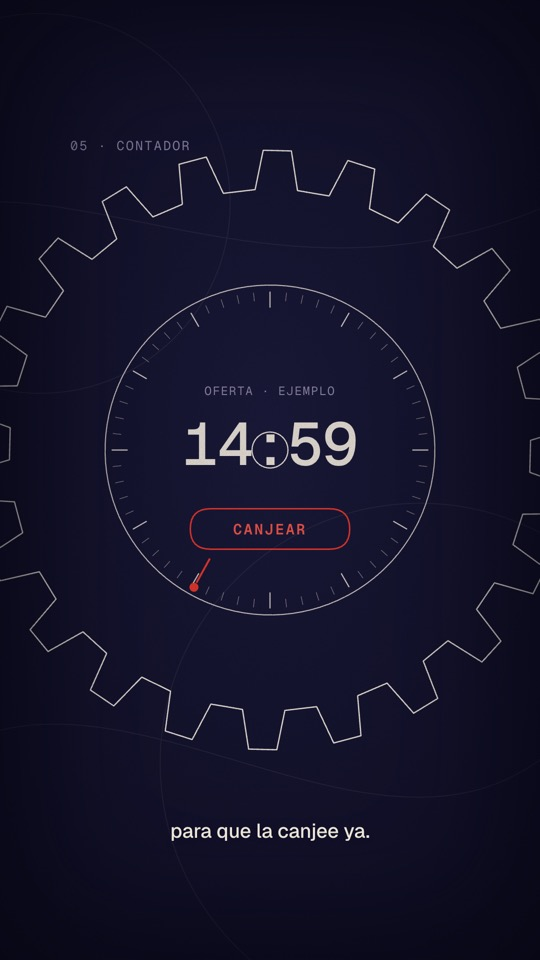
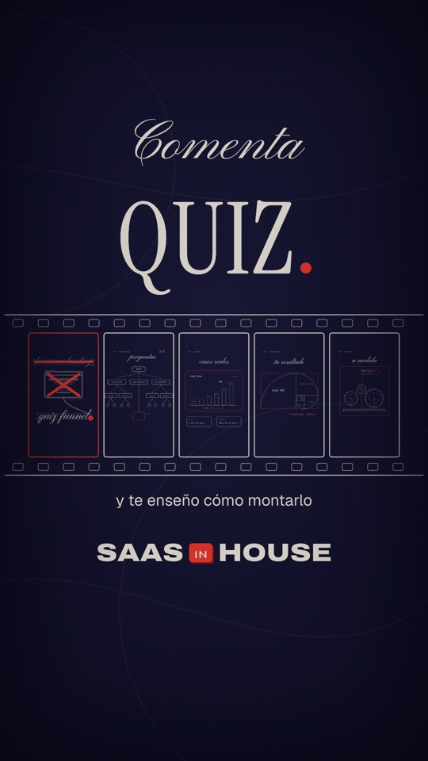

# Playbook: Zoom-blueprint film (one continuous zoom through nested chalk drawings)

A narrated, first-person **"how I think"** short. Thin chalk-white line drawings on deep indigo, one red-orange accent, cursive handwriting written live by a red pen dot, small sans subtitles. The camera never cuts: it **zooms into a tiny detail of each drawing, and that detail is the next drawing** (a ring → a question tree; a tree node → a case card; a tag on a bar → a golden spiral; the spiral's last square → a gear machine; a gear → a countdown dial). Near the end it **pulls back out through every layer in one breath**, and the opening drawing shrinks into frame 1 of a **film strip** whose other frames are live copies of the drawings.

- **Reference:** @devteamdrew, "I asked Fable 5.5 to create its own introduction video… single prompt", https://x.com/devteamdrew/status/2106155815707021549 (30s, 16:9, 24 fps, narrated by an AI voice with on-screen subtitles: "I'm Fable. I think in language… Into code that runs… Into mathematics… Into building things… And into checking… This film? I drew it. Every frame."). 121 likes, 9.3K views. Contact sheet: `reference-original.jpg`.
- **Our version:** `../../x-batch/devteamdrew2/` → `x-batch/devteamdrew2.mp4` (31.5s, 1080x1920). The quiz funnel's numbered list ("Uno… Dos… Tres… Cuatro… Y cinco…") replaces the reference's "Into X… Into Y…" chain, one nested drawing per step.
- **Cost:** **$0**. 0 images, 0 TTS, 0 ElevenLabs calls. Reused VO (Sara Martin 3, `chalk-quiz-funnel/vo.mp3`), reused music bed (`x-batch/dzhng/assets/music.mp3`, felt piano, only used once before) and library SFX. Fonts: Pinyon Script + Instrument Serif (OFL, from google/fonts), Geist / Geist Mono, Archivo + Silkscreen (brand).

   

### How it differs from format T `mind-trip-film/` (same author, earlier video)
| | T mind-trip film | **zoom-blueprint film** |
|---|---|---|
| Audio | music only, script as big handwritten text | **narrated** (reused VO), small sans subtitles, word-accurate |
| Camera | separate scenes joined by iris / dive cuts | **one unbroken zoom chain**: every drawing is nested inside the previous one, then a pull-back through all of them |
| Look | warm paper + hatched colour fills, mascot, glowing "wonders" | **indigo blueprint**: 2–3 px chalk lines only, no fills, one red accent; construction guide lines around words |
| Hero | a red block mascot | no character; the **red pen dot** that writes the cursive and the red "door" frame you zoom into |
| Ending | iris back to paper, happy mascot | the hook drawing shrinks into a **film strip of live `<use>` thumbnails** of every drawing, then the CTA |

## 1. What makes the format
| Trait | How we reproduce it (no AI video, no images) |
|---|---|
| Infinite nested zoom | Six drawings `cA…cF`, each inside a wrapper `<g>` with one `matrix(s,0,0,s,x,y)`. A `LINKS` table says where each child lives in its parent: focus `P` (parent coords), anchor `C` (child coords), ratio `k`. `M[i]` = each drawing's matrix relative to the first; `camState(i, j)` = drawing i's matrix when the camera rests on drawing j. A move tweens **all six** matrices from `camState(i, j)` to `camState(i, j2)` with the **same ease**: since the child matrix is linear in the parent's, the nesting stays glued at every frame (seek-safe, no onUpdate) |
| Even zoom speed | Custom ease `(r^v − 1)/(r − 1)` with `v = sine.inOut(u)`, `r` = zoom ratio: constant speed in log-scale, so a 20x zoom doesn't rush at the end |
| Seamless doors | Make the parent's door **exactly** the child's frame divided by `k` (the 180x128 card node = the 900x640 case card / 5; the 58x36 tag = the 890x550 golden rectangle / 15.3; the 50 px square = the 760 px gear box / 15.2; the r150 gear = the r600 gear / 4, same tooth count and final angle) |
| Lines never get fat | CSS `vector-effect: non-scaling-stroke` on every shape in `#world`. Side effect: dash-based "drawing" breaks when scaled, so `draw()` sets `stroke-dasharray: none` right after a stroke finishes, and children draw their content **after** the camera arrives (only their frame is pre-drawn) |
| Handwriting | `cursive()`: Pinyon Script `<text>` revealed by a growing `clipPath` rect + a red pen dot riding the edge with a small up/down. Widths come from the font's advance table (`tools/text_em.py`) so the dot ends where the ink ends |
| Blueprint feel | faint construction lines around words (`guide()`), mono labels `01 · PREGUNTAS`, drifting giant background curves at 7%, a static `feTurbulence` grain multiplied on top, inset vignette |
| Pull-back | the camera runs the chain backwards F→A in 1.45s, each link's time ∝ `log k`, parents fading in during the first 60% of their link; on arrival the people dots now flow into the quiz-funnel ring |
| Film strip | the hook wrapper tweens into frame 1; frames 2–5 are `<use href="#cB">…` clones scaled 176/1080 with a clipPath, so they show the drawings' final state for free |

## 2. Script → beats (31.5s, VO 0.25–27.4 s)
| Time | VO (Sara, chalk-quiz-funnel take) | Drawing | Door to the next |
|---|---|---|---|
| 0–3.8 | ¿Vendes un SaaS y mandas a todo el mundo a la misma landing? | landing wireframe, 34 dots from everywhere into it; cursive "la misma landing" | — |
| 3.8–4.9 | Error. | red X over the box + red strike on the cursive (stamp SFX) | — |
| 4.9–6.1 | Haz un quiz funnel. | cursive "quiz funnel" + red ring as the full stop | ring, k=20 |
| 6.1–10.1 | Uno, entre cinco y ocho preguntas para saber quién es y qué necesita. | question tree (QUIZ → 3 → 4 → a/b/c leaves), "5–8" | red card node, k=5 |
| 10.1–13.2 | Dos, entre medias, cards con casos reales. | CASO REAL card: bar chart 4→19 demos/mes (EJEMPLO), DATO + CONSEJO cards | red tag on the best bar, k≈15.3 |
| 13.2–16.2 | Tres, le enseñas un resultado personalizado. | golden spiral; squares = answers (SaaS B2B, 10–50 clientes, demos, churn) → TU RESULTADO · PERFIL B | smallest square, k=15.2 |
| 16.2–18.3 | Cuatro, una oferta a medida. | 3 meshing gears assemble a tag "OFERTA PERFIL B −30% · EJEMPLO" | big gear, k=4 |
| 18.3–21.9 | Y cinco, un contador para que la canjee ya. | giant gear, dial 15:00→14:58, CANJEAR button, kitchen-timer tick | — |
| 21.9–24.3 | Nada de mandar a todos a la misma landing. | pull-back F→A; dots now flow from the box into the ring | — |
| 24.3–27.4 | Así segmentas, educas y vendes. | hook shrinks into a film strip of the 5 drawings; cursive segmentas / educas / vendes. | — |
| 27.4–31.5 | (music) | cursive "Comenta" + serif **QUIZ.** + "y te enseño cómo montarlo" + SAAS [IN] HOUSE | — |

## 3. Recipe
```bash
cp -R playbook/zoom-blueprint-film/template my-zoom && cd my-zoom
$EDITOR index.html      # W = word times, LINKS = doors, one block per drawing (// A · …, // B · …)
npx --yes hyperframes@0.8.137 check            # 0 errors (2 warnings: one-file composition + 0.2s frame-0 hint are harmless)
npx --yes hyperframes@0.8.137 snapshot --describe false --at 2.6,6.5,9.9,12.6,15.9,18.1,20.9,22.6,23.9,26.9,30.8 -o snapshots
npx --yes hyperframes@0.8.137 render -o ../out.mp4 -w 2 --quiet
bash ../playbook/tools/audio_check.sh ../out.mp4
```
- **New VO:** transcribe locally (`npx --yes hyperframes@0.8.137 transcribe vo.mp3`), paste the words into `W`, keep `VO` offset; every cue uses `t(i)`.
- **New door / drawing:** draw the child centred around `C` at full 1080x1920; draw its frame in the parent at `P` with size = child frame / `k`; add the link to `LINKS`; call `zoomIn(j, t0, dur)` ~0.6 s before the word that introduces it. Keep `k` ≤ ~20 and each zoom 0.75–1.0 s.
- **Words:** add any new cursive string to `EM` with `python3 tools/text_em.py assets/PinyonScript.ttf "palabra"`.

## 4. Audio (all reused, no ElevenLabs)
- VO `chalk-quiz-funnel/vo.mp3` (Sara Martin 3, 27.1s, numbered "Uno…cinco" version of the base script; the closest match to the reference's "Into… Into…" chain). Words from `chalk-quiz-funnel/words.json` (identical to a local whisper pass).
- Music `x-batch/dzhng/assets/music.mp3` (warm felt piano, 96 bpm) → `fit_music.sh … 31.5 2.45-30.0 37.4-end` (skips its 2.5 s silent intro, keeps a real ending). Volume 0.42 under the VO. Mix test: whole −21.1 dB, last 3 s −29.6 dB (not silent).
- SFX: whoosh / pop / pencil (mind-trip-film, pop + pencil normalised with `sfx_normalize.sh`), stamp / paper / tick / ding (dzhng), scribble (jordan).

## 5. Gotchas
- **`non-scaling-stroke` + `pathLength` dashes**: a fully drawn path shows only 1/s of its length once its group is scaled up by s. Remove the dash right after drawing (`draw()` does it), and don't draw a child's lines while it is still tiny (they finish instantly).
- **Matrix strings**: format with `toFixed(7)` (never exponent notation, GSAP's string tween would break on `1e-5`). The deepest drawing is ~1/90,000 of the first; fine in doubles.
- Keep each door **empty** in the parent (the child shows through, there are no background rects), and make it the same aspect as the child's frame so the hand-over is invisible.
- Any SVG filter on a zooming wrapper is rasterised at the zoomed size (slow, memory). The chalk grain is one static overlay instead.
- Cursive on top of a film strip: Pinyon descenders are deep (~0.45 em); keep baselines ≥ 90 px above the next element.
- The CTA is on-screen only (the VO ends on "vendes"); the music must still be loud there (check the last 3 s).
- Originality: no logos, no mascot, all drawings are code. The reference's own words ("I'm Fable…") are not used.
